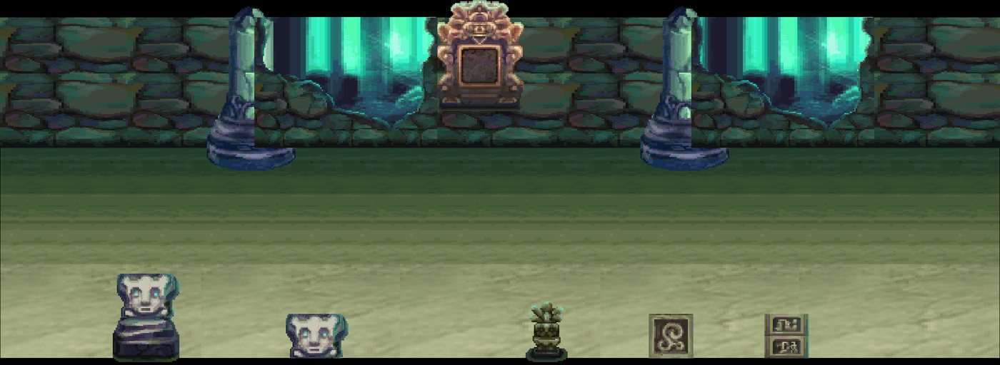
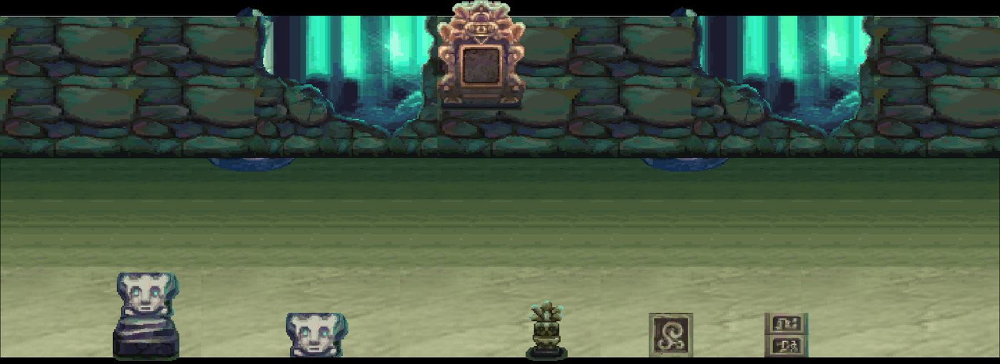
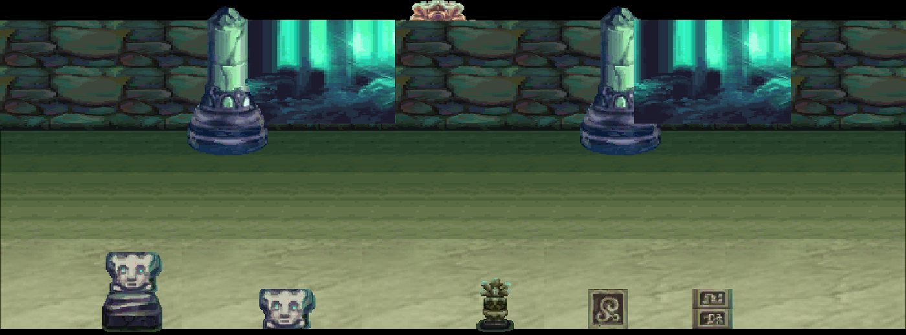
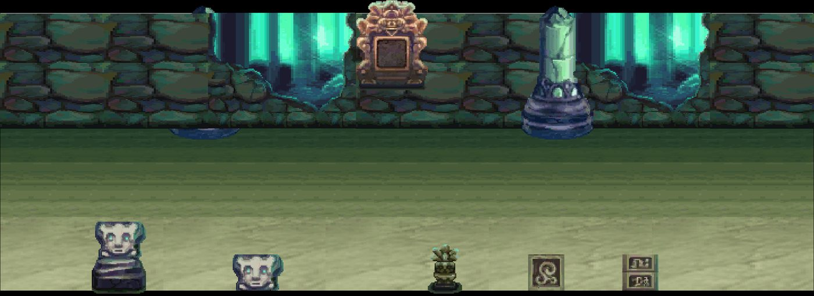
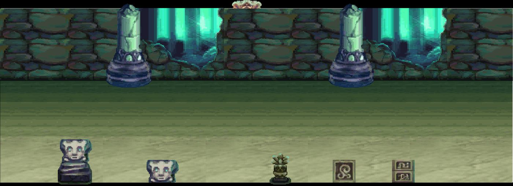
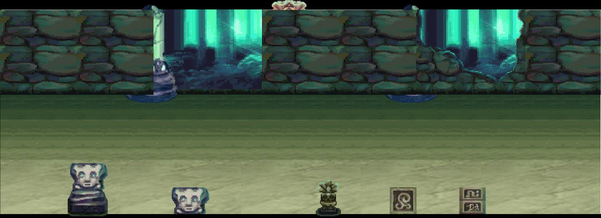

# Kit `ancient` — Cổ Tích

> **Quy tắc bắt buộc cho Codex** (xem README.md): dùng https://github.com/0x0funky/agent-sprite-forge (generate2dmap / generate2dsprite) với route image_gen tích hợp; cấm codeart2d, API trả phí, vẽ bằng code, lật gương; không commit; không sửa tools/hd2d_audit/*, gate_waivers.json, check.sh; mỗi asset phải tự nhìn ảnh trước khi ghi "vẽ xong"; chỉ Claude/owner đánh dấu "duyệt".

- Style/palette: Điện đá ngọc lục bích, tượng cổ, tinh thạch; chuỗi phòng trong nhà (có tường).
- Thư mục asset: `apps/game-web/art-src/hd2d/batch-11-ancient/`
- Số map: 6

## 1. Danh sách asset cần vẽ (kit chưa có asset)

Nguồn: Phần C `hd2d-maps-75-gemini-prompt.md`. Yêu cầu gốc: tile sàn đá ngọc lục, sàn hoa văn, thảm đá; prop (tường/cột): tường phòng trong module, cột chạm ×3, tượng thần ×3 (một vỡ), bệ tế lễ, tinh thạch xanh ×3 (phát sáng, 4 khung), đèn đá, cổng đá, bậc thang; backdrop xa: sảnh điện sâu.

| Vẽ | Duyệt | id (số thứ tự; đặt tên tiếng Anh vào manifest `name`) | loại | mô tả + prompt đi kèm |
|---|---|---|---|---|
| ⬜ | ⬜ | `ancient-floor-01` | floor | sàn đá ngọc lục — tile sàn nhìn từ trên xuống, seamless 512×512; HD-2D Octopath pixel art, palette Cổ Tích, outline tối cùng sắc, 33–48 màu, không bóng đổ/sương/chữ. |
| ⬜ | ⬜ | `ancient-floor-02` | floor | sàn hoa văn — tile sàn nhìn từ trên xuống, seamless 512×512; HD-2D Octopath pixel art, palette Cổ Tích, outline tối cùng sắc, 33–48 màu, không bóng đổ/sương/chữ. |
| ⬜ | ⬜ | `ancient-floor-03` | floor | thảm đá — tile sàn nhìn từ trên xuống, seamless 512×512; HD-2D Octopath pixel art, palette Cổ Tích, outline tối cùng sắc, 33–48 màu, không bóng đổ/sương/chữ. |
| ⬜ | ⬜ | `ancient-prop-01` | prop | prop (tường/cột): tường phòng trong module — prop đứng billboard, pivot giữa-đáy; HD-2D Octopath pixel art, palette Cổ Tích, outline tối cùng sắc, 33–48 màu, không bóng đổ/sương/chữ. |
| ⬜ | ⬜ | `ancient-prop-02` | prop | cột chạm — prop đứng billboard, pivot giữa-đáy; HD-2D Octopath pixel art, palette Cổ Tích, outline tối cùng sắc, 33–48 màu, không bóng đổ/sương/chữ. |
| ⬜ | ⬜ | `ancient-prop-03` | prop | cột chạm — prop đứng billboard, pivot giữa-đáy; HD-2D Octopath pixel art, palette Cổ Tích, outline tối cùng sắc, 33–48 màu, không bóng đổ/sương/chữ. |
| ⬜ | ⬜ | `ancient-prop-04` | prop | cột chạm — prop đứng billboard, pivot giữa-đáy; HD-2D Octopath pixel art, palette Cổ Tích, outline tối cùng sắc, 33–48 màu, không bóng đổ/sương/chữ. |
| ⬜ | ⬜ | `ancient-prop-05` | prop | tượng thần (một vỡ) — prop đứng billboard, pivot giữa-đáy; HD-2D Octopath pixel art, palette Cổ Tích, outline tối cùng sắc, 33–48 màu, không bóng đổ/sương/chữ. |
| ⬜ | ⬜ | `ancient-prop-06` | prop | tượng thần (một vỡ) — prop đứng billboard, pivot giữa-đáy; HD-2D Octopath pixel art, palette Cổ Tích, outline tối cùng sắc, 33–48 màu, không bóng đổ/sương/chữ. |
| ⬜ | ⬜ | `ancient-prop-07` | prop | tượng thần (một vỡ) — prop đứng billboard, pivot giữa-đáy; HD-2D Octopath pixel art, palette Cổ Tích, outline tối cùng sắc, 33–48 màu, không bóng đổ/sương/chữ. |
| ⬜ | ⬜ | `ancient-prop-08` | prop | bệ tế lễ — prop đứng billboard, pivot giữa-đáy; HD-2D Octopath pixel art, palette Cổ Tích, outline tối cùng sắc, 33–48 màu, không bóng đổ/sương/chữ. |
| ⬜ | ⬜ | `ancient-prop-09` | prop | tinh thạch xanh (phát sáng, 4 khung) — prop đứng billboard, pivot giữa-đáy; HD-2D Octopath pixel art, palette Cổ Tích, outline tối cùng sắc, 33–48 màu, không bóng đổ/sương/chữ. |
| ⬜ | ⬜ | `ancient-prop-10` | prop | tinh thạch xanh (phát sáng, 4 khung) — prop đứng billboard, pivot giữa-đáy; HD-2D Octopath pixel art, palette Cổ Tích, outline tối cùng sắc, 33–48 màu, không bóng đổ/sương/chữ. |
| ⬜ | ⬜ | `ancient-prop-11` | prop | tinh thạch xanh (phát sáng, 4 khung) — prop đứng billboard, pivot giữa-đáy; HD-2D Octopath pixel art, palette Cổ Tích, outline tối cùng sắc, 33–48 màu, không bóng đổ/sương/chữ. |
| ⬜ | ⬜ | `ancient-prop-12` | prop | đèn đá — prop đứng billboard, pivot giữa-đáy; HD-2D Octopath pixel art, palette Cổ Tích, outline tối cùng sắc, 33–48 màu, không bóng đổ/sương/chữ. |
| ⬜ | ⬜ | `ancient-prop-13` | prop | cổng đá — prop đứng billboard, pivot giữa-đáy; HD-2D Octopath pixel art, palette Cổ Tích, outline tối cùng sắc, 33–48 màu, không bóng đổ/sương/chữ. |
| ⬜ | ⬜ | `ancient-prop-14` | prop | bậc thang — prop đứng billboard, pivot giữa-đáy; HD-2D Octopath pixel art, palette Cổ Tích, outline tối cùng sắc, 33–48 màu, không bóng đổ/sương/chữ. |
| ⬜ | ⬜ | `ancient-backdrop-far-01` | backdrop_far | sảnh điện sâu — backdrop xa 1280×384 lặp ngang liền (64 px/đơn vị); HD-2D Octopath pixel art, palette Cổ Tích, outline tối cùng sắc, 33–48 màu, không bóng đổ/sương/chữ. |
| ⬜ | ⬜ | `ancient-floor-extra-01` | floor | tile sàn bổ sung (đủ ≥8 biến thể khác texture), seamless 512×512 |
| ⬜ | ⬜ | `ancient-floor-extra-02` | floor | tile sàn bổ sung (đủ ≥8 biến thể khác texture), seamless 512×512 |
| ⬜ | ⬜ | `ancient-floor-extra-03` | floor | tile sàn bổ sung (đủ ≥8 biến thể khác texture), seamless 512×512 |
| ⬜ | ⬜ | `ancient-floor-extra-04` | floor | tile sàn bổ sung (đủ ≥8 biến thể khác texture), seamless 512×512 |
| ⬜ | ⬜ | `ancient-floor-extra-05` | floor | tile sàn bổ sung (đủ ≥8 biến thể khác texture), seamless 512×512 |
| ⬜ | ⬜ | `ancient-edge-01` | edge | dải chuyển tiếp giữa 2 tile chính, 512×128 liền hai đầu, mép bất quy tắc |
| ⬜ | ⬜ | `ancient-edge-02` | edge | dải chuyển tiếp giữa 2 tile chính, 512×128 liền hai đầu, mép bất quy tắc |
| ⬜ | ⬜ | `ancient-edge-03` | edge | dải chuyển tiếp giữa 2 tile chính, 512×128 liền hai đầu, mép bất quy tắc |
| ⬜ | ⬜ | `ancient-decal-01` | decal | decal tiếp đất theo chủ đề kit (vụn, vết, xương/đá), bất quy tắc, mép mềm |
| ⬜ | ⬜ | `ancient-decal-02` | decal | decal tiếp đất theo chủ đề kit (vụn, vết, xương/đá), bất quy tắc, mép mềm |
| ⬜ | ⬜ | `ancient-decal-03` | decal | decal tiếp đất theo chủ đề kit (vụn, vết, xương/đá), bất quy tắc, mép mềm |
| ⬜ | ⬜ | `ancient-decal-04` | decal | decal tiếp đất theo chủ đề kit (vụn, vết, xương/đá), bất quy tắc, mép mềm |
| ⬜ | ⬜ | `ancient-decal-05` | decal | decal tiếp đất theo chủ đề kit (vụn, vết, xương/đá), bất quy tắc, mép mềm |
| ⬜ | ⬜ | `ancient-decal-06` | decal | decal tiếp đất theo chủ đề kit (vụn, vết, xương/đá), bất quy tắc, mép mềm |
| ⬜ | ⬜ | `ancient-decal-07` | decal | decal tiếp đất theo chủ đề kit (vụn, vết, xương/đá), bất quy tắc, mép mềm |
| ⬜ | ⬜ | `ancient-decal-08` | decal | decal tiếp đất theo chủ đề kit (vụn, vết, xương/đá), bất quy tắc, mép mềm |
| ⬜ | ⬜ | `ancient-decal-09` | decal | decal tiếp đất theo chủ đề kit (vụn, vết, xương/đá), bất quy tắc, mép mềm |
| ⬜ | ⬜ | `ancient-decal-10` | decal | decal tiếp đất theo chủ đề kit (vụn, vết, xương/đá), bất quy tắc, mép mềm |
| ⬜ | ⬜ | `ancient-decal-11` | decal | decal tiếp đất theo chủ đề kit (vụn, vết, xương/đá), bất quy tắc, mép mềm |
| ⬜ | ⬜ | `ancient-decal-12` | decal | decal tiếp đất theo chủ đề kit (vụn, vết, xương/đá), bất quy tắc, mép mềm |
| ⬜ | ⬜ | `ancient-shadow-01` | shadow | bóng procedural alpha mềm, màu kit |
| ⬜ | ⬜ | `ancient-shadow-02` | shadow | bóng procedural alpha mềm, màu kit |
| ⬜ | ⬜ | `ancient-shadow-03` | shadow | bóng procedural alpha mềm, màu kit |
| ⬜ | ⬜ | `ancient-shadow-04` | shadow | bóng procedural alpha mềm, màu kit |
| ⬜ | ⬜ | `ancient-backdrop-far` | backdrop | 1280×384, lặp ngang liền, mỗi tầng một khung cảnh khác |
| ⬜ | ⬜ | `ancient-backdrop-mid` | backdrop | 1280×384, lặp ngang liền, mỗi tầng một khung cảnh khác |
| ⬜ | ⬜ | `ancient-backdrop-near` | backdrop | 1280×384, lặp ngang liền, mỗi tầng một khung cảnh khác |
| ⬜ | ⬜ | `ancient-portal-dormant` | portal | cổng nhìn thẳng mặt trước, đúng tông kit |
| ⬜ | ⬜ | `ancient-portal-active` | portal | cùng mask với dormant |
| ⬜ | ⬜ | `ancient-marker-arrival` | marker | vòng sáng 4 khung |
| ⬜ | ⬜ | `ancient-fx-01` | fx | hạt/tia sáng sprite sheet theo chủ đề |
| ⬜ | ⬜ | `ancient-fx-02` | fx | hạt/tia sáng sprite sheet theo chủ đề |
| ⬜ | ⬜ | `ancient-fx-03` | fx | hạt/tia sáng sprite sheet theo chủ đề |

## 2. Prompt sheet chung cho kit

```text
[Dán Master v2: .ai/design/gpt-redo/00-master-v2.md]
Dùng agent-sprite-forge ($generate2dmap cho tile/prop, $generate2dsprite cho prop/decal/FX/marker). Route ảnh: image_gen tích hợp của Codex (kiểm `route_media.py resolve --kind image`). KHÔNG codeart2d, KHÔNG API, KHÔNG vẽ bằng code.
Kit: Cổ Tích (ancient). Style: Điện đá ngọc lục bích, tượng cổ, tinh thạch; chuỗi phòng trong nhà (có tường).. Style anchor: batch-01-octopath/contact-sheet.png + 2 sprites.png linh thú.
Mỗi lần gọi: 1 sheet ~6 vật trên nền #FF00FF, bố trí 2×3/3×2, cách nhau ≥48 px, không chạm mép. Giữ raw-01.png byte-identical. Cắt/khử nền/pixel finish bằng script forge. 33–48 màu, alpha nhị phân, lề ≥8 px, 128 px = 1 đơn vị (far 64), người = 1.31 đơn vị (cỡ tối đa vật nhỏ: tools/hd2d_audit/size_check.py).
Mỗi asset: thư mục raw-01/final/prompt.md/review.md/qa.json trong apps/game-web/art-src/hd2d/batch-11-ancient/<id>/. Tự nhìn 4× nền tối/caro. Xong: `python3 tools/hd2d_audit/art_gate.py batch-11-ancient` = 0 lỗi, contact-sheet mới hơn manifest.
```

## 3. Từng map

### `ancient_ruins_unnamed_area_01` — Tiền Sảnh Ngọc Lục



- Ảnh gốc (đối chiếu): `.ai/design/map-checklists/refs/ancient_ruins_unnamed_area_01.jpg` (bản đầy đủ: `~/Downloads/Phimond-P12-Review/map-images/ancient_ruins_unnamed_area_01.png`, 2403×879 px, 100 px = 1 đơn vị APK)
- Nguồn APK: scene `Assets/Scenes/Map/DiTichCo.unity`, 23 sprite ghép; brief: [../map-briefs/kit_ancient/ancient_ruins_unnamed_area_01.md](../map-briefs/kit_ancient/ancient_ruins_unnamed_area_01.md)
- Cổng: 4 · vùng quái: không · spawn: 0 · NPC: ancient_neth, ancient_olin · ghi chú: nối Hải Tặc Hào; hub 02, 03, 04
- neo `P:ancient_ruins_portal_001` (door) Cửa → Phòng Tinh Thạch: px [2294, 561]
- neo `P:ancient_ruins_portal_005` (door) Cửa → Phòng Tượng Cổ: px [1374, 406]
- neo `P:ancient_ruins_portal_009` (door) Cửa → Hành Lang Thạch Vệ: px [1080, 810]
- neo `P:ancient_ruins_portal_011` (door) Cửa → Hải Tặc Hào: px [115, 558]
- neo `AT:ship:ancient_ruins_unnamed_area_01` (arrival) Đến từ trụ Hải Tặc Hào: px [214, 547]
- neo `ancient_neth` (npc) : px CẦN ĐẶT
- neo `ancient_olin` (npc) : px CẦN ĐẶT
- NPC cần sprite (batch-05; kiểm trùng): ancient_neth, ancient_olin

Asset chính: dùng bảng kit (mục 1). Landmark riêng của map (Codex xem ảnh gốc, ghi tên vật nhận diện vào bảng rồi vẽ):

| Vẽ | Duyệt | id | loại | mô tả | prompt |
|---|---|---|---|---|---|
| ⬜ | ⬜ | `ancient_ruins_unnamed_area_01-landmark-01` | landmark | (vật nhận diện #1 trong ảnh gốc) | — |
| ⬜ | ⬜ | `ancient_ruins_unnamed_area_01-landmark-02` | landmark | (vật nhận diện #2, nếu có) | — |

Prompt cho Codex:

```text
Dùng agent-sprite-forge (generate2dmap + generate2dsprite, route image_gen). Map ancient_ruins_unnamed_area_01 (), kit ancient.
Mở và đính kèm thật ảnh gốc .ai/design/map-checklists/refs/ancient_ruins_unnamed_area_01.jpg vào image_gen cùng 2–3 ảnh style batch 00–09 sát loại + 2 anchor linh thú; ghi sha256.
Rà các hàng chưa ✅ trong bảng; vẽ theo sheet 6 vật; landmark riêng: nhìn ảnh gốc, ghi tên vật vào bảng rồi vẽ (không giả là recovered APK nếu là diễn giải).
Xong: cập nhật cột "Vẽ" (✅ chỉ khi đã nhìn final 4×), chạy art_gate cho kit, KHÔNG tự đặt "Duyệt".
```

### `ancient_ruins_unnamed_area_02` — Phòng Tượng Cổ



- Ảnh gốc (đối chiếu): `.ai/design/map-checklists/refs/ancient_ruins_unnamed_area_02.jpg` (bản đầy đủ: `~/Downloads/Phimond-P12-Review/map-images/ancient_ruins_unnamed_area_02.png`, 2403×876 px, 100 px = 1 đơn vị APK)
- Nguồn APK: scene `Assets/Scenes/Map/DiTichCo.unity`, 23 sprite ghép; brief: [../map-briefs/kit_ancient/ancient_ruins_unnamed_area_02.md](../map-briefs/kit_ancient/ancient_ruins_unnamed_area_02.md)
- Cổng: 1 · vùng quái: có · spawn: 0 · NPC: ancient_perrin · ghi chú: cụt
- neo `P:ancient_ruins_portal_008` (door) Cửa → Tiền Sảnh Ngọc Lục: px [1121, 796]
- neo `ancient_perrin` (npc) : px CẦN ĐẶT
- NPC cần sprite (batch-05; kiểm trùng): ancient_perrin

Asset chính: dùng bảng kit (mục 1). Landmark riêng của map (Codex xem ảnh gốc, ghi tên vật nhận diện vào bảng rồi vẽ):

| Vẽ | Duyệt | id | loại | mô tả | prompt |
|---|---|---|---|---|---|
| ⬜ | ⬜ | `ancient_ruins_unnamed_area_02-landmark-01` | landmark | (vật nhận diện #1 trong ảnh gốc) | — |
| ⬜ | ⬜ | `ancient_ruins_unnamed_area_02-landmark-02` | landmark | (vật nhận diện #2, nếu có) | — |

Prompt cho Codex:

```text
Dùng agent-sprite-forge (generate2dmap + generate2dsprite, route image_gen). Map ancient_ruins_unnamed_area_02 (), kit ancient.
Mở và đính kèm thật ảnh gốc .ai/design/map-checklists/refs/ancient_ruins_unnamed_area_02.jpg vào image_gen cùng 2–3 ảnh style batch 00–09 sát loại + 2 anchor linh thú; ghi sha256.
Rà các hàng chưa ✅ trong bảng; vẽ theo sheet 6 vật; landmark riêng: nhìn ảnh gốc, ghi tên vật vào bảng rồi vẽ (không giả là recovered APK nếu là diễn giải).
Xong: cập nhật cột "Vẽ" (✅ chỉ khi đã nhìn final 4×), chạy art_gate cho kit, KHÔNG tự đặt "Duyệt".
```

### `ancient_ruins_unnamed_area_03` — Phòng Tinh Thạch



- Ảnh gốc (đối chiếu): `.ai/design/map-checklists/refs/ancient_ruins_unnamed_area_03.jpg` (bản đầy đủ: `~/Downloads/Phimond-P12-Review/map-images/ancient_ruins_unnamed_area_03.png`, 2403×891 px, 100 px = 1 đơn vị APK)
- Nguồn APK: scene `Assets/Scenes/Map/DiTichCo.unity`, 23 sprite ghép; brief: [../map-briefs/kit_ancient/ancient_ruins_unnamed_area_03.md](../map-briefs/kit_ancient/ancient_ruins_unnamed_area_03.md)
- Cổng: 1 · vùng quái: có · spawn: 0 · NPC: — · ghi chú: cụt
- neo `P:ancient_ruins_portal_004` (door) Cửa → Tiền Sảnh Ngọc Lục: px [122, 557]

Asset chính: dùng bảng kit (mục 1). Landmark riêng của map (Codex xem ảnh gốc, ghi tên vật nhận diện vào bảng rồi vẽ):

| Vẽ | Duyệt | id | loại | mô tả | prompt |
|---|---|---|---|---|---|
| ⬜ | ⬜ | `ancient_ruins_unnamed_area_03-landmark-01` | landmark | (vật nhận diện #1 trong ảnh gốc) | — |
| ⬜ | ⬜ | `ancient_ruins_unnamed_area_03-landmark-02` | landmark | (vật nhận diện #2, nếu có) | — |

Prompt cho Codex:

```text
Dùng agent-sprite-forge (generate2dmap + generate2dsprite, route image_gen). Map ancient_ruins_unnamed_area_03 (), kit ancient.
Mở và đính kèm thật ảnh gốc .ai/design/map-checklists/refs/ancient_ruins_unnamed_area_03.jpg vào image_gen cùng 2–3 ảnh style batch 00–09 sát loại + 2 anchor linh thú; ghi sha256.
Rà các hàng chưa ✅ trong bảng; vẽ theo sheet 6 vật; landmark riêng: nhìn ảnh gốc, ghi tên vật vào bảng rồi vẽ (không giả là recovered APK nếu là diễn giải).
Xong: cập nhật cột "Vẽ" (✅ chỉ khi đã nhìn final 4×), chạy art_gate cho kit, KHÔNG tự đặt "Duyệt".
```

### `ancient_ruins_unnamed_area_04` — Hành Lang Thạch Vệ



- Ảnh gốc (đối chiếu): `.ai/design/map-checklists/refs/ancient_ruins_unnamed_area_04.jpg` (bản đầy đủ: `~/Downloads/Phimond-P12-Review/map-images/ancient_ruins_unnamed_area_04.png`, 2403×876 px, 100 px = 1 đơn vị APK)
- Nguồn APK: scene `Assets/Scenes/Map/DiTichCo.unity`, 23 sprite ghép; brief: [../map-briefs/kit_ancient/ancient_ruins_unnamed_area_04.md](../map-briefs/kit_ancient/ancient_ruins_unnamed_area_04.md)
- Cổng: 2 · vùng quái: có · spawn: 0 · NPC: ancient_rue · ghi chú: →05
- neo `P:ancient_ruins_portal_006` (door) Cửa → Thâm Sảnh Ngọc Lục: px [2292, 762]
- neo `P:ancient_ruins_portal_010` (door) Cửa → Tiền Sảnh Ngọc Lục: px [240, 446]
- neo `ancient_rue` (npc) : px CẦN ĐẶT
- NPC cần sprite (batch-05; kiểm trùng): ancient_rue

Asset chính: dùng bảng kit (mục 1). Landmark riêng của map (Codex xem ảnh gốc, ghi tên vật nhận diện vào bảng rồi vẽ):

| Vẽ | Duyệt | id | loại | mô tả | prompt |
|---|---|---|---|---|---|
| ⬜ | ⬜ | `ancient_ruins_unnamed_area_04-landmark-01` | landmark | (vật nhận diện #1 trong ảnh gốc) | — |
| ⬜ | ⬜ | `ancient_ruins_unnamed_area_04-landmark-02` | landmark | (vật nhận diện #2, nếu có) | — |

Prompt cho Codex:

```text
Dùng agent-sprite-forge (generate2dmap + generate2dsprite, route image_gen). Map ancient_ruins_unnamed_area_04 (), kit ancient.
Mở và đính kèm thật ảnh gốc .ai/design/map-checklists/refs/ancient_ruins_unnamed_area_04.jpg vào image_gen cùng 2–3 ảnh style batch 00–09 sát loại + 2 anchor linh thú; ghi sha256.
Rà các hàng chưa ✅ trong bảng; vẽ theo sheet 6 vật; landmark riêng: nhìn ảnh gốc, ghi tên vật vào bảng rồi vẽ (không giả là recovered APK nếu là diễn giải).
Xong: cập nhật cột "Vẽ" (✅ chỉ khi đã nhìn final 4×), chạy art_gate cho kit, KHÔNG tự đặt "Duyệt".
```

### `ancient_ruins_unnamed_area_05` — Thâm Sảnh Ngọc Lục



- Ảnh gốc (đối chiếu): `.ai/design/map-checklists/refs/ancient_ruins_unnamed_area_05.jpg` (bản đầy đủ: `~/Downloads/Phimond-P12-Review/map-images/ancient_ruins_unnamed_area_05.png`, 2404×876 px, 100 px = 1 đơn vị APK)
- Nguồn APK: scene `Assets/Scenes/Map/DiTichCo.unity`, 23 sprite ghép; brief: [../map-briefs/kit_ancient/ancient_ruins_unnamed_area_05.md](../map-briefs/kit_ancient/ancient_ruins_unnamed_area_05.md)
- Cổng: 2 · vùng quái: có · spawn: 0 · NPC: ancient_sable · ghi chú: →06
- neo `P:ancient_ruins_portal_003` (door) Cửa → Tận Điện Cổ Tích: px [2301, 729]
- neo `P:ancient_ruins_portal_007` (door) Cửa → Hành Lang Thạch Vệ: px [136, 707]
- neo `ancient_sable` (npc) : px CẦN ĐẶT
- NPC cần sprite (batch-05; kiểm trùng): ancient_sable

Asset chính: dùng bảng kit (mục 1). Landmark riêng của map (Codex xem ảnh gốc, ghi tên vật nhận diện vào bảng rồi vẽ):

| Vẽ | Duyệt | id | loại | mô tả | prompt |
|---|---|---|---|---|---|
| ⬜ | ⬜ | `ancient_ruins_unnamed_area_05-landmark-01` | landmark | (vật nhận diện #1 trong ảnh gốc) | — |
| ⬜ | ⬜ | `ancient_ruins_unnamed_area_05-landmark-02` | landmark | (vật nhận diện #2, nếu có) | — |

Prompt cho Codex:

```text
Dùng agent-sprite-forge (generate2dmap + generate2dsprite, route image_gen). Map ancient_ruins_unnamed_area_05 (), kit ancient.
Mở và đính kèm thật ảnh gốc .ai/design/map-checklists/refs/ancient_ruins_unnamed_area_05.jpg vào image_gen cùng 2–3 ảnh style batch 00–09 sát loại + 2 anchor linh thú; ghi sha256.
Rà các hàng chưa ✅ trong bảng; vẽ theo sheet 6 vật; landmark riêng: nhìn ảnh gốc, ghi tên vật vào bảng rồi vẽ (không giả là recovered APK nếu là diễn giải).
Xong: cập nhật cột "Vẽ" (✅ chỉ khi đã nhìn final 4×), chạy art_gate cho kit, KHÔNG tự đặt "Duyệt".
```

### `ancient_ruins_unnamed_area_06` — Tận Điện Cổ Tích



- Ảnh gốc (đối chiếu): `.ai/design/map-checklists/refs/ancient_ruins_unnamed_area_06.jpg` (bản đầy đủ: `~/Downloads/Phimond-P12-Review/map-images/ancient_ruins_unnamed_area_06.png`, 2404×876 px, 100 px = 1 đơn vị APK)
- Nguồn APK: scene `Assets/Scenes/Map/DiTichCo.unity`, 23 sprite ghép; brief: [../map-briefs/kit_ancient/ancient_ruins_unnamed_area_06.md](../map-briefs/kit_ancient/ancient_ruins_unnamed_area_06.md)
- Cổng: 1 · vùng quái: có · spawn: 0 · NPC: — · ghi chú: cụt
- neo `P:ancient_ruins_portal_002` (door) Cửa → Thâm Sảnh Ngọc Lục: px [115, 729]

Asset chính: dùng bảng kit (mục 1). Landmark riêng của map (Codex xem ảnh gốc, ghi tên vật nhận diện vào bảng rồi vẽ):

| Vẽ | Duyệt | id | loại | mô tả | prompt |
|---|---|---|---|---|---|
| ⬜ | ⬜ | `ancient_ruins_unnamed_area_06-landmark-01` | landmark | (vật nhận diện #1 trong ảnh gốc) | — |
| ⬜ | ⬜ | `ancient_ruins_unnamed_area_06-landmark-02` | landmark | (vật nhận diện #2, nếu có) | — |

Prompt cho Codex:

```text
Dùng agent-sprite-forge (generate2dmap + generate2dsprite, route image_gen). Map ancient_ruins_unnamed_area_06 (), kit ancient.
Mở và đính kèm thật ảnh gốc .ai/design/map-checklists/refs/ancient_ruins_unnamed_area_06.jpg vào image_gen cùng 2–3 ảnh style batch 00–09 sát loại + 2 anchor linh thú; ghi sha256.
Rà các hàng chưa ✅ trong bảng; vẽ theo sheet 6 vật; landmark riêng: nhìn ảnh gốc, ghi tên vật vào bảng rồi vẽ (không giả là recovered APK nếu là diễn giải).
Xong: cập nhật cột "Vẽ" (✅ chỉ khi đã nhìn final 4×), chạy art_gate cho kit, KHÔNG tự đặt "Duyệt".
```
