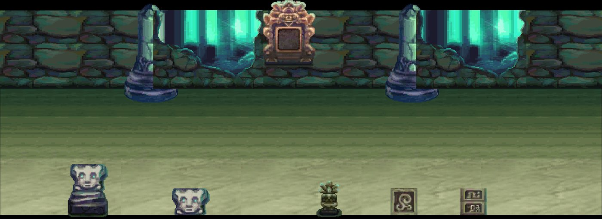
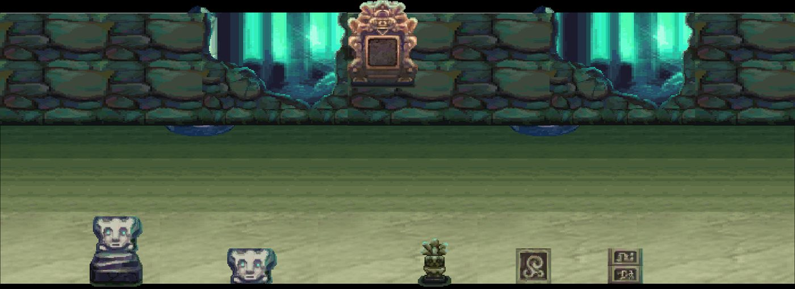
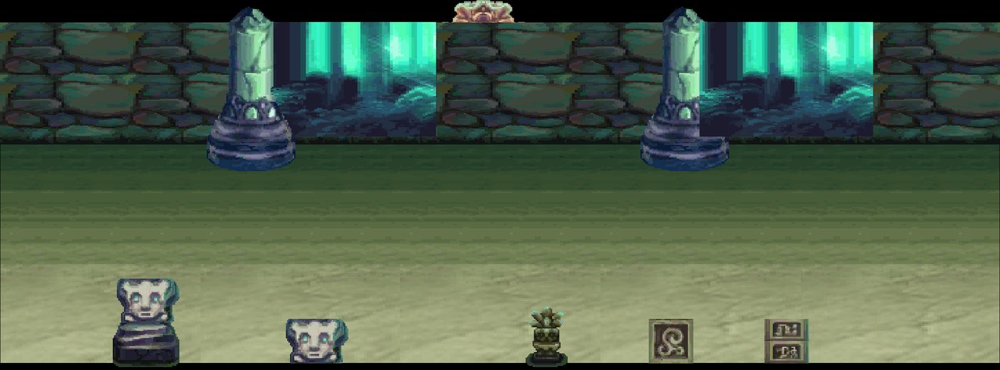
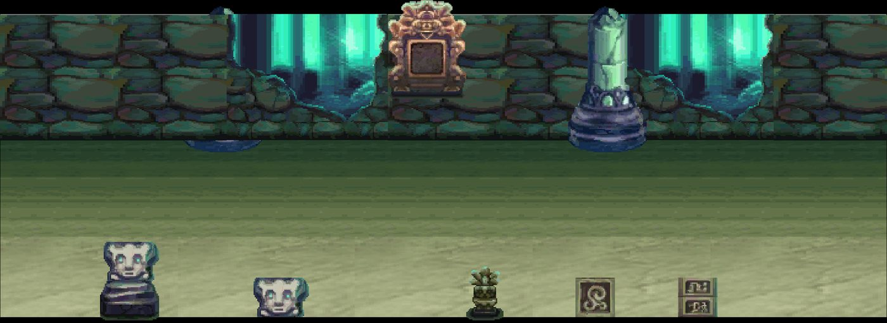
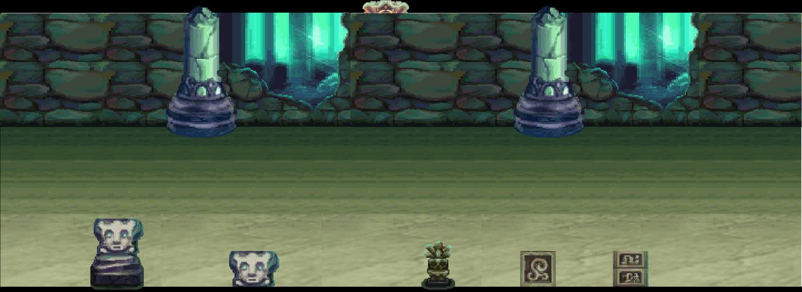
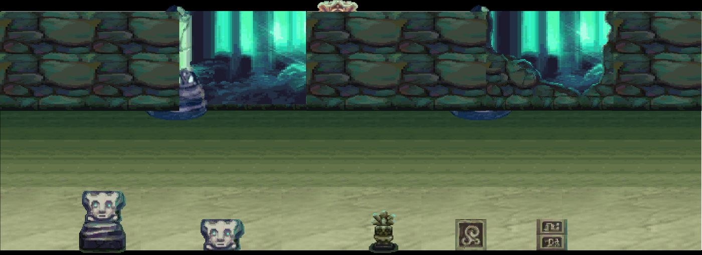

# Kit `ancient` — Cổ Tích

> **Nghiệm thu Claude 2026-11-09** (mức V1, chưa 4×): DUYỆT 48, VẼ_LẠI 3, SỬA_ĐÓNG_GÓI_METADATA 4. Map: {'CHƯA ĐỦ': 6}. Trạng thái hiện hành ở [ASSET-VERDICTS-20261109.csv](ASSET-VERDICTS-20261109.csv) / [MAP-COVERAGE-20261109.csv](MAP-COVERAGE-20261109.csv); tick ✅/❌ bên dưới là LỊCH SỬ, không phải approval.
> VẼ_LẠI (3): `ancient-floor-01`, `ancient-floor-extra-02`, `ancient-edge-03`

> **Quy tắc bắt buộc cho Codex** (xem README.md): dùng https://github.com/0x0funky/agent-sprite-forge (generate2dmap / generate2dsprite) với route image_gen tích hợp; cấm codeart2d, API trả phí, vẽ bằng code, lật gương; không commit; không sửa tools/hd2d_audit/*, gate_waivers.json, check.sh; mỗi asset phải tự nhìn ảnh trước khi ghi "vẽ xong"; chỉ Claude/owner đánh dấu "duyệt".

- Style/palette: Điện đá ngọc lục bích, tượng cổ, tinh thạch; chuỗi phòng trong nhà (có tường).
- Thư mục asset: `art/src/hd2d/batch-11-ancient/`
- Số map: 6
- Tiến độ candidate: 55 candidate đã đóng gói; mọi dòng checklist đã được vẽ hoặc ánh xạ sang asset kit dùng chung. 0 owner approvals. Còn bước composite map-scale và Claude/owner visual review.

Ghi chú QA 2026-11-04: `ancient-floor-02` được thay bằng candidate redraw 04 từ texture jade tesserae. Đã xem tile 4× và repeat 3×3; seam X 11.264/2.807, Y 13.461/3.227. Art gate toàn batch: 494 asset, 0 lỗi, 0 cảnh báo. Asset vẫn chờ owner duyệt. Chi tiết prompt/raw/QA: `art/src/hd2d/batch-11-ancient/jobs/redraw-20261104/`.

Ghi chú tiếp tục 2026-11-04: nghiên cứu candidate cho `ancient-floor-extra-04` trong `art/src/hd2d/batch-11-ancient/jobs/ancient-floor-extra-04-study-20261104/`. Lần 01 bị loại vì hoa văn lá lặp thành lưới; lần 02 có tessera bất quy tắc, 48 màu, seam X 5.710/4.000 và Y 4.147/3.188, đã xem tile + repeat 3×3. Giữ ở jobs, chưa vào manifest/checklist Vẽ cho tới khi phối cảnh map xác nhận cadence.

Tiếp tục cùng ngày: `ancient-floor-extra-05` có hai study trong `art/src/hd2d/batch-11-ancient/jobs/ancient-floor-extra-05-study-20261104/`. Lần 01 không khớp pixel style. Lần 02 khớp style và qua seam số học (X 4.626/1.465; Y 6.683/1.815), nhưng khối đá lặp rõ trong repeat 3×3; giữ ngoài manifest để đánh giá ở tỉ lệ map. Chưa đánh dấu Vẽ/Duyệt.

Tiếp tục 2026-11-04 — shadow: `ancient-shadow-01..04` được tạo từ sheet RGBA 2×2, tách thành các bóng nhỏ/cột/tượng/chân bậc. Giữ alpha mềm, giảm RGB còn 48 màu. Đã xem tất cả ở 4× trên nền tối và caro. Manifest có 40 candidate; art gate quét 510 asset với 0 lỗi, 0 cảnh báo. Cột `Duyệt` vẫn để trống.

Tiếp tục 2026-11-04 — sàn: sau khi xem mosaic 3×3 của tám texture, `ancient-floor-extra-04/05` được đưa vào manifest như hai vật liệu riêng cho các phòng/khu khác nhau, không xếp xen kẽ bàn cờ. Cả hai đã xem 4× và repeat 3×3. Manifest có 42 candidate; gate quét 512 asset, 0 lỗi, 0 cảnh báo. Chưa được Claude/owner duyệt.

## 1. Danh sách asset cần vẽ (kit chưa có asset)

Nguồn: Phần C `hd2d-maps-75-gemini-prompt.md`. Yêu cầu gốc: tile sàn đá ngọc lục, sàn hoa văn, thảm đá; prop (tường/cột): tường phòng trong module, cột chạm ×3, tượng thần ×3 (một vỡ), bệ tế lễ, tinh thạch xanh ×3 (phát sáng, 4 khung), đèn đá, cổng đá, bậc thang; backdrop xa: sảnh điện sâu.

| Vẽ | Duyệt | id (số thứ tự; đặt tên tiếng Anh vào manifest `name`) | loại | mô tả + prompt đi kèm |
|---|---|---|---|---|
| ✅ | ⬜ | `ancient-floor-01` | floor | sàn đá ngọc lục — tile sàn nhìn từ trên xuống, seamless 512×512; HD-2D Octopath pixel art, palette Cổ Tích, outline tối cùng sắc, 33–48 màu, không bóng đổ/sương/chữ. |
| ✅ | ⬜ | `ancient-floor-02` | floor | sàn hoa văn — tile sàn nhìn từ trên xuống, seamless 512×512; HD-2D Octopath pixel art, palette Cổ Tích, outline tối cùng sắc, 33–48 màu, không bóng đổ/sương/chữ. |
| ✅ | ⬜ | `ancient-floor-03` | floor | thảm đá — tile sàn nhìn từ trên xuống, seamless 512×512; HD-2D Octopath pixel art, palette Cổ Tích, outline tối cùng sắc, 33–48 màu, không bóng đổ/sương/chữ. |
| ✅ | ⬜ | `ancient-prop-01` | prop | prop (tường/cột): tường phòng trong module — prop đứng billboard, pivot giữa-đáy; HD-2D Octopath pixel art, palette Cổ Tích, outline tối cùng sắc, 33–48 màu, không bóng đổ/sương/chữ. |
| ✅ | ⬜ | `ancient-prop-02` | prop | cột chạm — prop đứng billboard, pivot giữa-đáy; HD-2D Octopath pixel art, palette Cổ Tích, outline tối cùng sắc, 33–48 màu, không bóng đổ/sương/chữ. |
| ✅ | ⬜ | `ancient-prop-03` | prop | cột chạm — prop đứng billboard, pivot giữa-đáy; HD-2D Octopath pixel art, palette Cổ Tích, outline tối cùng sắc, 33–48 màu, không bóng đổ/sương/chữ. |
| ✅ | ⬜ | `ancient-prop-04` | prop | cột chạm — prop đứng billboard, pivot giữa-đáy; HD-2D Octopath pixel art, palette Cổ Tích, outline tối cùng sắc, 33–48 màu, không bóng đổ/sương/chữ. |
| ✅ | ⬜ | `ancient-prop-05` | prop | tượng thần (một vỡ) — prop đứng billboard, pivot giữa-đáy; HD-2D Octopath pixel art, palette Cổ Tích, outline tối cùng sắc, 33–48 màu, không bóng đổ/sương/chữ. |
| ✅ | ⬜ | `ancient-prop-06` | prop | tượng thần (một vỡ) — prop đứng billboard, pivot giữa-đáy; HD-2D Octopath pixel art, palette Cổ Tích, outline tối cùng sắc, 33–48 màu, không bóng đổ/sương/chữ. |
| ✅ | ⬜ | `ancient-prop-07` | prop | tượng thần (một vỡ) — prop đứng billboard, pivot giữa-đáy; HD-2D Octopath pixel art, palette Cổ Tích, outline tối cùng sắc, 33–48 màu, không bóng đổ/sương/chữ. |
| ✅ | ⬜ | `ancient-prop-08` | prop | bệ tế lễ — prop đứng billboard, pivot giữa-đáy; HD-2D Octopath pixel art, palette Cổ Tích, outline tối cùng sắc, 33–48 màu, không bóng đổ/sương/chữ. |
| ✅ | ⬜ | `ancient-prop-09` | prop | tinh thạch xanh (phát sáng, 4 khung) — prop đứng billboard, pivot giữa-đáy; HD-2D Octopath pixel art, palette Cổ Tích, outline tối cùng sắc, 33–48 màu, không bóng đổ/sương/chữ. |
| ✅ | ⬜ | `ancient-prop-10` | prop | tinh thạch xanh (phát sáng, 4 khung) — prop đứng billboard, pivot giữa-đáy; HD-2D Octopath pixel art, palette Cổ Tích, outline tối cùng sắc, 33–48 màu, không bóng đổ/sương/chữ. |
| ✅ | ⬜ | `ancient-prop-11` | prop | tinh thạch xanh (phát sáng, 4 khung) — prop đứng billboard, pivot giữa-đáy; HD-2D Octopath pixel art, palette Cổ Tích, outline tối cùng sắc, 33–48 màu, không bóng đổ/sương/chữ. |
| ✅ | ⬜ | `ancient-prop-12` | prop | đèn đá — prop đứng billboard, pivot giữa-đáy; HD-2D Octopath pixel art, palette Cổ Tích, outline tối cùng sắc, 33–48 màu, không bóng đổ/sương/chữ. |
| ✅ | ⬜ | `ancient-prop-13` | prop | cổng đá — prop đứng billboard, pivot giữa-đáy; HD-2D Octopath pixel art, palette Cổ Tích, outline tối cùng sắc, 33–48 màu, không bóng đổ/sương/chữ. |
| ✅ | ⬜ | `ancient-prop-14` | prop | bậc thang — prop đứng billboard, pivot giữa-đáy; HD-2D Octopath pixel art, palette Cổ Tích, outline tối cùng sắc, 33–48 màu, không bóng đổ/sương/chữ. |
| ✅ | ⬜ | `ancient-backdrop-far-01` | backdrop_far | sảnh điện sâu — backdrop xa 1280×384 lặp ngang liền (64 px/đơn vị); HD-2D Octopath pixel art, palette Cổ Tích, outline tối cùng sắc, 33–48 màu, không bóng đổ/sương/chữ. |
| ✅ | ⬜ | `ancient-floor-extra-01` | floor | tile sàn bổ sung (đủ ≥8 biến thể khác texture), seamless 512×512 |
| ✅ | ⬜ | `ancient-floor-extra-02` | floor | tile sàn bổ sung (đủ ≥8 biến thể khác texture), seamless 512×512 |
| ✅ | ⬜ | `ancient-floor-extra-03` | floor | tile sàn bổ sung (đủ ≥8 biến thể khác texture), seamless 512×512 |
| ✅ | ⬜ | `ancient-floor-extra-04` | floor | tessera ngọc bất quy tắc, khắc lá thưa, seamless 512×512 |
| ✅ | ⬜ | `ancient-floor-extra-05` | floor | phiến đá vôi sáng điểm ngọc, seamless 512×512 |
| ✅ | ⬜ | `ancient-edge-01` | edge | dải chuyển tiếp giữa 2 tile chính, 512×128 liền hai đầu, mép bất quy tắc |
| ✅ | ⬜ | `ancient-edge-02` | edge | dải chuyển tiếp giữa 2 tile chính, 512×128 liền hai đầu, mép bất quy tắc |
| ✅ | ⬜ | `ancient-edge-03` | edge | dải chuyển tiếp giữa 2 tile chính, 512×128 liền hai đầu, mép bất quy tắc |
| ✅ | ⬜ | `ancient-decal-01` | decal | decal tiếp đất theo chủ đề kit (vụn, vết, xương/đá), bất quy tắc, mép mềm |
| ✅ | ⬜ | `ancient-decal-02` | decal | decal tiếp đất theo chủ đề kit (vụn, vết, xương/đá), bất quy tắc, mép mềm |
| ✅ | ⬜ | `ancient-decal-03` | decal | decal tiếp đất theo chủ đề kit (vụn, vết, xương/đá), bất quy tắc, mép mềm |
| ✅ | ⬜ | `ancient-decal-04` | decal | decal tiếp đất theo chủ đề kit (vụn, vết, xương/đá), bất quy tắc, mép mềm |
| ✅ | ⬜ | `ancient-decal-05` | decal | decal tiếp đất theo chủ đề kit (vụn, vết, xương/đá), bất quy tắc, mép mềm |
| ✅ | ⬜ | `ancient-decal-06` | decal | decal tiếp đất theo chủ đề kit (vụn, vết, xương/đá), bất quy tắc, mép mềm |
| ✅ | ⬜ | `ancient-decal-07` | decal | decal tiếp đất theo chủ đề kit (vụn, vết, xương/đá), bất quy tắc, mép mềm |
| ✅ | ⬜ | `ancient-decal-08` | decal | decal tiếp đất theo chủ đề kit (vụn, vết, xương/đá), bất quy tắc, mép mềm |
| ✅ | ⬜ | `ancient-decal-09` | decal | decal tiếp đất theo chủ đề kit (vụn, vết, xương/đá), bất quy tắc, mép mềm |
| ✅ | ⬜ | `ancient-decal-10` | decal | decal tiếp đất theo chủ đề kit (vụn, vết, xương/đá), bất quy tắc, mép mềm |
| ✅ | ⬜ | `ancient-decal-11` | decal | decal tiếp đất theo chủ đề kit (vụn, vết, xương/đá), bất quy tắc, mép mềm |
| ✅ | ⬜ | `ancient-decal-12` | decal | decal tiếp đất theo chủ đề kit (vụn, vết, xương/đá), bất quy tắc, mép mềm |
| ✅ | ⬜ | `ancient-shadow-01` | shadow | bóng tiếp xúc nhỏ, alpha mềm, xanh than ngọc |
| ✅ | ⬜ | `ancient-shadow-02` | shadow | bóng tiếp xúc dài cho cột, alpha mềm, xanh than ngọc |
| ✅ | ⬜ | `ancient-shadow-03` | shadow | bóng tiếp xúc rộng cho tượng/bệ, alpha mềm, xanh than ngọc |
| ✅ | ⬜ | `ancient-shadow-04` | shadow | bóng tiếp xúc dài và thấp cho chân tường/bậc, alpha mềm, xanh than ngọc |
| ✅ | ⬜ | `ancient-backdrop-far` | backdrop | Đã có `ancient-backdrop-far-01` (sảnh điện ngọc lục, 1280×384); dùng làm tầng xa, không tạo trùng. | reuse |
| ✅ | ⬜ | `ancient-backdrop-mid` | backdrop | 1280×384, lặp ngang liền, mỗi tầng một khung cảnh khác |
| ✅ | ⬜ | `ancient-backdrop-near` | backdrop | 1280×384, lặp ngang liền, mỗi tầng một khung cảnh khác |
| ✅ | ⬜ | `ancient-portal-dormant` | portal | cổng nhìn thẳng mặt trước, đúng tông kit |
| ✅ | ⬜ | `ancient-portal-active` | portal | cùng mask với dormant |
| ✅ | ⬜ | `ancient-marker-arrival` | marker | vòng sáng 4 khung |
| ✅ | ⬜ | `ancient-fx-01` | fx | hạt/tia sáng sprite sheet theo chủ đề |
| ✅ | ⬜ | `ancient-fx-02` | fx | hạt/tia sáng sprite sheet theo chủ đề |
| ✅ | ⬜ | `ancient-fx-03` | fx | hạt/tia sáng sprite sheet theo chủ đề |

## 2. Prompt sheet chung cho kit

```text
[Dán Master v2: .ai/design/gpt-redo/00-master-v2.md]
Dùng agent-sprite-forge ($generate2dmap cho tile/prop, $generate2dsprite cho prop/decal/FX/marker). Route ảnh: image_gen tích hợp của Codex (kiểm `route_media.py resolve --kind image`). KHÔNG codeart2d, KHÔNG API, KHÔNG vẽ bằng code.
Kit: Cổ Tích (ancient). Style: Điện đá ngọc lục bích, tượng cổ, tinh thạch; chuỗi phòng trong nhà (có tường).. Style anchor: batch-01-octopath/contact-sheet.png + 2 sprites.png linh thú.
Mỗi lần gọi: 1 sheet ~6 vật trên nền #FF00FF, bố trí 2×3/3×2, cách nhau ≥48 px, không chạm mép. Giữ raw-01.png byte-identical. Cắt/khử nền/pixel finish bằng script forge. 33–48 màu, alpha nhị phân, lề ≥8 px, 128 px = 1 đơn vị (far 64), người = 1.31 đơn vị (cỡ tối đa vật nhỏ: tools/hd2d_audit/size_check.py).
Mỗi asset: thư mục raw-01/final/prompt.md/review.md/qa.json trong art/src/hd2d/batch-11-ancient/<id>/. Tự nhìn 4× nền tối/caro. Xong: `python3 tools/hd2d_audit/art_gate.py batch-11-ancient` = 0 lỗi, contact-sheet mới hơn manifest.
```

## 3. Từng map

### `ancient_ruins_unnamed_area_01` — Tiền Sảnh Ngọc Lục



- Ảnh gốc (đối chiếu): `.ai/design/map-checklists/refs/ancient_ruins_unnamed_area_01.jpg` (bản đầy đủ: `~/Downloads/Phimond-P12-Review/map-images/ancient_ruins_unnamed_area_01.png`, 2403×879 px, 100 px = 1 đơn vị APK)
- Nguồn APK: scene `Assets/Scenes/Map/DiTichCo.unity`, 23 sprite ghép; brief: [../map-briefs/kit_ancient/ancient_ruins_unnamed_area_01.md](../map-briefs/kit_ancient/ancient_ruins_unnamed_area_01.md)
- Cổng: 4 · vùng quái: không · spawn: 0 · NPC: ancient_neth, ancient_olin · ghi chú: nối Hải Tặc Hào; hub 02, 03, 04
- neo `P:ancient_ruins_portal_001` (door) Cửa → Phòng Tinh Thạch: px [2294, 561]
- neo `P:ancient_ruins_portal_005` (door) Cửa → Phòng Tượng Cổ: px [1374, 406]
- neo `P:ancient_ruins_portal_009` (door) Cửa → Hành Lang Thạch Vệ: px [1080, 810]
- neo `P:ancient_ruins_portal_011` (door) Cửa → Hải Tặc Hào: px [115, 558]
- neo `AT:ship:ancient_ruins_unnamed_area_01` (arrival) Đến từ trụ Hải Tặc Hào: px [214, 547]
- neo `ancient_neth` (npc) : px CẦN ĐẶT
- neo `ancient_olin` (npc) : px CẦN ĐẶT
- NPC cần sprite (batch-05; kiểm trùng): ancient_neth, ancient_olin

Asset chính: dùng bảng kit (mục 1). Landmark riêng của map (Codex xem ảnh gốc, ghi tên vật nhận diện vào bảng rồi vẽ):

| Vẽ | Duyệt | id | loại | mô tả | prompt |
|---|---|---|---|---|---|
| ✅ | ⬜ | `ancient_ruins_unnamed_area_01-landmark-01` | landmark | Bảng thờ gắn tường có phù điêu linh thú vàng và ô ngọc lục ở giữa; diễn giải theo ảnh gốc, không phải sprite APK phục hồi. | prompt trong batch-11-ancient/ancient_ruins_unnamed_area_01-landmark-01/ |
| ✅ | ⬜ | `ancient_ruins_unnamed_area_01-landmark-02` | landmark | Cặp tượng đầu linh thú nguyên vẹn/vỡ ở tiền cảnh — tái sử dụng `ancient-prop-05` + `ancient-prop-06`, không tạo sprite trùng. | reuse props |

Prompt cho Codex:

```text
Dùng agent-sprite-forge (generate2dmap + generate2dsprite, route image_gen). Map ancient_ruins_unnamed_area_01 (), kit ancient.
Mở và đính kèm thật ảnh gốc .ai/design/map-checklists/refs/ancient_ruins_unnamed_area_01.jpg vào image_gen cùng 2–3 ảnh style batch 00–09 sát loại + 2 anchor linh thú; ghi sha256.
Rà các hàng chưa ✅ trong bảng; vẽ theo sheet 6 vật; landmark riêng: nhìn ảnh gốc, ghi tên vật vào bảng rồi vẽ (không giả là recovered APK nếu là diễn giải).
Xong: cập nhật cột "Vẽ" (✅ chỉ khi đã nhìn final 4×), chạy art_gate cho kit, KHÔNG tự đặt "Duyệt".
```

### `ancient_ruins_unnamed_area_02` — Phòng Tượng Cổ



- Ảnh gốc (đối chiếu): `.ai/design/map-checklists/refs/ancient_ruins_unnamed_area_02.jpg` (bản đầy đủ: `~/Downloads/Phimond-P12-Review/map-images/ancient_ruins_unnamed_area_02.png`, 2403×876 px, 100 px = 1 đơn vị APK)
- Nguồn APK: scene `Assets/Scenes/Map/DiTichCo.unity`, 23 sprite ghép; brief: [../map-briefs/kit_ancient/ancient_ruins_unnamed_area_02.md](../map-briefs/kit_ancient/ancient_ruins_unnamed_area_02.md)
- Cổng: 1 · vùng quái: có · spawn: 0 · NPC: ancient_perrin · ghi chú: cụt
- neo `P:ancient_ruins_portal_008` (door) Cửa → Tiền Sảnh Ngọc Lục: px [1121, 796]
- neo `ancient_perrin` (npc) : px CẦN ĐẶT
- NPC cần sprite (batch-05; kiểm trùng): ancient_perrin

Asset chính: dùng bảng kit (mục 1). Landmark riêng của map (Codex xem ảnh gốc, ghi tên vật nhận diện vào bảng rồi vẽ):

| Vẽ | Duyệt | id | loại | mô tả | prompt |
|---|---|---|---|---|---|
| ✅ | ⬜ | `ancient_ruins_unnamed_area_02-landmark-01` | landmark | Bảng thờ phù điêu linh thú ở tường sau — dùng lại `ancient_ruins_unnamed_area_01-landmark-01` (không tạo trùng). | reuse kit asset |
| ✅ | ⬜ | `ancient_ruins_unnamed_area_02-landmark-02` | landmark | Cặp tượng đầu linh thú nguyên vẹn/vỡ ở tiền cảnh — dùng `ancient-prop-05/06`. | reuse kit asset |

Prompt cho Codex:

```text
Dùng agent-sprite-forge (generate2dmap + generate2dsprite, route image_gen). Map ancient_ruins_unnamed_area_02 (), kit ancient.
Mở và đính kèm thật ảnh gốc .ai/design/map-checklists/refs/ancient_ruins_unnamed_area_02.jpg vào image_gen cùng 2–3 ảnh style batch 00–09 sát loại + 2 anchor linh thú; ghi sha256.
Rà các hàng chưa ✅ trong bảng; vẽ theo sheet 6 vật; landmark riêng: nhìn ảnh gốc, ghi tên vật vào bảng rồi vẽ (không giả là recovered APK nếu là diễn giải).
Xong: cập nhật cột "Vẽ" (✅ chỉ khi đã nhìn final 4×), chạy art_gate cho kit, KHÔNG tự đặt "Duyệt".
```

### `ancient_ruins_unnamed_area_03` — Phòng Tinh Thạch



- Ảnh gốc (đối chiếu): `.ai/design/map-checklists/refs/ancient_ruins_unnamed_area_03.jpg` (bản đầy đủ: `~/Downloads/Phimond-P12-Review/map-images/ancient_ruins_unnamed_area_03.png`, 2403×891 px, 100 px = 1 đơn vị APK)
- Nguồn APK: scene `Assets/Scenes/Map/DiTichCo.unity`, 23 sprite ghép; brief: [../map-briefs/kit_ancient/ancient_ruins_unnamed_area_03.md](../map-briefs/kit_ancient/ancient_ruins_unnamed_area_03.md)
- Cổng: 1 · vùng quái: có · spawn: 0 · NPC: — · ghi chú: cụt
- neo `P:ancient_ruins_portal_004` (door) Cửa → Tiền Sảnh Ngọc Lục: px [122, 557]

Asset chính: dùng bảng kit (mục 1). Landmark riêng của map (Codex xem ảnh gốc, ghi tên vật nhận diện vào bảng rồi vẽ):

| Vẽ | Duyệt | id | loại | mô tả | prompt |
|---|---|---|---|---|---|
| ✅ | ⬜ | `ancient_ruins_unnamed_area_03-landmark-01` | landmark | Cặp cột xanh pha lê gắn chân đế — dùng `ancient-prop-03` + `ancient-prop-10`. | reuse kit asset |
| ✅ | ⬜ | `ancient_ruins_unnamed_area_03-landmark-02` | landmark | Tượng đầu linh thú và bệ nhỏ ở tiền cảnh — dùng `ancient-prop-05/06`. | reuse kit asset |

Prompt cho Codex:

```text
Dùng agent-sprite-forge (generate2dmap + generate2dsprite, route image_gen). Map ancient_ruins_unnamed_area_03 (), kit ancient.
Mở và đính kèm thật ảnh gốc .ai/design/map-checklists/refs/ancient_ruins_unnamed_area_03.jpg vào image_gen cùng 2–3 ảnh style batch 00–09 sát loại + 2 anchor linh thú; ghi sha256.
Rà các hàng chưa ✅ trong bảng; vẽ theo sheet 6 vật; landmark riêng: nhìn ảnh gốc, ghi tên vật vào bảng rồi vẽ (không giả là recovered APK nếu là diễn giải).
Xong: cập nhật cột "Vẽ" (✅ chỉ khi đã nhìn final 4×), chạy art_gate cho kit, KHÔNG tự đặt "Duyệt".
```

### `ancient_ruins_unnamed_area_04` — Hành Lang Thạch Vệ



- Ảnh gốc (đối chiếu): `.ai/design/map-checklists/refs/ancient_ruins_unnamed_area_04.jpg` (bản đầy đủ: `~/Downloads/Phimond-P12-Review/map-images/ancient_ruins_unnamed_area_04.png`, 2403×876 px, 100 px = 1 đơn vị APK)
- Nguồn APK: scene `Assets/Scenes/Map/DiTichCo.unity`, 23 sprite ghép; brief: [../map-briefs/kit_ancient/ancient_ruins_unnamed_area_04.md](../map-briefs/kit_ancient/ancient_ruins_unnamed_area_04.md)
- Cổng: 2 · vùng quái: có · spawn: 0 · NPC: ancient_rue · ghi chú: →05
- neo `P:ancient_ruins_portal_006` (door) Cửa → Thâm Sảnh Ngọc Lục: px [2292, 762]
- neo `P:ancient_ruins_portal_010` (door) Cửa → Tiền Sảnh Ngọc Lục: px [240, 446]
- neo `ancient_rue` (npc) : px CẦN ĐẶT
- NPC cần sprite (batch-05; kiểm trùng): ancient_rue

Asset chính: dùng bảng kit (mục 1). Landmark riêng của map (Codex xem ảnh gốc, ghi tên vật nhận diện vào bảng rồi vẽ):

| Vẽ | Duyệt | id | loại | mô tả | prompt |
|---|---|---|---|---|---|
| ✅ | ⬜ | `ancient_ruins_unnamed_area_04-landmark-01` | landmark | Bảng thờ phù điêu linh thú ở tường sau — dùng lại `ancient_ruins_unnamed_area_01-landmark-01`. | reuse kit asset |
| ✅ | ⬜ | `ancient_ruins_unnamed_area_04-landmark-02` | landmark | Cột pha lê xanh bên phải — dùng `ancient-prop-03` + `ancient-prop-10`. | reuse kit asset |

Prompt cho Codex:

```text
Dùng agent-sprite-forge (generate2dmap + generate2dsprite, route image_gen). Map ancient_ruins_unnamed_area_04 (), kit ancient.
Mở và đính kèm thật ảnh gốc .ai/design/map-checklists/refs/ancient_ruins_unnamed_area_04.jpg vào image_gen cùng 2–3 ảnh style batch 00–09 sát loại + 2 anchor linh thú; ghi sha256.
Rà các hàng chưa ✅ trong bảng; vẽ theo sheet 6 vật; landmark riêng: nhìn ảnh gốc, ghi tên vật vào bảng rồi vẽ (không giả là recovered APK nếu là diễn giải).
Xong: cập nhật cột "Vẽ" (✅ chỉ khi đã nhìn final 4×), chạy art_gate cho kit, KHÔNG tự đặt "Duyệt".
```

### `ancient_ruins_unnamed_area_05` — Thâm Sảnh Ngọc Lục



- Ảnh gốc (đối chiếu): `.ai/design/map-checklists/refs/ancient_ruins_unnamed_area_05.jpg` (bản đầy đủ: `~/Downloads/Phimond-P12-Review/map-images/ancient_ruins_unnamed_area_05.png`, 2404×876 px, 100 px = 1 đơn vị APK)
- Nguồn APK: scene `Assets/Scenes/Map/DiTichCo.unity`, 23 sprite ghép; brief: [../map-briefs/kit_ancient/ancient_ruins_unnamed_area_05.md](../map-briefs/kit_ancient/ancient_ruins_unnamed_area_05.md)
- Cổng: 2 · vùng quái: có · spawn: 0 · NPC: ancient_sable · ghi chú: →06
- neo `P:ancient_ruins_portal_003` (door) Cửa → Tận Điện Cổ Tích: px [2301, 729]
- neo `P:ancient_ruins_portal_007` (door) Cửa → Hành Lang Thạch Vệ: px [136, 707]
- neo `ancient_sable` (npc) : px CẦN ĐẶT
- NPC cần sprite (batch-05; kiểm trùng): ancient_sable

Asset chính: dùng bảng kit (mục 1). Landmark riêng của map (Codex xem ảnh gốc, ghi tên vật nhận diện vào bảng rồi vẽ):

| Vẽ | Duyệt | id | loại | mô tả | prompt |
|---|---|---|---|---|---|
| ✅ | ⬜ | `ancient_ruins_unnamed_area_05-landmark-01` | landmark | Cặp cột pha lê xanh lặp dọc tường — dùng `ancient-prop-03` + `ancient-prop-10`. | reuse kit asset |
| ✅ | ⬜ | `ancient_ruins_unnamed_area_05-landmark-02` | landmark | Tượng đầu linh thú tiền cảnh — dùng `ancient-prop-05/06`. | reuse kit asset |

Prompt cho Codex:

```text
Dùng agent-sprite-forge (generate2dmap + generate2dsprite, route image_gen). Map ancient_ruins_unnamed_area_05 (), kit ancient.
Mở và đính kèm thật ảnh gốc .ai/design/map-checklists/refs/ancient_ruins_unnamed_area_05.jpg vào image_gen cùng 2–3 ảnh style batch 00–09 sát loại + 2 anchor linh thú; ghi sha256.
Rà các hàng chưa ✅ trong bảng; vẽ theo sheet 6 vật; landmark riêng: nhìn ảnh gốc, ghi tên vật vào bảng rồi vẽ (không giả là recovered APK nếu là diễn giải).
Xong: cập nhật cột "Vẽ" (✅ chỉ khi đã nhìn final 4×), chạy art_gate cho kit, KHÔNG tự đặt "Duyệt".
```

### `ancient_ruins_unnamed_area_06` — Tận Điện Cổ Tích



- Ảnh gốc (đối chiếu): `.ai/design/map-checklists/refs/ancient_ruins_unnamed_area_06.jpg` (bản đầy đủ: `~/Downloads/Phimond-P12-Review/map-images/ancient_ruins_unnamed_area_06.png`, 2404×876 px, 100 px = 1 đơn vị APK)
- Nguồn APK: scene `Assets/Scenes/Map/DiTichCo.unity`, 23 sprite ghép; brief: [../map-briefs/kit_ancient/ancient_ruins_unnamed_area_06.md](../map-briefs/kit_ancient/ancient_ruins_unnamed_area_06.md)
- Cổng: 1 · vùng quái: có · spawn: 0 · NPC: — · ghi chú: cụt
- neo `P:ancient_ruins_portal_002` (door) Cửa → Thâm Sảnh Ngọc Lục: px [115, 729]

Asset chính: dùng bảng kit (mục 1). Landmark riêng của map (Codex xem ảnh gốc, ghi tên vật nhận diện vào bảng rồi vẽ):

| Vẽ | Duyệt | id | loại | mô tả | prompt |
|---|---|---|---|---|---|
| ✅ | ⬜ | `ancient_ruins_unnamed_area_06-landmark-01` | landmark | Cột pha lê xanh một phần khuất sau tường — dùng `ancient-prop-03` + `ancient-prop-10`. | reuse kit asset |
| ✅ | ⬜ | `ancient_ruins_unnamed_area_06-landmark-02` | landmark | Tượng đầu linh thú tiền cảnh và bảng thờ lộ một phần — dùng `ancient-prop-05/06` và `ancient_ruins_unnamed_area_01-landmark-01`. | reuse kit asset |

Prompt cho Codex:

```text
Dùng agent-sprite-forge (generate2dmap + generate2dsprite, route image_gen). Map ancient_ruins_unnamed_area_06 (), kit ancient.
Mở và đính kèm thật ảnh gốc .ai/design/map-checklists/refs/ancient_ruins_unnamed_area_06.jpg vào image_gen cùng 2–3 ảnh style batch 00–09 sát loại + 2 anchor linh thú; ghi sha256.
Rà các hàng chưa ✅ trong bảng; vẽ theo sheet 6 vật; landmark riêng: nhìn ảnh gốc, ghi tên vật vào bảng rồi vẽ (không giả là recovered APK nếu là diễn giải).
Xong: cập nhật cột "Vẽ" (✅ chỉ khi đã nhìn final 4×), chạy art_gate cho kit, KHÔNG tự đặt "Duyệt".
```


### 2026-11-04 — six ground decals added

- Added `ancient-decal-01..06`: jade slab flakes, dark tessera rubble, turquoise mineral rubble, pale limestone fragments, mossy grout patch, and broken brass inlay fragments. Original sheets, prompts, hashes, keyed candidates, reviews, and rejected sheet attempts are retained under `art/src/hd2d/batch-11-ancient/jobs/`.
- Each selected final is 336 px wide, 48 colors, binary alpha with 8 px margin; viewed at 4× over dark and checker backgrounds. Mechanical asset QA is recorded per asset. Owner approval remains unchecked.
- The 3×2 sheet's last two entries were clipped near its cell split, so those decals were redrawn from a centered 2×1 sheet; the rejected raw is retained.


### 2026-11-04 — remaining six ground decals added

- Added `ancient-decal-07..12`: cracked jade grout, fractured tesserae, carved inlay fragments, mossed stones, pale limestone chips, and a turquoise mineral trail. Six selected candidates have 48 colors, binary alpha and 8 px margin; each was viewed at 4× over dark and checker backgrounds.
- Rejected sheet cells (thin crack line, clipped moss/brass variants, lavender mineral trail) and all raw prompts/previews remain in `batch-11-ancient/jobs/`. The selected decal-12 uses a separate no-glow teal generation.
- Manifest now contains 36 candidates and the contact sheet was rebuilt. Owner approval remains unchecked.


Ghi chú tiếp tục 2026-11-04 — edge-02: đã chọn attempt 02 sau khi xem repeat 3×1, cadence đá vụn bất quy tắc không tạo cụm huy chương lặp. Đóng gói `ancient-edge-02` 512×128, alpha nhị phân, study ghi 48 màu RGB, seam X 6.271/3.581; đã xem dải 4× trên nền tối/caro và repeat. Contact sheet cập nhật. Gate batch-11: chờ chạy lại sau cập nhật sheet. Candidate chưa được owner duyệt.


Ghi chú tiếp tục 2026-11-04 — far backdrop 01: tạo sảnh điện ngọc lục 1280×384, 48 màu; nối X bằng blend đối xứng 24px, seam sau lượng tử hóa 0/0. Đã xem final phóng 2× và repeat 3×1; không thấy đường nối, nhịp cột/cửa có chủ ý cho sảnh dài. Cần composite ở tỉ lệ map và owner review. Contact sheet gồm 45 candidate. Gate trước khi cập nhật lại sheet báo đúng lỗi stale contact sheet.


Ghi chú tiếp tục 2026-11-04 — map 01 landmark: xác định bảng thờ phù điêu ở tường trung tâm và cặp tượng đầu linh thú (một nguyên vẹn, một vỡ) ở tiền cảnh từ ảnh gốc. Vẽ `ancient_ruins_unnamed_area_01-landmark-01` theo ảnh + style refs; xem final 4× checker, alpha nhị phân, 45 màu. Landmark-02 dùng lại prop-05/06. Manifest/contact sheet hiện có 46 candidate. Cả hai chờ owner duyệt.


Đối chiếu landmark ảnh gốc 2026-11-04: các phòng 02–06 dùng lại bảng thờ phù điêu, cột pha lê và tượng đầu linh thú đã xác định trong kit; không có bằng chứng cần tạo landmark mới độc lập. Các mapping được ghi ở từng bảng phòng. Cột “Duyệt” vẫn để Claude/owner.


Ghi chú tiếp tục 2026-11-04 — portal: tạo cổng dormant/active từ cùng mẫu ảnh và ép dùng chung binary alpha mask (SHA256 mask trùng nhau), 336×448, 48 màu mỗi trạng thái. Đã xem cả hai final 4× trên nền caro; khác biệt chỉ ở viên ngọc và rune phát sáng, không thay silhouette. Manifest/contact sheet gồm 48 candidate; owner review pending.


Ghi chú tiếp tục 2026-11-04 — arrival marker: sprite strip 4×128px, vòng phù văn ngọc lục trên nền trong; đã xem contact 2×, tâm và tỉ lệ vòng ổn định, frame 3 sáng nhất rồi trở lại baseline. 48 màu, alpha nhị phân. Manifest/contact sheet gồm 49 candidate; owner approval pending.


Ghi chú tiếp tục 2026-11-04 — FX-01: bốn frame tinh thể ngọc lục trôi, sprite 512×128, 48 màu và alpha nhị phân. Đã loại nền checker trung tính, xem contact 2×; một vài pixel sáng nhỏ còn là sparkle của hiệu ứng. Owner review pending.


Ghi chú tiếp tục 2026-11-04 — FX-02: lần đầu để lại viền tím nên loại và lưu trong `jobs/fx-02-study-20261104/attempt-01`. Attempt 02 dùng nền xanh lam phẳng; đã key sạch, xem đủ bốn frame 2×. Cadence: vụn rời → đợt vỡ lớn → đỉnh → vụn thưa, 48 màu, alpha nhị phân. Owner review pending.


Ghi chú tiếp tục 2026-11-04 — FX-03: 4 frame mảnh phù văn ngọc xuất hiện, lóe sáng, rồi tách thành vụn; 512×128, 48 màu, alpha nhị phân, đã xem đủ frame 2×. Owner review pending.


Ghi chú: `ancient-edge-01` đã được nhìn 3× repeat và strip 4× trên nền tối/caro ở lượt trước; đánh dấu Vẽ tại đây. `ancient-backdrop-far` được đáp ứng bởi `ancient-backdrop-far-01`, không phải asset thứ hai.


Ghi chú tiếp tục 2026-11-04 — edge-03: ba lượt study trước không đạt do texture nền nướng/khối đá lặp quá lớn hoặc key fringe. Chọn attempt 03: dải tessera nhỏ, moss và đá vôi; xóa key magenta, dùng alpha-premultiplied seam blend 24px, seam cuối 0/0; 48 màu, alpha nhị phân. Đã xem 3× repeat và 4× detail. Một tessera lớn lặp theo chu kỳ; dùng xen kẽ edge-01/02, không kéo dài một dải đơn độc. Candidate chờ owner review.


Ghi chú tiếp tục 2026-11-04 — backdrop mid: sảnh ngọc lục với cột chạm và hốc tượng, 1280×384, 48 màu, seam X 0/0; đã xem crop 2× và repeat 3×1. Nhịp kiến trúc lặp có chủ ý, cần composite map-scale. Manifest/contact sheet gồm 54 candidate; chưa owner duyệt.


Ghi chú tiếp tục 2026-11-04 — backdrop near: lớp tường gần với cột xoắn nứt và phù điêu linh thú sáng hơn mid; 1280×384, 48 màu, seam 0/0. Đã xem repeat 3×1 và detail 2×; cần dựng thử composite map-scale. Owner review pending. Manifest/contact sheet hiện có 55 candidate.
