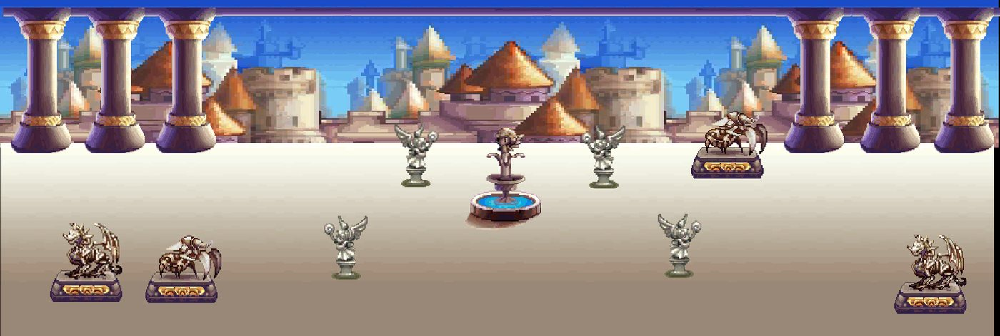

# Kit `arena2` — Đấu Trường Hỗn Mang / Tổ Đội

> **Nghiệm thu Claude 2026-11-09** (mức V1, chưa 4×): THIẾU_CHƯA_CÓ 44. Map: {'CHƯA CÓ ART': 2}. Trạng thái hiện hành ở [ASSET-VERDICTS-20261109.csv](ASSET-VERDICTS-20261109.csv) / [MAP-COVERAGE-20261109.csv](MAP-COVERAGE-20261109.csv); tick ✅/❌ bên dưới là LỊCH SỬ, không phải approval.
> **Cảnh báo brief:** cùng ảnh với battlefield; chỉ vẽ phần khác biệt — thực hiện `BRIEF-arena2` trong [ROADMAP-ART-92MAPS-20261109.md](ROADMAP-ART-92MAPS-20261109.md) trước khi vẽ.

## Brief đối chiếu ảnh gốc (Codex, 2026-11-10; chờ Claude/owner duyệt)

Hai ảnh `chaos_arena_main_field.jpg` và `team_arena_main_field.jpg` giống hệt pixel (1400×471); không có khác biệt màu/đạo cụ nào để biện minh cho hai biến thể hỗn mang đỏ cam và tổ đội xanh lam. Ảnh chỉ cho thấy cùng một đấu trường đá sáng, cột tím viền vàng, skyline xanh lam với mái tháp nâu cam, tượng đá nhỏ, đài phun trung tâm và các tượng quái trên bệ tím-vàng. Không thêm cờ màu đội, cổng riêng, giá vũ khí hay bảng điểm khi chúng không xuất hiện trong nguồn.

| ID đề xuất / nhóm hiển thị | Map dùng | Bằng chứng crop |
|---|---|---|
| `arena2-backdrop-far` — skyline thành lũy xanh lam, mái tháp nâu cam, khung cột tím viền vàng | cả hai map (ảnh giống hệt) | [01-colonnade-and-skyline](evidence/arena2-brief/01-colonnade-and-skyline.jpg) |
| `arena2-floor-01` — mặt sân đá trắng ngà chuyển sang ghi-be ấm; không thấy cát | cả hai map | [02-pale-stone-field](evidence/arena2-brief/02-pale-stone-field.jpg) |
| `chaos_arena_main_field-landmark-01` / `team_arena_main_field-landmark-01` — đài phun tròn viền gạch tím, nước lam ngọc và tượng trung tâm | từng map | [03-central-fountain-statue](evidence/arena2-brief/03-central-fountain-statue.jpg) |
| `arena2-prop-01` — tượng đá có cánh nhỏ trên đế thấp | cả hai map | [04-winged-statuettes](evidence/arena2-brief/04-winged-statuettes.jpg) |
| `chaos_arena_main_field-landmark-02` / `team_arena_main_field-landmark-02` — tượng quái/griffin trên bệ trưng bày tím, viền vàng | từng map | [05-winged-trophy-plinths](evidence/arena2-brief/05-winged-trophy-plinths.jpg), [06-monster-trophy-plinth](evidence/arena2-brief/06-monster-trophy-plinth.jpg), [07-right-trophy-plinth](evidence/arena2-brief/07-right-trophy-plinth.jpg) |

**Đối chiếu plan — đề xuất loại khỏi danh sách kit đang thấy:** ~~`arena2-floor-02` (vòng ranh giới đội), `arena2-floor-03` (module khán đài trên sàn), `arena2-prop-02` (cổng vào), `arena2-prop-03` (bục hồi sinh), `arena2-prop-04` (giá vũ khí), `arena2-prop-05` (bảng điểm), toàn bộ `arena2-floor-extra-*`, `arena2-edge-*`, `arena2-decal-*`, `arena2-shadow-*`, `arena2-backdrop-mid/near`, `arena2-portal-*`, `arena2-marker-arrival` và `arena2-fx-*`.~~ Ảnh không cung cấp bằng chứng cho các mục này. Đây là đề xuất phạm vi dựa trên ảnh chụp; không phải quyết định nghiệm thu hay xóa task CSV. Chúng không được vẽ thành ứng viên cho kit này nếu chưa có nguồn tham chiếu xác nhận.

**Chỉ dẫn bảng màu:** bỏ chỉ dẫn plan cũ về nền cát và phân màu đỏ/xanh theo đội; theo ảnh gốc dùng đá trắng ngà/ghi-be, cột tím với chi tiết vàng, nền skyline lam-xanh, mái tháp nâu cam, nước lam ngọc, bệ tượng tím-vàng. Không có asset phân màu riêng giữa hai map.

> **Quy tắc bắt buộc cho Codex** (xem README.md): dùng https://github.com/0x0funky/agent-sprite-forge (generate2dmap / generate2dsprite) với route image_gen tích hợp; cấm codeart2d, API trả phí, vẽ bằng code, lật gương; không commit; không sửa tools/hd2d_audit/*, gate_waivers.json, check.sh; mỗi asset phải tự nhìn ảnh trước khi ghi "vẽ xong"; chỉ Claude/owner đánh dấu "duyệt".

- Style/palette: Dùng lại kit Huyết Chiến Đài (batch-02) cho cột/cờ/giá vũ khí; thêm nền cát/đất đấu trường và khán đài khác màu cho mỗi đấu trường (hỗn mang: đỏ cam; tổ đội: xanh lam).
- Thư mục asset: `art/src/hd2d/batch-11-arena2/`
- Số map: 2

## 1. Danh sách asset cần vẽ (kit chưa có asset)

Nguồn: Phần C `hd2d-maps-75-gemini-prompt.md`. Yêu cầu gốc: tile sân đấu (2 biến thể mỗi đấu trường), vòng ranh giới đội, khán đài module; prop: cột cờ đội đỏ/xanh, cổng vào, bục điểm hồi sinh, giá vũ khí (tái dùng), bảng điểm (không chữ); backdrop xa: khán đài ngoài trời.

| Vẽ | Duyệt | id (số thứ tự; đặt tên tiếng Anh vào manifest `name`) | loại | mô tả + prompt đi kèm |
|---|---|---|---|---|
| ⬜ | ⬜ | `arena2-floor-01` | floor | sân đấu (2 biến thể mỗi đấu trường) — tile sàn nhìn từ trên xuống, seamless 512×512; HD-2D Octopath pixel art, palette Đấu Trường Hỗn Mang / Tổ Đội, outline tối cùng sắc, 33–48 màu, không bóng đổ/sương/chữ. |
| ⬜ | ⬜ | `arena2-floor-02` | floor | vòng ranh giới đội — tile sàn nhìn từ trên xuống, seamless 512×512; HD-2D Octopath pixel art, palette Đấu Trường Hỗn Mang / Tổ Đội, outline tối cùng sắc, 33–48 màu, không bóng đổ/sương/chữ. |
| ⬜ | ⬜ | `arena2-floor-03` | floor | khán đài module — tile sàn nhìn từ trên xuống, seamless 512×512; HD-2D Octopath pixel art, palette Đấu Trường Hỗn Mang / Tổ Đội, outline tối cùng sắc, 33–48 màu, không bóng đổ/sương/chữ. |
| ⬜ | ⬜ | `arena2-prop-01` | prop | cột cờ đội đỏ/xanh — prop đứng billboard, pivot giữa-đáy; HD-2D Octopath pixel art, palette Đấu Trường Hỗn Mang / Tổ Đội, outline tối cùng sắc, 33–48 màu, không bóng đổ/sương/chữ. |
| ⬜ | ⬜ | `arena2-prop-02` | prop | cổng vào — prop đứng billboard, pivot giữa-đáy; HD-2D Octopath pixel art, palette Đấu Trường Hỗn Mang / Tổ Đội, outline tối cùng sắc, 33–48 màu, không bóng đổ/sương/chữ. |
| ⬜ | ⬜ | `arena2-prop-03` | prop | bục điểm hồi sinh — prop đứng billboard, pivot giữa-đáy; HD-2D Octopath pixel art, palette Đấu Trường Hỗn Mang / Tổ Đội, outline tối cùng sắc, 33–48 màu, không bóng đổ/sương/chữ. |
| ⬜ | ⬜ | `arena2-prop-04` | prop | giá vũ khí (tái dùng) — prop đứng billboard, pivot giữa-đáy; HD-2D Octopath pixel art, palette Đấu Trường Hỗn Mang / Tổ Đội, outline tối cùng sắc, 33–48 màu, không bóng đổ/sương/chữ. |
| ⬜ | ⬜ | `arena2-prop-05` | prop | bảng điểm (không chữ) — prop đứng billboard, pivot giữa-đáy; HD-2D Octopath pixel art, palette Đấu Trường Hỗn Mang / Tổ Đội, outline tối cùng sắc, 33–48 màu, không bóng đổ/sương/chữ. |
| ⬜ | ⬜ | `arena2-backdrop-far-01` | backdrop_far | khán đài ngoài trời — backdrop xa 1280×384 lặp ngang liền (64 px/đơn vị); HD-2D Octopath pixel art, palette Đấu Trường Hỗn Mang / Tổ Đội, outline tối cùng sắc, 33–48 màu, không bóng đổ/sương/chữ. |
| ⬜ | ⬜ | `arena2-floor-extra-01` | floor | tile sàn bổ sung (đủ ≥8 biến thể khác texture), seamless 512×512 |
| ⬜ | ⬜ | `arena2-floor-extra-02` | floor | tile sàn bổ sung (đủ ≥8 biến thể khác texture), seamless 512×512 |
| ⬜ | ⬜ | `arena2-floor-extra-03` | floor | tile sàn bổ sung (đủ ≥8 biến thể khác texture), seamless 512×512 |
| ⬜ | ⬜ | `arena2-floor-extra-04` | floor | tile sàn bổ sung (đủ ≥8 biến thể khác texture), seamless 512×512 |
| ⬜ | ⬜ | `arena2-floor-extra-05` | floor | tile sàn bổ sung (đủ ≥8 biến thể khác texture), seamless 512×512 |
| ⬜ | ⬜ | `arena2-edge-01` | edge | dải chuyển tiếp giữa 2 tile chính, 512×128 liền hai đầu, mép bất quy tắc |
| ⬜ | ⬜ | `arena2-edge-02` | edge | dải chuyển tiếp giữa 2 tile chính, 512×128 liền hai đầu, mép bất quy tắc |
| ⬜ | ⬜ | `arena2-edge-03` | edge | dải chuyển tiếp giữa 2 tile chính, 512×128 liền hai đầu, mép bất quy tắc |
| ⬜ | ⬜ | `arena2-decal-01` | decal | decal tiếp đất theo chủ đề kit (vụn, vết, xương/đá), bất quy tắc, mép mềm |
| ⬜ | ⬜ | `arena2-decal-02` | decal | decal tiếp đất theo chủ đề kit (vụn, vết, xương/đá), bất quy tắc, mép mềm |
| ⬜ | ⬜ | `arena2-decal-03` | decal | decal tiếp đất theo chủ đề kit (vụn, vết, xương/đá), bất quy tắc, mép mềm |
| ⬜ | ⬜ | `arena2-decal-04` | decal | decal tiếp đất theo chủ đề kit (vụn, vết, xương/đá), bất quy tắc, mép mềm |
| ⬜ | ⬜ | `arena2-decal-05` | decal | decal tiếp đất theo chủ đề kit (vụn, vết, xương/đá), bất quy tắc, mép mềm |
| ⬜ | ⬜ | `arena2-decal-06` | decal | decal tiếp đất theo chủ đề kit (vụn, vết, xương/đá), bất quy tắc, mép mềm |
| ⬜ | ⬜ | `arena2-decal-07` | decal | decal tiếp đất theo chủ đề kit (vụn, vết, xương/đá), bất quy tắc, mép mềm |
| ⬜ | ⬜ | `arena2-decal-08` | decal | decal tiếp đất theo chủ đề kit (vụn, vết, xương/đá), bất quy tắc, mép mềm |
| ⬜ | ⬜ | `arena2-decal-09` | decal | decal tiếp đất theo chủ đề kit (vụn, vết, xương/đá), bất quy tắc, mép mềm |
| ⬜ | ⬜ | `arena2-decal-10` | decal | decal tiếp đất theo chủ đề kit (vụn, vết, xương/đá), bất quy tắc, mép mềm |
| ⬜ | ⬜ | `arena2-decal-11` | decal | decal tiếp đất theo chủ đề kit (vụn, vết, xương/đá), bất quy tắc, mép mềm |
| ⬜ | ⬜ | `arena2-decal-12` | decal | decal tiếp đất theo chủ đề kit (vụn, vết, xương/đá), bất quy tắc, mép mềm |
| ⬜ | ⬜ | `arena2-shadow-01` | shadow | bóng procedural alpha mềm, màu kit |
| ⬜ | ⬜ | `arena2-shadow-02` | shadow | bóng procedural alpha mềm, màu kit |
| ⬜ | ⬜ | `arena2-shadow-03` | shadow | bóng procedural alpha mềm, màu kit |
| ⬜ | ⬜ | `arena2-shadow-04` | shadow | bóng procedural alpha mềm, màu kit |
| ⬜ | ⬜ | `arena2-backdrop-far` | backdrop | 1280×384, lặp ngang liền, mỗi tầng một khung cảnh khác |
| ⬜ | ⬜ | `arena2-backdrop-mid` | backdrop | 1280×384, lặp ngang liền, mỗi tầng một khung cảnh khác |
| ⬜ | ⬜ | `arena2-backdrop-near` | backdrop | 1280×384, lặp ngang liền, mỗi tầng một khung cảnh khác |
| ⬜ | ⬜ | `arena2-portal-dormant` | portal | cổng nhìn thẳng mặt trước, đúng tông kit |
| ⬜ | ⬜ | `arena2-portal-active` | portal | cùng mask với dormant |
| ⬜ | ⬜ | `arena2-marker-arrival` | marker | vòng sáng 4 khung |
| ⬜ | ⬜ | `arena2-fx-01` | fx | hạt/tia sáng sprite sheet theo chủ đề |
| ⬜ | ⬜ | `arena2-fx-02` | fx | hạt/tia sáng sprite sheet theo chủ đề |
| ⬜ | ⬜ | `arena2-fx-03` | fx | hạt/tia sáng sprite sheet theo chủ đề |

## 2. Prompt sheet chung cho kit

```text
[Dán Master v2: .ai/design/gpt-redo/00-master-v2.md]
Dùng agent-sprite-forge ($generate2dmap cho tile/prop, $generate2dsprite cho prop/decal/FX/marker). Route ảnh: image_gen tích hợp của Codex (kiểm `route_media.py resolve --kind image`). KHÔNG codeart2d, KHÔNG API, KHÔNG vẽ bằng code.
Kit: Đấu Trường Hỗn Mang / Tổ Đội (arena2). Style: Dùng lại kit Huyết Chiến Đài (batch-02) cho cột/cờ/giá vũ khí; thêm nền cát/đất đấu trường và khán đài khác màu cho mỗi đấu trường (hỗn mang: đỏ cam; tổ đội: xanh lam).. Style anchor: batch-01-octopath/contact-sheet.png + 2 sprites.png linh thú.
Mỗi lần gọi: 1 sheet ~6 vật trên nền #FF00FF, bố trí 2×3/3×2, cách nhau ≥48 px, không chạm mép. Giữ raw-01.png byte-identical. Cắt/khử nền/pixel finish bằng script forge. 33–48 màu, alpha nhị phân, lề ≥8 px, 128 px = 1 đơn vị (far 64), người = 1.31 đơn vị (cỡ tối đa vật nhỏ: tools/hd2d_audit/size_check.py).
Mỗi asset: thư mục raw-01/final/prompt.md/review.md/qa.json trong art/src/hd2d/batch-11-arena2/<id>/. Tự nhìn 4× nền tối/caro. Xong: `python3 tools/hd2d_audit/art_gate.py batch-11-arena2` = 0 lỗi, contact-sheet mới hơn manifest.
```

## 3. Từng map

### `chaos_arena_main_field` — Đấu Trường Hỗn Mang



- Ảnh gốc (đối chiếu): `.ai/design/map-checklists/refs/chaos_arena_main_field.jpg` (bản đầy đủ: `~/Downloads/Phimond-P12-Review/map-images/chaos_arena_main_field.png`, 2519×848 px, 100 px = 1 đơn vị APK)
- Nguồn APK: scene `Assets/Scenes/HoatDong/SanhPK.unity`, 21 sprite ghép; brief: chưa có
- Cổng: 1 · vùng quái: không · spawn: 0 · NPC: —
- Brief điểm neo: **chưa có** (thiếu bounds P12). Codex đối chiếu ảnh gốc bằng mắt; Claude bổ sung brief trước khi dựng layout.

Asset chính: dùng bảng kit (mục 1). Landmark riêng của map (Codex xem ảnh gốc, ghi tên vật nhận diện vào bảng rồi vẽ):

| Vẽ | Duyệt | id | loại | mô tả | prompt |
|---|---|---|---|---|---|
| ⬜ | ⬜ | `chaos_arena_main_field-landmark-01` | landmark | (vật nhận diện #1 trong ảnh gốc) | — |
| ⬜ | ⬜ | `chaos_arena_main_field-landmark-02` | landmark | (vật nhận diện #2, nếu có) | — |

Prompt cho Codex:

```text
Dùng agent-sprite-forge (generate2dmap + generate2dsprite, route image_gen). Map chaos_arena_main_field (), kit arena2.
Mở và đính kèm thật ảnh gốc .ai/design/map-checklists/refs/chaos_arena_main_field.jpg vào image_gen cùng 2–3 ảnh style batch 00–09 sát loại + 2 anchor linh thú; ghi sha256.
Rà các hàng chưa ✅ trong bảng; vẽ theo sheet 6 vật; landmark riêng: nhìn ảnh gốc, ghi tên vật vào bảng rồi vẽ (không giả là recovered APK nếu là diễn giải).
Xong: cập nhật cột "Vẽ" (✅ chỉ khi đã nhìn final 4×), chạy art_gate cho kit, KHÔNG tự đặt "Duyệt".
```

### `team_arena_main_field` — Đấu Trường Tổ Đội


- Ảnh gốc (đối chiếu): `.ai/design/map-checklists/refs/team_arena_main_field.jpg` (bản đầy đủ: `~/Downloads/Phimond-P12-Review/map-images/team_arena_main_field.png`, 2519×848 px, 100 px = 1 đơn vị APK)
- Nguồn APK: scene `Assets/Scenes/HoatDong/SanhPKDoi.unity`, 21 sprite ghép; brief: chưa có
- Cổng: 1 · vùng quái: không · spawn: 0 · NPC: —
- Brief điểm neo: **chưa có** (thiếu bounds P12). Codex đối chiếu ảnh gốc bằng mắt; Claude bổ sung brief trước khi dựng layout.

Asset chính: dùng bảng kit (mục 1). Landmark riêng của map (Codex xem ảnh gốc, ghi tên vật nhận diện vào bảng rồi vẽ):

| Vẽ | Duyệt | id | loại | mô tả | prompt |
|---|---|---|---|---|---|
| ⬜ | ⬜ | `team_arena_main_field-landmark-01` | landmark | (vật nhận diện #1 trong ảnh gốc) | — |
| ⬜ | ⬜ | `team_arena_main_field-landmark-02` | landmark | (vật nhận diện #2, nếu có) | — |

Prompt cho Codex:

```text
Dùng agent-sprite-forge (generate2dmap + generate2dsprite, route image_gen). Map team_arena_main_field (), kit arena2.
Mở và đính kèm thật ảnh gốc .ai/design/map-checklists/refs/team_arena_main_field.jpg vào image_gen cùng 2–3 ảnh style batch 00–09 sát loại + 2 anchor linh thú; ghi sha256.
Rà các hàng chưa ✅ trong bảng; vẽ theo sheet 6 vật; landmark riêng: nhìn ảnh gốc, ghi tên vật vào bảng rồi vẽ (không giả là recovered APK nếu là diễn giải).
Xong: cập nhật cột "Vẽ" (✅ chỉ khi đã nhìn final 4×), chạy art_gate cho kit, KHÔNG tự đặt "Duyệt".
```
