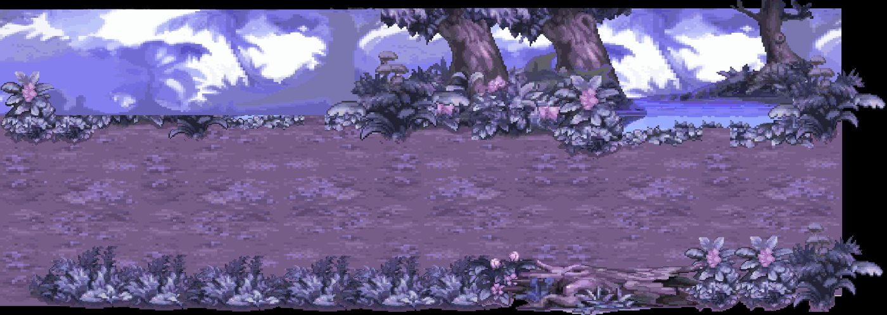
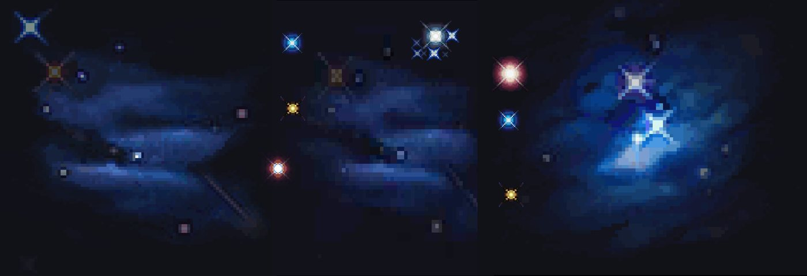
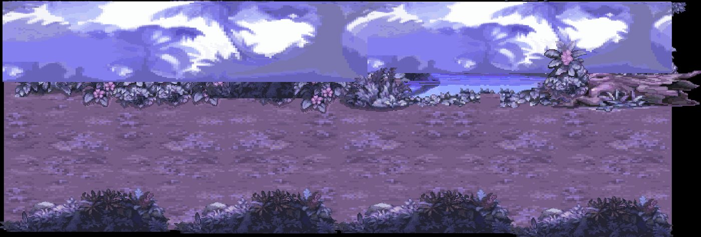
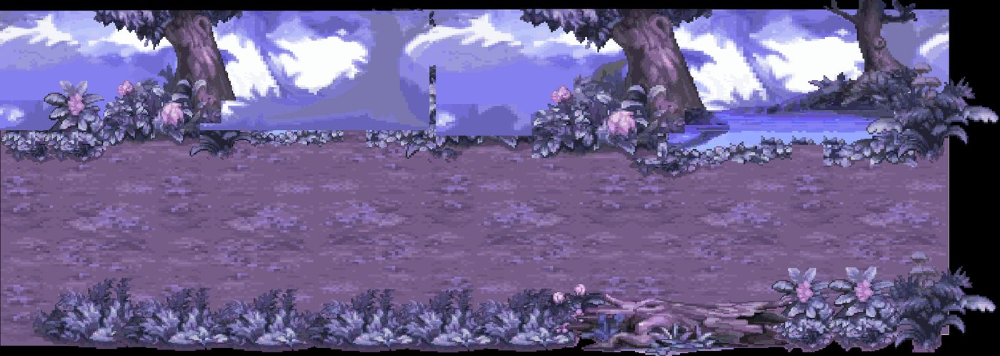
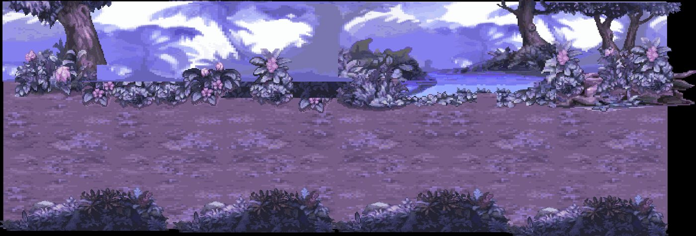
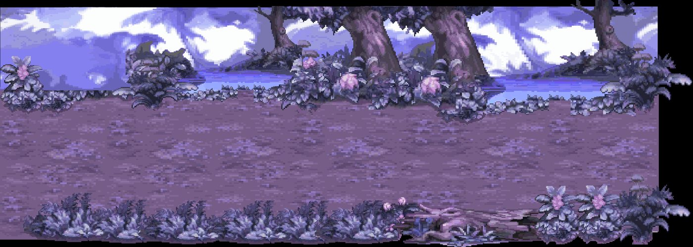
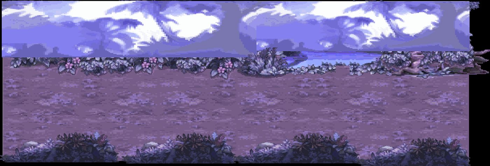

# Kit `astral` — Tinh Giới

> **Quy tắc bắt buộc cho Codex** (xem README.md): dùng https://github.com/0x0funky/agent-sprite-forge (generate2dmap / generate2dsprite) với route image_gen tích hợp; cấm codeart2d, API trả phí, vẽ bằng code, lật gương; không commit; không sửa tools/hd2d_audit/*, gate_waivers.json, check.sh; mỗi asset phải tự nhìn ảnh trước khi ghi "vẽ xong"; chỉ Claude/owner đánh dấu "duyệt".

- Style/palette: Cảnh ma mị: rừng mây tím, hoàng hôn, hồ vân ảnh, cổ thụ; Khe nứt thời không phát sáng. Bảng màu: tím #5B4A9B, hồng hoàng hôn #E08AA0, vàng #F2C879.
- Thư mục asset: `apps/game-web/art-src/hd2d/batch-11-astral/`
- Số map: 7

## 1. Danh sách asset cần vẽ (kit chưa có asset)

Nguồn: Phần C `hd2d-maps-75-gemini-prompt.md`. Yêu cầu gốc: tile mặt đất tím/hoàng hôn, đường mây lát đá, cỏ tím; prop: cây tím ×3 (sway-split), cổ thụ rỗng (Hốc Cổ Thụ), tinh thể pha lê ×3, đá lơ lửng ×3, hoa phát sáng, vòng xoáy khe nứt (4 khung), bờ hồ (viền), cầu mây; backdrop xa: dải ngân hà, mây tím, núi trôi.

| Vẽ | Duyệt | id (số thứ tự; đặt tên tiếng Anh vào manifest `name`) | loại | mô tả + prompt đi kèm |
|---|---|---|---|---|
| ⬜ | ⬜ | `astral-floor-01` | floor | mặt đất tím/hoàng hôn — tile sàn nhìn từ trên xuống, seamless 512×512; HD-2D Octopath pixel art, palette Tinh Giới, outline tối cùng sắc, 33–48 màu, không bóng đổ/sương/chữ. |
| ⬜ | ⬜ | `astral-floor-02` | floor | đường mây lát đá — tile sàn nhìn từ trên xuống, seamless 512×512; HD-2D Octopath pixel art, palette Tinh Giới, outline tối cùng sắc, 33–48 màu, không bóng đổ/sương/chữ. |
| ⬜ | ⬜ | `astral-floor-03` | floor | cỏ tím — tile sàn nhìn từ trên xuống, seamless 512×512; HD-2D Octopath pixel art, palette Tinh Giới, outline tối cùng sắc, 33–48 màu, không bóng đổ/sương/chữ. |
| ⬜ | ⬜ | `astral-prop-01` | prop | cây tím (sway-split) — prop đứng billboard, pivot giữa-đáy; HD-2D Octopath pixel art, palette Tinh Giới, outline tối cùng sắc, 33–48 màu, không bóng đổ/sương/chữ. |
| ⬜ | ⬜ | `astral-prop-02` | prop | cây tím (sway-split) — prop đứng billboard, pivot giữa-đáy; HD-2D Octopath pixel art, palette Tinh Giới, outline tối cùng sắc, 33–48 màu, không bóng đổ/sương/chữ. |
| ⬜ | ⬜ | `astral-prop-03` | prop | cây tím (sway-split) — prop đứng billboard, pivot giữa-đáy; HD-2D Octopath pixel art, palette Tinh Giới, outline tối cùng sắc, 33–48 màu, không bóng đổ/sương/chữ. |
| ⬜ | ⬜ | `astral-prop-04` | prop | cổ thụ rỗng (Hốc Cổ Thụ) — prop đứng billboard, pivot giữa-đáy; HD-2D Octopath pixel art, palette Tinh Giới, outline tối cùng sắc, 33–48 màu, không bóng đổ/sương/chữ. |
| ⬜ | ⬜ | `astral-prop-05` | prop | tinh thể pha lê — prop đứng billboard, pivot giữa-đáy; HD-2D Octopath pixel art, palette Tinh Giới, outline tối cùng sắc, 33–48 màu, không bóng đổ/sương/chữ. |
| ⬜ | ⬜ | `astral-prop-06` | prop | tinh thể pha lê — prop đứng billboard, pivot giữa-đáy; HD-2D Octopath pixel art, palette Tinh Giới, outline tối cùng sắc, 33–48 màu, không bóng đổ/sương/chữ. |
| ⬜ | ⬜ | `astral-prop-07` | prop | tinh thể pha lê — prop đứng billboard, pivot giữa-đáy; HD-2D Octopath pixel art, palette Tinh Giới, outline tối cùng sắc, 33–48 màu, không bóng đổ/sương/chữ. |
| ⬜ | ⬜ | `astral-prop-08` | prop | đá lơ lửng — prop đứng billboard, pivot giữa-đáy; HD-2D Octopath pixel art, palette Tinh Giới, outline tối cùng sắc, 33–48 màu, không bóng đổ/sương/chữ. |
| ⬜ | ⬜ | `astral-prop-09` | prop | đá lơ lửng — prop đứng billboard, pivot giữa-đáy; HD-2D Octopath pixel art, palette Tinh Giới, outline tối cùng sắc, 33–48 màu, không bóng đổ/sương/chữ. |
| ⬜ | ⬜ | `astral-prop-10` | prop | đá lơ lửng — prop đứng billboard, pivot giữa-đáy; HD-2D Octopath pixel art, palette Tinh Giới, outline tối cùng sắc, 33–48 màu, không bóng đổ/sương/chữ. |
| ⬜ | ⬜ | `astral-prop-11` | prop | hoa phát sáng — prop đứng billboard, pivot giữa-đáy; HD-2D Octopath pixel art, palette Tinh Giới, outline tối cùng sắc, 33–48 màu, không bóng đổ/sương/chữ. |
| ⬜ | ⬜ | `astral-prop-12` | prop | vòng xoáy khe nứt (4 khung) — prop đứng billboard, pivot giữa-đáy; HD-2D Octopath pixel art, palette Tinh Giới, outline tối cùng sắc, 33–48 màu, không bóng đổ/sương/chữ. |
| ⬜ | ⬜ | `astral-prop-13` | prop | bờ hồ (viền) — prop đứng billboard, pivot giữa-đáy; HD-2D Octopath pixel art, palette Tinh Giới, outline tối cùng sắc, 33–48 màu, không bóng đổ/sương/chữ. |
| ⬜ | ⬜ | `astral-prop-14` | prop | cầu mây — prop đứng billboard, pivot giữa-đáy; HD-2D Octopath pixel art, palette Tinh Giới, outline tối cùng sắc, 33–48 màu, không bóng đổ/sương/chữ. |
| ⬜ | ⬜ | `astral-backdrop-far-01` | backdrop_far | dải ngân hà — backdrop xa 1280×384 lặp ngang liền (64 px/đơn vị); HD-2D Octopath pixel art, palette Tinh Giới, outline tối cùng sắc, 33–48 màu, không bóng đổ/sương/chữ. |
| ⬜ | ⬜ | `astral-backdrop-far-02` | backdrop_far | mây tím — backdrop xa 1280×384 lặp ngang liền (64 px/đơn vị); HD-2D Octopath pixel art, palette Tinh Giới, outline tối cùng sắc, 33–48 màu, không bóng đổ/sương/chữ. |
| ⬜ | ⬜ | `astral-backdrop-far-03` | backdrop_far | núi trôi — backdrop xa 1280×384 lặp ngang liền (64 px/đơn vị); HD-2D Octopath pixel art, palette Tinh Giới, outline tối cùng sắc, 33–48 màu, không bóng đổ/sương/chữ. |
| ⬜ | ⬜ | `astral-floor-extra-01` | floor | tile sàn bổ sung (đủ ≥8 biến thể khác texture), seamless 512×512 |
| ⬜ | ⬜ | `astral-floor-extra-02` | floor | tile sàn bổ sung (đủ ≥8 biến thể khác texture), seamless 512×512 |
| ⬜ | ⬜ | `astral-floor-extra-03` | floor | tile sàn bổ sung (đủ ≥8 biến thể khác texture), seamless 512×512 |
| ⬜ | ⬜ | `astral-floor-extra-04` | floor | tile sàn bổ sung (đủ ≥8 biến thể khác texture), seamless 512×512 |
| ⬜ | ⬜ | `astral-floor-extra-05` | floor | tile sàn bổ sung (đủ ≥8 biến thể khác texture), seamless 512×512 |
| ⬜ | ⬜ | `astral-edge-01` | edge | dải chuyển tiếp giữa 2 tile chính, 512×128 liền hai đầu, mép bất quy tắc |
| ⬜ | ⬜ | `astral-edge-02` | edge | dải chuyển tiếp giữa 2 tile chính, 512×128 liền hai đầu, mép bất quy tắc |
| ⬜ | ⬜ | `astral-edge-03` | edge | dải chuyển tiếp giữa 2 tile chính, 512×128 liền hai đầu, mép bất quy tắc |
| ⬜ | ⬜ | `astral-decal-01` | decal | decal tiếp đất theo chủ đề kit (vụn, vết, xương/đá), bất quy tắc, mép mềm |
| ⬜ | ⬜ | `astral-decal-02` | decal | decal tiếp đất theo chủ đề kit (vụn, vết, xương/đá), bất quy tắc, mép mềm |
| ⬜ | ⬜ | `astral-decal-03` | decal | decal tiếp đất theo chủ đề kit (vụn, vết, xương/đá), bất quy tắc, mép mềm |
| ⬜ | ⬜ | `astral-decal-04` | decal | decal tiếp đất theo chủ đề kit (vụn, vết, xương/đá), bất quy tắc, mép mềm |
| ⬜ | ⬜ | `astral-decal-05` | decal | decal tiếp đất theo chủ đề kit (vụn, vết, xương/đá), bất quy tắc, mép mềm |
| ⬜ | ⬜ | `astral-decal-06` | decal | decal tiếp đất theo chủ đề kit (vụn, vết, xương/đá), bất quy tắc, mép mềm |
| ⬜ | ⬜ | `astral-decal-07` | decal | decal tiếp đất theo chủ đề kit (vụn, vết, xương/đá), bất quy tắc, mép mềm |
| ⬜ | ⬜ | `astral-decal-08` | decal | decal tiếp đất theo chủ đề kit (vụn, vết, xương/đá), bất quy tắc, mép mềm |
| ⬜ | ⬜ | `astral-decal-09` | decal | decal tiếp đất theo chủ đề kit (vụn, vết, xương/đá), bất quy tắc, mép mềm |
| ⬜ | ⬜ | `astral-decal-10` | decal | decal tiếp đất theo chủ đề kit (vụn, vết, xương/đá), bất quy tắc, mép mềm |
| ⬜ | ⬜ | `astral-decal-11` | decal | decal tiếp đất theo chủ đề kit (vụn, vết, xương/đá), bất quy tắc, mép mềm |
| ⬜ | ⬜ | `astral-decal-12` | decal | decal tiếp đất theo chủ đề kit (vụn, vết, xương/đá), bất quy tắc, mép mềm |
| ⬜ | ⬜ | `astral-shadow-01` | shadow | bóng procedural alpha mềm, màu kit |
| ⬜ | ⬜ | `astral-shadow-02` | shadow | bóng procedural alpha mềm, màu kit |
| ⬜ | ⬜ | `astral-shadow-03` | shadow | bóng procedural alpha mềm, màu kit |
| ⬜ | ⬜ | `astral-shadow-04` | shadow | bóng procedural alpha mềm, màu kit |
| ⬜ | ⬜ | `astral-backdrop-far` | backdrop | 1280×384, lặp ngang liền, mỗi tầng một khung cảnh khác |
| ⬜ | ⬜ | `astral-backdrop-mid` | backdrop | 1280×384, lặp ngang liền, mỗi tầng một khung cảnh khác |
| ⬜ | ⬜ | `astral-backdrop-near` | backdrop | 1280×384, lặp ngang liền, mỗi tầng một khung cảnh khác |
| ⬜ | ⬜ | `astral-portal-dormant` | portal | cổng nhìn thẳng mặt trước, đúng tông kit |
| ⬜ | ⬜ | `astral-portal-active` | portal | cùng mask với dormant |
| ⬜ | ⬜ | `astral-marker-arrival` | marker | vòng sáng 4 khung |
| ⬜ | ⬜ | `astral-fx-01` | fx | hạt/tia sáng sprite sheet theo chủ đề |
| ⬜ | ⬜ | `astral-fx-02` | fx | hạt/tia sáng sprite sheet theo chủ đề |
| ⬜ | ⬜ | `astral-fx-03` | fx | hạt/tia sáng sprite sheet theo chủ đề |

## 2. Prompt sheet chung cho kit

```text
[Dán Master v2: .ai/design/gpt-redo/00-master-v2.md]
Dùng agent-sprite-forge ($generate2dmap cho tile/prop, $generate2dsprite cho prop/decal/FX/marker). Route ảnh: image_gen tích hợp của Codex (kiểm `route_media.py resolve --kind image`). KHÔNG codeart2d, KHÔNG API, KHÔNG vẽ bằng code.
Kit: Tinh Giới (astral). Style: Cảnh ma mị: rừng mây tím, hoàng hôn, hồ vân ảnh, cổ thụ; Khe nứt thời không phát sáng. Bảng màu: tím #5B4A9B, hồng hoàng hôn #E08AA0, vàng #F2C879.. Style anchor: batch-01-octopath/contact-sheet.png + 2 sprites.png linh thú.
Mỗi lần gọi: 1 sheet ~6 vật trên nền #FF00FF, bố trí 2×3/3×2, cách nhau ≥48 px, không chạm mép. Giữ raw-01.png byte-identical. Cắt/khử nền/pixel finish bằng script forge. 33–48 màu, alpha nhị phân, lề ≥8 px, 128 px = 1 đơn vị (far 64), người = 1.31 đơn vị (cỡ tối đa vật nhỏ: tools/hd2d_audit/size_check.py).
Mỗi asset: thư mục raw-01/final/prompt.md/review.md/qa.json trong apps/game-web/art-src/hd2d/batch-11-astral/<id>/. Tự nhìn 4× nền tối/caro. Xong: `python3 tools/hd2d_audit/art_gate.py batch-11-astral` = 0 lỗi, contact-sheet mới hơn manifest.
```

## 3. Từng map

### `astral_realm_unnamed_area_01` — Tử Vân Lâm



- Ảnh gốc (đối chiếu): `.ai/design/map-checklists/refs/astral_realm_unnamed_area_01.jpg` (bản đầy đủ: `~/Downloads/Phimond-P12-Review/map-images/astral_realm_unnamed_area_01.png`, 2532×903 px, 100 px = 1 đơn vị APK)
- Nguồn APK: scene `Assets/Scenes/Map/TinhKhong.unity`, 28 sprite ghép; brief: [../map-briefs/kit_astral/astral_realm_unnamed_area_01.md](../map-briefs/kit_astral/astral_realm_unnamed_area_01.md)
- Cổng: 4 · vùng quái: không · spawn: 0 · NPC: astral_joss, astral_kira · ghi chú: hub: 02, 04, 05 + Khe nứt
- neo `P:astral_realm_portal_001` (door) Cửa → Hốc Cổ Thụ: px [2295, 548]
- neo `P:astral_realm_portal_004` (door) Cửa → Thời Không Liệt Khích: px [106, 505]
- neo `P:astral_realm_portal_006` (door) Cửa → Lối Mây Tím: px [1493, 424]
- neo `P:astral_realm_portal_011` (door) Cửa → Rừng Hoàng Hôn: px [1766, 738]
- neo `astral_joss` (npc) : px CẦN ĐẶT
- neo `astral_kira` (npc) : px CẦN ĐẶT
- NPC cần sprite (batch-05; kiểm trùng): astral_joss, astral_kira

Asset chính: dùng bảng kit (mục 1). Landmark riêng của map (Codex xem ảnh gốc, ghi tên vật nhận diện vào bảng rồi vẽ):

| Vẽ | Duyệt | id | loại | mô tả | prompt |
|---|---|---|---|---|---|
| ⬜ | ⬜ | `astral_realm_unnamed_area_01-landmark-01` | landmark | (vật nhận diện #1 trong ảnh gốc) | — |
| ⬜ | ⬜ | `astral_realm_unnamed_area_01-landmark-02` | landmark | (vật nhận diện #2, nếu có) | — |

Prompt cho Codex:

```text
Dùng agent-sprite-forge (generate2dmap + generate2dsprite, route image_gen). Map astral_realm_unnamed_area_01 (), kit astral.
Mở và đính kèm thật ảnh gốc .ai/design/map-checklists/refs/astral_realm_unnamed_area_01.jpg vào image_gen cùng 2–3 ảnh style batch 00–09 sát loại + 2 anchor linh thú; ghi sha256.
Rà các hàng chưa ✅ trong bảng; vẽ theo sheet 6 vật; landmark riêng: nhìn ảnh gốc, ghi tên vật vào bảng rồi vẽ (không giả là recovered APK nếu là diễn giải).
Xong: cập nhật cột "Vẽ" (✅ chỉ khi đã nhìn final 4×), chạy art_gate cho kit, KHÔNG tự đặt "Duyệt".
```

### `astral_realm_spacetime_rift` — Thời Không Liệt Khích



- Ảnh gốc (đối chiếu): `.ai/design/map-checklists/refs/astral_realm_spacetime_rift.jpg` (bản đầy đủ: `~/Downloads/Phimond-P12-Review/map-images/astral_realm_spacetime_rift.png`, 2410×826 px, 100 px = 1 đơn vị APK)
- Nguồn APK: scene `Assets/Scenes/Map/TinhKhong.unity`, 11 sprite ghép; brief: [../map-briefs/kit_astral/astral_realm_spacetime_rift.md](../map-briefs/kit_astral/astral_realm_spacetime_rift.md)
- Cổng: 2 · vùng quái: không · spawn: 0 · NPC: — · ghi chú: nối Hải Tặc Hào
- neo `P:astral_realm_portal_003` (door) Cửa → Tử Vân Lâm: px [2253, 311]
- neo `P:astral_realm_portal_013` (door) Cửa → Hải Tặc Hào: px [248, 592]
- neo `AT:ship:astral_realm_spacetime_rift` (arrival) Đến từ trụ Hải Tặc Hào: px [346, 574]

Asset chính: dùng bảng kit (mục 1). Landmark riêng của map (Codex xem ảnh gốc, ghi tên vật nhận diện vào bảng rồi vẽ):

| Vẽ | Duyệt | id | loại | mô tả | prompt |
|---|---|---|---|---|---|
| ⬜ | ⬜ | `astral_realm_spacetime_rift-landmark-01` | landmark | (vật nhận diện #1 trong ảnh gốc) | — |
| ⬜ | ⬜ | `astral_realm_spacetime_rift-landmark-02` | landmark | (vật nhận diện #2, nếu có) | — |

Prompt cho Codex:

```text
Dùng agent-sprite-forge (generate2dmap + generate2dsprite, route image_gen). Map astral_realm_spacetime_rift (), kit astral.
Mở và đính kèm thật ảnh gốc .ai/design/map-checklists/refs/astral_realm_spacetime_rift.jpg vào image_gen cùng 2–3 ảnh style batch 00–09 sát loại + 2 anchor linh thú; ghi sha256.
Rà các hàng chưa ✅ trong bảng; vẽ theo sheet 6 vật; landmark riêng: nhìn ảnh gốc, ghi tên vật vào bảng rồi vẽ (không giả là recovered APK nếu là diễn giải).
Xong: cập nhật cột "Vẽ" (✅ chỉ khi đã nhìn final 4×), chạy art_gate cho kit, KHÔNG tự đặt "Duyệt".
```

### `astral_realm_unnamed_area_02` — Lối Mây Tím



- Ảnh gốc (đối chiếu): `.ai/design/map-checklists/refs/astral_realm_unnamed_area_02.jpg` (bản đầy đủ: `~/Downloads/Phimond-P12-Review/map-images/astral_realm_unnamed_area_02.png`, 2522×856 px, 100 px = 1 đơn vị APK)
- Nguồn APK: scene `Assets/Scenes/Map/TinhKhong.unity`, 25 sprite ghép; brief: [../map-briefs/kit_astral/astral_realm_unnamed_area_02.md](../map-briefs/kit_astral/astral_realm_unnamed_area_02.md)
- Cổng: 2 · vùng quái: có · spawn: 10 · NPC: astral_lars · ghi chú: →03
- neo `P:astral_realm_portal_002` (door) Cửa → Bờ Hồ Vân Ảnh: px [135, 526]
- neo `P:astral_realm_portal_009` (door) Cửa → Tử Vân Lâm: px [2005, 714]
- neo `astral_lars` (npc) : px CẦN ĐẶT
- NPC cần sprite (batch-05; kiểm trùng): astral_lars

Asset chính: dùng bảng kit (mục 1). Landmark riêng của map (Codex xem ảnh gốc, ghi tên vật nhận diện vào bảng rồi vẽ):

| Vẽ | Duyệt | id | loại | mô tả | prompt |
|---|---|---|---|---|---|
| ⬜ | ⬜ | `astral_realm_unnamed_area_02-landmark-01` | landmark | (vật nhận diện #1 trong ảnh gốc) | — |
| ⬜ | ⬜ | `astral_realm_unnamed_area_02-landmark-02` | landmark | (vật nhận diện #2, nếu có) | — |

Prompt cho Codex:

```text
Dùng agent-sprite-forge (generate2dmap + generate2dsprite, route image_gen). Map astral_realm_unnamed_area_02 (), kit astral.
Mở và đính kèm thật ảnh gốc .ai/design/map-checklists/refs/astral_realm_unnamed_area_02.jpg vào image_gen cùng 2–3 ảnh style batch 00–09 sát loại + 2 anchor linh thú; ghi sha256.
Rà các hàng chưa ✅ trong bảng; vẽ theo sheet 6 vật; landmark riêng: nhìn ảnh gốc, ghi tên vật vào bảng rồi vẽ (không giả là recovered APK nếu là diễn giải).
Xong: cập nhật cột "Vẽ" (✅ chỉ khi đã nhìn final 4×), chạy art_gate cho kit, KHÔNG tự đặt "Duyệt".
```

### `astral_realm_unnamed_area_03` — Bờ Hồ Vân Ảnh



- Ảnh gốc (đối chiếu): `.ai/design/map-checklists/refs/astral_realm_unnamed_area_03.jpg` (bản đầy đủ: `~/Downloads/Phimond-P12-Review/map-images/astral_realm_unnamed_area_03.png`, 2531×903 px, 100 px = 1 đơn vị APK)
- Nguồn APK: scene `Assets/Scenes/Map/TinhKhong.unity`, 28 sprite ghép; brief: [../map-briefs/kit_astral/astral_realm_unnamed_area_03.md](../map-briefs/kit_astral/astral_realm_unnamed_area_03.md)
- Cổng: 1 · vùng quái: có · spawn: 10 · NPC: — · ghi chú: cụt
- neo `P:astral_realm_portal_010` (door) Cửa → Lối Mây Tím: px [2275, 563]

Asset chính: dùng bảng kit (mục 1). Landmark riêng của map (Codex xem ảnh gốc, ghi tên vật nhận diện vào bảng rồi vẽ):

| Vẽ | Duyệt | id | loại | mô tả | prompt |
|---|---|---|---|---|---|
| ⬜ | ⬜ | `astral_realm_unnamed_area_03-landmark-01` | landmark | (vật nhận diện #1 trong ảnh gốc) | — |
| ⬜ | ⬜ | `astral_realm_unnamed_area_03-landmark-02` | landmark | (vật nhận diện #2, nếu có) | — |

Prompt cho Codex:

```text
Dùng agent-sprite-forge (generate2dmap + generate2dsprite, route image_gen). Map astral_realm_unnamed_area_03 (), kit astral.
Mở và đính kèm thật ảnh gốc .ai/design/map-checklists/refs/astral_realm_unnamed_area_03.jpg vào image_gen cùng 2–3 ảnh style batch 00–09 sát loại + 2 anchor linh thú; ghi sha256.
Rà các hàng chưa ✅ trong bảng; vẽ theo sheet 6 vật; landmark riêng: nhìn ảnh gốc, ghi tên vật vào bảng rồi vẽ (không giả là recovered APK nếu là diễn giải).
Xong: cập nhật cột "Vẽ" (✅ chỉ khi đã nhìn final 4×), chạy art_gate cho kit, KHÔNG tự đặt "Duyệt".
```

### `astral_realm_unnamed_area_04` — Hốc Cổ Thụ



- Ảnh gốc (đối chiếu): `.ai/design/map-checklists/refs/astral_realm_unnamed_area_04.jpg` (bản đầy đủ: `~/Downloads/Phimond-P12-Review/map-images/astral_realm_unnamed_area_04.png`, 2522×856 px, 100 px = 1 đơn vị APK)
- Nguồn APK: scene `Assets/Scenes/Map/TinhKhong.unity`, 25 sprite ghép; brief: [../map-briefs/kit_astral/astral_realm_unnamed_area_04.md](../map-briefs/kit_astral/astral_realm_unnamed_area_04.md)
- Cổng: 1 · vùng quái: có · spawn: 12 · NPC: — · ghi chú: cụt
- neo `P:astral_realm_portal_005` (door) Cửa → Tử Vân Lâm: px [126, 528]

Asset chính: dùng bảng kit (mục 1). Landmark riêng của map (Codex xem ảnh gốc, ghi tên vật nhận diện vào bảng rồi vẽ):

| Vẽ | Duyệt | id | loại | mô tả | prompt |
|---|---|---|---|---|---|
| ⬜ | ⬜ | `astral_realm_unnamed_area_04-landmark-01` | landmark | (vật nhận diện #1 trong ảnh gốc) | — |
| ⬜ | ⬜ | `astral_realm_unnamed_area_04-landmark-02` | landmark | (vật nhận diện #2, nếu có) | — |

Prompt cho Codex:

```text
Dùng agent-sprite-forge (generate2dmap + generate2dsprite, route image_gen). Map astral_realm_unnamed_area_04 (), kit astral.
Mở và đính kèm thật ảnh gốc .ai/design/map-checklists/refs/astral_realm_unnamed_area_04.jpg vào image_gen cùng 2–3 ảnh style batch 00–09 sát loại + 2 anchor linh thú; ghi sha256.
Rà các hàng chưa ✅ trong bảng; vẽ theo sheet 6 vật; landmark riêng: nhìn ảnh gốc, ghi tên vật vào bảng rồi vẽ (không giả là recovered APK nếu là diễn giải).
Xong: cập nhật cột "Vẽ" (✅ chỉ khi đã nhìn final 4×), chạy art_gate cho kit, KHÔNG tự đặt "Duyệt".
```

### `astral_realm_unnamed_area_05` — Rừng Hoàng Hôn



- Ảnh gốc (đối chiếu): `.ai/design/map-checklists/refs/astral_realm_unnamed_area_05.jpg` (bản đầy đủ: `~/Downloads/Phimond-P12-Review/map-images/astral_realm_unnamed_area_05.png`, 2532×903 px, 100 px = 1 đơn vị APK)
- Nguồn APK: scene `Assets/Scenes/Map/TinhKhong.unity`, 28 sprite ghép; brief: [../map-briefs/kit_astral/astral_realm_unnamed_area_05.md](../map-briefs/kit_astral/astral_realm_unnamed_area_05.md)
- Cổng: 2 · vùng quái: có · spawn: 10 · NPC: astral_mara · ghi chú: →06
- neo `P:astral_realm_portal_007` (door) Cửa → Tận Cùng Thời Không: px [2295, 505]
- neo `P:astral_realm_portal_012` (door) Cửa → Tử Vân Lâm: px [356, 427]
- neo `astral_mara` (npc) : px CẦN ĐẶT
- NPC cần sprite (batch-05; kiểm trùng): astral_mara

Asset chính: dùng bảng kit (mục 1). Landmark riêng của map (Codex xem ảnh gốc, ghi tên vật nhận diện vào bảng rồi vẽ):

| Vẽ | Duyệt | id | loại | mô tả | prompt |
|---|---|---|---|---|---|
| ⬜ | ⬜ | `astral_realm_unnamed_area_05-landmark-01` | landmark | (vật nhận diện #1 trong ảnh gốc) | — |
| ⬜ | ⬜ | `astral_realm_unnamed_area_05-landmark-02` | landmark | (vật nhận diện #2, nếu có) | — |

Prompt cho Codex:

```text
Dùng agent-sprite-forge (generate2dmap + generate2dsprite, route image_gen). Map astral_realm_unnamed_area_05 (), kit astral.
Mở và đính kèm thật ảnh gốc .ai/design/map-checklists/refs/astral_realm_unnamed_area_05.jpg vào image_gen cùng 2–3 ảnh style batch 00–09 sát loại + 2 anchor linh thú; ghi sha256.
Rà các hàng chưa ✅ trong bảng; vẽ theo sheet 6 vật; landmark riêng: nhìn ảnh gốc, ghi tên vật vào bảng rồi vẽ (không giả là recovered APK nếu là diễn giải).
Xong: cập nhật cột "Vẽ" (✅ chỉ khi đã nhìn final 4×), chạy art_gate cho kit, KHÔNG tự đặt "Duyệt".
```

### `astral_realm_unnamed_area_06` — Tận Cùng Thời Không



- Ảnh gốc (đối chiếu): `.ai/design/map-checklists/refs/astral_realm_unnamed_area_06.jpg` (bản đầy đủ: `~/Downloads/Phimond-P12-Review/map-images/astral_realm_unnamed_area_06.png`, 2522×856 px, 100 px = 1 đơn vị APK)
- Nguồn APK: scene `Assets/Scenes/Map/TinhKhong.unity`, 25 sprite ghép; brief: [../map-briefs/kit_astral/astral_realm_unnamed_area_06.md](../map-briefs/kit_astral/astral_realm_unnamed_area_06.md)
- Cổng: 1 · vùng quái: có · spawn: 12 · NPC: — · ghi chú: cụt
- neo `P:astral_realm_portal_008` (door) Cửa → Rừng Hoàng Hôn: px [138, 512]

Asset chính: dùng bảng kit (mục 1). Landmark riêng của map (Codex xem ảnh gốc, ghi tên vật nhận diện vào bảng rồi vẽ):

| Vẽ | Duyệt | id | loại | mô tả | prompt |
|---|---|---|---|---|---|
| ⬜ | ⬜ | `astral_realm_unnamed_area_06-landmark-01` | landmark | (vật nhận diện #1 trong ảnh gốc) | — |
| ⬜ | ⬜ | `astral_realm_unnamed_area_06-landmark-02` | landmark | (vật nhận diện #2, nếu có) | — |

Prompt cho Codex:

```text
Dùng agent-sprite-forge (generate2dmap + generate2dsprite, route image_gen). Map astral_realm_unnamed_area_06 (), kit astral.
Mở và đính kèm thật ảnh gốc .ai/design/map-checklists/refs/astral_realm_unnamed_area_06.jpg vào image_gen cùng 2–3 ảnh style batch 00–09 sát loại + 2 anchor linh thú; ghi sha256.
Rà các hàng chưa ✅ trong bảng; vẽ theo sheet 6 vật; landmark riêng: nhìn ảnh gốc, ghi tên vật vào bảng rồi vẽ (không giả là recovered APK nếu là diễn giải).
Xong: cập nhật cột "Vẽ" (✅ chỉ khi đã nhìn final 4×), chạy art_gate cho kit, KHÔNG tự đặt "Duyệt".
```
