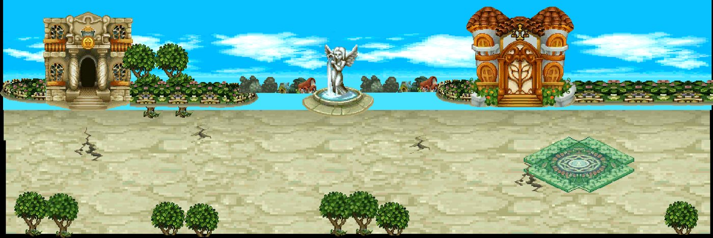
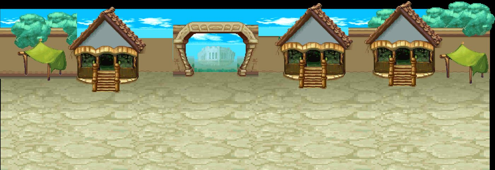
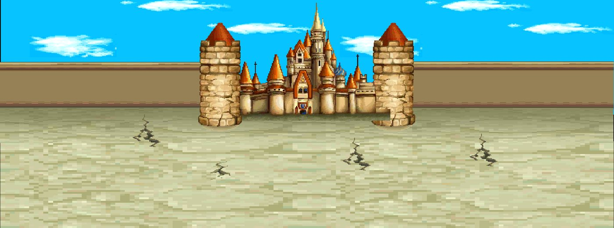
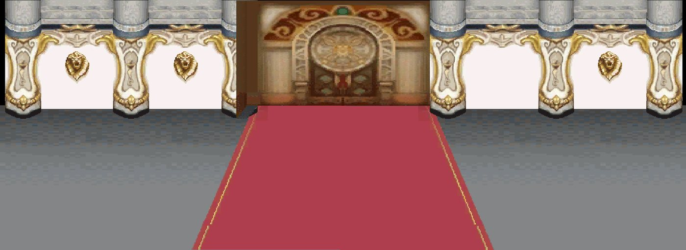
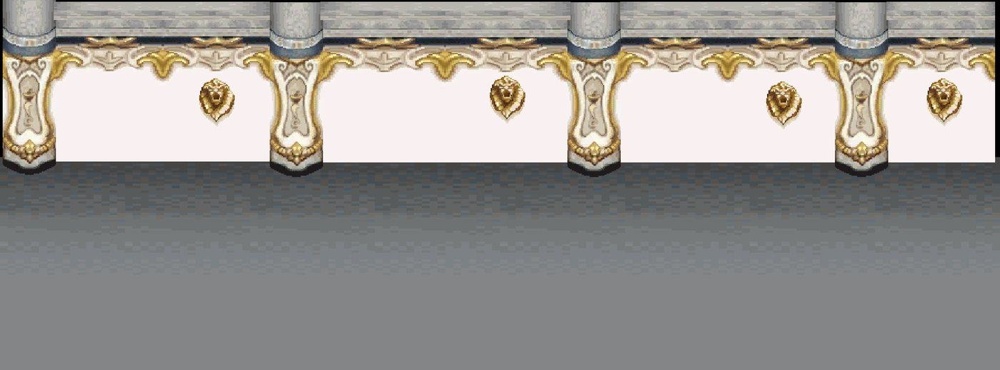
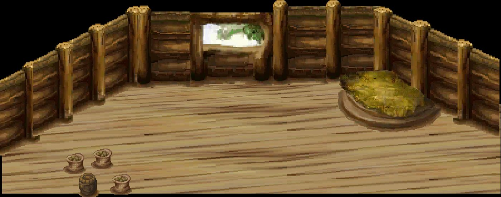
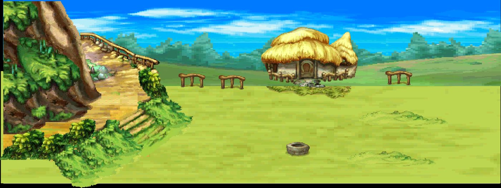
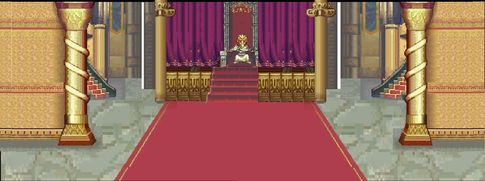
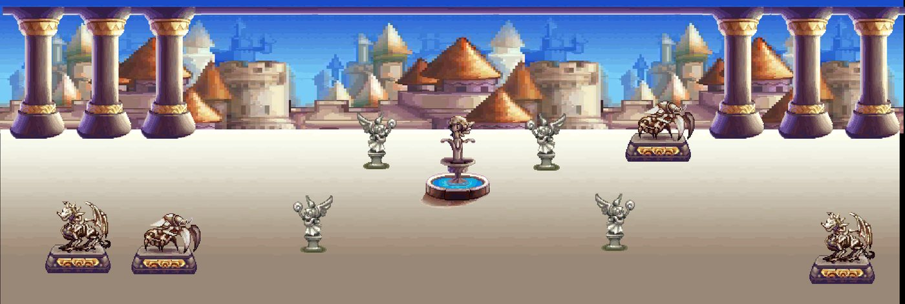

# Kit `city` — Thành phố, Hoàng Cung, nội thất, trang trại, đấu trường

> **Quy tắc bắt buộc cho Codex** (xem README.md): dùng https://github.com/0x0funky/agent-sprite-forge (generate2dmap / generate2dsprite) với route image_gen tích hợp; cấm codeart2d, API trả phí, vẽ bằng code, lật gương; không commit; không sửa tools/hd2d_audit/*, gate_waivers.json, check.sh; mỗi asset phải tự nhìn ảnh trước khi ghi "vẽ xong"; chỉ Claude/owner đánh dấu "duyệt".

- Style/palette: Gạch xám ấm, mái ngói đỏ, cổng cung điện, phòng gỗ/đá
- Thư mục asset: `apps/game-web/art-src/hd2d/batch-02-octopath/`
- Số map: 9

## 1. Trạng thái asset hiện có

Tổng 143 · duyệt 89 · nháp 54 · khác 0

| Loại | Có | Cần tối thiểu | Ghi chú |
|---|---|---|---|
| floor | 9 | 8 | ✅ · tile sàn 512×512 seamless, mỗi biến thể là texture khác |
| edge | 2 | 3 | ⬜ thiếu 1 · dải chuyển tiếp 512×128 liền hai đầu |
| prop | 83 | 36 | ✅ · prop đứng, ≥2–3 biến thể thật/chủng loại |
| decal | 11 | 12 | ⬜ thiếu 1 · decal tiếp đất bất quy tắc, mép mềm |
| shadow | 0 | 4 | ⬜ thiếu 4 · bóng procedural alpha mềm (ngoại lệ) |
| backdrop | 25 | 3 | ✅ · far/mid/near, lặp ngang liền |
| portal | 3 | 2 | ✅ · cặp dormant/active cùng mask |
| marker | 0 | 1 | ⬜ thiếu 1 · điểm xuất hiện 4 khung |
| fx | 4 | 3 | ✅ · hạt/tia sáng sprite sheet |

### Danh sách asset

| Vẽ | Duyệt | id | loại | kích thước (world) | prompt/nguồn |
|---|---|---|---|---|---|
| ✅ | ⏳ nháp, chờ duyệt | `arena-stands-far` | backdrop_far | [12.5, 3.75] | — |
| ✅ | ⏳ nháp, chờ duyệt | `city-skyline-far` | backdrop_far | [16.0, 4.0] | — |
| ✅ | ⏳ nháp, chờ duyệt | `farm-hills-far` | backdrop_far | [12.5, 3.75] | — |
| ✅ | ✅ duyệt | `arena-grandstand` | backdrop_mid | [4.671875, 2.3125] | [prompt.md](../../../apps/game-web/art-src/hd2d/batch-02-octopath/arena-grandstand/prompt.md) |
| ✅ | ⏳ nháp, chờ duyệt | `city-alley-arch` | backdrop_mid | [1.6328125, 3.671875] | — |
| ✅ | ✅ duyệt | `city-facade-artisan` | backdrop_mid | [5.4375, 4.03125] | [prompt.md](../../../apps/game-web/art-src/hd2d/batch-02-octopath/city-facade-artisan/prompt.md) |
| ✅ | ⏳ nháp, chờ duyệt | `city-facade-bakery` | backdrop_mid | [3.3125, 3.75] | — |
| ✅ | ⏳ nháp, chờ duyệt | `city-facade-belltower` | backdrop_mid | [2.6171875, 4.6875] | — |
| ✅ | ⏳ nháp, chờ duyệt | `city-facade-corner` | backdrop_mid | [3.25, 4.21875] | — |
| ✅ | ⏳ nháp, chờ duyệt | `city-facade-exchange` | backdrop_mid | [3.515625, 4.03125] | — |
| ✅ | ✅ duyệt | `city-facade-guild` | backdrop_mid | [4.96875, 4.03125] | [prompt.md](../../../apps/game-web/art-src/hd2d/batch-02-octopath/city-facade-guild/prompt.md) |
| ✅ | ⏳ nháp, chờ duyệt | `city-facade-inn` | backdrop_mid | [3.953125, 4.03125] | — |
| ✅ | ✅ duyệt | `city-facade-shop` | backdrop_mid | [5.4375, 4.03125] | [prompt.md](../../../apps/game-web/art-src/hd2d/batch-02-octopath/city-facade-shop/prompt.md) |
| ✅ | ✅ duyệt | `city-facade-townhouse` | backdrop_mid | [5.171875, 4.03125] | [prompt.md](../../../apps/game-web/art-src/hd2d/batch-02-octopath/city-facade-townhouse/prompt.md) |
| ✅ | ⏳ nháp, chờ duyệt | `city-facade-warehouse` | backdrop_mid | [3.828125, 3.90625] | — |
| ✅ | ⏳ nháp, chờ duyệt | `city-pillar-drainpipe` | backdrop_mid | [0.8359375, 3.671875] | — |
| ✅ | ⏳ nháp, chờ duyệt | `city-roofline-mid` | backdrop_mid | [10.3046875, 1.796875] | — |
| ✅ | ⏳ nháp, chờ duyệt | `city-wall-flowerbox` | backdrop_mid | [2.8359375, 2.96875] | — |
| ✅ | ✅ duyệt | `farm-barn` | backdrop_mid | [4.9375, 3.25] | [prompt.md](../../../apps/game-web/art-src/hd2d/batch-02-octopath/farm-barn/prompt.md) |
| ✅ | ✅ duyệt | `hall-wall-stone` | backdrop_mid | [7.40625, 2.9375] | [prompt.md](../../../apps/game-web/art-src/hd2d/batch-02-octopath/hall-wall-stone/prompt.md) |
| ✅ | ✅ duyệt | `hall-wall-timber` | backdrop_mid | [7.453125, 2.9375] | [prompt.md](../../../apps/game-web/art-src/hd2d/batch-02-octopath/hall-wall-timber/prompt.md) |
| ✅ | ⏳ nháp, chờ duyệt | `palace-crenel-wall` | backdrop_mid | [6.5859375, 3.203125] | — |
| ✅ | ✅ duyệt | `palace-gate` | backdrop_mid | [5.984375, 4.1875] | [prompt.md](../../../apps/game-web/art-src/hd2d/batch-02-octopath/palace-gate/prompt.md) |
| ✅ | ✅ duyệt | `palace-tower` | backdrop_mid | [2.15625, 4.8125] | [prompt.md](../../../apps/game-web/art-src/hd2d/batch-02-octopath/palace-tower/prompt.md) |
| ✅ | ✅ duyệt | `palace-wall-section` | backdrop_mid | [4.578125, 2.625] | [prompt.md](../../../apps/game-web/art-src/hd2d/batch-02-octopath/palace-wall-section/prompt.md) |
| ✅ | ✅ duyệt | `arena-center-medallion` | decal | [2.9375, 2.9375] | [prompt.md](../../../apps/game-web/art-src/hd2d/batch-02-octopath/arena-center-medallion/prompt.md) |
| ✅ | ✅ duyệt | `city-plaza-medallion` | decal | [3.25, 3.25] | [prompt.md](../../../apps/game-web/art-src/hd2d/batch-02-octopath/city-plaza-medallion/prompt.md) |
| ✅ | ⏳ nháp, chờ duyệt | `decal-cracks` | decal | [1.484375, 1.265625] | — |
| ✅ | ⏳ nháp, chờ duyệt | `decal-drain` | decal | [0.703125, 0.640625] | — |
| ✅ | ⏳ nháp, chờ duyệt | `decal-hopscotch` | decal | [1.1015625, 1.796875] | — |
| ✅ | ⏳ nháp, chờ duyệt | `decal-petals` | decal | [1.40625, 1.2890625] | — |
| ✅ | ⏳ nháp, chờ duyệt | `decal-puddle` | decal | [1.5625, 1.3515625] | — |
| ✅ | ⏳ nháp, chờ duyệt | `decal-ruts` | decal | [1.71875, 1.703125] | — |
| ✅ | ✅ duyệt | `palace-carpet-strip` | decal | [3.359375, 0.984375] | [prompt.md](../../../apps/game-web/art-src/hd2d/batch-02-octopath/palace-carpet-strip/prompt.md) |
| ✅ | ⏳ nháp, chờ duyệt | `royal-carpet-runner` | decal | [1.40625, 3.0] | — |
| ✅ | ✅ duyệt | `summon-floor-emblem` | decal | [2.625, 2.625] | [prompt.md](../../../apps/game-web/art-src/hd2d/batch-02-octopath/summon-floor-emblem/prompt.md) |
| ✅ | ✅ duyệt | `city-garden-border` | edge | [4.515625, 1.0625] | [prompt.md](../../../apps/game-web/art-src/hd2d/batch-02-octopath/city-garden-border/prompt.md) |
| ✅ | ⏳ nháp, chờ duyệt | `farm-dirt-path-strip` | edge | [7.34375, 1.375] | [prompt.md](../../../apps/game-web/art-src/hd2d/batch-02-octopath/farm-dirt-path-strip/prompt.md) |
| ✅ | ⏳ nháp, chờ duyệt | `arena-floor` | floor | [4.0, 4.0] | [prompt.md](../../../apps/game-web/art-src/hd2d/batch-02-octopath/arena-floor/prompt.md) |
| ✅ | ⏳ nháp, chờ duyệt | `city-brick-path` | floor | [4.0, 4.0] | [prompt.md](../../../apps/game-web/art-src/hd2d/batch-02-octopath/city-brick-path/prompt.md) |
| ✅ | ⏳ nháp, chờ duyệt | `city-paving-01` | floor | [4.0, 4.0] | [prompt.md](../../../apps/game-web/art-src/hd2d/batch-02-octopath/city-paving-01/prompt.md) |
| ✅ | ⏳ nháp, chờ duyệt | `city-paving-02` | floor | [4.0, 4.0] | [prompt.md](../../../apps/game-web/art-src/hd2d/batch-02-octopath/city-paving-02/prompt.md) |
| ✅ | ⏳ nháp, chờ duyệt | `city-paving-03` | floor | [4.0, 4.0] | [prompt.md](../../../apps/game-web/art-src/hd2d/batch-02-octopath/city-paving-03/prompt.md) |
| ✅ | ⏳ nháp, chờ duyệt | `farm-tilled-01` | floor | [4.0, 4.0] | [prompt.md](../../../apps/game-web/art-src/hd2d/batch-02-octopath/farm-tilled-01/prompt.md) |
| ✅ | ⏳ nháp, chờ duyệt | `farm-tilled-02` | floor | [4.0, 4.0] | [prompt.md](../../../apps/game-web/art-src/hd2d/batch-02-octopath/farm-tilled-02/prompt.md) |
| ✅ | ⏳ nháp, chờ duyệt | `hall-floor-stone` | floor | [4.0, 4.0] | [prompt.md](../../../apps/game-web/art-src/hd2d/batch-02-octopath/hall-floor-stone/prompt.md) |
| ✅ | ✅ duyệt | `hall-floor-wood` | floor | [4.0, 4.0] | [prompt.md](../../../apps/game-web/art-src/hd2d/batch-02-octopath/hall-floor-wood/prompt.md) |
| ✅ | ✅ duyệt | `farm-windmill-rotor` | fx | [2.5, 2.5] | [prompt.md](../../../apps/game-web/art-src/hd2d/batch-02-octopath/farm-windmill-rotor/prompt.md) |
| ✅ | ✅ duyệt | `fountain-water` | fx | [1.5, 1.5] | [prompt.md](../../../apps/game-web/art-src/hd2d/batch-02-octopath/fountain-water/prompt.md) |
| ✅ | ✅ duyệt | `hall-candle` | fx | [0.75, 0.75] | [prompt.md](../../../apps/game-web/art-src/hd2d/batch-02-octopath/hall-candle/prompt.md) |
| ✅ | ✅ duyệt | `hall-torch` | fx | [1.0, 1.0] | [prompt.md](../../../apps/game-web/art-src/hd2d/batch-02-octopath/hall-torch/prompt.md) |
| ✅ | ✅ duyệt | `city-teleport-active` | portal | [2.15625, 2.3125] | [prompt.md](../../../apps/game-web/art-src/hd2d/batch-02-octopath/city-teleport-active/prompt.md) |
| ✅ | ✅ duyệt | `city-teleport-dormant` | portal | [2.15625, 2.3125] | [prompt.md](../../../apps/game-web/art-src/hd2d/batch-02-octopath/city-teleport-dormant/prompt.md) |
| ✅ | ✅ duyệt | `city-teleport-ring` | portal | [2.5, 2.5] | [prompt.md](../../../apps/game-web/art-src/hd2d/batch-02-octopath/city-teleport-ring/prompt.md) |
| ✅ | ⏳ nháp, chờ duyệt | `animal-butterflies` | prop | [0.3828125, 0.5] | — |
| ✅ | ⏳ nháp, chờ duyệt | `animal-cat` | prop | [0.578125, 0.75] | — |
| ✅ | ⏳ nháp, chờ duyệt | `animal-crow` | prop | [0.6328125, 0.5625] | — |
| ✅ | ⏳ nháp, chờ duyệt | `animal-dog` | prop | [1.046875, 0.625] | — |
| ✅ | ⏳ nháp, chờ duyệt | `animal-pigeon-fly` | prop | [0.46875, 0.546875] | — |
| ✅ | ⏳ nháp, chờ duyệt | `animal-pigeon-peck` | prop | [0.546875, 0.453125] | — |
| ✅ | ✅ duyệt | `arena-column` | prop | [1.15625, 2.859375] | [prompt.md](../../../apps/game-web/art-src/hd2d/batch-02-octopath/arena-column/prompt.md) |
| ✅ | ✅ duyệt | `arena-flag-red` | prop | [1.03125, 2.15625] | [prompt.md](../../../apps/game-web/art-src/hd2d/batch-02-octopath/arena-flag-red/prompt.md) |
| ✅ | ✅ duyệt | `arena-flag-teal` | prop | [1.046875, 2.15625] | [prompt.md](../../../apps/game-web/art-src/hd2d/batch-02-octopath/arena-flag-teal/prompt.md) |
| ✅ | ✅ duyệt | `arena-standings-board` | prop | [1.90625, 2.15625] | [prompt.md](../../../apps/game-web/art-src/hd2d/batch-02-octopath/arena-standings-board/prompt.md) |
| ✅ | ✅ duyệt | `arena-weapon-rack` | prop | [1.828125, 1.84375] | [prompt.md](../../../apps/game-web/art-src/hd2d/batch-02-octopath/arena-weapon-rack/prompt.md) |
| ✅ | ✅ duyệt | `awning-blue` | prop | [2.765625, 2.46875] | [prompt.md](../../../apps/game-web/art-src/hd2d/batch-02-octopath/awning-blue/prompt.md) |
| ✅ | ✅ duyệt | `awning-green` | prop | [2.765625, 2.46875] | [prompt.md](../../../apps/game-web/art-src/hd2d/batch-02-octopath/awning-green/prompt.md) |
| ✅ | ✅ duyệt | `awning-red` | prop | [2.765625, 2.46875] | [prompt.md](../../../apps/game-web/art-src/hd2d/batch-02-octopath/awning-red/prompt.md) |
| ✅ | ✅ duyệt | `balustrade` | prop | [2.5625, 1.21875] | [prompt.md](../../../apps/game-web/art-src/hd2d/batch-02-octopath/balustrade/prompt.md) |
| ✅ | ✅ duyệt | `banner-blue` | prop | [0.84375, 2.15625] | [prompt.md](../../../apps/game-web/art-src/hd2d/batch-02-octopath/banner-blue/prompt.md) |
| ✅ | ✅ duyệt | `banner-red` | prop | [0.859375, 2.15625] | [prompt.md](../../../apps/game-web/art-src/hd2d/batch-02-octopath/banner-red/prompt.md) |
| ✅ | ✅ duyệt | `barrel` | prop | [0.9375, 1.2578125] | [prompt.md](../../../apps/game-web/art-src/hd2d/batch-02-octopath/barrel/prompt.md) |
| ✅ | ✅ duyệt | `bench` | prop | [1.6875, 1.140625] | [prompt.md](../../../apps/game-web/art-src/hd2d/batch-02-octopath/bench/prompt.md) |
| ✅ | ⏳ nháp, chờ duyệt | `city-bunting` | prop | [3.15625, 2.34375] | — |
| ✅ | ✅ duyệt | `city-carved-pillar` | prop | [0.859375, 2.078125] | [prompt.md](../../../apps/game-web/art-src/hd2d/batch-02-octopath/city-carved-pillar/prompt.md) |
| ✅ | ⏳ nháp, chờ duyệt | `city-hanging-sign` | prop | [1.5390625, 2.1875] | — |
| ✅ | ⏳ nháp, chờ duyệt | `city-iron-fence` | prop | [2.8125, 1.71875] | — |
| ✅ | ⏳ nháp, chờ duyệt | `city-lion-fountain` | prop | [1.5234375, 1.796875] | — |
| ✅ | ✅ duyệt | `city-roof-module` | prop | [2.8125, 1.6875] | [prompt.md](../../../apps/game-web/art-src/hd2d/batch-02-octopath/city-roof-module/prompt.md) |
| ✅ | ⏳ nháp, chờ duyệt | `city-sacks` | prop | [1.734375, 1.171875] | — |
| ✅ | ✅ duyệt | `city-statue` | prop | [1.109375, 2.3125] | [prompt.md](../../../apps/game-web/art-src/hd2d/batch-02-octopath/city-statue/prompt.md) |
| ✅ | ⏳ nháp, chờ duyệt | `city-topiary` | prop | [1.234375, 1.953125] | — |
| ✅ | ✅ duyệt | `city-tree-01` | prop | [1.84375, 2.390625] | [prompt.md](../../../apps/game-web/art-src/hd2d/batch-02-octopath/city-tree-01/prompt.md) |
| ✅ | ✅ duyệt | `city-tree-02` | prop | [2.40625, 2.546875] | [prompt.md](../../../apps/game-web/art-src/hd2d/batch-02-octopath/city-tree-02/prompt.md) |
| ✅ | ⏳ nháp, chờ duyệt | `city-vendor-cart` | prop | [2.03125, 1.796875] | — |
| ✅ | ✅ duyệt | `farm-basket` | prop | [1.203125, 1.140625] | [prompt.md](../../../apps/game-web/art-src/hd2d/batch-02-octopath/farm-basket/prompt.md) |
| ✅ | ✅ duyệt | `farm-fence-post` | prop | [0.65625, 1.21875] | [prompt.md](../../../apps/game-web/art-src/hd2d/batch-02-octopath/farm-fence-post/prompt.md) |
| ✅ | ✅ duyệt | `farm-fence-rail` | prop | [1.734375, 0.90625] | [prompt.md](../../../apps/game-web/art-src/hd2d/batch-02-octopath/farm-fence-rail/prompt.md) |
| ✅ | ✅ duyệt | `farm-flowers-01` | prop | [1.140625, 0.8671875] | [prompt.md](../../../apps/game-web/art-src/hd2d/batch-02-octopath/farm-flowers-01/prompt.md) |
| ✅ | ✅ duyệt | `farm-flowers-02` | prop | [1.21875, 0.90625] | [prompt.md](../../../apps/game-web/art-src/hd2d/batch-02-octopath/farm-flowers-02/prompt.md) |
| ✅ | ✅ duyệt | `farm-flowers-03` | prop | [1.25, 0.90625] | [prompt.md](../../../apps/game-web/art-src/hd2d/batch-02-octopath/farm-flowers-03/prompt.md) |
| ✅ | ✅ duyệt | `farm-fruit-tree` | prop | [2.75, 2.78125] | [prompt.md](../../../apps/game-web/art-src/hd2d/batch-02-octopath/farm-fruit-tree/prompt.md) |
| ✅ | ✅ duyệt | `farm-hay-bale` | prop | [1.6875, 1.140625] | [prompt.md](../../../apps/game-web/art-src/hd2d/batch-02-octopath/farm-hay-bale/prompt.md) |
| ✅ | ✅ duyệt | `farm-hay-loose` | prop | [2.265625, 1.0625] | [prompt.md](../../../apps/game-web/art-src/hd2d/batch-02-octopath/farm-hay-loose/prompt.md) |
| ✅ | ✅ duyệt | `farm-hay-shed` | prop | [3.328125, 2.703125] | [prompt.md](../../../apps/game-web/art-src/hd2d/batch-02-octopath/farm-hay-shed/prompt.md) |
| ✅ | ✅ duyệt | `farm-scarecrow` | prop | [2.09375, 2.078125] | [prompt.md](../../../apps/game-web/art-src/hd2d/batch-02-octopath/farm-scarecrow/prompt.md) |
| ✅ | ✅ duyệt | `farm-stable` | prop | [4.203125, 2.625] | [prompt.md](../../../apps/game-web/art-src/hd2d/batch-02-octopath/farm-stable/prompt.md) |
| ✅ | ✅ duyệt | `farm-trough` | prop | [2.640625, 0.984375] | [prompt.md](../../../apps/game-web/art-src/hd2d/batch-02-octopath/farm-trough/prompt.md) |
| ✅ | ✅ duyệt | `farm-windmill-body` | prop | [2.609375, 4.03125] | [prompt.md](../../../apps/game-web/art-src/hd2d/batch-02-octopath/farm-windmill-body/prompt.md) |
| ✅ | ✅ duyệt | `flowerpot-cream` | prop | [1.21875, 1.4140625] | [prompt.md](../../../apps/game-web/art-src/hd2d/batch-02-octopath/flowerpot-cream/prompt.md) |
| ✅ | ✅ duyệt | `flowerpot-red` | prop | [1.265625, 1.21875] | [prompt.md](../../../apps/game-web/art-src/hd2d/batch-02-octopath/flowerpot-red/prompt.md) |
| ✅ | ✅ duyệt | `flowerpot-violet` | prop | [1.109375, 1.21875] | [prompt.md](../../../apps/game-web/art-src/hd2d/batch-02-octopath/flowerpot-violet/prompt.md) |
| ✅ | ✅ duyệt | `fountain-body` | prop | [2.546875, 2.625] | [prompt.md](../../../apps/game-web/art-src/hd2d/batch-02-octopath/fountain-body/prompt.md) |
| ✅ | ✅ duyệt | `hall-bookshelf` | prop | [2.265625, 2.0] | [prompt.md](../../../apps/game-web/art-src/hd2d/batch-02-octopath/hall-bookshelf/prompt.md) |
| ✅ | ✅ duyệt | `hall-counter` | prop | [2.859375, 1.453125] | [prompt.md](../../../apps/game-web/art-src/hd2d/batch-02-octopath/hall-counter/prompt.md) |
| ✅ | ✅ duyệt | `hall-exit-closed` | prop | [2.140625, 2.3125] | [prompt.md](../../../apps/game-web/art-src/hd2d/batch-02-octopath/hall-exit-closed/prompt.md) |
| ✅ | ✅ duyệt | `hall-exit-open` | prop | [2.140625, 2.3125] | [prompt.md](../../../apps/game-web/art-src/hd2d/batch-02-octopath/hall-exit-open/prompt.md) |
| ✅ | ✅ duyệt | `hall-quest-board` | prop | [1.890625, 1.921875] | [prompt.md](../../../apps/game-web/art-src/hd2d/batch-02-octopath/hall-quest-board/prompt.md) |
| ✅ | ✅ duyệt | `handcart` | prop | [2.5, 1.6484375] | [prompt.md](../../../apps/game-web/art-src/hd2d/batch-02-octopath/handcart/prompt.md) |
| ✅ | ✅ duyệt | `market-cloth` | prop | [1.875, 1.4140625] | [prompt.md](../../../apps/game-web/art-src/hd2d/batch-02-octopath/market-cloth/prompt.md) |
| ✅ | ✅ duyệt | `market-produce` | prop | [2.0, 1.4140625] | [prompt.md](../../../apps/game-web/art-src/hd2d/batch-02-octopath/market-produce/prompt.md) |
| ✅ | ✅ duyệt | `market-weapons` | prop | [1.875, 1.6484375] | [prompt.md](../../../apps/game-web/art-src/hd2d/batch-02-octopath/market-weapons/prompt.md) |
| ✅ | ✅ duyệt | `palace-chandelier` | prop | [1.5, 1.921875] | [prompt.md](../../../apps/game-web/art-src/hd2d/batch-02-octopath/palace-chandelier/prompt.md) |
| ✅ | ✅ duyệt | `palace-column` | prop | [1.390625, 3.25] | [prompt.md](../../../apps/game-web/art-src/hd2d/batch-02-octopath/palace-column/prompt.md) |
| ✅ | ✅ duyệt | `palace-curtain` | prop | [3.140625, 2.9375] | [prompt.md](../../../apps/game-web/art-src/hd2d/batch-02-octopath/palace-curtain/prompt.md) |
| ✅ | ⏳ nháp, chờ duyệt | `palace-flagpole` | prop | [2.09375, 3.4375] | — |
| ✅ | ⏳ nháp, chờ duyệt | `palace-guard-booth` | prop | [1.484375, 2.65625] | — |
| ✅ | ✅ duyệt | `palace-guard-statue` | prop | [1.328125, 2.46875] | [prompt.md](../../../apps/game-web/art-src/hd2d/batch-02-octopath/palace-guard-statue/prompt.md) |
| ✅ | ⏳ nháp, chờ duyệt | `palace-lion-l` | prop | [1.2265625, 1.953125] | — |
| ✅ | ⏳ nháp, chờ duyệt | `palace-lion-r` | prop | [1.234375, 1.953125] | — |
| ✅ | ⏳ nháp, chờ duyệt | `palace-long-planter` | prop | [4.4609375, 1.171875] | — |
| ✅ | ✅ duyệt | `palace-marble-pillar` | prop | [0.875, 2.9375] | — |
| ✅ | ✅ duyệt | `palace-throne` | prop | [1.484375, 2.15625] | [prompt.md](../../../apps/game-web/art-src/hd2d/batch-02-octopath/palace-throne/prompt.md) |
| ✅ | ✅ duyệt | `pet-nest-blanket` | prop | [1.859375, 1.0625] | [prompt.md](../../../apps/game-web/art-src/hd2d/batch-02-octopath/pet-nest-blanket/prompt.md) |
| ✅ | ✅ duyệt | `pet-nest-shelter` | prop | [2.015625, 1.609375] | [prompt.md](../../../apps/game-web/art-src/hd2d/batch-02-octopath/pet-nest-shelter/prompt.md) |
| ✅ | ✅ duyệt | `pet-nest-straw` | prop | [1.546875, 0.90625] | [prompt.md](../../../apps/game-web/art-src/hd2d/batch-02-octopath/pet-nest-straw/prompt.md) |
| ✅ | ✅ duyệt | `royal-throne` | prop | [2.0, 2.625] | — |
| ✅ | ✅ duyệt | `stone-steps` | prop | [1.703125, 0.90625] | [prompt.md](../../../apps/game-web/art-src/hd2d/batch-02-octopath/stone-steps/prompt.md) |
| ✅ | ✅ duyệt | `streetlamp-unlit` | prop | [0.6875, 2.078125] | [prompt.md](../../../apps/game-web/art-src/hd2d/batch-02-octopath/streetlamp-unlit/prompt.md) |
| ✅ | ✅ duyệt | `summon-pedestal-01-active` | prop | [1.703125, 1.0625] | [prompt.md](../../../apps/game-web/art-src/hd2d/batch-02-octopath/summon-pedestal-01-active/prompt.md) |
| ✅ | ✅ duyệt | `summon-pedestal-01-dormant` | prop | [1.703125, 1.0625] | [prompt.md](../../../apps/game-web/art-src/hd2d/batch-02-octopath/summon-pedestal-01-dormant/prompt.md) |
| ✅ | ✅ duyệt | `summon-pedestal-02-active` | prop | [1.65625, 1.21875] | [prompt.md](../../../apps/game-web/art-src/hd2d/batch-02-octopath/summon-pedestal-02-active/prompt.md) |
| ✅ | ✅ duyệt | `summon-pedestal-02-dormant` | prop | [1.671875, 1.21875] | [prompt.md](../../../apps/game-web/art-src/hd2d/batch-02-octopath/summon-pedestal-02-dormant/prompt.md) |
| ✅ | ✅ duyệt | `summon-pedestal-03-active` | prop | [1.75, 1.0625] | [prompt.md](../../../apps/game-web/art-src/hd2d/batch-02-octopath/summon-pedestal-03-active/prompt.md) |
| ✅ | ✅ duyệt | `summon-pedestal-03-dormant` | prop | [1.75, 1.0625] | [prompt.md](../../../apps/game-web/art-src/hd2d/batch-02-octopath/summon-pedestal-03-dormant/prompt.md) |
| ✅ | ✅ duyệt | `well` | prop | [1.734375, 2.078125] | [prompt.md](../../../apps/game-web/art-src/hd2d/batch-02-octopath/well/prompt.md) |
| ✅ | ✅ duyệt | `wooden-crate` | prop | [1.140625, 1.140625] | [prompt.md](../../../apps/game-web/art-src/hd2d/batch-02-octopath/wooden-crate/prompt.md) |
| ✅ | ⏳ nháp, chờ duyệt | `walker-baker` | walker | — | — |
| ✅ | ⏳ nháp, chờ duyệt | `walker-boy` | walker | — | — |
| ✅ | ⏳ nháp, chờ duyệt | `walker-elder` | walker | — | — |
| ✅ | ⏳ nháp, chờ duyệt | `walker-girl` | walker | — | — |
| ✅ | ⏳ nháp, chờ duyệt | `walker-guard` | walker | — | — |
| ✅ | ⏳ nháp, chờ duyệt | `walker-traveller` | walker | — | — |

## 2. Prompt sheet chung cho kit

```text
[Dán Master v2: .ai/design/gpt-redo/00-master-v2.md]
Dùng agent-sprite-forge ($generate2dmap cho tile/prop, $generate2dsprite cho prop/decal/FX/marker). Route ảnh: image_gen tích hợp của Codex (kiểm `route_media.py resolve --kind image`). KHÔNG codeart2d, KHÔNG API, KHÔNG vẽ bằng code.
Kit: Thành phố, Hoàng Cung, nội thất, trang trại, đấu trường (city). Style: Gạch xám ấm, mái ngói đỏ, cổng cung điện, phòng gỗ/đá. Style anchor: batch-01-octopath/contact-sheet.png + 2 sprites.png linh thú.
Mỗi lần gọi: 1 sheet ~6 vật trên nền #FF00FF, bố trí 2×3/3×2, cách nhau ≥48 px, không chạm mép. Giữ raw-01.png byte-identical. Cắt/khử nền/pixel finish bằng script forge. 33–48 màu, alpha nhị phân, lề ≥8 px, 128 px = 1 đơn vị (far 64), người = 1.31 đơn vị (cỡ tối đa vật nhỏ: tools/hd2d_audit/size_check.py).
Mỗi asset: thư mục raw-01/final/prompt.md/review.md/qa.json trong apps/game-web/art-src/hd2d/batch-11-city/<id>/. Tự nhìn 4× nền tối/caro. Xong: `python3 tools/hd2d_audit/art_gate.py batch-11-city` = 0 lỗi, contact-sheet mới hơn manifest.
```

## 3. Từng map

### `city_square` — Quảng Trường Thạch Trụ



- Ảnh gốc (đối chiếu): `.ai/design/map-checklists/refs/city_square.jpg` (bản đầy đủ: `~/Downloads/Phimond-P12-Review/map-images/city_square.png`, 2543×853 px, 100 px = 1 đơn vị APK)
- Nguồn APK: scene `Assets/Scenes/QTTP.unity`, 39 sprite ghép; brief: chưa có
- Brief điểm neo: **chưa có** (thiếu bounds P12). Codex đối chiếu ảnh gốc bằng mắt; Claude bổ sung brief trước khi dựng layout.

Asset chính cho map này (rút từ kit):

| Vẽ | Duyệt | id | loại | kích thước (world) | prompt/nguồn |
|---|---|---|---|---|---|
| ✅ | ⏳ nháp, chờ duyệt | `city-skyline-far` | backdrop_far | [16.0, 4.0] | — |
| ✅ | ⏳ nháp, chờ duyệt | `city-alley-arch` | backdrop_mid | [1.6328125, 3.671875] | — |
| ✅ | ✅ duyệt | `city-facade-artisan` | backdrop_mid | [5.4375, 4.03125] | [prompt.md](../../../apps/game-web/art-src/hd2d/batch-02-octopath/city-facade-artisan/prompt.md) |
| ✅ | ⏳ nháp, chờ duyệt | `city-facade-bakery` | backdrop_mid | [3.3125, 3.75] | — |
| ✅ | ⏳ nháp, chờ duyệt | `city-facade-belltower` | backdrop_mid | [2.6171875, 4.6875] | — |
| ✅ | ⏳ nháp, chờ duyệt | `city-facade-corner` | backdrop_mid | [3.25, 4.21875] | — |
| ✅ | ⏳ nháp, chờ duyệt | `city-facade-exchange` | backdrop_mid | [3.515625, 4.03125] | — |
| ✅ | ✅ duyệt | `city-facade-guild` | backdrop_mid | [4.96875, 4.03125] | [prompt.md](../../../apps/game-web/art-src/hd2d/batch-02-octopath/city-facade-guild/prompt.md) |
| ✅ | ⏳ nháp, chờ duyệt | `city-facade-inn` | backdrop_mid | [3.953125, 4.03125] | — |
| ✅ | ✅ duyệt | `city-facade-shop` | backdrop_mid | [5.4375, 4.03125] | [prompt.md](../../../apps/game-web/art-src/hd2d/batch-02-octopath/city-facade-shop/prompt.md) |
| ✅ | ✅ duyệt | `city-facade-townhouse` | backdrop_mid | [5.171875, 4.03125] | [prompt.md](../../../apps/game-web/art-src/hd2d/batch-02-octopath/city-facade-townhouse/prompt.md) |
| ✅ | ⏳ nháp, chờ duyệt | `city-facade-warehouse` | backdrop_mid | [3.828125, 3.90625] | — |
| ✅ | ⏳ nháp, chờ duyệt | `city-pillar-drainpipe` | backdrop_mid | [0.8359375, 3.671875] | — |
| ✅ | ⏳ nháp, chờ duyệt | `city-roofline-mid` | backdrop_mid | [10.3046875, 1.796875] | — |
| ✅ | ⏳ nháp, chờ duyệt | `city-wall-flowerbox` | backdrop_mid | [2.8359375, 2.96875] | — |
| ✅ | ✅ duyệt | `city-plaza-medallion` | decal | [3.25, 3.25] | [prompt.md](../../../apps/game-web/art-src/hd2d/batch-02-octopath/city-plaza-medallion/prompt.md) |
| ✅ | ⏳ nháp, chờ duyệt | `decal-cracks` | decal | [1.484375, 1.265625] | — |
| ✅ | ⏳ nháp, chờ duyệt | `decal-drain` | decal | [0.703125, 0.640625] | — |
| ✅ | ⏳ nháp, chờ duyệt | `decal-hopscotch` | decal | [1.1015625, 1.796875] | — |
| ✅ | ⏳ nháp, chờ duyệt | `decal-petals` | decal | [1.40625, 1.2890625] | — |
| ✅ | ⏳ nháp, chờ duyệt | `decal-puddle` | decal | [1.5625, 1.3515625] | — |
| ✅ | ⏳ nháp, chờ duyệt | `decal-ruts` | decal | [1.71875, 1.703125] | — |
| ✅ | ✅ duyệt | `city-garden-border` | edge | [4.515625, 1.0625] | [prompt.md](../../../apps/game-web/art-src/hd2d/batch-02-octopath/city-garden-border/prompt.md) |
| ✅ | ⏳ nháp, chờ duyệt | `city-brick-path` | floor | [4.0, 4.0] | [prompt.md](../../../apps/game-web/art-src/hd2d/batch-02-octopath/city-brick-path/prompt.md) |
| ✅ | ⏳ nháp, chờ duyệt | `city-paving-01` | floor | [4.0, 4.0] | [prompt.md](../../../apps/game-web/art-src/hd2d/batch-02-octopath/city-paving-01/prompt.md) |
| ✅ | ⏳ nháp, chờ duyệt | `city-paving-02` | floor | [4.0, 4.0] | [prompt.md](../../../apps/game-web/art-src/hd2d/batch-02-octopath/city-paving-02/prompt.md) |
| ✅ | ⏳ nháp, chờ duyệt | `city-paving-03` | floor | [4.0, 4.0] | [prompt.md](../../../apps/game-web/art-src/hd2d/batch-02-octopath/city-paving-03/prompt.md) |
| ✅ | ✅ duyệt | `fountain-water` | fx | [1.5, 1.5] | [prompt.md](../../../apps/game-web/art-src/hd2d/batch-02-octopath/fountain-water/prompt.md) |
| ✅ | ✅ duyệt | `city-teleport-active` | portal | [2.15625, 2.3125] | [prompt.md](../../../apps/game-web/art-src/hd2d/batch-02-octopath/city-teleport-active/prompt.md) |
| ✅ | ✅ duyệt | `city-teleport-dormant` | portal | [2.15625, 2.3125] | [prompt.md](../../../apps/game-web/art-src/hd2d/batch-02-octopath/city-teleport-dormant/prompt.md) |
| ✅ | ✅ duyệt | `city-teleport-ring` | portal | [2.5, 2.5] | [prompt.md](../../../apps/game-web/art-src/hd2d/batch-02-octopath/city-teleport-ring/prompt.md) |
| ✅ | ⏳ nháp, chờ duyệt | `animal-butterflies` | prop | [0.3828125, 0.5] | — |
| ✅ | ⏳ nháp, chờ duyệt | `animal-cat` | prop | [0.578125, 0.75] | — |
| ✅ | ⏳ nháp, chờ duyệt | `animal-crow` | prop | [0.6328125, 0.5625] | — |
| ✅ | ⏳ nháp, chờ duyệt | `animal-dog` | prop | [1.046875, 0.625] | — |
| ✅ | ⏳ nháp, chờ duyệt | `animal-pigeon-fly` | prop | [0.46875, 0.546875] | — |
| ✅ | ⏳ nháp, chờ duyệt | `animal-pigeon-peck` | prop | [0.546875, 0.453125] | — |
| ✅ | ✅ duyệt | `awning-blue` | prop | [2.765625, 2.46875] | [prompt.md](../../../apps/game-web/art-src/hd2d/batch-02-octopath/awning-blue/prompt.md) |
| ✅ | ✅ duyệt | `awning-green` | prop | [2.765625, 2.46875] | [prompt.md](../../../apps/game-web/art-src/hd2d/batch-02-octopath/awning-green/prompt.md) |
| ✅ | ✅ duyệt | `awning-red` | prop | [2.765625, 2.46875] | [prompt.md](../../../apps/game-web/art-src/hd2d/batch-02-octopath/awning-red/prompt.md) |
| ✅ | ✅ duyệt | `balustrade` | prop | [2.5625, 1.21875] | [prompt.md](../../../apps/game-web/art-src/hd2d/batch-02-octopath/balustrade/prompt.md) |
| ✅ | ✅ duyệt | `banner-blue` | prop | [0.84375, 2.15625] | [prompt.md](../../../apps/game-web/art-src/hd2d/batch-02-octopath/banner-blue/prompt.md) |
| ✅ | ✅ duyệt | `banner-red` | prop | [0.859375, 2.15625] | [prompt.md](../../../apps/game-web/art-src/hd2d/batch-02-octopath/banner-red/prompt.md) |
| ✅ | ✅ duyệt | `barrel` | prop | [0.9375, 1.2578125] | [prompt.md](../../../apps/game-web/art-src/hd2d/batch-02-octopath/barrel/prompt.md) |
| ✅ | ✅ duyệt | `bench` | prop | [1.6875, 1.140625] | [prompt.md](../../../apps/game-web/art-src/hd2d/batch-02-octopath/bench/prompt.md) |
| ✅ | ⏳ nháp, chờ duyệt | `city-bunting` | prop | [3.15625, 2.34375] | — |
| ✅ | ✅ duyệt | `city-carved-pillar` | prop | [0.859375, 2.078125] | [prompt.md](../../../apps/game-web/art-src/hd2d/batch-02-octopath/city-carved-pillar/prompt.md) |
| ✅ | ⏳ nháp, chờ duyệt | `city-hanging-sign` | prop | [1.5390625, 2.1875] | — |
| ✅ | ⏳ nháp, chờ duyệt | `city-iron-fence` | prop | [2.8125, 1.71875] | — |
| ✅ | ⏳ nháp, chờ duyệt | `city-lion-fountain` | prop | [1.5234375, 1.796875] | — |
| ✅ | ✅ duyệt | `city-roof-module` | prop | [2.8125, 1.6875] | [prompt.md](../../../apps/game-web/art-src/hd2d/batch-02-octopath/city-roof-module/prompt.md) |
| ✅ | ⏳ nháp, chờ duyệt | `city-sacks` | prop | [1.734375, 1.171875] | — |
| ✅ | ✅ duyệt | `city-statue` | prop | [1.109375, 2.3125] | [prompt.md](../../../apps/game-web/art-src/hd2d/batch-02-octopath/city-statue/prompt.md) |
| ✅ | ⏳ nháp, chờ duyệt | `city-topiary` | prop | [1.234375, 1.953125] | — |
| ✅ | ✅ duyệt | `city-tree-01` | prop | [1.84375, 2.390625] | [prompt.md](../../../apps/game-web/art-src/hd2d/batch-02-octopath/city-tree-01/prompt.md) |
| ✅ | ✅ duyệt | `city-tree-02` | prop | [2.40625, 2.546875] | [prompt.md](../../../apps/game-web/art-src/hd2d/batch-02-octopath/city-tree-02/prompt.md) |
| ✅ | ⏳ nháp, chờ duyệt | `city-vendor-cart` | prop | [2.03125, 1.796875] | — |
| ✅ | ✅ duyệt | `flowerpot-cream` | prop | [1.21875, 1.4140625] | [prompt.md](../../../apps/game-web/art-src/hd2d/batch-02-octopath/flowerpot-cream/prompt.md) |
| ✅ | ✅ duyệt | `flowerpot-red` | prop | [1.265625, 1.21875] | [prompt.md](../../../apps/game-web/art-src/hd2d/batch-02-octopath/flowerpot-red/prompt.md) |
| ✅ | ✅ duyệt | `flowerpot-violet` | prop | [1.109375, 1.21875] | [prompt.md](../../../apps/game-web/art-src/hd2d/batch-02-octopath/flowerpot-violet/prompt.md) |
| ✅ | ✅ duyệt | `fountain-body` | prop | [2.546875, 2.625] | [prompt.md](../../../apps/game-web/art-src/hd2d/batch-02-octopath/fountain-body/prompt.md) |
| ✅ | ✅ duyệt | `handcart` | prop | [2.5, 1.6484375] | [prompt.md](../../../apps/game-web/art-src/hd2d/batch-02-octopath/handcart/prompt.md) |
| ✅ | ✅ duyệt | `market-cloth` | prop | [1.875, 1.4140625] | [prompt.md](../../../apps/game-web/art-src/hd2d/batch-02-octopath/market-cloth/prompt.md) |
| ✅ | ✅ duyệt | `market-produce` | prop | [2.0, 1.4140625] | [prompt.md](../../../apps/game-web/art-src/hd2d/batch-02-octopath/market-produce/prompt.md) |
| ✅ | ✅ duyệt | `market-weapons` | prop | [1.875, 1.6484375] | [prompt.md](../../../apps/game-web/art-src/hd2d/batch-02-octopath/market-weapons/prompt.md) |
| ✅ | ✅ duyệt | `stone-steps` | prop | [1.703125, 0.90625] | [prompt.md](../../../apps/game-web/art-src/hd2d/batch-02-octopath/stone-steps/prompt.md) |
| ✅ | ✅ duyệt | `streetlamp-unlit` | prop | [0.6875, 2.078125] | [prompt.md](../../../apps/game-web/art-src/hd2d/batch-02-octopath/streetlamp-unlit/prompt.md) |
| ✅ | ✅ duyệt | `well` | prop | [1.734375, 2.078125] | [prompt.md](../../../apps/game-web/art-src/hd2d/batch-02-octopath/well/prompt.md) |
| ✅ | ✅ duyệt | `wooden-crate` | prop | [1.140625, 1.140625] | [prompt.md](../../../apps/game-web/art-src/hd2d/batch-02-octopath/wooden-crate/prompt.md) |
| ✅ | ⏳ nháp, chờ duyệt | `walker-baker` | walker | — | — |
| ✅ | ⏳ nháp, chờ duyệt | `walker-boy` | walker | — | — |
| ✅ | ⏳ nháp, chờ duyệt | `walker-elder` | walker | — | — |
| ✅ | ⏳ nháp, chờ duyệt | `walker-girl` | walker | — | — |
| ✅ | ⏳ nháp, chờ duyệt | `walker-guard` | walker | — | — |
| ✅ | ⏳ nháp, chờ duyệt | `walker-traveller` | walker | — | — |

Prompt cho Codex:

```text
Dùng agent-sprite-forge (generate2dmap + generate2dsprite, route image_gen). Map city_square (Quảng Trường Thạch Trụ), kit city.
Mở và đính kèm thật ảnh gốc .ai/design/map-checklists/refs/city_square.jpg vào image_gen cùng 2–3 ảnh style batch 00–09 sát loại + 2 anchor linh thú; ghi sha256.
Rà các hàng chưa ✅ trong bảng; vẽ theo sheet 6 vật; landmark riêng: nhìn ảnh gốc, ghi tên vật vào bảng rồi vẽ (không giả là recovered APK nếu là diễn giải).
Xong: cập nhật cột "Vẽ" (✅ chỉ khi đã nhìn final 4×), chạy art_gate cho kit, KHÔNG tự đặt "Duyệt".
```

### `city_market` — Thương Phố



- Ảnh gốc (đối chiếu): `.ai/design/map-checklists/refs/city_market.jpg` (bản đầy đủ: `~/Downloads/Phimond-P12-Review/map-images/city_market.png`, 2532×871 px, 100 px = 1 đơn vị APK)
- Nguồn APK: scene `Assets/Scenes/QTTP.unity`, 30 sprite ghép; brief: chưa có
- Brief điểm neo: **chưa có** (thiếu bounds P12). Codex đối chiếu ảnh gốc bằng mắt; Claude bổ sung brief trước khi dựng layout.

Asset chính cho map này (rút từ kit):

| Vẽ | Duyệt | id | loại | kích thước (world) | prompt/nguồn |
|---|---|---|---|---|---|
| ✅ | ✅ duyệt | `city-facade-artisan` | backdrop_mid | [5.4375, 4.03125] | [prompt.md](../../../apps/game-web/art-src/hd2d/batch-02-octopath/city-facade-artisan/prompt.md) |
| ✅ | ⏳ nháp, chờ duyệt | `city-facade-bakery` | backdrop_mid | [3.3125, 3.75] | — |
| ✅ | ⏳ nháp, chờ duyệt | `city-facade-belltower` | backdrop_mid | [2.6171875, 4.6875] | — |
| ✅ | ⏳ nháp, chờ duyệt | `city-facade-corner` | backdrop_mid | [3.25, 4.21875] | — |
| ✅ | ⏳ nháp, chờ duyệt | `city-facade-exchange` | backdrop_mid | [3.515625, 4.03125] | — |
| ✅ | ✅ duyệt | `city-facade-guild` | backdrop_mid | [4.96875, 4.03125] | [prompt.md](../../../apps/game-web/art-src/hd2d/batch-02-octopath/city-facade-guild/prompt.md) |
| ✅ | ⏳ nháp, chờ duyệt | `city-facade-inn` | backdrop_mid | [3.953125, 4.03125] | — |
| ✅ | ✅ duyệt | `city-facade-shop` | backdrop_mid | [5.4375, 4.03125] | [prompt.md](../../../apps/game-web/art-src/hd2d/batch-02-octopath/city-facade-shop/prompt.md) |
| ✅ | ✅ duyệt | `city-facade-townhouse` | backdrop_mid | [5.171875, 4.03125] | [prompt.md](../../../apps/game-web/art-src/hd2d/batch-02-octopath/city-facade-townhouse/prompt.md) |
| ✅ | ⏳ nháp, chờ duyệt | `city-facade-warehouse` | backdrop_mid | [3.828125, 3.90625] | — |
| ✅ | ⏳ nháp, chờ duyệt | `city-roofline-mid` | backdrop_mid | [10.3046875, 1.796875] | — |
| ✅ | ⏳ nháp, chờ duyệt | `decal-cracks` | decal | [1.484375, 1.265625] | — |
| ✅ | ⏳ nháp, chờ duyệt | `decal-drain` | decal | [0.703125, 0.640625] | — |
| ✅ | ⏳ nháp, chờ duyệt | `decal-hopscotch` | decal | [1.1015625, 1.796875] | — |
| ✅ | ⏳ nháp, chờ duyệt | `decal-petals` | decal | [1.40625, 1.2890625] | — |
| ✅ | ⏳ nháp, chờ duyệt | `decal-puddle` | decal | [1.5625, 1.3515625] | — |
| ✅ | ⏳ nháp, chờ duyệt | `decal-ruts` | decal | [1.71875, 1.703125] | — |
| ✅ | ✅ duyệt | `awning-blue` | prop | [2.765625, 2.46875] | [prompt.md](../../../apps/game-web/art-src/hd2d/batch-02-octopath/awning-blue/prompt.md) |
| ✅ | ✅ duyệt | `awning-green` | prop | [2.765625, 2.46875] | [prompt.md](../../../apps/game-web/art-src/hd2d/batch-02-octopath/awning-green/prompt.md) |
| ✅ | ✅ duyệt | `awning-red` | prop | [2.765625, 2.46875] | [prompt.md](../../../apps/game-web/art-src/hd2d/batch-02-octopath/awning-red/prompt.md) |
| ✅ | ✅ duyệt | `barrel` | prop | [0.9375, 1.2578125] | [prompt.md](../../../apps/game-web/art-src/hd2d/batch-02-octopath/barrel/prompt.md) |
| ✅ | ✅ duyệt | `city-roof-module` | prop | [2.8125, 1.6875] | [prompt.md](../../../apps/game-web/art-src/hd2d/batch-02-octopath/city-roof-module/prompt.md) |
| ✅ | ✅ duyệt | `flowerpot-cream` | prop | [1.21875, 1.4140625] | [prompt.md](../../../apps/game-web/art-src/hd2d/batch-02-octopath/flowerpot-cream/prompt.md) |
| ✅ | ✅ duyệt | `flowerpot-red` | prop | [1.265625, 1.21875] | [prompt.md](../../../apps/game-web/art-src/hd2d/batch-02-octopath/flowerpot-red/prompt.md) |
| ✅ | ✅ duyệt | `flowerpot-violet` | prop | [1.109375, 1.21875] | [prompt.md](../../../apps/game-web/art-src/hd2d/batch-02-octopath/flowerpot-violet/prompt.md) |
| ✅ | ✅ duyệt | `handcart` | prop | [2.5, 1.6484375] | [prompt.md](../../../apps/game-web/art-src/hd2d/batch-02-octopath/handcart/prompt.md) |
| ✅ | ✅ duyệt | `market-cloth` | prop | [1.875, 1.4140625] | [prompt.md](../../../apps/game-web/art-src/hd2d/batch-02-octopath/market-cloth/prompt.md) |
| ✅ | ✅ duyệt | `market-produce` | prop | [2.0, 1.4140625] | [prompt.md](../../../apps/game-web/art-src/hd2d/batch-02-octopath/market-produce/prompt.md) |
| ✅ | ✅ duyệt | `market-weapons` | prop | [1.875, 1.6484375] | [prompt.md](../../../apps/game-web/art-src/hd2d/batch-02-octopath/market-weapons/prompt.md) |
| ✅ | ✅ duyệt | `wooden-crate` | prop | [1.140625, 1.140625] | [prompt.md](../../../apps/game-web/art-src/hd2d/batch-02-octopath/wooden-crate/prompt.md) |
| ✅ | ⏳ nháp, chờ duyệt | `walker-baker` | walker | — | — |
| ✅ | ⏳ nháp, chờ duyệt | `walker-boy` | walker | — | — |
| ✅ | ⏳ nháp, chờ duyệt | `walker-elder` | walker | — | — |
| ✅ | ⏳ nháp, chờ duyệt | `walker-girl` | walker | — | — |
| ✅ | ⏳ nháp, chờ duyệt | `walker-guard` | walker | — | — |
| ✅ | ⏳ nháp, chờ duyệt | `walker-traveller` | walker | — | — |

Prompt cho Codex:

```text
Dùng agent-sprite-forge (generate2dmap + generate2dsprite, route image_gen). Map city_market (Thương Phố), kit city.
Mở và đính kèm thật ảnh gốc .ai/design/map-checklists/refs/city_market.jpg vào image_gen cùng 2–3 ảnh style batch 00–09 sát loại + 2 anchor linh thú; ghi sha256.
Rà các hàng chưa ✅ trong bảng; vẽ theo sheet 6 vật; landmark riêng: nhìn ảnh gốc, ghi tên vật vào bảng rồi vẽ (không giả là recovered APK nếu là diễn giải).
Xong: cập nhật cột "Vẽ" (✅ chỉ khi đã nhìn final 4×), chạy art_gate cho kit, KHÔNG tự đặt "Duyệt".
```

### `city_palace_gate` — Hoàng Môn



- Ảnh gốc (đối chiếu): `.ai/design/map-checklists/refs/city_palace_gate.jpg` (bản đầy đủ: `~/Downloads/Phimond-P12-Review/map-images/city_palace_gate.png`, 2254×839 px, 100 px = 1 đơn vị APK)
- Nguồn APK: scene `Assets/Scenes/QTTP.unity`, 14 sprite ghép; brief: chưa có
- Brief điểm neo: **chưa có** (thiếu bounds P12). Codex đối chiếu ảnh gốc bằng mắt; Claude bổ sung brief trước khi dựng layout.

Asset chính cho map này (rút từ kit):

| Vẽ | Duyệt | id | loại | kích thước (world) | prompt/nguồn |
|---|---|---|---|---|---|
| ✅ | ⏳ nháp, chờ duyệt | `palace-crenel-wall` | backdrop_mid | [6.5859375, 3.203125] | — |
| ✅ | ✅ duyệt | `palace-gate` | backdrop_mid | [5.984375, 4.1875] | [prompt.md](../../../apps/game-web/art-src/hd2d/batch-02-octopath/palace-gate/prompt.md) |
| ✅ | ✅ duyệt | `palace-tower` | backdrop_mid | [2.15625, 4.8125] | [prompt.md](../../../apps/game-web/art-src/hd2d/batch-02-octopath/palace-tower/prompt.md) |
| ✅ | ✅ duyệt | `palace-wall-section` | backdrop_mid | [4.578125, 2.625] | [prompt.md](../../../apps/game-web/art-src/hd2d/batch-02-octopath/palace-wall-section/prompt.md) |
| ✅ | ✅ duyệt | `palace-carpet-strip` | decal | [3.359375, 0.984375] | [prompt.md](../../../apps/game-web/art-src/hd2d/batch-02-octopath/palace-carpet-strip/prompt.md) |
| ✅ | ✅ duyệt | `balustrade` | prop | [2.5625, 1.21875] | [prompt.md](../../../apps/game-web/art-src/hd2d/batch-02-octopath/balustrade/prompt.md) |
| ✅ | ✅ duyệt | `banner-blue` | prop | [0.84375, 2.15625] | [prompt.md](../../../apps/game-web/art-src/hd2d/batch-02-octopath/banner-blue/prompt.md) |
| ✅ | ✅ duyệt | `banner-red` | prop | [0.859375, 2.15625] | [prompt.md](../../../apps/game-web/art-src/hd2d/batch-02-octopath/banner-red/prompt.md) |
| ✅ | ✅ duyệt | `city-carved-pillar` | prop | [0.859375, 2.078125] | [prompt.md](../../../apps/game-web/art-src/hd2d/batch-02-octopath/city-carved-pillar/prompt.md) |
| ✅ | ✅ duyệt | `city-statue` | prop | [1.109375, 2.3125] | [prompt.md](../../../apps/game-web/art-src/hd2d/batch-02-octopath/city-statue/prompt.md) |
| ✅ | ✅ duyệt | `palace-chandelier` | prop | [1.5, 1.921875] | [prompt.md](../../../apps/game-web/art-src/hd2d/batch-02-octopath/palace-chandelier/prompt.md) |
| ✅ | ✅ duyệt | `palace-column` | prop | [1.390625, 3.25] | [prompt.md](../../../apps/game-web/art-src/hd2d/batch-02-octopath/palace-column/prompt.md) |
| ✅ | ✅ duyệt | `palace-curtain` | prop | [3.140625, 2.9375] | [prompt.md](../../../apps/game-web/art-src/hd2d/batch-02-octopath/palace-curtain/prompt.md) |
| ✅ | ⏳ nháp, chờ duyệt | `palace-flagpole` | prop | [2.09375, 3.4375] | — |
| ✅ | ⏳ nháp, chờ duyệt | `palace-guard-booth` | prop | [1.484375, 2.65625] | — |
| ✅ | ✅ duyệt | `palace-guard-statue` | prop | [1.328125, 2.46875] | [prompt.md](../../../apps/game-web/art-src/hd2d/batch-02-octopath/palace-guard-statue/prompt.md) |
| ✅ | ⏳ nháp, chờ duyệt | `palace-lion-l` | prop | [1.2265625, 1.953125] | — |
| ✅ | ⏳ nháp, chờ duyệt | `palace-lion-r` | prop | [1.234375, 1.953125] | — |
| ✅ | ⏳ nháp, chờ duyệt | `palace-long-planter` | prop | [4.4609375, 1.171875] | — |
| ✅ | ✅ duyệt | `palace-marble-pillar` | prop | [0.875, 2.9375] | — |
| ✅ | ✅ duyệt | `palace-throne` | prop | [1.484375, 2.15625] | [prompt.md](../../../apps/game-web/art-src/hd2d/batch-02-octopath/palace-throne/prompt.md) |
| ✅ | ✅ duyệt | `stone-steps` | prop | [1.703125, 0.90625] | [prompt.md](../../../apps/game-web/art-src/hd2d/batch-02-octopath/stone-steps/prompt.md) |

Prompt cho Codex:

```text
Dùng agent-sprite-forge (generate2dmap + generate2dsprite, route image_gen). Map city_palace_gate (Hoàng Môn), kit city.
Mở và đính kèm thật ảnh gốc .ai/design/map-checklists/refs/city_palace_gate.jpg vào image_gen cùng 2–3 ảnh style batch 00–09 sát loại + 2 anchor linh thú; ghi sha256.
Rà các hàng chưa ✅ trong bảng; vẽ theo sheet 6 vật; landmark riêng: nhìn ảnh gốc, ghi tên vật vào bảng rồi vẽ (không giả là recovered APK nếu là diễn giải).
Xong: cập nhật cột "Vẽ" (✅ chỉ khi đã nhìn final 4×), chạy art_gate cho kit, KHÔNG tự đặt "Duyệt".
```

### `city_royal_palace` — Vương Cung



- Ảnh gốc (đối chiếu): `.ai/design/map-checklists/refs/city_royal_palace.jpg` (bản đầy đủ: `~/Downloads/Phimond-P12-Review/map-images/city_royal_palace.png`, 2282×833 px, 100 px = 1 đơn vị APK)
- Nguồn APK: scene `Assets/Scenes/QTTP.unity`, 24 sprite ghép; brief: chưa có
- Brief điểm neo: **chưa có** (thiếu bounds P12). Codex đối chiếu ảnh gốc bằng mắt; Claude bổ sung brief trước khi dựng layout.

Asset chính cho map này (rút từ kit):

| Vẽ | Duyệt | id | loại | kích thước (world) | prompt/nguồn |
|---|---|---|---|---|---|
| ✅ | ✅ duyệt | `palace-carpet-strip` | decal | [3.359375, 0.984375] | [prompt.md](../../../apps/game-web/art-src/hd2d/batch-02-octopath/palace-carpet-strip/prompt.md) |
| ✅ | ⏳ nháp, chờ duyệt | `royal-carpet-runner` | decal | [1.40625, 3.0] | — |
| ✅ | ✅ duyệt | `hall-torch` | fx | [1.0, 1.0] | [prompt.md](../../../apps/game-web/art-src/hd2d/batch-02-octopath/hall-torch/prompt.md) |
| ✅ | ✅ duyệt | `palace-chandelier` | prop | [1.5, 1.921875] | [prompt.md](../../../apps/game-web/art-src/hd2d/batch-02-octopath/palace-chandelier/prompt.md) |
| ✅ | ✅ duyệt | `palace-column` | prop | [1.390625, 3.25] | [prompt.md](../../../apps/game-web/art-src/hd2d/batch-02-octopath/palace-column/prompt.md) |
| ✅ | ✅ duyệt | `palace-curtain` | prop | [3.140625, 2.9375] | [prompt.md](../../../apps/game-web/art-src/hd2d/batch-02-octopath/palace-curtain/prompt.md) |
| ✅ | ⏳ nháp, chờ duyệt | `palace-guard-booth` | prop | [1.484375, 2.65625] | — |
| ✅ | ✅ duyệt | `palace-guard-statue` | prop | [1.328125, 2.46875] | [prompt.md](../../../apps/game-web/art-src/hd2d/batch-02-octopath/palace-guard-statue/prompt.md) |
| ✅ | ✅ duyệt | `palace-marble-pillar` | prop | [0.875, 2.9375] | — |
| ✅ | ✅ duyệt | `palace-throne` | prop | [1.484375, 2.15625] | [prompt.md](../../../apps/game-web/art-src/hd2d/batch-02-octopath/palace-throne/prompt.md) |
| ✅ | ✅ duyệt | `royal-throne` | prop | [2.0, 2.625] | — |

Prompt cho Codex:

```text
Dùng agent-sprite-forge (generate2dmap + generate2dsprite, route image_gen). Map city_royal_palace (Vương Cung), kit city.
Mở và đính kèm thật ảnh gốc .ai/design/map-checklists/refs/city_royal_palace.jpg vào image_gen cùng 2–3 ảnh style batch 00–09 sát loại + 2 anchor linh thú; ghi sha256.
Rà các hàng chưa ✅ trong bảng; vẽ theo sheet 6 vật; landmark riêng: nhìn ảnh gốc, ghi tên vật vào bảng rồi vẽ (không giả là recovered APK nếu là diễn giải).
Xong: cập nhật cột "Vẽ" (✅ chỉ khi đã nhìn final 4×), chạy art_gate cho kit, KHÔNG tự đặt "Duyệt".
```

### `city_activity_hall` — Vạn Sự Hội Sảnh



- Ảnh gốc (đối chiếu): `.ai/design/map-checklists/refs/city_activity_hall.jpg` (bản đầy đủ: `~/Downloads/Phimond-P12-Review/map-images/city_activity_hall.png`, 2254×836 px, 100 px = 1 đơn vị APK)
- Nguồn APK: scene `Assets/Scenes/QTTP.unity`, 24 sprite ghép; brief: chưa có
- Brief điểm neo: **chưa có** (thiếu bounds P12). Codex đối chiếu ảnh gốc bằng mắt; Claude bổ sung brief trước khi dựng layout.

Asset chính cho map này (rút từ kit):

| Vẽ | Duyệt | id | loại | kích thước (world) | prompt/nguồn |
|---|---|---|---|---|---|
| ✅ | ✅ duyệt | `hall-wall-stone` | backdrop_mid | [7.40625, 2.9375] | [prompt.md](../../../apps/game-web/art-src/hd2d/batch-02-octopath/hall-wall-stone/prompt.md) |
| ✅ | ✅ duyệt | `hall-wall-timber` | backdrop_mid | [7.453125, 2.9375] | [prompt.md](../../../apps/game-web/art-src/hd2d/batch-02-octopath/hall-wall-timber/prompt.md) |
| ✅ | ✅ duyệt | `palace-carpet-strip` | decal | [3.359375, 0.984375] | [prompt.md](../../../apps/game-web/art-src/hd2d/batch-02-octopath/palace-carpet-strip/prompt.md) |
| ✅ | ⏳ nháp, chờ duyệt | `royal-carpet-runner` | decal | [1.40625, 3.0] | — |
| ✅ | ⏳ nháp, chờ duyệt | `hall-floor-stone` | floor | [4.0, 4.0] | [prompt.md](../../../apps/game-web/art-src/hd2d/batch-02-octopath/hall-floor-stone/prompt.md) |
| ✅ | ✅ duyệt | `hall-floor-wood` | floor | [4.0, 4.0] | [prompt.md](../../../apps/game-web/art-src/hd2d/batch-02-octopath/hall-floor-wood/prompt.md) |
| ✅ | ✅ duyệt | `hall-candle` | fx | [0.75, 0.75] | [prompt.md](../../../apps/game-web/art-src/hd2d/batch-02-octopath/hall-candle/prompt.md) |
| ✅ | ✅ duyệt | `hall-torch` | fx | [1.0, 1.0] | [prompt.md](../../../apps/game-web/art-src/hd2d/batch-02-octopath/hall-torch/prompt.md) |
| ✅ | ✅ duyệt | `banner-blue` | prop | [0.84375, 2.15625] | [prompt.md](../../../apps/game-web/art-src/hd2d/batch-02-octopath/banner-blue/prompt.md) |
| ✅ | ✅ duyệt | `banner-red` | prop | [0.859375, 2.15625] | [prompt.md](../../../apps/game-web/art-src/hd2d/batch-02-octopath/banner-red/prompt.md) |
| ✅ | ✅ duyệt | `hall-bookshelf` | prop | [2.265625, 2.0] | [prompt.md](../../../apps/game-web/art-src/hd2d/batch-02-octopath/hall-bookshelf/prompt.md) |
| ✅ | ✅ duyệt | `hall-counter` | prop | [2.859375, 1.453125] | [prompt.md](../../../apps/game-web/art-src/hd2d/batch-02-octopath/hall-counter/prompt.md) |
| ✅ | ✅ duyệt | `hall-exit-closed` | prop | [2.140625, 2.3125] | [prompt.md](../../../apps/game-web/art-src/hd2d/batch-02-octopath/hall-exit-closed/prompt.md) |
| ✅ | ✅ duyệt | `hall-exit-open` | prop | [2.140625, 2.3125] | [prompt.md](../../../apps/game-web/art-src/hd2d/batch-02-octopath/hall-exit-open/prompt.md) |
| ✅ | ✅ duyệt | `hall-quest-board` | prop | [1.890625, 1.921875] | [prompt.md](../../../apps/game-web/art-src/hd2d/batch-02-octopath/hall-quest-board/prompt.md) |
| ✅ | ✅ duyệt | `pet-nest-blanket` | prop | [1.859375, 1.0625] | [prompt.md](../../../apps/game-web/art-src/hd2d/batch-02-octopath/pet-nest-blanket/prompt.md) |
| ✅ | ✅ duyệt | `pet-nest-shelter` | prop | [2.015625, 1.609375] | [prompt.md](../../../apps/game-web/art-src/hd2d/batch-02-octopath/pet-nest-shelter/prompt.md) |
| ✅ | ✅ duyệt | `pet-nest-straw` | prop | [1.546875, 0.90625] | [prompt.md](../../../apps/game-web/art-src/hd2d/batch-02-octopath/pet-nest-straw/prompt.md) |

Prompt cho Codex:

```text
Dùng agent-sprite-forge (generate2dmap + generate2dsprite, route image_gen). Map city_activity_hall (Vạn Sự Hội Sảnh), kit city.
Mở và đính kèm thật ảnh gốc .ai/design/map-checklists/refs/city_activity_hall.jpg vào image_gen cùng 2–3 ảnh style batch 00–09 sát loại + 2 anchor linh thú; ghi sha256.
Rà các hàng chưa ✅ trong bảng; vẽ theo sheet 6 vật; landmark riêng: nhìn ảnh gốc, ghi tên vật vào bảng rồi vẽ (không giả là recovered APK nếu là diễn giải).
Xong: cập nhật cột "Vẽ" (✅ chỉ khi đã nhìn final 4×), chạy art_gate cho kit, KHÔNG tự đặt "Duyệt".
```

### `city_pet_room` — Phòng thú cưng



- Ảnh gốc (đối chiếu): `.ai/design/map-checklists/refs/city_pet_room.jpg` (bản đầy đủ: `~/Downloads/Phimond-P12-Review/map-images/city_pet_room.png`, 2249×887 px, 100 px = 1 đơn vị APK)
- Nguồn APK: scene `Assets/Scenes/QTTP.unity`, 19 sprite ghép; brief: chưa có
- Brief điểm neo: **chưa có** (thiếu bounds P12). Codex đối chiếu ảnh gốc bằng mắt; Claude bổ sung brief trước khi dựng layout.

Asset chính cho map này (rút từ kit):

| Vẽ | Duyệt | id | loại | kích thước (world) | prompt/nguồn |
|---|---|---|---|---|---|
| ✅ | ✅ duyệt | `hall-wall-stone` | backdrop_mid | [7.40625, 2.9375] | [prompt.md](../../../apps/game-web/art-src/hd2d/batch-02-octopath/hall-wall-stone/prompt.md) |
| ✅ | ✅ duyệt | `hall-wall-timber` | backdrop_mid | [7.453125, 2.9375] | [prompt.md](../../../apps/game-web/art-src/hd2d/batch-02-octopath/hall-wall-timber/prompt.md) |
| ✅ | ✅ duyệt | `palace-carpet-strip` | decal | [3.359375, 0.984375] | [prompt.md](../../../apps/game-web/art-src/hd2d/batch-02-octopath/palace-carpet-strip/prompt.md) |
| ✅ | ⏳ nháp, chờ duyệt | `royal-carpet-runner` | decal | [1.40625, 3.0] | — |
| ✅ | ⏳ nháp, chờ duyệt | `hall-floor-stone` | floor | [4.0, 4.0] | [prompt.md](../../../apps/game-web/art-src/hd2d/batch-02-octopath/hall-floor-stone/prompt.md) |
| ✅ | ✅ duyệt | `hall-floor-wood` | floor | [4.0, 4.0] | [prompt.md](../../../apps/game-web/art-src/hd2d/batch-02-octopath/hall-floor-wood/prompt.md) |
| ✅ | ✅ duyệt | `hall-candle` | fx | [0.75, 0.75] | [prompt.md](../../../apps/game-web/art-src/hd2d/batch-02-octopath/hall-candle/prompt.md) |
| ✅ | ✅ duyệt | `hall-torch` | fx | [1.0, 1.0] | [prompt.md](../../../apps/game-web/art-src/hd2d/batch-02-octopath/hall-torch/prompt.md) |
| ✅ | ✅ duyệt | `hall-bookshelf` | prop | [2.265625, 2.0] | [prompt.md](../../../apps/game-web/art-src/hd2d/batch-02-octopath/hall-bookshelf/prompt.md) |
| ✅ | ✅ duyệt | `hall-counter` | prop | [2.859375, 1.453125] | [prompt.md](../../../apps/game-web/art-src/hd2d/batch-02-octopath/hall-counter/prompt.md) |
| ✅ | ✅ duyệt | `hall-exit-closed` | prop | [2.140625, 2.3125] | [prompt.md](../../../apps/game-web/art-src/hd2d/batch-02-octopath/hall-exit-closed/prompt.md) |
| ✅ | ✅ duyệt | `hall-exit-open` | prop | [2.140625, 2.3125] | [prompt.md](../../../apps/game-web/art-src/hd2d/batch-02-octopath/hall-exit-open/prompt.md) |
| ✅ | ✅ duyệt | `hall-quest-board` | prop | [1.890625, 1.921875] | [prompt.md](../../../apps/game-web/art-src/hd2d/batch-02-octopath/hall-quest-board/prompt.md) |
| ✅ | ✅ duyệt | `pet-nest-blanket` | prop | [1.859375, 1.0625] | [prompt.md](../../../apps/game-web/art-src/hd2d/batch-02-octopath/pet-nest-blanket/prompt.md) |
| ✅ | ✅ duyệt | `pet-nest-shelter` | prop | [2.015625, 1.609375] | [prompt.md](../../../apps/game-web/art-src/hd2d/batch-02-octopath/pet-nest-shelter/prompt.md) |
| ✅ | ✅ duyệt | `pet-nest-straw` | prop | [1.546875, 0.90625] | [prompt.md](../../../apps/game-web/art-src/hd2d/batch-02-octopath/pet-nest-straw/prompt.md) |

Prompt cho Codex:

```text
Dùng agent-sprite-forge (generate2dmap + generate2dsprite, route image_gen). Map city_pet_room (Phòng thú cưng), kit city.
Mở và đính kèm thật ảnh gốc .ai/design/map-checklists/refs/city_pet_room.jpg vào image_gen cùng 2–3 ảnh style batch 00–09 sát loại + 2 anchor linh thú; ghi sha256.
Rà các hàng chưa ✅ trong bảng; vẽ theo sheet 6 vật; landmark riêng: nhìn ảnh gốc, ghi tên vật vào bảng rồi vẽ (không giả là recovered APK nếu là diễn giải).
Xong: cập nhật cột "Vẽ" (✅ chỉ khi đã nhìn final 4×), chạy art_gate cho kit, KHÔNG tự đặt "Duyệt".
```

### `city_farm` — Điền Trang Lục Dã



- Ảnh gốc (đối chiếu): `.ai/design/map-checklists/refs/city_farm.jpg` (bản đầy đủ: `~/Downloads/Phimond-P12-Review/map-images/city_farm.png`, 2250×843 px, 100 px = 1 đơn vị APK)
- Nguồn APK: scene `Assets/Scenes/QTTP.unity`, 24 sprite ghép; brief: chưa có
- Brief điểm neo: **chưa có** (thiếu bounds P12). Codex đối chiếu ảnh gốc bằng mắt; Claude bổ sung brief trước khi dựng layout.

Asset chính cho map này (rút từ kit):

| Vẽ | Duyệt | id | loại | kích thước (world) | prompt/nguồn |
|---|---|---|---|---|---|
| ✅ | ⏳ nháp, chờ duyệt | `farm-hills-far` | backdrop_far | [12.5, 3.75] | — |
| ✅ | ✅ duyệt | `farm-barn` | backdrop_mid | [4.9375, 3.25] | [prompt.md](../../../apps/game-web/art-src/hd2d/batch-02-octopath/farm-barn/prompt.md) |
| ✅ | ⏳ nháp, chờ duyệt | `decal-cracks` | decal | [1.484375, 1.265625] | — |
| ✅ | ⏳ nháp, chờ duyệt | `decal-drain` | decal | [0.703125, 0.640625] | — |
| ✅ | ⏳ nháp, chờ duyệt | `decal-hopscotch` | decal | [1.1015625, 1.796875] | — |
| ✅ | ⏳ nháp, chờ duyệt | `decal-petals` | decal | [1.40625, 1.2890625] | — |
| ✅ | ⏳ nháp, chờ duyệt | `decal-puddle` | decal | [1.5625, 1.3515625] | — |
| ✅ | ⏳ nháp, chờ duyệt | `decal-ruts` | decal | [1.71875, 1.703125] | — |
| ✅ | ⏳ nháp, chờ duyệt | `farm-dirt-path-strip` | edge | [7.34375, 1.375] | [prompt.md](../../../apps/game-web/art-src/hd2d/batch-02-octopath/farm-dirt-path-strip/prompt.md) |
| ✅ | ⏳ nháp, chờ duyệt | `farm-tilled-01` | floor | [4.0, 4.0] | [prompt.md](../../../apps/game-web/art-src/hd2d/batch-02-octopath/farm-tilled-01/prompt.md) |
| ✅ | ⏳ nháp, chờ duyệt | `farm-tilled-02` | floor | [4.0, 4.0] | [prompt.md](../../../apps/game-web/art-src/hd2d/batch-02-octopath/farm-tilled-02/prompt.md) |
| ✅ | ✅ duyệt | `farm-windmill-rotor` | fx | [2.5, 2.5] | [prompt.md](../../../apps/game-web/art-src/hd2d/batch-02-octopath/farm-windmill-rotor/prompt.md) |
| ✅ | ✅ duyệt | `farm-basket` | prop | [1.203125, 1.140625] | [prompt.md](../../../apps/game-web/art-src/hd2d/batch-02-octopath/farm-basket/prompt.md) |
| ✅ | ✅ duyệt | `farm-fence-post` | prop | [0.65625, 1.21875] | [prompt.md](../../../apps/game-web/art-src/hd2d/batch-02-octopath/farm-fence-post/prompt.md) |
| ✅ | ✅ duyệt | `farm-fence-rail` | prop | [1.734375, 0.90625] | [prompt.md](../../../apps/game-web/art-src/hd2d/batch-02-octopath/farm-fence-rail/prompt.md) |
| ✅ | ✅ duyệt | `farm-flowers-01` | prop | [1.140625, 0.8671875] | [prompt.md](../../../apps/game-web/art-src/hd2d/batch-02-octopath/farm-flowers-01/prompt.md) |
| ✅ | ✅ duyệt | `farm-flowers-02` | prop | [1.21875, 0.90625] | [prompt.md](../../../apps/game-web/art-src/hd2d/batch-02-octopath/farm-flowers-02/prompt.md) |
| ✅ | ✅ duyệt | `farm-flowers-03` | prop | [1.25, 0.90625] | [prompt.md](../../../apps/game-web/art-src/hd2d/batch-02-octopath/farm-flowers-03/prompt.md) |
| ✅ | ✅ duyệt | `farm-fruit-tree` | prop | [2.75, 2.78125] | [prompt.md](../../../apps/game-web/art-src/hd2d/batch-02-octopath/farm-fruit-tree/prompt.md) |
| ✅ | ✅ duyệt | `farm-hay-bale` | prop | [1.6875, 1.140625] | [prompt.md](../../../apps/game-web/art-src/hd2d/batch-02-octopath/farm-hay-bale/prompt.md) |
| ✅ | ✅ duyệt | `farm-hay-loose` | prop | [2.265625, 1.0625] | [prompt.md](../../../apps/game-web/art-src/hd2d/batch-02-octopath/farm-hay-loose/prompt.md) |
| ✅ | ✅ duyệt | `farm-hay-shed` | prop | [3.328125, 2.703125] | [prompt.md](../../../apps/game-web/art-src/hd2d/batch-02-octopath/farm-hay-shed/prompt.md) |
| ✅ | ✅ duyệt | `farm-scarecrow` | prop | [2.09375, 2.078125] | [prompt.md](../../../apps/game-web/art-src/hd2d/batch-02-octopath/farm-scarecrow/prompt.md) |
| ✅ | ✅ duyệt | `farm-stable` | prop | [4.203125, 2.625] | [prompt.md](../../../apps/game-web/art-src/hd2d/batch-02-octopath/farm-stable/prompt.md) |
| ✅ | ✅ duyệt | `farm-trough` | prop | [2.640625, 0.984375] | [prompt.md](../../../apps/game-web/art-src/hd2d/batch-02-octopath/farm-trough/prompt.md) |
| ✅ | ✅ duyệt | `farm-windmill-body` | prop | [2.609375, 4.03125] | [prompt.md](../../../apps/game-web/art-src/hd2d/batch-02-octopath/farm-windmill-body/prompt.md) |

Prompt cho Codex:

```text
Dùng agent-sprite-forge (generate2dmap + generate2dsprite, route image_gen). Map city_farm (Điền Trang Lục Dã), kit city.
Mở và đính kèm thật ảnh gốc .ai/design/map-checklists/refs/city_farm.jpg vào image_gen cùng 2–3 ảnh style batch 00–09 sát loại + 2 anchor linh thú; ghi sha256.
Rà các hàng chưa ✅ trong bảng; vẽ theo sheet 6 vật; landmark riêng: nhìn ảnh gốc, ghi tên vật vào bảng rồi vẽ (không giả là recovered APK nếu là diễn giải).
Xong: cập nhật cột "Vẽ" (✅ chỉ khi đã nhìn final 4×), chạy art_gate cho kit, KHÔNG tự đặt "Duyệt".
```

### `city_deathmatch_arena` — Huyết Chiến Đài



- Ảnh gốc (đối chiếu): `.ai/design/map-checklists/refs/city_deathmatch_arena.jpg` (bản đầy đủ: `~/Downloads/Phimond-P12-Review/map-images/city_deathmatch_arena.png`, 2242×838 px, 100 px = 1 đơn vị APK)
- Nguồn APK: scene `Assets/Scenes/QTTP.unity`, 21 sprite ghép; brief: chưa có
- Brief điểm neo: **chưa có** (thiếu bounds P12). Codex đối chiếu ảnh gốc bằng mắt; Claude bổ sung brief trước khi dựng layout.

Asset chính cho map này (rút từ kit):

| Vẽ | Duyệt | id | loại | kích thước (world) | prompt/nguồn |
|---|---|---|---|---|---|
| ✅ | ⏳ nháp, chờ duyệt | `arena-stands-far` | backdrop_far | [12.5, 3.75] | — |
| ✅ | ✅ duyệt | `arena-grandstand` | backdrop_mid | [4.671875, 2.3125] | [prompt.md](../../../apps/game-web/art-src/hd2d/batch-02-octopath/arena-grandstand/prompt.md) |
| ✅ | ✅ duyệt | `arena-center-medallion` | decal | [2.9375, 2.9375] | [prompt.md](../../../apps/game-web/art-src/hd2d/batch-02-octopath/arena-center-medallion/prompt.md) |
| ✅ | ⏳ nháp, chờ duyệt | `arena-floor` | floor | [4.0, 4.0] | [prompt.md](../../../apps/game-web/art-src/hd2d/batch-02-octopath/arena-floor/prompt.md) |
| ✅ | ✅ duyệt | `arena-column` | prop | [1.15625, 2.859375] | [prompt.md](../../../apps/game-web/art-src/hd2d/batch-02-octopath/arena-column/prompt.md) |
| ✅ | ✅ duyệt | `arena-flag-red` | prop | [1.03125, 2.15625] | [prompt.md](../../../apps/game-web/art-src/hd2d/batch-02-octopath/arena-flag-red/prompt.md) |
| ✅ | ✅ duyệt | `arena-flag-teal` | prop | [1.046875, 2.15625] | [prompt.md](../../../apps/game-web/art-src/hd2d/batch-02-octopath/arena-flag-teal/prompt.md) |
| ✅ | ✅ duyệt | `arena-standings-board` | prop | [1.90625, 2.15625] | [prompt.md](../../../apps/game-web/art-src/hd2d/batch-02-octopath/arena-standings-board/prompt.md) |
| ✅ | ✅ duyệt | `arena-weapon-rack` | prop | [1.828125, 1.84375] | [prompt.md](../../../apps/game-web/art-src/hd2d/batch-02-octopath/arena-weapon-rack/prompt.md) |

Prompt cho Codex:

```text
Dùng agent-sprite-forge (generate2dmap + generate2dsprite, route image_gen). Map city_deathmatch_arena (Huyết Chiến Đài), kit city.
Mở và đính kèm thật ảnh gốc .ai/design/map-checklists/refs/city_deathmatch_arena.jpg vào image_gen cùng 2–3 ảnh style batch 00–09 sát loại + 2 anchor linh thú; ghi sha256.
Rà các hàng chưa ✅ trong bảng; vẽ theo sheet 6 vật; landmark riêng: nhìn ảnh gốc, ghi tên vật vào bảng rồi vẽ (không giả là recovered APK nếu là diễn giải).
Xong: cập nhật cột "Vẽ" (✅ chỉ khi đã nhìn final 4×), chạy art_gate cho kit, KHÔNG tự đặt "Duyệt".
```

### `summoning_hall_main_hall` — Triệu Linh Điện



- Ảnh gốc (đối chiếu): `.ai/design/map-checklists/refs/summoning_hall_main_hall.jpg` (bản đầy đủ: `~/Downloads/Phimond-P12-Review/map-images/summoning_hall_main_hall.png`, 2519×848 px, 100 px = 1 đơn vị APK)
- Nguồn APK: scene `Assets/Scenes/SanhVayGoi.unity`, 21 sprite ghép; brief: chưa có
- Brief điểm neo: **chưa có** (thiếu bounds P12). Codex đối chiếu ảnh gốc bằng mắt; Claude bổ sung brief trước khi dựng layout.

Asset chính cho map này (rút từ kit):

| Vẽ | Duyệt | id | loại | kích thước (world) | prompt/nguồn |
|---|---|---|---|---|---|
| ✅ | ✅ duyệt | `hall-wall-stone` | backdrop_mid | [7.40625, 2.9375] | [prompt.md](../../../apps/game-web/art-src/hd2d/batch-02-octopath/hall-wall-stone/prompt.md) |
| ✅ | ✅ duyệt | `hall-wall-timber` | backdrop_mid | [7.453125, 2.9375] | [prompt.md](../../../apps/game-web/art-src/hd2d/batch-02-octopath/hall-wall-timber/prompt.md) |
| ✅ | ✅ duyệt | `palace-carpet-strip` | decal | [3.359375, 0.984375] | [prompt.md](../../../apps/game-web/art-src/hd2d/batch-02-octopath/palace-carpet-strip/prompt.md) |
| ✅ | ✅ duyệt | `summon-floor-emblem` | decal | [2.625, 2.625] | [prompt.md](../../../apps/game-web/art-src/hd2d/batch-02-octopath/summon-floor-emblem/prompt.md) |
| ✅ | ⏳ nháp, chờ duyệt | `hall-floor-stone` | floor | [4.0, 4.0] | [prompt.md](../../../apps/game-web/art-src/hd2d/batch-02-octopath/hall-floor-stone/prompt.md) |
| ✅ | ✅ duyệt | `hall-floor-wood` | floor | [4.0, 4.0] | [prompt.md](../../../apps/game-web/art-src/hd2d/batch-02-octopath/hall-floor-wood/prompt.md) |
| ✅ | ✅ duyệt | `hall-candle` | fx | [0.75, 0.75] | [prompt.md](../../../apps/game-web/art-src/hd2d/batch-02-octopath/hall-candle/prompt.md) |
| ✅ | ✅ duyệt | `hall-torch` | fx | [1.0, 1.0] | [prompt.md](../../../apps/game-web/art-src/hd2d/batch-02-octopath/hall-torch/prompt.md) |
| ✅ | ✅ duyệt | `hall-bookshelf` | prop | [2.265625, 2.0] | [prompt.md](../../../apps/game-web/art-src/hd2d/batch-02-octopath/hall-bookshelf/prompt.md) |
| ✅ | ✅ duyệt | `hall-counter` | prop | [2.859375, 1.453125] | [prompt.md](../../../apps/game-web/art-src/hd2d/batch-02-octopath/hall-counter/prompt.md) |
| ✅ | ✅ duyệt | `hall-exit-closed` | prop | [2.140625, 2.3125] | [prompt.md](../../../apps/game-web/art-src/hd2d/batch-02-octopath/hall-exit-closed/prompt.md) |
| ✅ | ✅ duyệt | `hall-exit-open` | prop | [2.140625, 2.3125] | [prompt.md](../../../apps/game-web/art-src/hd2d/batch-02-octopath/hall-exit-open/prompt.md) |
| ✅ | ✅ duyệt | `hall-quest-board` | prop | [1.890625, 1.921875] | [prompt.md](../../../apps/game-web/art-src/hd2d/batch-02-octopath/hall-quest-board/prompt.md) |
| ✅ | ✅ duyệt | `summon-pedestal-01-active` | prop | [1.703125, 1.0625] | [prompt.md](../../../apps/game-web/art-src/hd2d/batch-02-octopath/summon-pedestal-01-active/prompt.md) |
| ✅ | ✅ duyệt | `summon-pedestal-01-dormant` | prop | [1.703125, 1.0625] | [prompt.md](../../../apps/game-web/art-src/hd2d/batch-02-octopath/summon-pedestal-01-dormant/prompt.md) |
| ✅ | ✅ duyệt | `summon-pedestal-02-active` | prop | [1.65625, 1.21875] | [prompt.md](../../../apps/game-web/art-src/hd2d/batch-02-octopath/summon-pedestal-02-active/prompt.md) |
| ✅ | ✅ duyệt | `summon-pedestal-02-dormant` | prop | [1.671875, 1.21875] | [prompt.md](../../../apps/game-web/art-src/hd2d/batch-02-octopath/summon-pedestal-02-dormant/prompt.md) |
| ✅ | ✅ duyệt | `summon-pedestal-03-active` | prop | [1.75, 1.0625] | [prompt.md](../../../apps/game-web/art-src/hd2d/batch-02-octopath/summon-pedestal-03-active/prompt.md) |
| ✅ | ✅ duyệt | `summon-pedestal-03-dormant` | prop | [1.75, 1.0625] | [prompt.md](../../../apps/game-web/art-src/hd2d/batch-02-octopath/summon-pedestal-03-dormant/prompt.md) |

Prompt cho Codex:

```text
Dùng agent-sprite-forge (generate2dmap + generate2dsprite, route image_gen). Map summoning_hall_main_hall (Triệu Linh Điện), kit city.
Mở và đính kèm thật ảnh gốc .ai/design/map-checklists/refs/summoning_hall_main_hall.jpg vào image_gen cùng 2–3 ảnh style batch 00–09 sát loại + 2 anchor linh thú; ghi sha256.
Rà các hàng chưa ✅ trong bảng; vẽ theo sheet 6 vật; landmark riêng: nhìn ảnh gốc, ghi tên vật vào bảng rồi vẽ (không giả là recovered APK nếu là diễn giải).
Xong: cập nhật cột "Vẽ" (✅ chỉ khi đã nhìn final 4×), chạy art_gate cho kit, KHÔNG tự đặt "Duyệt".
```
