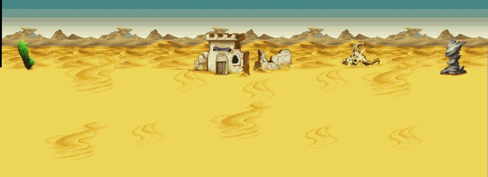
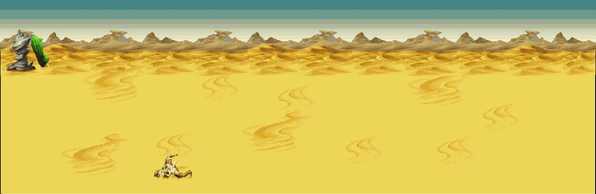
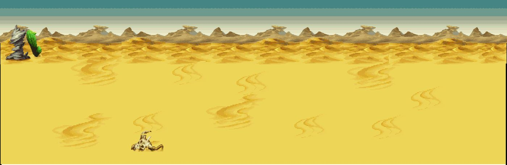
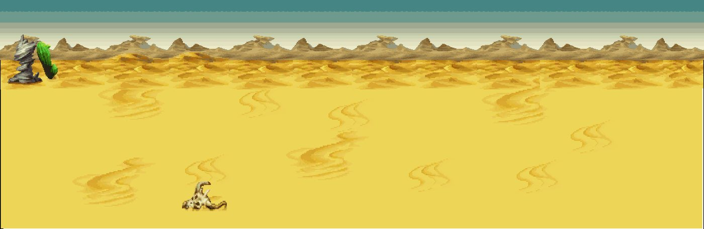
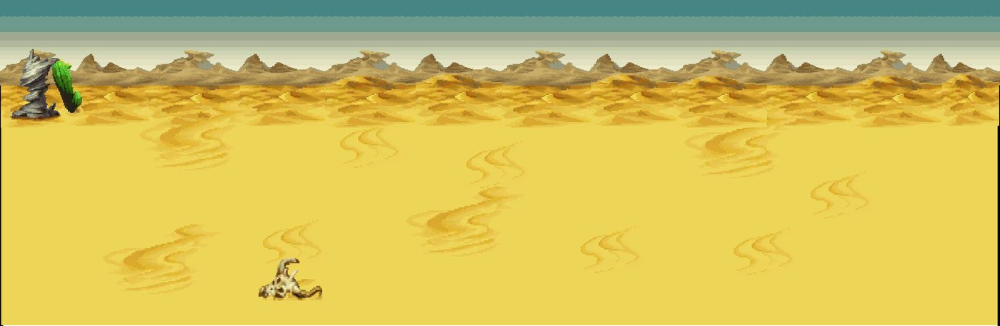
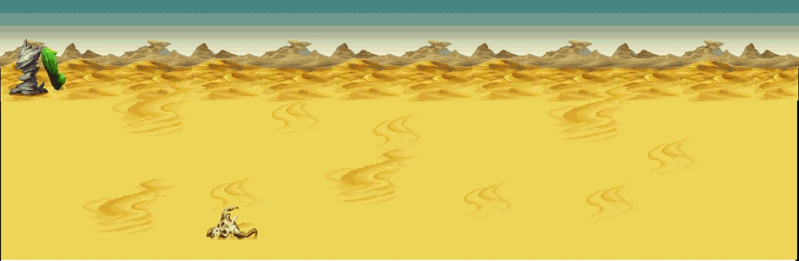

# Kit `desert` — Hoang mạc

> **Quy tắc bắt buộc cho Codex** (xem README.md): dùng https://github.com/0x0funky/agent-sprite-forge (generate2dmap / generate2dsprite) với route image_gen tích hợp; cấm codeart2d, API trả phí, vẽ bằng code, lật gương; không commit; không sửa tools/hd2d_audit/*, gate_waivers.json, check.sh; mỗi asset phải tự nhìn ảnh trước khi ghi "vẽ xong"; chỉ Claude/owner đánh dấu "duyệt".

- Style/palette: Cát vàng ấm, đá sa thạch đỏ cam, trời xanh gắt. Bảng màu: cát #D9B26B/#B88A44, đá #A5522B, bóng lạnh tím nhạt.
- Thư mục asset: `apps/game-web/art-src/hd2d/batch-11-desert/`
- Số map: 6

## 1. Trạng thái asset hiện có

Tổng 98 · duyệt 0 · nháp 98 · khác 0

| Loại | Có | Cần tối thiểu | Ghi chú |
|---|---|---|---|
| floor | 9 | 8 | ✅ · tile sàn 512×512 seamless, mỗi biến thể là texture khác |
| edge | 0 | 3 | ⬜ thiếu 3 · dải chuyển tiếp 512×128 liền hai đầu |
| prop | 49 | 36 | ✅ · prop đứng, ≥2–3 biến thể thật/chủng loại |
| decal | 22 | 12 | ✅ · decal tiếp đất bất quy tắc, mép mềm |
| shadow | 6 | 4 | ✅ · bóng procedural alpha mềm (ngoại lệ) |
| backdrop | 5 | 3 | ✅ · far/mid/near, lặp ngang liền |
| portal | 2 | 2 | ✅ · cặp dormant/active cùng mask |
| marker | 1 | 1 | ✅ · điểm xuất hiện 4 khung |
| fx | 4 | 3 | ✅ · hạt/tia sáng sprite sheet |

### Danh sách asset

| Vẽ | Duyệt | id | loại | kích thước (world) | prompt/nguồn |
|---|---|---|---|---|---|
| ✅ | ⏳ nháp, chờ duyệt | `desert-ruins-near` | backdrop | [10.0, 3.0] | [prompt.md](../../../apps/game-web/art-src/hd2d/batch-11-desert/desert-ruins-near/prompt.md) |
| ✅ | ⏳ nháp, chờ duyệt | `desert-dunes-wall-far` | backdrop_far | [20.0, 6.0] | [prompt.md](../../../apps/game-web/art-src/hd2d/batch-11-desert/desert-dunes-wall-far/prompt.md) |
| ✅ | ⏳ nháp, chờ duyệt | `desert-horizon-gradient-01` | backdrop_far | [8.0, 2.0] | [prompt.md](../../../apps/game-web/art-src/hd2d/batch-11-desert/desert-horizon-gradient-01/prompt.md) |
| ✅ | ⏳ nháp, chờ duyệt | `desert-horizon-gradient-02` | backdrop_far | [8.0, 2.0] | [prompt.md](../../../apps/game-web/art-src/hd2d/batch-11-desert/desert-horizon-gradient-02/prompt.md) |
| ✅ | ⏳ nháp, chờ duyệt | `desert-dunes-mid` | backdrop_mid | [10.0, 3.0] | [prompt.md](../../../apps/game-web/art-src/hd2d/batch-11-desert/desert-dunes-mid/prompt.md) |
| ✅ | ⏳ nháp, chờ duyệt | `desert-decal-ancient-rune-faded` | decal | [3.0, 2.5] | [prompt.md](../../../apps/game-web/art-src/hd2d/batch-11-desert/desert-decal-ancient-rune-faded/prompt.md) |
| ✅ | ⏳ nháp, chờ duyệt | `desert-decal-bones-scatter` | decal | [3.0, 2.0] | [prompt.md](../../../apps/game-web/art-src/hd2d/batch-11-desert/desert-decal-bones-scatter/prompt.md) |
| ✅ | ⏳ nháp, chờ duyệt | `desert-decal-cracked-earth-patch` | decal | [3.5, 2.5] | [prompt.md](../../../apps/game-web/art-src/hd2d/batch-11-desert/desert-decal-cracked-earth-patch/prompt.md) |
| ✅ | ⏳ nháp, chờ duyệt | `desert-decal-footprints` | decal | [3.5, 2.25] | [prompt.md](../../../apps/game-web/art-src/hd2d/batch-11-desert/desert-decal-footprints/prompt.md) |
| ✅ | ⏳ nháp, chờ duyệt | `desert-decal-pebbles-desert` | decal | [2.25, 1.75] | [prompt.md](../../../apps/game-web/art-src/hd2d/batch-11-desert/desert-decal-pebbles-desert/prompt.md) |
| ✅ | ⏳ nháp, chờ duyệt | `desert-decal-pottery-shards` | decal | [2.5, 2.0] | [prompt.md](../../../apps/game-web/art-src/hd2d/batch-11-desert/desert-decal-pottery-shards/prompt.md) |
| ✅ | ⏳ nháp, chờ duyệt | `desert-decal-sandstone-rubble` | decal | [3.0, 2.0] | [prompt.md](../../../apps/game-web/art-src/hd2d/batch-11-desert/desert-decal-sandstone-rubble/prompt.md) |
| ✅ | ⏳ nháp, chờ duyệt | `desert-decal-sunken-bricks` | decal | [3.5, 2.25] | [prompt.md](../../../apps/game-web/art-src/hd2d/batch-11-desert/desert-decal-sunken-bricks/prompt.md) |
| ✅ | ⏳ nháp, chờ duyệt | `desert-decal-wind-sand-01` | decal | [4.0, 2.5] | [prompt.md](../../../apps/game-web/art-src/hd2d/batch-11-desert/desert-decal-wind-sand-01/prompt.md) |
| ✅ | ⏳ nháp, chờ duyệt | `desert-decal-wind-sand-02` | decal | [3.5, 2.5] | [prompt.md](../../../apps/game-web/art-src/hd2d/batch-11-desert/desert-decal-wind-sand-02/prompt.md) |
| ✅ | ⏳ nháp, chờ duyệt | `desert-edge-sand-cracked-01` | decal | [4.0, 1.0] | [prompt.md](../../../apps/game-web/art-src/hd2d/batch-11-desert/desert-edge-sand-cracked-01/prompt.md) |
| ✅ | ⏳ nháp, chờ duyệt | `desert-edge-sand-cracked-patch-01` | decal | [3.0, 2.0] | [prompt.md](../../../apps/game-web/art-src/hd2d/batch-11-desert/desert-edge-sand-cracked-patch-01/prompt.md) |
| ✅ | ⏳ nháp, chờ duyệt | `desert-edge-sand-cracked-patch-02` | decal | [3.0, 2.0] | [prompt.md](../../../apps/game-web/art-src/hd2d/batch-11-desert/desert-edge-sand-cracked-patch-02/prompt.md) |
| ✅ | ⏳ nháp, chờ duyệt | `desert-edge-sand-gravel-01` | decal | [4.0, 1.0] | [prompt.md](../../../apps/game-web/art-src/hd2d/batch-11-desert/desert-edge-sand-gravel-01/prompt.md) |
| ✅ | ⏳ nháp, chờ duyệt | `desert-edge-sand-sandstone-01` | decal | [4.0, 1.0] | [prompt.md](../../../apps/game-web/art-src/hd2d/batch-11-desert/desert-edge-sand-sandstone-01/prompt.md) |
| ✅ | ⏳ nháp, chờ duyệt | `desert-edge-sand-sandstone-corner-01` | decal | [3.0, 2.75] | [prompt.md](../../../apps/game-web/art-src/hd2d/batch-11-desert/desert-edge-sand-sandstone-corner-01/prompt.md) |
| ✅ | ⏳ nháp, chờ duyệt | `desert-edge-sand-sandstone-corner-02` | decal | [3.0, 2.75] | [prompt.md](../../../apps/game-web/art-src/hd2d/batch-11-desert/desert-edge-sand-sandstone-corner-02/prompt.md) |
| ✅ | ⏳ nháp, chờ duyệt | `desert-edge-sand-sandstone-e` | decal | [4.0, 2.5] | [prompt.md](../../../apps/game-web/art-src/hd2d/batch-11-desert/desert-edge-sand-sandstone-e/prompt.md) |
| ✅ | ⏳ nháp, chờ duyệt | `desert-edge-sand-sandstone-n` | decal | [4.0, 2.5] | [prompt.md](../../../apps/game-web/art-src/hd2d/batch-11-desert/desert-edge-sand-sandstone-n/prompt.md) |
| ✅ | ⏳ nháp, chờ duyệt | `desert-edge-sand-sandstone-s` | decal | [4.0, 2.5] | [prompt.md](../../../apps/game-web/art-src/hd2d/batch-11-desert/desert-edge-sand-sandstone-s/prompt.md) |
| ✅ | ⏳ nháp, chờ duyệt | `desert-edge-sand-sandstone-w` | decal | [4.0, 2.5] | [prompt.md](../../../apps/game-web/art-src/hd2d/batch-11-desert/desert-edge-sand-sandstone-w/prompt.md) |
| ✅ | ⏳ nháp, chờ duyệt | `desert-tile-edge-decal` | decal | [4.0, 1.0] | [prompt.md](../../../apps/game-web/art-src/hd2d/batch-11-desert/desert-tile-edge-decal/prompt.md) |
| ✅ | ⏳ nháp, chờ duyệt | `desert-gravel-floor` | floor | [4.0, 4.0] | [prompt.md](../../../apps/game-web/art-src/hd2d/batch-11-desert/desert-gravel-floor/prompt.md) |
| ✅ | ⏳ nháp, chờ duyệt | `desert-limestone-grit-floor` | floor | [4.0, 4.0] | [prompt.md](../../../apps/game-web/art-src/hd2d/batch-11-desert/desert-limestone-grit-floor/prompt.md) |
| ✅ | ⏳ nháp, chờ duyệt | `desert-sand-cracked-01` | floor | [4.0, 4.0] | [prompt.md](../../../apps/game-web/art-src/hd2d/batch-11-desert/desert-sand-cracked-01/prompt.md) |
| ✅ | ⏳ nháp, chờ duyệt | `desert-sand-cracked-02` | floor | [4.0, 4.0] | [prompt.md](../../../apps/game-web/art-src/hd2d/batch-11-desert/desert-sand-cracked-02/prompt.md) |
| ✅ | ⏳ nháp, chờ duyệt | `desert-sand-floor-01` | floor | [4.0, 4.0] | [prompt.md](../../../apps/game-web/art-src/hd2d/batch-11-desert/desert-sand-floor-01/prompt.md) |
| ✅ | ⏳ nháp, chờ duyệt | `desert-sand-floor-02` | floor | [4.0, 4.0] | [prompt.md](../../../apps/game-web/art-src/hd2d/batch-11-desert/desert-sand-floor-02/prompt.md) |
| ✅ | ⏳ nháp, chờ duyệt | `desert-sand-floor-03` | floor | [4.0, 4.0] | [prompt.md](../../../apps/game-web/art-src/hd2d/batch-11-desert/desert-sand-floor-03/prompt.md) |
| ✅ | ⏳ nháp, chờ duyệt | `desert-sandstone-floor` | floor | [4.0, 4.0] | [prompt.md](../../../apps/game-web/art-src/hd2d/batch-11-desert/desert-sandstone-floor/prompt.md) |
| ✅ | ⏳ nháp, chờ duyệt | `desert-sunken-brick-floor` | floor | [4.0, 4.0] | [prompt.md](../../../apps/game-web/art-src/hd2d/batch-11-desert/desert-sunken-brick-floor/prompt.md) |
| ✅ | ⏳ nháp, chờ duyệt | `desert-dust-devil-anim` | fx | [1.5, 1.75] | [prompt.md](../../../apps/game-web/art-src/hd2d/batch-11-desert/desert-dust-devil-anim/prompt.md) |
| ✅ | ⏳ nháp, chờ duyệt | `desert-magic-rune-anim` | fx | [2, 1.25] | [prompt.md](../../../apps/game-web/art-src/hd2d/batch-11-desert/desert-magic-rune-anim/prompt.md) |
| ✅ | ⏳ nháp, chờ duyệt | `desert-oasis-sparkle-anim` | fx | [1, 0.75] | [prompt.md](../../../apps/game-web/art-src/hd2d/batch-11-desert/desert-oasis-sparkle-anim/prompt.md) |
| ✅ | ⏳ nháp, chờ duyệt | `desert-torch-lantern-anim` | fx | [0.75, 1] | [prompt.md](../../../apps/game-web/art-src/hd2d/batch-11-desert/desert-torch-lantern-anim/prompt.md) |
| ✅ | ⏳ nháp, chờ duyệt | `desert-spawn-marker` | marker | [1.5, 1] | [prompt.md](../../../apps/game-web/art-src/hd2d/batch-11-desert/desert-spawn-marker/prompt.md) |
| ✅ | ⏳ nháp, chờ duyệt | `desert-portal-active` | portal | [3.828125, 3.25] | [prompt.md](../../../apps/game-web/art-src/hd2d/batch-11-desert/desert-portal-active/prompt.md) |
| ✅ | ⏳ nháp, chờ duyệt | `desert-portal-dormant` | portal | [3.828125, 3.25] | [prompt.md](../../../apps/game-web/art-src/hd2d/batch-11-desert/desert-portal-dormant/prompt.md) |
| ✅ | ⏳ nháp, chờ duyệt | `desert-ancient-stele` | prop | [2.0, 3.5] | [prompt.md](../../../apps/game-web/art-src/hd2d/batch-11-desert/desert-ancient-stele/prompt.md) |
| ✅ | ⏳ nháp, chờ duyệt | `desert-arch-gate` | prop | [6.0, 5.0] | [prompt.md](../../../apps/game-web/art-src/hd2d/batch-11-desert/desert-arch-gate/prompt.md) |
| ✅ | ⏳ nháp, chờ duyệt | `desert-barren-compass-cairn` | prop | [4.5, 3.25] | [prompt.md](../../../apps/game-web/art-src/hd2d/batch-11-desert/desert-barren-compass-cairn/prompt.md) |
| ✅ | ⏳ nháp, chờ duyệt | `desert-boulder-01` | prop | [3.0, 2.25] | [prompt.md](../../../apps/game-web/art-src/hd2d/batch-11-desert/desert-boulder-01/prompt.md) |
| ✅ | ⏳ nháp, chờ duyệt | `desert-boulder-02` | prop | [4.5, 2.5] | [prompt.md](../../../apps/game-web/art-src/hd2d/batch-11-desert/desert-boulder-02/prompt.md) |
| ✅ | ⏳ nháp, chờ duyệt | `desert-boulder-03` | prop | [4.0, 3.5] | [prompt.md](../../../apps/game-web/art-src/hd2d/batch-11-desert/desert-boulder-03/prompt.md) |
| ✅ | ⏳ nháp, chờ duyệt | `desert-cactus-01` | prop | [2.25, 3.0] | [prompt.md](../../../apps/game-web/art-src/hd2d/batch-11-desert/desert-cactus-01/prompt.md) |
| ✅ | ⏳ nháp, chờ duyệt | `desert-cactus-02` | prop | [3.0, 2.25] | [prompt.md](../../../apps/game-web/art-src/hd2d/batch-11-desert/desert-cactus-02/prompt.md) |
| ✅ | ⏳ nháp, chờ duyệt | `desert-cactus-03` | prop | [2.5, 4.0] | [prompt.md](../../../apps/game-web/art-src/hd2d/batch-11-desert/desert-cactus-03/prompt.md) |
| ✅ | ⏳ nháp, chờ duyệt | `desert-cactus-dead` | prop | [3.0, 2.75] | [prompt.md](../../../apps/game-web/art-src/hd2d/batch-11-desert/desert-cactus-dead/prompt.md) |
| ✅ | ⏳ nháp, chờ duyệt | `desert-cactus-tall` | prop | [2.25, 4.5] | [prompt.md](../../../apps/game-web/art-src/hd2d/batch-11-desert/desert-cactus-tall/prompt.md) |
| ✅ | ⏳ nháp, chờ duyệt | `desert-camp-canvas-pack` | prop | [0.875, 1.0] | [prompt.md](../../../apps/game-web/art-src/hd2d/batch-11-desert/desert-camp-canvas-pack/prompt.md) |
| ✅ | ⏳ nháp, chờ duyệt | `desert-camp-canvas-sack` | prop | [0.78125, 0.5] | [prompt.md](../../../apps/game-web/art-src/hd2d/batch-11-desert/desert-camp-canvas-sack/prompt.md) |
| ✅ | ⏳ nháp, chờ duyệt | `desert-camp-charcoal-stove` | prop | [1.09375, 0.9375] | [prompt.md](../../../apps/game-web/art-src/hd2d/batch-11-desert/desert-camp-charcoal-stove/prompt.md) |
| ✅ | ⏳ nháp, chờ duyệt | `desert-camp-wood-crate` | prop | [1.25, 1.0] | [prompt.md](../../../apps/game-web/art-src/hd2d/batch-11-desert/desert-camp-wood-crate/prompt.md) |
| ✅ | ⏳ nháp, chờ duyệt | `desert-chasm-ravine-01` | prop | [6.0, 3.0] | [prompt.md](../../../apps/game-web/art-src/hd2d/batch-11-desert/desert-chasm-ravine-01/prompt.md) |
| ✅ | ⏳ nháp, chờ duyệt | `desert-chasm-ravine-02` | prop | [6.0, 3.0] | [prompt.md](../../../apps/game-web/art-src/hd2d/batch-11-desert/desert-chasm-ravine-02/prompt.md) |
| ✅ | ⏳ nháp, chờ duyệt | `desert-disaster-fossil-chasm` | prop | [5.75, 3.5] | [prompt.md](../../../apps/game-web/art-src/hd2d/batch-11-desert/desert-disaster-fossil-chasm/prompt.md) |
| ✅ | ⏳ nháp, chờ duyệt | `desert-dry-well` | prop | [2.25, 1.75] | [prompt.md](../../../apps/game-web/art-src/hd2d/batch-11-desert/desert-dry-well/prompt.md) |
| ✅ | ⏳ nháp, chờ duyệt | `desert-entrance-wind-gate` | prop | [5.25, 3.375] | [prompt.md](../../../apps/game-web/art-src/hd2d/batch-11-desert/desert-entrance-wind-gate/prompt.md) |
| ✅ | ⏳ nháp, chờ duyệt | `desert-hulu-gourd-pavilion` | prop | [5.25, 3.25] | [prompt.md](../../../apps/game-web/art-src/hd2d/batch-11-desert/desert-hulu-gourd-pavilion/prompt.md) |
| ✅ | ⏳ nháp, chờ duyệt | `desert-monster-bones` | prop | [3.5, 2.0] | [prompt.md](../../../apps/game-web/art-src/hd2d/batch-11-desert/desert-monster-bones/prompt.md) |
| ✅ | ⏳ nháp, chờ duyệt | `desert-nomad-stake-banner` | prop | [2.5, 2.75] | [prompt.md](../../../apps/game-web/art-src/hd2d/batch-11-desert/desert-nomad-stake-banner/prompt.md) |
| ✅ | ⏳ nháp, chờ duyệt | `desert-nomad-tent` | prop | [3.75, 3.0] | [prompt.md](../../../apps/game-web/art-src/hd2d/batch-11-desert/desert-nomad-tent/prompt.md) |
| ✅ | ⏳ nháp, chờ duyệt | `desert-nomad-tent-large` | prop | [5.0, 3.5] | [prompt.md](../../../apps/game-web/art-src/hd2d/batch-11-desert/desert-nomad-tent-large/prompt.md) |
| ✅ | ⏳ nháp, chờ duyệt | `desert-palm-canopy` | prop | [6.0, 3.5] | [prompt.md](../../../apps/game-web/art-src/hd2d/batch-11-desert/desert-palm-canopy/prompt.md) |
| ✅ | ⏳ nháp, chờ duyệt | `desert-palm-trunk` | prop | [2.0, 5.5] | [prompt.md](../../../apps/game-web/art-src/hd2d/batch-11-desert/desert-palm-trunk/prompt.md) |
| ✅ | ⏳ nháp, chờ duyệt | `desert-pottery-urn-broken` | prop | [1.0625, 1.0625] | [prompt.md](../../../apps/game-web/art-src/hd2d/batch-11-desert/desert-pottery-urn-broken/prompt.md) |
| ✅ | ⏳ nháp, chờ duyệt | `desert-ruins-pillar` | prop | [2.25, 3.5] | [prompt.md](../../../apps/game-web/art-src/hd2d/batch-11-desert/desert-ruins-pillar/prompt.md) |
| ✅ | ⏳ nháp, chờ duyệt | `desert-ruins-pillar-fallen` | prop | [2.0, 1.25] | [prompt.md](../../../apps/game-web/art-src/hd2d/batch-11-desert/desert-ruins-pillar-fallen/prompt.md) |
| ✅ | ⏳ nháp, chờ duyệt | `desert-ruins-wall` | prop | [5.0, 2.75] | [prompt.md](../../../apps/game-web/art-src/hd2d/batch-11-desert/desert-ruins-wall/prompt.md) |
| ✅ | ⏳ nháp, chờ duyệt | `desert-ruins-wall-arch` | prop | [3.5, 3.25] | [prompt.md](../../../apps/game-web/art-src/hd2d/batch-11-desert/desert-ruins-wall-arch/prompt.md) |
| ✅ | ⏳ nháp, chờ duyệt | `desert-sand-dune-medium` | prop | [5.0, 2.0] | [prompt.md](../../../apps/game-web/art-src/hd2d/batch-11-desert/desert-sand-dune-medium/prompt.md) |
| ✅ | ⏳ nháp, chờ duyệt | `desert-sand-mound` | prop | [4.5, 1.75] | [prompt.md](../../../apps/game-web/art-src/hd2d/batch-11-desert/desert-sand-mound/prompt.md) |
| ✅ | ⏳ nháp, chờ duyệt | `desert-sealed-land-disk` | prop | [4.5, 3.25] | [prompt.md](../../../apps/game-web/art-src/hd2d/batch-11-desert/desert-sealed-land-disk/prompt.md) |
| ✅ | ⏳ nháp, chờ duyệt | `desert-shicheng-dome-ruin` | prop | [5.25, 3.25] | [prompt.md](../../../apps/game-web/art-src/hd2d/batch-11-desert/desert-shicheng-dome-ruin/prompt.md) |
| ✅ | ⏳ nháp, chờ duyệt | `desert-small-cactus-01` | prop | [1.0, 0.875] | [prompt.md](../../../apps/game-web/art-src/hd2d/batch-11-desert/desert-small-cactus-01/prompt.md) |
| ✅ | ⏳ nháp, chờ duyệt | `desert-small-cactus-02` | prop | [1.0, 0.875] | [prompt.md](../../../apps/game-web/art-src/hd2d/batch-11-desert/desert-small-cactus-02/prompt.md) |
| ✅ | ⏳ nháp, chờ duyệt | `desert-small-cactus-03` | prop | [1.0, 0.875] | [prompt.md](../../../apps/game-web/art-src/hd2d/batch-11-desert/desert-small-cactus-03/prompt.md) |
| ✅ | ⏳ nháp, chờ duyệt | `desert-small-ribs` | prop | [1.125, 0.875] | [prompt.md](../../../apps/game-web/art-src/hd2d/batch-11-desert/desert-small-ribs/prompt.md) |
| ✅ | ⏳ nháp, chờ duyệt | `desert-small-rock-01` | prop | [1.0, 0.75] | [prompt.md](../../../apps/game-web/art-src/hd2d/batch-11-desert/desert-small-rock-01/prompt.md) |
| ✅ | ⏳ nháp, chờ duyệt | `desert-small-rock-02` | prop | [1.0, 0.75] | [prompt.md](../../../apps/game-web/art-src/hd2d/batch-11-desert/desert-small-rock-02/prompt.md) |
| ✅ | ⏳ nháp, chờ duyệt | `desert-small-rock-03` | prop | [1.0, 0.75] | [prompt.md](../../../apps/game-web/art-src/hd2d/batch-11-desert/desert-small-rock-03/prompt.md) |
| ✅ | ⏳ nháp, chờ duyệt | `desert-small-skull` | prop | [1.0, 0.875] | [prompt.md](../../../apps/game-web/art-src/hd2d/batch-11-desert/desert-small-skull/prompt.md) |
| ✅ | ⏳ nháp, chờ duyệt | `desert-sphinx-ruin` | prop | [5.25, 3.5] | [prompt.md](../../../apps/game-web/art-src/hd2d/batch-11-desert/desert-sphinx-ruin/prompt.md) |
| ✅ | ⏳ nháp, chờ duyệt | `desert-stone-stairs` | prop | [3.75, 2.0] | [prompt.md](../../../apps/game-web/art-src/hd2d/batch-11-desert/desert-stone-stairs/prompt.md) |
| ✅ | ⏳ nháp, chờ duyệt | `desert-tumbleweed-01` | prop | [1.0, 1.0] | [prompt.md](../../../apps/game-web/art-src/hd2d/batch-11-desert/desert-tumbleweed-01/prompt.md) |
| ✅ | ⏳ nháp, chờ duyệt | `desert-tumbleweed-02` | prop | [1.0, 1.0] | [prompt.md](../../../apps/game-web/art-src/hd2d/batch-11-desert/desert-tumbleweed-02/prompt.md) |
| ✅ | ⏳ nháp, chờ duyệt | `desert-wind-spire` | prop | [3.0, 3.75] | [prompt.md](../../../apps/game-web/art-src/hd2d/batch-11-desert/desert-wind-spire/prompt.md) |
| ✅ | ⏳ nháp, chờ duyệt | `desert-shadow-large-01` | shadow | [3.0, 1.0] | [prompt.md](../../../apps/game-web/art-src/hd2d/batch-11-desert/desert-shadow-large-01/prompt.md) |
| ✅ | ⏳ nháp, chờ duyệt | `desert-shadow-large-02` | shadow | [2.5, 1.5] | [prompt.md](../../../apps/game-web/art-src/hd2d/batch-11-desert/desert-shadow-large-02/prompt.md) |
| ✅ | ⏳ nháp, chờ duyệt | `desert-shadow-medium-01` | shadow | [2.0, 0.75] | [prompt.md](../../../apps/game-web/art-src/hd2d/batch-11-desert/desert-shadow-medium-01/prompt.md) |
| ✅ | ⏳ nháp, chờ duyệt | `desert-shadow-medium-02` | shadow | [2.0, 1.0] | [prompt.md](../../../apps/game-web/art-src/hd2d/batch-11-desert/desert-shadow-medium-02/prompt.md) |
| ✅ | ⏳ nháp, chờ duyệt | `desert-shadow-small-01` | shadow | [1.0, 0.5] | [prompt.md](../../../apps/game-web/art-src/hd2d/batch-11-desert/desert-shadow-small-01/prompt.md) |
| ✅ | ⏳ nháp, chờ duyệt | `desert-shadow-small-02` | shadow | [1.25, 0.5] | [prompt.md](../../../apps/game-web/art-src/hd2d/batch-11-desert/desert-shadow-small-02/prompt.md) |

## 2. Prompt sheet chung cho kit

```text
[Dán Master v2: .ai/design/gpt-redo/00-master-v2.md]
Dùng agent-sprite-forge ($generate2dmap cho tile/prop, $generate2dsprite cho prop/decal/FX/marker). Route ảnh: image_gen tích hợp của Codex (kiểm `route_media.py resolve --kind image`). KHÔNG codeart2d, KHÔNG API, KHÔNG vẽ bằng code.
Kit: Hoang mạc (desert). Style: Cát vàng ấm, đá sa thạch đỏ cam, trời xanh gắt. Bảng màu: cát #D9B26B/#B88A44, đá #A5522B, bóng lạnh tím nhạt.. Style anchor: batch-01-octopath/contact-sheet.png + 2 sprites.png linh thú.
Mỗi lần gọi: 1 sheet ~6 vật trên nền #FF00FF, bố trí 2×3/3×2, cách nhau ≥48 px, không chạm mép. Giữ raw-01.png byte-identical. Cắt/khử nền/pixel finish bằng script forge. 33–48 màu, alpha nhị phân, lề ≥8 px, 128 px = 1 đơn vị (far 64), người = 1.31 đơn vị (cỡ tối đa vật nhỏ: tools/hd2d_audit/size_check.py).
Mỗi asset: thư mục raw-01/final/prompt.md/review.md/qa.json trong apps/game-web/art-src/hd2d/batch-11-desert/<id>/. Tự nhìn 4× nền tối/caro. Xong: `python3 tools/hd2d_audit/art_gate.py batch-11-desert` = 0 lỗi, contact-sheet mới hơn manifest.
```

## 3. Từng map

### `desert_shicheng_ruins` — Sa Thạch Cổ Thành



- Ảnh gốc (đối chiếu): `.ai/design/map-checklists/refs/desert_shicheng_ruins.jpg` (bản đầy đủ: `~/Downloads/Phimond-P12-Review/map-images/desert_shicheng_ruins.png`, 2249×820 px, 100 px = 1 đơn vị APK)
- Nguồn APK: scene `Assets/Scenes/Map/15-20/SaMac.unity`, 33 sprite ghép; brief: [../map-briefs/kit_desert/desert_shicheng_ruins.md](../map-briefs/kit_desert/desert_shicheng_ruins.md)
- Cổng: 3 · vùng quái: không · spawn: 0 · NPC: desert_aven, desert_brisa, desert_calder, desert_dalia
- neo `P:desert_portal_002` (door) Cửa → Phong Ấn Cổ Địa: px [1090, 750]
- neo `P:desert_portal_006` (door) Cửa → Cửa Ngõ Hoàng Mạc: px [2134, 484]
- neo `P:desert_portal_008` (door) Cửa → Bộ Lạc Hồ Lô: px [102, 460]
- neo `desert_aven` (npc) : px CẦN ĐẶT
- neo `desert_brisa` (npc) : px CẦN ĐẶT
- neo `desert_calder` (npc) : px CẦN ĐẶT
- neo `desert_dalia` (npc) : px CẦN ĐẶT
- NPC cần sprite (batch-05; kiểm trùng): desert_aven, desert_brisa, desert_calder, desert_dalia

Asset chính: dùng bảng kit (mục 1). Landmark riêng của map (Codex xem ảnh gốc, ghi tên vật nhận diện vào bảng rồi vẽ):

| Vẽ | Duyệt | id | loại | mô tả | prompt |
|---|---|---|---|---|---|
| ⬜ | ⬜ | `desert_shicheng_ruins-landmark-01` | landmark | (vật nhận diện #1 trong ảnh gốc) | — |
| ⬜ | ⬜ | `desert_shicheng_ruins-landmark-02` | landmark | (vật nhận diện #2, nếu có) | — |

Prompt cho Codex:

```text
Dùng agent-sprite-forge (generate2dmap + generate2dsprite, route image_gen). Map desert_shicheng_ruins (Sa Thạch Cổ Thành), kit desert.
Mở và đính kèm thật ảnh gốc .ai/design/map-checklists/refs/desert_shicheng_ruins.jpg vào image_gen cùng 2–3 ảnh style batch 00–09 sát loại + 2 anchor linh thú; ghi sha256.
Rà các hàng chưa ✅ trong bảng; vẽ theo sheet 6 vật; landmark riêng: nhìn ảnh gốc, ghi tên vật vào bảng rồi vẽ (không giả là recovered APK nếu là diễn giải).
Xong: cập nhật cột "Vẽ" (✅ chỉ khi đã nhìn final 4×), chạy art_gate cho kit, KHÔNG tự đặt "Duyệt".
```

### `desert_entrance` — Cửa Ngõ Hoàng Mạc



- Ảnh gốc (đối chiếu): `.ai/design/map-checklists/refs/desert_entrance.jpg` (bản đầy đủ: `~/Downloads/Phimond-P12-Review/map-images/desert_entrance.png`, 2514×820 px, 100 px = 1 đơn vị APK)
- Nguồn APK: scene `Assets/Scenes/Map/15-20/SaMac.unity`, 33 sprite ghép; brief: [../map-briefs/kit_desert/desert_entrance.md](../map-briefs/kit_desert/desert_entrance.md)
- Cổng: 2 · vùng quái: có · spawn: 12 · NPC: desert_edda
- neo `P:desert_portal_005` (door) Cửa → Sa Thạch Cổ Thành: px [118, 490]
- neo `P:desert_portal_010` (door) Cửa → Quảng Trường Thạch Trụ: px [2406, 441]
- neo `AT:square:desert_entrance` (arrival) Đến từ trụ Quảng Trường: px [2306, 438]
- neo `desert_edda` (npc) : px CẦN ĐẶT
- NPC cần sprite (batch-05; kiểm trùng): desert_edda

Asset chính: dùng bảng kit (mục 1). Landmark riêng của map (Codex xem ảnh gốc, ghi tên vật nhận diện vào bảng rồi vẽ):

| Vẽ | Duyệt | id | loại | mô tả | prompt |
|---|---|---|---|---|---|
| ⬜ | ⬜ | `desert_entrance-landmark-01` | landmark | (vật nhận diện #1 trong ảnh gốc) | — |
| ⬜ | ⬜ | `desert_entrance-landmark-02` | landmark | (vật nhận diện #2, nếu có) | — |

Prompt cho Codex:

```text
Dùng agent-sprite-forge (generate2dmap + generate2dsprite, route image_gen). Map desert_entrance (Cửa Ngõ Hoàng Mạc), kit desert.
Mở và đính kèm thật ảnh gốc .ai/design/map-checklists/refs/desert_entrance.jpg vào image_gen cùng 2–3 ảnh style batch 00–09 sát loại + 2 anchor linh thú; ghi sha256.
Rà các hàng chưa ✅ trong bảng; vẽ theo sheet 6 vật; landmark riêng: nhìn ảnh gốc, ghi tên vật vào bảng rồi vẽ (không giả là recovered APK nếu là diễn giải).
Xong: cập nhật cột "Vẽ" (✅ chỉ khi đã nhìn final 4×), chạy art_gate cho kit, KHÔNG tự đặt "Duyệt".
```

### `desert_sealed_land` — Phong Ấn Cổ Địa



- Ảnh gốc (đối chiếu): `.ai/design/map-checklists/refs/desert_sealed_land.jpg` (bản đầy đủ: `~/Downloads/Phimond-P12-Review/map-images/desert_sealed_land.png`, 2514×823 px, 100 px = 1 đơn vị APK)
- Nguồn APK: scene `Assets/Scenes/Map/15-20/SaMac.unity`, 33 sprite ghép; brief: [../map-briefs/kit_desert/desert_sealed_land.md](../map-briefs/kit_desert/desert_sealed_land.md)
- Cổng: 1 · vùng quái: có · spawn: 12 · NPC: —
- neo `P:desert_portal_003` (door) Cửa → Sa Thạch Cổ Thành: px [128, 484]

Asset chính: dùng bảng kit (mục 1). Landmark riêng của map (Codex xem ảnh gốc, ghi tên vật nhận diện vào bảng rồi vẽ):

| Vẽ | Duyệt | id | loại | mô tả | prompt |
|---|---|---|---|---|---|
| ⬜ | ⬜ | `desert_sealed_land-landmark-01` | landmark | (vật nhận diện #1 trong ảnh gốc) | — |
| ⬜ | ⬜ | `desert_sealed_land-landmark-02` | landmark | (vật nhận diện #2, nếu có) | — |

Prompt cho Codex:

```text
Dùng agent-sprite-forge (generate2dmap + generate2dsprite, route image_gen). Map desert_sealed_land (Phong Ấn Cổ Địa), kit desert.
Mở và đính kèm thật ảnh gốc .ai/design/map-checklists/refs/desert_sealed_land.jpg vào image_gen cùng 2–3 ảnh style batch 00–09 sát loại + 2 anchor linh thú; ghi sha256.
Rà các hàng chưa ✅ trong bảng; vẽ theo sheet 6 vật; landmark riêng: nhìn ảnh gốc, ghi tên vật vào bảng rồi vẽ (không giả là recovered APK nếu là diễn giải).
Xong: cập nhật cột "Vẽ" (✅ chỉ khi đã nhìn final 4×), chạy art_gate cho kit, KHÔNG tự đặt "Duyệt".
```

### `desert_hulu_tribe` — Bộ Lạc Hồ Lô



- Ảnh gốc (đối chiếu): `.ai/design/map-checklists/refs/desert_hulu_tribe.jpg` (bản đầy đủ: `~/Downloads/Phimond-P12-Review/map-images/desert_hulu_tribe.png`, 2514×821 px, 100 px = 1 đơn vị APK)
- Nguồn APK: scene `Assets/Scenes/Map/15-20/SaMac.unity`, 33 sprite ghép; brief: [../map-briefs/kit_desert/desert_hulu_tribe.md](../map-briefs/kit_desert/desert_hulu_tribe.md)
- Cổng: 3 · vùng quái: có · spawn: 10 · NPC: desert_fenwick
- neo `P:desert_portal_007` (door) Cửa → Sa Thạch Cổ Thành: px [2398, 506]
- neo `P:desert_portal_009` (door) Cửa → Hoang Sa Vô Tận: px [156, 492]
- neo `P:desert_portal_011` (door) Cửa → Tai Ương Sa Mạc: px [2035, 340]
- neo `desert_fenwick` (npc) : px CẦN ĐẶT
- NPC cần sprite (batch-05; kiểm trùng): desert_fenwick

Asset chính: dùng bảng kit (mục 1). Landmark riêng của map (Codex xem ảnh gốc, ghi tên vật nhận diện vào bảng rồi vẽ):

| Vẽ | Duyệt | id | loại | mô tả | prompt |
|---|---|---|---|---|---|
| ⬜ | ⬜ | `desert_hulu_tribe-landmark-01` | landmark | (vật nhận diện #1 trong ảnh gốc) | — |
| ⬜ | ⬜ | `desert_hulu_tribe-landmark-02` | landmark | (vật nhận diện #2, nếu có) | — |

Prompt cho Codex:

```text
Dùng agent-sprite-forge (generate2dmap + generate2dsprite, route image_gen). Map desert_hulu_tribe (Bộ Lạc Hồ Lô), kit desert.
Mở và đính kèm thật ảnh gốc .ai/design/map-checklists/refs/desert_hulu_tribe.jpg vào image_gen cùng 2–3 ảnh style batch 00–09 sát loại + 2 anchor linh thú; ghi sha256.
Rà các hàng chưa ✅ trong bảng; vẽ theo sheet 6 vật; landmark riêng: nhìn ảnh gốc, ghi tên vật vào bảng rồi vẽ (không giả là recovered APK nếu là diễn giải).
Xong: cập nhật cột "Vẽ" (✅ chỉ khi đã nhìn final 4×), chạy art_gate cho kit, KHÔNG tự đặt "Duyệt".
```

### `desert_barren_sands` — Hoang Sa Vô Tận



- Ảnh gốc (đối chiếu): `.ai/design/map-checklists/refs/desert_barren_sands.jpg` (bản đầy đủ: `~/Downloads/Phimond-P12-Review/map-images/desert_barren_sands.png`, 2514×821 px, 100 px = 1 đơn vị APK)
- Nguồn APK: scene `Assets/Scenes/Map/15-20/SaMac.unity`, 33 sprite ghép; brief: [../map-briefs/kit_desert/desert_barren_sands.md](../map-briefs/kit_desert/desert_barren_sands.md)
- Cổng: 1 · vùng quái: có · spawn: 12 · NPC: desert_galen
- neo `P:desert_portal_001` (door) Cửa → Bộ Lạc Hồ Lô: px [2395, 492]
- neo `desert_galen` (npc) : px CẦN ĐẶT
- NPC cần sprite (batch-05; kiểm trùng): desert_galen

Asset chính: dùng bảng kit (mục 1). Landmark riêng của map (Codex xem ảnh gốc, ghi tên vật nhận diện vào bảng rồi vẽ):

| Vẽ | Duyệt | id | loại | mô tả | prompt |
|---|---|---|---|---|---|
| ⬜ | ⬜ | `desert_barren_sands-landmark-01` | landmark | (vật nhận diện #1 trong ảnh gốc) | — |
| ⬜ | ⬜ | `desert_barren_sands-landmark-02` | landmark | (vật nhận diện #2, nếu có) | — |

Prompt cho Codex:

```text
Dùng agent-sprite-forge (generate2dmap + generate2dsprite, route image_gen). Map desert_barren_sands (Hoang Sa Vô Tận), kit desert.
Mở và đính kèm thật ảnh gốc .ai/design/map-checklists/refs/desert_barren_sands.jpg vào image_gen cùng 2–3 ảnh style batch 00–09 sát loại + 2 anchor linh thú; ghi sha256.
Rà các hàng chưa ✅ trong bảng; vẽ theo sheet 6 vật; landmark riêng: nhìn ảnh gốc, ghi tên vật vào bảng rồi vẽ (không giả là recovered APK nếu là diễn giải).
Xong: cập nhật cột "Vẽ" (✅ chỉ khi đã nhìn final 4×), chạy art_gate cho kit, KHÔNG tự đặt "Duyệt".
```

### `desert_disaster_sands` — Tai Ương Sa Mạc



- Ảnh gốc (đối chiếu): `.ai/design/map-checklists/refs/desert_disaster_sands.jpg` (bản đầy đủ: `~/Downloads/Phimond-P12-Review/map-images/desert_disaster_sands.png`, 2514×823 px, 100 px = 1 đơn vị APK)
- Nguồn APK: scene `Assets/Scenes/Map/15-20/SaMac.unity`, 33 sprite ghép; brief: [../map-briefs/kit_desert/desert_disaster_sands.md](../map-briefs/kit_desert/desert_disaster_sands.md)
- Cổng: 1 · vùng quái: có · spawn: 10 · NPC: —
- neo `P:desert_portal_004` (door) Cửa → Bộ Lạc Hồ Lô: px [2400, 526]

Asset chính: dùng bảng kit (mục 1). Landmark riêng của map (Codex xem ảnh gốc, ghi tên vật nhận diện vào bảng rồi vẽ):

| Vẽ | Duyệt | id | loại | mô tả | prompt |
|---|---|---|---|---|---|
| ⬜ | ⬜ | `desert_disaster_sands-landmark-01` | landmark | (vật nhận diện #1 trong ảnh gốc) | — |
| ⬜ | ⬜ | `desert_disaster_sands-landmark-02` | landmark | (vật nhận diện #2, nếu có) | — |

Prompt cho Codex:

```text
Dùng agent-sprite-forge (generate2dmap + generate2dsprite, route image_gen). Map desert_disaster_sands (Tai Ương Sa Mạc), kit desert.
Mở và đính kèm thật ảnh gốc .ai/design/map-checklists/refs/desert_disaster_sands.jpg vào image_gen cùng 2–3 ảnh style batch 00–09 sát loại + 2 anchor linh thú; ghi sha256.
Rà các hàng chưa ✅ trong bảng; vẽ theo sheet 6 vật; landmark riêng: nhìn ảnh gốc, ghi tên vật vào bảng rồi vẽ (không giả là recovered APK nếu là diễn giải).
Xong: cập nhật cột "Vẽ" (✅ chỉ khi đã nhìn final 4×), chạy art_gate cho kit, KHÔNG tự đặt "Duyệt".
```
