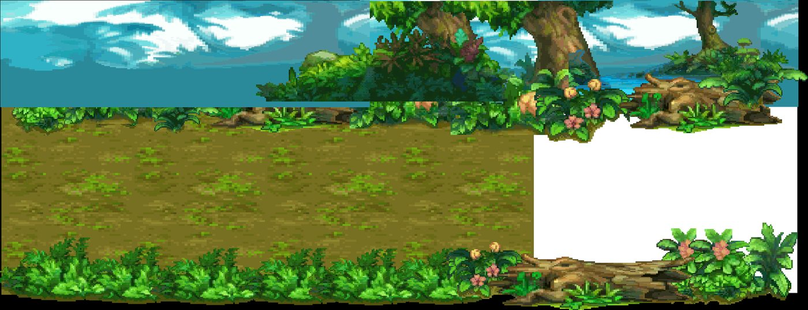
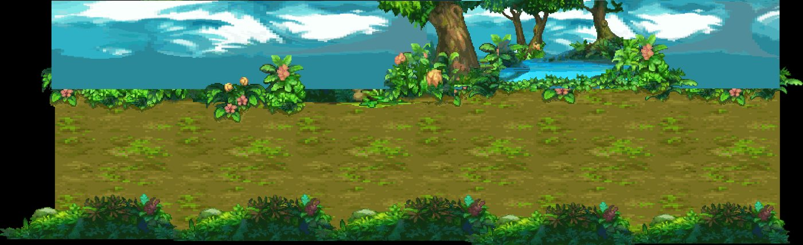

# Kit `forest` — Rừng Lục Bảo

> **Quy tắc bắt buộc cho Codex** (xem README.md): dùng https://github.com/0x0funky/agent-sprite-forge (generate2dmap / generate2dsprite) với route image_gen tích hợp; cấm codeart2d, API trả phí, vẽ bằng code, lật gương; không commit; không sửa tools/hd2d_audit/*, gate_waivers.json, check.sh; mỗi asset phải tự nhìn ảnh trước khi ghi "vẽ xong"; chỉ Claude/owner đánh dấu "duyệt".

- Style/palette: Rừng ôliu/lá ấm, bảng màu phimond-octopath-forest (48 màu)
- Thư mục asset: `apps/game-web/art-src/hd2d/batch-01-octopath/`
- Số map: 2

## 1. Trạng thái asset hiện có

Tổng 62 · duyệt 61 · nháp 1 · khác 0

| Loại | Có | Cần tối thiểu | Ghi chú |
|---|---|---|---|
| floor | 5 | 8 | ⬜ thiếu 3 · tile sàn 512×512 seamless, mỗi biến thể là texture khác |
| edge | 2 | 3 | ⬜ thiếu 1 · dải chuyển tiếp 512×128 liền hai đầu |
| prop | 35 | 36 | ⬜ thiếu 1 · prop đứng, ≥2–3 biến thể thật/chủng loại |
| decal | 11 | 12 | ⬜ thiếu 1 · decal tiếp đất bất quy tắc, mép mềm |
| shadow | 0 | 4 | ⬜ thiếu 4 · bóng procedural alpha mềm (ngoại lệ) |
| backdrop | 3 | 3 | ✅ · far/mid/near, lặp ngang liền |
| portal | 2 | 2 | ✅ · cặp dormant/active cùng mask |
| marker | 0 | 1 | ⬜ thiếu 1 · điểm xuất hiện 4 khung |
| fx | 3 | 3 | ✅ · hạt/tia sáng sprite sheet |

### Danh sách asset

| Vẽ | Duyệt | id | loại | kích thước (world) | prompt/nguồn |
|---|---|---|---|---|---|
| ✅ | ✅ duyệt | `forest-wall-far` | backdrop_far | [32.0, 7.5] | [prompt.md](../../../apps/game-web/art-src/hd2d/batch-01-octopath/forest-wall-far/prompt.md) |
| ✅ | ✅ duyệt | `forest-canopy-mid` | backdrop_mid | [16.0, 4.0] | [prompt.md](../../../apps/game-web/art-src/hd2d/batch-01-octopath/forest-canopy-mid/prompt.md) |
| ✅ | ✅ duyệt | `forest-hedge-front` | backdrop_mid | [16.0, 2.0] | [prompt.md](../../../apps/game-web/art-src/hd2d/batch-01-octopath/forest-hedge-front/prompt.md) |
| ✅ | ✅ duyệt | `fallen-leaves-01` | decal | [0.578125, 0.625] | [prompt.md](../../../apps/game-web/art-src/hd2d/batch-01-octopath/fallen-leaves-01/prompt.md) |
| ✅ | ✅ duyệt | `fallen-leaves-02` | decal | [0.578125, 0.625] | [prompt.md](../../../apps/game-web/art-src/hd2d/batch-01-octopath/fallen-leaves-02/prompt.md) |
| ✅ | ✅ duyệt | `fallen-leaves-03` | decal | [0.671875, 0.625] | [prompt.md](../../../apps/game-web/art-src/hd2d/batch-01-octopath/fallen-leaves-03/prompt.md) |
| ✅ | ✅ duyệt | `monster-patrol-nest` | decal | [1.28125, 0.875] | [prompt.md](../../../apps/game-web/art-src/hd2d/batch-01-octopath/monster-patrol-nest/prompt.md) |
| ✅ | ✅ duyệt | `moss-patch-01` | decal | [0.640625, 0.625] | [prompt.md](../../../apps/game-web/art-src/hd2d/batch-01-octopath/moss-patch-01/prompt.md) |
| ✅ | ✅ duyệt | `moss-patch-02` | decal | [0.640625, 0.625] | [prompt.md](../../../apps/game-web/art-src/hd2d/batch-01-octopath/moss-patch-02/prompt.md) |
| ✅ | ✅ duyệt | `mud-patch` | decal | [0.78125, 0.828125] | [prompt.md](../../../apps/game-web/art-src/hd2d/batch-01-octopath/mud-patch/prompt.md) |
| ✅ | ✅ duyệt | `mushroom-ring` | decal | [1.296875, 1.21875] | [prompt.md](../../../apps/game-web/art-src/hd2d/batch-01-octopath/mushroom-ring/prompt.md) |
| ✅ | ✅ duyệt | `pebbles-01` | decal | [0.609375, 0.625] | [prompt.md](../../../apps/game-web/art-src/hd2d/batch-01-octopath/pebbles-01/prompt.md) |
| ✅ | ✅ duyệt | `pebbles-02` | decal | [0.578125, 0.625] | [prompt.md](../../../apps/game-web/art-src/hd2d/batch-01-octopath/pebbles-02/prompt.md) |
| ✅ | ✅ duyệt | `pebbles-03` | decal | [0.5625, 0.625] | [prompt.md](../../../apps/game-web/art-src/hd2d/batch-01-octopath/pebbles-03/prompt.md) |
| ✅ | ✅ duyệt | `edge-grass-dirt` | edge | [4.0, 4.0] | [prompt.md](../../../apps/game-web/art-src/hd2d/batch-01-octopath/edge-grass-dirt/prompt.md) |
| ✅ | ✅ duyệt | `edge-grass-roots` | edge | [4.0, 4.0] | [prompt.md](../../../apps/game-web/art-src/hd2d/batch-01-octopath/edge-grass-roots/prompt.md) |
| ✅ | ✅ duyệt | `dirt-floor-01` | floor | [4.0, 4.0] | [prompt.md](../../../apps/game-web/art-src/hd2d/batch-01-octopath/dirt-floor-01/prompt.md) |
| ✅ | ✅ duyệt | `dirt-floor-02` | floor | [4.0, 4.0] | [prompt.md](../../../apps/game-web/art-src/hd2d/batch-01-octopath/dirt-floor-02/prompt.md) |
| ✅ | ✅ duyệt | `grass-floor-01` | floor | [4.0, 4.0] | [prompt.md](../../../apps/game-web/art-src/hd2d/batch-01-octopath/grass-floor-01/prompt.md) |
| ✅ | ✅ duyệt | `grass-floor-02` | floor | [4.0, 4.0] | [prompt.md](../../../apps/game-web/art-src/hd2d/batch-01-octopath/grass-floor-02/prompt.md) |
| ✅ | ✅ duyệt | `grass-floor-03` | floor | [4.0, 4.0] | [prompt.md](../../../apps/game-web/art-src/hd2d/batch-01-octopath/grass-floor-03/prompt.md) |
| ✅ | ✅ duyệt | `firefly` | fx | [0.375, 0.375] | [prompt.md](../../../apps/game-web/art-src/hd2d/batch-01-octopath/firefly/prompt.md) |
| ✅ | ✅ duyệt | `leaf-flutter` | fx | [0.5, 0.5] | [prompt.md](../../../apps/game-web/art-src/hd2d/batch-01-octopath/leaf-flutter/prompt.md) |
| ✅ | ✅ duyệt | `spores` | fx | [0.5, 0.5] | [prompt.md](../../../apps/game-web/art-src/hd2d/batch-01-octopath/spores/prompt.md) |
| ✅ | ✅ duyệt | `sunbeam-mask` | light | [2.0, 2.0] | [prompt.md](../../../apps/game-web/art-src/hd2d/batch-01-octopath/sunbeam-mask/prompt.md) |
| ✅ | ✅ duyệt | `forest-portal-active` | portal | [2.6875, 2.46875] | [prompt.md](../../../apps/game-web/art-src/hd2d/batch-01-octopath/forest-portal-active/prompt.md) |
| ✅ | ✅ duyệt | `forest-portal-dormant` | portal | [2.703125, 2.46875] | [prompt.md](../../../apps/game-web/art-src/hd2d/batch-01-octopath/forest-portal-dormant/prompt.md) |
| ✅ | ✅ duyệt | `bush-01` | prop | [1.609375, 1.0625] | [prompt.md](../../../apps/game-web/art-src/hd2d/batch-01-octopath/bush-01/prompt.md) |
| ✅ | ✅ duyệt | `bush-02` | prop | [1.984375, 1.2578125] | [prompt.md](../../../apps/game-web/art-src/hd2d/batch-01-octopath/bush-02/prompt.md) |
| ✅ | ✅ duyệt | `bush-03` | prop | [1.671875, 1.453125] | [prompt.md](../../../apps/game-web/art-src/hd2d/batch-01-octopath/bush-03/prompt.md) |
| ✅ | ⏳ nháp, chờ duyệt | `deep-woods-giant-tree` | prop | [2.625, 3.40625] | — |
| ✅ | ✅ duyệt | `exposed-roots` | prop | [2.140625, 0.828125] | [prompt.md](../../../apps/game-web/art-src/hd2d/batch-01-octopath/exposed-roots/prompt.md) |
| ✅ | ✅ duyệt | `fallen-log` | prop | [2.703125, 1.0625] | [prompt.md](../../../apps/game-web/art-src/hd2d/batch-01-octopath/fallen-log/prompt.md) |
| ✅ | ✅ duyệt | `fern-01` | prop | [1.171875, 0.75] | [prompt.md](../../../apps/game-web/art-src/hd2d/batch-01-octopath/fern-01/prompt.md) |
| ✅ | ✅ duyệt | `fern-02` | prop | [1.25, 0.90625] | [prompt.md](../../../apps/game-web/art-src/hd2d/batch-01-octopath/fern-02/prompt.md) |
| ✅ | ✅ duyệt | `flower-bush` | prop | [1.5625, 1.0625] | [prompt.md](../../../apps/game-web/art-src/hd2d/batch-01-octopath/flower-bush/prompt.md) |
| ✅ | ✅ duyệt | `flower-purple` | prop | [0.90625, 0.75] | [prompt.md](../../../apps/game-web/art-src/hd2d/batch-01-octopath/flower-purple/prompt.md) |
| ✅ | ✅ duyệt | `flower-red` | prop | [0.921875, 0.75] | [prompt.md](../../../apps/game-web/art-src/hd2d/batch-01-octopath/flower-red/prompt.md) |
| ✅ | ✅ duyệt | `flower-white` | prop | [0.953125, 0.75] | [prompt.md](../../../apps/game-web/art-src/hd2d/batch-01-octopath/flower-white/prompt.md) |
| ✅ | ✅ duyệt | `flower-yellow` | prop | [0.859375, 0.75] | [prompt.md](../../../apps/game-web/art-src/hd2d/batch-01-octopath/flower-yellow/prompt.md) |
| ✅ | ✅ duyệt | `grass-01` | prop | [1.078125, 0.6328125] | [prompt.md](../../../apps/game-web/art-src/hd2d/batch-01-octopath/grass-01/prompt.md) |
| ✅ | ✅ duyệt | `grass-02` | prop | [0.765625, 0.7109375] | [prompt.md](../../../apps/game-web/art-src/hd2d/batch-01-octopath/grass-02/prompt.md) |
| ✅ | ✅ duyệt | `grass-03` | prop | [0.890625, 0.59375] | [prompt.md](../../../apps/game-web/art-src/hd2d/batch-01-octopath/grass-03/prompt.md) |
| ✅ | ✅ duyệt | `grass-04` | prop | [1.328125, 0.828125] | [prompt.md](../../../apps/game-web/art-src/hd2d/batch-01-octopath/grass-04/prompt.md) |
| ✅ | ✅ duyệt | `moss-pillar` | prop | [1.59375, 1.84375] | [prompt.md](../../../apps/game-web/art-src/hd2d/batch-01-octopath/moss-pillar/prompt.md) |
| ✅ | ✅ duyệt | `mushroom-ochre` | prop | [0.96875, 0.75] | [prompt.md](../../../apps/game-web/art-src/hd2d/batch-01-octopath/mushroom-ochre/prompt.md) |
| ✅ | ✅ duyệt | `mushroom-violet` | prop | [1.171875, 0.875] | [prompt.md](../../../apps/game-web/art-src/hd2d/batch-01-octopath/mushroom-violet/prompt.md) |
| ✅ | ✅ duyệt | `reed-clump` | prop | [1.15625, 1.21875] | [prompt.md](../../../apps/game-web/art-src/hd2d/batch-01-octopath/reed-clump/prompt.md) |
| ✅ | ✅ duyệt | `rock-large` | prop | [2.15625, 1.375] | [prompt.md](../../../apps/game-web/art-src/hd2d/batch-01-octopath/rock-large/prompt.md) |
| ✅ | ✅ duyệt | `rock-medium` | prop | [1.34375, 0.90625] | [prompt.md](../../../apps/game-web/art-src/hd2d/batch-01-octopath/rock-medium/prompt.md) |
| ✅ | ✅ duyệt | `rock-small` | prop | [1.21875, 0.625] | [prompt.md](../../../apps/game-web/art-src/hd2d/batch-01-octopath/rock-small/prompt.md) |
| ✅ | ✅ duyệt | `signpost-blank` | prop | [1.109375, 1.375] | [prompt.md](../../../apps/game-web/art-src/hd2d/batch-01-octopath/signpost-blank/prompt.md) |
| ✅ | ✅ duyệt | `stump` | prop | [1.703125, 0.90625] | [prompt.md](../../../apps/game-web/art-src/hd2d/batch-01-octopath/stump/prompt.md) |
| ✅ | ✅ duyệt | `tree-large-01-canopy` | prop | [3.453125, 2.46875] | [prompt.md](../../../apps/game-web/art-src/hd2d/batch-01-octopath/tree-large-01-canopy/prompt.md) |
| ✅ | ✅ duyệt | `tree-large-01-trunk` | prop | [1.84375, 1.84375] | [prompt.md](../../../apps/game-web/art-src/hd2d/batch-01-octopath/tree-large-01-trunk/prompt.md) |
| ✅ | ✅ duyệt | `tree-large-02-canopy` | prop | [2.625, 2.46875] | [prompt.md](../../../apps/game-web/art-src/hd2d/batch-01-octopath/tree-large-02-canopy/prompt.md) |
| ✅ | ✅ duyệt | `tree-large-02-trunk` | prop | [1.703125, 1.84375] | [prompt.md](../../../apps/game-web/art-src/hd2d/batch-01-octopath/tree-large-02-trunk/prompt.md) |
| ✅ | ✅ duyệt | `tree-large-03-canopy` | prop | [4.03125, 2.46875] | [prompt.md](../../../apps/game-web/art-src/hd2d/batch-01-octopath/tree-large-03-canopy/prompt.md) |
| ✅ | ✅ duyệt | `tree-large-03-trunk` | prop | [2.421875, 1.84375] | [prompt.md](../../../apps/game-web/art-src/hd2d/batch-01-octopath/tree-large-03-trunk/prompt.md) |
| ✅ | ✅ duyệt | `tree-small-01` | prop | [1.765625, 2.0] | [prompt.md](../../../apps/game-web/art-src/hd2d/batch-01-octopath/tree-small-01/prompt.md) |
| ✅ | ✅ duyệt | `tree-small-02` | prop | [1.46875, 2.234375] | [prompt.md](../../../apps/game-web/art-src/hd2d/batch-01-octopath/tree-small-02/prompt.md) |
| ✅ | ✅ duyệt | `wooden-exit-gate` | prop | [2.828125, 2.46875] | [prompt.md](../../../apps/game-web/art-src/hd2d/batch-01-octopath/wooden-exit-gate/prompt.md) |

## 2. Prompt sheet chung cho kit

```text
[Dán Master v2: .ai/design/gpt-redo/00-master-v2.md]
Dùng agent-sprite-forge ($generate2dmap cho tile/prop, $generate2dsprite cho prop/decal/FX/marker). Route ảnh: image_gen tích hợp của Codex (kiểm `route_media.py resolve --kind image`). KHÔNG codeart2d, KHÔNG API, KHÔNG vẽ bằng code.
Kit: Rừng Lục Bảo (forest). Style: Rừng ôliu/lá ấm, bảng màu phimond-octopath-forest (48 màu). Style anchor: batch-01-octopath/contact-sheet.png + 2 sprites.png linh thú.
Mỗi lần gọi: 1 sheet ~6 vật trên nền #FF00FF, bố trí 2×3/3×2, cách nhau ≥48 px, không chạm mép. Giữ raw-01.png byte-identical. Cắt/khử nền/pixel finish bằng script forge. 33–48 màu, alpha nhị phân, lề ≥8 px, 128 px = 1 đơn vị (far 64), người = 1.31 đơn vị (cỡ tối đa vật nhỏ: tools/hd2d_audit/size_check.py).
Mỗi asset: thư mục raw-01/final/prompt.md/review.md/qa.json trong apps/game-web/art-src/hd2d/batch-11-forest/<id>/. Tự nhìn 4× nền tối/caro. Xong: `python3 tools/hd2d_audit/art_gate.py batch-11-forest` = 0 lỗi, contact-sheet mới hơn manifest.
```

## 3. Từng map

### `emerald_forest_main_woods` — Bìa Rừng Lục Bảo



- Ảnh gốc (đối chiếu): `.ai/design/map-checklists/refs/emerald_forest_main_woods.jpg` (bản đầy đủ: `~/Downloads/Phimond-P12-Review/map-images/emerald_forest_main_woods.png`, 2272×873 px, 100 px = 1 đơn vị APK)
- Nguồn APK: scene `Assets/Scenes/Map/1-10/RungBiBo.unity`, 29 sprite ghép; brief: chưa có
- Brief điểm neo: **chưa có** (thiếu bounds P12). Codex đối chiếu ảnh gốc bằng mắt; Claude bổ sung brief trước khi dựng layout.

Asset chính: dùng bảng kit (mục 1). Landmark riêng của map (Codex xem ảnh gốc, ghi tên vật nhận diện vào bảng rồi vẽ):

| Vẽ | Duyệt | id | loại | mô tả | prompt |
|---|---|---|---|---|---|
| ⬜ | ⬜ | `emerald_forest_main_woods-landmark-01` | landmark | (vật nhận diện #1 trong ảnh gốc) | — |
| ⬜ | ⬜ | `emerald_forest_main_woods-landmark-02` | landmark | (vật nhận diện #2, nếu có) | — |

Prompt cho Codex:

```text
Dùng agent-sprite-forge (generate2dmap + generate2dsprite, route image_gen). Map emerald_forest_main_woods (Bìa Rừng Lục Bảo), kit forest.
Mở và đính kèm thật ảnh gốc .ai/design/map-checklists/refs/emerald_forest_main_woods.jpg vào image_gen cùng 2–3 ảnh style batch 00–09 sát loại + 2 anchor linh thú; ghi sha256.
Rà các hàng chưa ✅ trong bảng; vẽ theo sheet 6 vật; landmark riêng: nhìn ảnh gốc, ghi tên vật vào bảng rồi vẽ (không giả là recovered APK nếu là diễn giải).
Xong: cập nhật cột "Vẽ" (✅ chỉ khi đã nhìn final 4×), chạy art_gate cho kit, KHÔNG tự đặt "Duyệt".
```

### `emerald_forest_deep_woods` — Rừng Sâu Lục Bảo



- Ảnh gốc (đối chiếu): `.ai/design/map-checklists/refs/emerald_forest_deep_woods.jpg` (bản đầy đủ: `~/Downloads/Phimond-P12-Review/map-images/emerald_forest_deep_woods.png`, 2777×847 px, 100 px = 1 đơn vị APK)
- Nguồn APK: scene `Assets/Scenes/Map/1-10/RungBiBo.unity`, 33 sprite ghép; brief: chưa có
- Brief điểm neo: **chưa có** (thiếu bounds P12). Codex đối chiếu ảnh gốc bằng mắt; Claude bổ sung brief trước khi dựng layout.

Asset chính: dùng bảng kit (mục 1). Landmark riêng của map (Codex xem ảnh gốc, ghi tên vật nhận diện vào bảng rồi vẽ):

| Vẽ | Duyệt | id | loại | mô tả | prompt |
|---|---|---|---|---|---|
| ⬜ | ⬜ | `emerald_forest_deep_woods-landmark-01` | landmark | (vật nhận diện #1 trong ảnh gốc) | — |
| ⬜ | ⬜ | `emerald_forest_deep_woods-landmark-02` | landmark | (vật nhận diện #2, nếu có) | — |

Prompt cho Codex:

```text
Dùng agent-sprite-forge (generate2dmap + generate2dsprite, route image_gen). Map emerald_forest_deep_woods (Rừng Sâu Lục Bảo), kit forest.
Mở và đính kèm thật ảnh gốc .ai/design/map-checklists/refs/emerald_forest_deep_woods.jpg vào image_gen cùng 2–3 ảnh style batch 00–09 sát loại + 2 anchor linh thú; ghi sha256.
Rà các hàng chưa ✅ trong bảng; vẽ theo sheet 6 vật; landmark riêng: nhìn ảnh gốc, ghi tên vật vào bảng rồi vẽ (không giả là recovered APK nếu là diễn giải).
Xong: cập nhật cột "Vẽ" (✅ chỉ khi đã nhìn final 4×), chạy art_gate cho kit, KHÔNG tự đặt "Duyệt".
```
