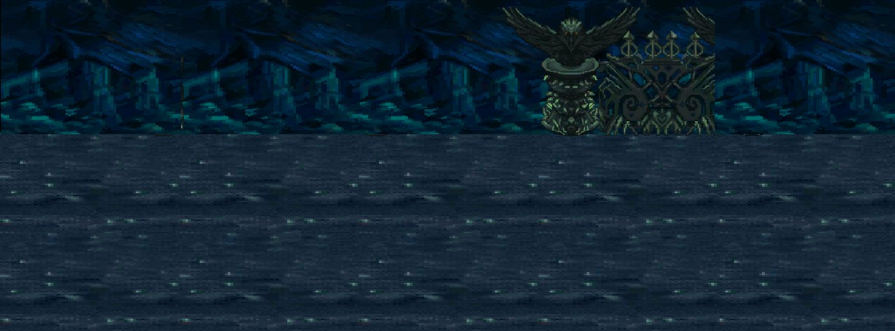
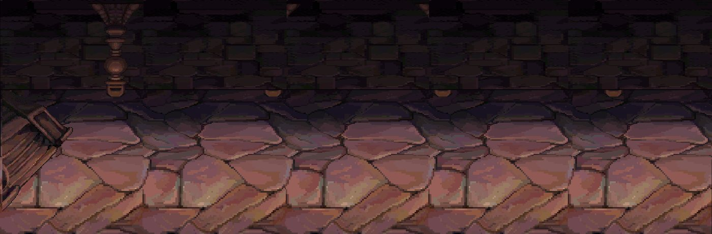
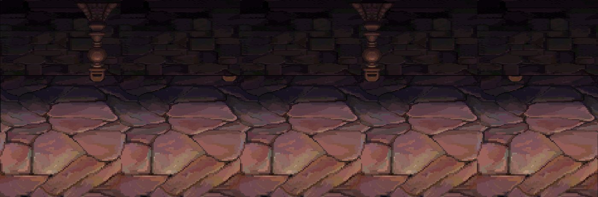

# Kit `ghost_castle` — Lâu Đài Ma

> **Nghiệm thu Claude 2026-11-09** (mức V1, chưa 4×): DUYỆT 44, VẼ_LẠI 6. Map: {'CHƯA ĐỦ': 3}. Trạng thái hiện hành ở [ASSET-VERDICTS-20261109.csv](ASSET-VERDICTS-20261109.csv) / [MAP-COVERAGE-20261109.csv](MAP-COVERAGE-20261109.csv); tick ✅/❌ bên dưới là LỊCH SỬ, không phải approval.
> VẼ_LẠI (6): `ghost_castle-floor-03`, `ghost_castle-floor-extra-01`, `ghost_castle-floor-extra-05`, `ghost_castle-edge-02`, `ghost_castle-edge-03`, `ghost_castle-backdrop-near-01`

> **Quy tắc bắt buộc cho Codex** (xem README.md): dùng https://github.com/0x0funky/agent-sprite-forge (generate2dmap / generate2dsprite) với route image_gen tích hợp; cấm codeart2d, API trả phí, vẽ bằng code, lật gương; không commit; không sửa tools/hd2d_audit/*, gate_waivers.json, check.sh; mỗi asset phải tự nhìn ảnh trước khi ghi "vẽ xong"; chỉ Claude/owner đánh dấu "duyệt".

- Style/palette: Đá cẩm thạch đen nứt, rèm nhung rách, nến bạc, rừng U Lâm xanh bích.
- Thư mục asset: `art/src/hd2d/batch-11-ghost_castle/`
- Số map: 3

## 1. Danh sách asset cần vẽ (kit chưa có asset)

Nguồn: Phần C `hd2d-maps-75-gemini-prompt.md`. Yêu cầu gốc: tile sàn cẩm thạch đen, thảm rách, cỏ khô nghĩa địa; prop: cổng lâu đài sắt, tường lâu đài, tháp canh nhỏ, rèm rách ×2, chân nến bạc (lửa 4 khung), tranh chân dung (không mặt nhận diện), tủ sách mục, cây khô ×3, đèn ma; backdrop xa: lâu đài trên đồi + trăng.

| Vẽ | Duyệt | id (số thứ tự; đặt tên tiếng Anh vào manifest `name`) | loại | mô tả + prompt đi kèm |
|---|---|---|---|---|
| ✅ | ⬜ | `ghost_castle-floor-01` | floor | sàn cẩm thạch đen nứt + gân xanh bích, 512×512, 40 màu; QC contrast 0.0414, wrap x 0.9097/y 0.7603; mosaic 3×3 đã xem, chưa owner duyệt. |
| ✅ | ⬜ | `ghost_castle-floor-02` | floor | thảm nhung đỏ rượu cũ, 512×512, 40 màu; QC terrain pass, mosaic 3×3 không lộ seam; họa tiết mòn có tính lặp, candidate chờ duyệt. |
| ✅ | ⬜ | `ghost_castle-floor-03` | floor | đất nghĩa địa nâu than, cỏ khô thưa; 512×512, 40 màu; terrain QC pass, mosaic 3×3 không lộ seam; candidate. |
| ✅ | ⬜ | `ghost_castle-prop-01` | prop | cổng lâu đài sắt — candidate đã xem 4×; prop đứng billboard, pivot giữa-đáy. |
| ✅ | ⬜ | `ghost_castle-prop-02` | prop | tường lâu đài — candidate đã xem 4×; prop đứng billboard, pivot giữa-đáy. |
| ✅ | ⬜ | `ghost_castle-prop-03` | prop | tháp canh nhỏ — candidate đã xem 4×; prop đứng billboard, pivot giữa-đáy. |
| ✅ | ⬜ | `ghost_castle-prop-04` | prop | rèm rách bản A — candidate đã xem 4×; prop đứng billboard, pivot giữa-đáy. |
| ✅ | ⬜ | `ghost_castle-prop-05` | prop | rèm rách bản B, silhouette khác — candidate đã xem 4×; prop đứng billboard, pivot giữa-đáy. |
| ✅ | ⬜ | `ghost_castle-prop-06` | prop | chân nến bạc tĩnh — candidate đã xem 4×; ngọn lửa 4 khung vẫn phải giao ở `ghost_castle-fx-01`. |
| ✅ | ⬜ | `ghost_castle-prop-07` | prop | tranh chân dung nứt, mặt trống không nhận diện — candidate đã xem 4×. |
| ✅ | ⬜ | `ghost_castle-prop-08` | prop | tủ sách mục — candidate đã xem 4×. |
| ✅ | ⬜ | `ghost_castle-prop-09` | prop | cây khô A, thân chẻ đứng — candidate đã xem 4×. |
| ✅ | ⬜ | `ghost_castle-prop-10` | prop | cây khô B, thân xoắn ngang — candidate đã xem 4×. |
| ✅ | ⬜ | `ghost_castle-prop-11` | prop | cây khô C, thân nghiêng gãy ngọn — candidate đã xem 4×. |
| ✅ | ⬜ | `ghost_castle-prop-12` | prop | đèn ma treo, lõi xanh lục lam dịu — candidate đã xem 4×. |
| ✅ | ⬜ | `ghost_castle-backdrop-far-01` | backdrop_far | lâu đài xa trên đồi + đĩa trăng; 1280×384/40 màu, 64 px/unit, tileable x; repeat 3× xem được, seam mean 2.03 < ngưỡng 14; candidate, cần composition review về chu kỳ castle/moon |
| ✅ | ⬜ | `ghost_castle-floor-extra-01` | floor | đá lát xanh than + mạch vữa xanh xám; 512×512, 40 màu; QC seamless pass; mosaic 3×3 đã xem, họa tiết lặp rõ. |
| ✅ | ⬜ | `ghost_castle-floor-extra-02` | floor | đá cuội ẩm xanh xám, rêu xanh bích thưa; 512×512, 40 màu, QC seamless pass; mosaic 3×3 đã xem. |
| ✅ | ⬜ | `ghost_castle-floor-extra-03` | floor | đất tro đen với mảnh đá slate thưa; 512×512, 40 màu; QC seamless pass, mosaic 3×3 đã xem; họa tiết cụm lặp rõ. |
| ✅ | ⬜ | `ghost_castle-floor-extra-04` | floor | phiến obsidian dài chéo, gân xanh bích mảnh; 512×512, 40 màu; QC seamless pass, mosaic đã xem; motif chéo lặp rõ. |
| ⬜ | ⬜ | `ghost_castle-floor-extra-05` | floor | khảm đá cẩm thạch bát giác, candidate 512×512/40 màu; 2 lần redraw mới vẫn không đạt viền ngoài 8 px phẳng (chi tiết/noise còn ở mép); chưa compliant, để mở. |
| ✅ | ⬜ | `ghost_castle-edge-01` | edge | đất nghĩa trang → đá cẩm thạch nứt, 512×128/40 màu; seam ngang 0.807923, repeat 3× và chi tiết 4× đã xem; cụm đá lặp rõ, candidate chờ duyệt. |
| ✅ | ⬜ | `ghost_castle-edge-02` | edge | thảm nhung rách → cẩm thạch nứt 512×128; seam ratio 0.710037 (giới hạn 1.25), lặp ngang 3× và xem 4×; candidate tileable x. Có junction dọc nhẹ, cần composition review |
| ✅ | ⬜ | `ghost_castle-edge-03` | edge | đất nghĩa địa/cobble → thảm nhung rách 512×128, seam ratio 1.000 (giới hạn 1.25), repeat 3× và chi tiết 4× đã xem; motif lặp rõ, candidate chờ composition review |
| ✅ | ⬜ | `ghost_castle-decal-01` | decal | vụn xương và mảnh sọ nhỏ; candidate đã xem 4× trên nền tối/caro. |
| ✅ | ⬜ | `ghost_castle-decal-02` | decal | mảnh cẩm thạch đen nứt, gân xanh bích; candidate đã xem 4× trên nền tối/caro. |
| ✅ | ⬜ | `ghost_castle-decal-03` | decal | lá khô và nhánh gai; candidate đã xem 4× trên nền tối/caro. |
| ✅ | ⬜ | `ghost_castle-decal-04` | decal | giọt sáp nến bạc và vụn bồ hóng; candidate đã xem 4× trên nền tối/caro. |
| ✅ | ⬜ | `ghost_castle-decal-05` | decal | mảnh kính khói; candidate đã xem 4× trên nền tối/caro. |
| ✅ | ⬜ | `ghost_castle-decal-06` | decal | rễ khô xoắn và đá vụn; candidate đã xem 4× trên nền tối/caro. |
| ✅ | ⬜ | `ghost_castle-decal-07` | decal | vệt bồ hóng và tro than xám, bất quy tắc; bản trung tính 939×639/40 màu, alpha nhị phân/lề 9 px, đã xem 4× tối/caro; candidate |
| ✅ | ⬜ | `ghost_castle-decal-08` | decal | mảnh sắt gỉ và đinh cũ; candidate 40 màu, alpha nhị phân, lề 8 px; đã xem 4× tối/caro. |
| ✅ | ⬜ | `ghost_castle-decal-09` | decal | cánh hoa khô ngà và cành gãy; candidate 40 màu, alpha nhị phân, lề 8 px; đã xem 4× tối/caro. |
| ✅ | ⬜ | `ghost_castle-decal-10` | decal | mảnh kính khói xám trung tính; candidate 40 màu, alpha nhị phân, lề 8 px; đã xem 4× tối/caro. |
| ✅ | ⬜ | `ghost_castle-decal-11` | decal | vệt đất nghĩa địa và sỏi nhỏ; candidate 40 màu, alpha nhị phân, lề 8 px; mảng khá rộng, cần kiểm tần suất ở composition. |
| ✅ | ⬜ | `ghost_castle-decal-12` | decal | đoạn xích sắt cũ và mảnh gỉ; candidate 40 màu, alpha nhị phân, lề 8 px; đã xem 4× tối/caro. |
| ✅ | ⬜ | `ghost_castle-shadow-01` | shadow | bóng gốc cây khô; alpha mềm là ngoại lệ đã ghi trong review; đã xem 4× nền tối/caro. |
| ✅ | ⬜ | `ghost_castle-shadow-02` | shadow | bóng tường lâu đài; alpha mềm là ngoại lệ đã ghi trong review; đã xem 4× nền tối/caro. |
| ✅ | ⬜ | `ghost_castle-shadow-03` | shadow | bóng bia mộ nhỏ; alpha mềm là ngoại lệ đã ghi trong review; đã xem 4× nền tối/caro. |
| ✅ | ⬜ | `ghost_castle-shadow-04` | shadow | bóng chân nến dài; alpha mềm là ngoại lệ đã ghi trong review; đã xem 4× nền tối/caro. |
| ✅ | ⬜ | `ghost_castle-backdrop-far` | backdrop | cùng asset `ghost_castle-backdrop-far-01` ở trên; không tạo file trùng |
| ✅ | ⬜ | `ghost_castle-backdrop-mid` | backdrop | cùng candidate `ghost_castle-backdrop-mid-01`; yews + tường đá, 1280×384/40 màu, alpha nhị phân, seam mean 6.61 < 14, repeat 3× xem; ghép thử che castle far, cần chỉnh placement/parallax |
| ✅ | ⬜ | `ghost_castle-backdrop-near` | backdrop | candidate `ghost_castle-backdrop-near-01`, cây yew + tường vỡ framing, 1280×384/40 màu, alpha nhị phân, seam mean 12.81 < 14; repeat 3× xem; cần map-scale kiểm chu kỳ/landmark |
| ✅ | ⬜ | `ghost_castle-portal-dormant` | portal | cổng sắt cẩm thạch đen, nhìn thẳng; candidate đã xem 4×. |
| ✅ | ⬜ | `ghost_castle-portal-active` | portal | cùng alpha mask với dormant (XOR = 0); candidate đã xem 4×. |
| ✅ | ⬜ | `ghost_castle-marker-arrival` | marker | vòng rune xanh ngọc 4 khung; đã xem 4× nền tối/caro; QC default cảnh báo safe_frame đã xử lý bằng ngưỡng strict 6% và frame cuối đủ lề. |
| ✅ | ⬜ | `ghost_castle-fx-01` | fx | lửa nến bạc 4 khung, dùng lặp trên ba nến của prop-06; candidate đã xem 4×. Sheet QA có WARN `torso_drift` 2.39 (ngưỡng 2.0), đã ghi trong review.md. |
| ✅ | ⬜ | `ghost_castle-fx-02` | fx | rune cẩm thạch vỡ với wisps xanh bích, 4 khung; candidate đã xem 4× tối/caro. QA frame detector: FAIL `identity_head_ratio` (max 1.058), WARN `torso_drift` 9.46; không áp dụng cho FX. |
| ✅ | ⬜ | `ghost_castle-fx-03` | fx | bụi rune và tia sáng vàng ngà, 4 khung; candidate đã xem 4× tối/caro. QA frame detector: FAIL `identity_head_ratio` (max 1.064), WARN `torso_drift` 50.56; không áp dụng cho FX. |

## 2. Prompt sheet chung cho kit

```text
[Dán Master v2: .ai/design/gpt-redo/00-master-v2.md]
Dùng agent-sprite-forge ($generate2dmap cho tile/prop, $generate2dsprite cho prop/decal/FX/marker). Route ảnh: image_gen tích hợp của Codex (kiểm `route_media.py resolve --kind image`). KHÔNG codeart2d, KHÔNG API, KHÔNG vẽ bằng code.
Kit: Lâu Đài Ma (ghost_castle). Style: Đá cẩm thạch đen nứt, rèm nhung rách, nến bạc, rừng U Lâm xanh bích.. Style anchor: batch-01-octopath/contact-sheet.png + 2 sprites.png linh thú.
Mỗi lần gọi: 1 sheet ~6 vật trên nền #FF00FF, bố trí 2×3/3×2, cách nhau ≥48 px, không chạm mép. Giữ raw-01.png byte-identical. Cắt/khử nền/pixel finish bằng script forge. 33–48 màu, alpha nhị phân, lề ≥8 px, 128 px = 1 đơn vị (far 64), người = 1.31 đơn vị (cỡ tối đa vật nhỏ: tools/hd2d_audit/size_check.py).
Mỗi asset: thư mục raw-01/final/prompt.md/review.md/qa.json trong art/src/hd2d/batch-11-ghost_castle/<id>/. Tự nhìn 4× nền tối/caro. Xong: `python3 tools/hd2d_audit/art_gate.py batch-11-ghost_castle` = 0 lỗi, contact-sheet mới hơn manifest.
```

## 3. Từng map

### `ghost_castle_gate` — Cổng U Lâu



- Ảnh gốc (đối chiếu): `.ai/design/map-checklists/refs/ghost_castle_gate.jpg` (bản đầy đủ: `~/Downloads/Phimond-P12-Review/map-images/ghost_castle_gate.png`, 2241×831 px, 100 px = 1 đơn vị APK)
- Nguồn APK: scene `Assets/Scenes/Map/LauDaiMa.unity`, 17 sprite ghép; brief: [../map-briefs/kit_ghost_castle/ghost_castle_gate.md](../map-briefs/kit_ghost_castle/ghost_castle_gate.md)
- Cổng: 2 · vùng quái: không · spawn: 0 · NPC: ghost_tove, ghost_una
- neo `P:ghost_castle_portal_004` (door) Cửa → U Linh Cổ Thành: px [1648, 411]
- neo `P:ghost_castle_portal_005` (door) Cửa → Hải Tặc Hào: px [113, 549]
- neo `AT:ship:ghost_castle_gate` (arrival) Đến từ trụ Hải Tặc Hào: px [212, 536]
- neo `ghost_tove` (npc) : px CẦN ĐẶT
- neo `ghost_una` (npc) : px CẦN ĐẶT
- NPC cần sprite (batch-05; kiểm trùng): ghost_tove, ghost_una

Asset chính: dùng bảng kit (mục 1). Landmark riêng của map (Codex xem ảnh gốc, ghi tên vật nhận diện vào bảng rồi vẽ):

| Vẽ | Duyệt | id | loại | mô tả | prompt |
|---|---|---|---|---|---|
| ✅ | ⬜ | `ghost_castle_gate-landmark-01` | landmark | Huy hiệu gargoyle có cánh trên cổng sắt; diễn giải lại từ ảnh map, không phải sprite trích xuất APK; candidate 447×219, đã xem 4× tối/caro | Prompt + provenance trong `batch-11-ghost_castle/ghost_castle_gate-landmark-01/`; Claude/owner review pending |
| ⬜ | ⬜ | `ghost_castle_gate-landmark-02` | landmark | (vật nhận diện #2, nếu có) | — |

Prompt cho Codex:

```text
Dùng agent-sprite-forge (generate2dmap + generate2dsprite, route image_gen). Map ghost_castle_gate (), kit ghost_castle.
Mở và đính kèm thật ảnh gốc .ai/design/map-checklists/refs/ghost_castle_gate.jpg vào image_gen cùng 2–3 ảnh style batch 00–09 sát loại + 2 anchor linh thú; ghi sha256.
Rà các hàng chưa ✅ trong bảng; vẽ theo sheet 6 vật; landmark riêng: nhìn ảnh gốc, ghi tên vật vào bảng rồi vẽ (không giả là recovered APK nếu là diễn giải).
Xong: cập nhật cột "Vẽ" (✅ chỉ khi đã nhìn final 4×), chạy art_gate cho kit, KHÔNG tự đặt "Duyệt".
```

### `ghost_castle_deep_woods` — U Linh Cổ Thành



- Ảnh gốc (đối chiếu): `.ai/design/map-checklists/refs/ghost_castle_deep_woods.jpg` (bản đầy đủ: `~/Downloads/Phimond-P12-Review/map-images/ghost_castle_deep_woods.png`, 2509×826 px, 100 px = 1 đơn vị APK)
- Nguồn APK: scene `Assets/Scenes/Map/LauDaiMa.unity`, 21 sprite ghép; brief: [../map-briefs/kit_ghost_castle/ghost_castle_deep_woods.md](../map-briefs/kit_ghost_castle/ghost_castle_deep_woods.md)
- Cổng: 2 · vùng quái: có · spawn: 25 · NPC: — · ghi chú: tên nguồn trùng với 2 map khác
- neo `P:ghost_castle_portal_001` (door) Cửa → Cổng U Lâu: px [103, 599]
- neo `P:ghost_castle_portal_002` (door) Cửa → Cổng U Lâu: px [2374, 563]

Asset chính: dùng bảng kit (mục 1). Landmark riêng của map (Codex xem ảnh gốc, ghi tên vật nhận diện vào bảng rồi vẽ):

| Vẽ | Duyệt | id | loại | mô tả | prompt |
|---|---|---|---|---|---|
| ✅ | ⬜ | `ghost_castle_deep_woods-landmark-01` | landmark | Bình/finial đồng treo tường lặp lại trong ảnh; asset diễn giải 112×272, dùng chung cho deep woods và secret chamber; không phải sprite trích xuất APK. | Prompt + provenance trong `batch-11-ghost_castle/ghost_castle_deep_woods-landmark-01/`; candidate chờ Claude/owner review. |
| ✅ | ⬜ | `ghost_castle_deep_woods-landmark-02` | landmark | Không thấy landmark riêng thứ hai trong screenshot ngoài đoạn vật gỗ vỡ bị cắt ở mép trái; đã đối chiếu, không tạo asset trùng/đoán. | — (đã rà ảnh nguồn; không có asset riêng) |

Prompt cho Codex:

```text
Dùng agent-sprite-forge (generate2dmap + generate2dsprite, route image_gen). Map ghost_castle_deep_woods (), kit ghost_castle.
Mở và đính kèm thật ảnh gốc .ai/design/map-checklists/refs/ghost_castle_deep_woods.jpg vào image_gen cùng 2–3 ảnh style batch 00–09 sát loại + 2 anchor linh thú; ghi sha256.
Rà các hàng chưa ✅ trong bảng; vẽ theo sheet 6 vật; landmark riêng: nhìn ảnh gốc, ghi tên vật vào bảng rồi vẽ (không giả là recovered APK nếu là diễn giải).
Xong: cập nhật cột "Vẽ" (✅ chỉ khi đã nhìn final 4×), chạy art_gate cho kit, KHÔNG tự đặt "Duyệt".
```

### `ghost_castle_ancient_city_secret_chamber` — Mật Thất Cổ Thành



- Ảnh gốc (đối chiếu): `.ai/design/map-checklists/refs/ghost_castle_ancient_city_secret_chamber.jpg` (bản đầy đủ: `~/Downloads/Phimond-P12-Review/map-images/ghost_castle_ancient_city_secret_chamber.png`, 2509×826 px, 100 px = 1 đơn vị APK)
- Nguồn APK: scene `Assets/Scenes/Map/LauDaiMa.unity`, 20 sprite ghép; brief: [../map-briefs/kit_ghost_castle/ghost_castle_ancient_city_secret_chamber.md](../map-briefs/kit_ghost_castle/ghost_castle_ancient_city_secret_chamber.md)
- Cổng: 1 · vùng quái: có · spawn: 20 · NPC: —
- neo `P:ghost_castle_portal_003` (door) Cửa → Cổng U Lâu: px [115, 519]

Asset chính: dùng bảng kit (mục 1). Landmark riêng của map (Codex xem ảnh gốc, ghi tên vật nhận diện vào bảng rồi vẽ):

| Vẽ | Duyệt | id | loại | mô tả | prompt |
|---|---|---|---|---|---|
| ✅ | ⬜ | `ghost_castle_ancient_city_secret_chamber-landmark-01` | landmark | Dùng chung `ghost_castle_deep_woods-landmark-01`: bình/finial đồng treo tường lặp trong ảnh tương ứng. | Prompt + provenance ở asset dùng chung; candidate chờ Claude/owner review. |
| ✅ | ⬜ | `ghost_castle_ancient_city_secret_chamber-landmark-02` | landmark | Không thấy landmark riêng thứ hai trong screenshot ngoài đoạn vật gỗ vỡ bị cắt ở mép trái; đã đối chiếu, không tạo asset trùng/đoán. | — (đã rà ảnh nguồn; không có asset riêng) |

Prompt cho Codex:

```text
Dùng agent-sprite-forge (generate2dmap + generate2dsprite, route image_gen). Map ghost_castle_ancient_city_secret_chamber (), kit ghost_castle.
Mở và đính kèm thật ảnh gốc .ai/design/map-checklists/refs/ghost_castle_ancient_city_secret_chamber.jpg vào image_gen cùng 2–3 ảnh style batch 00–09 sát loại + 2 anchor linh thú; ghi sha256.
Rà các hàng chưa ✅ trong bảng; vẽ theo sheet 6 vật; landmark riêng: nhìn ảnh gốc, ghi tên vật vào bảng rồi vẽ (không giả là recovered APK nếu là diễn giải).
Xong: cập nhật cột "Vẽ" (✅ chỉ khi đã nhìn final 4×), chạy art_gate cho kit, KHÔNG tự đặt "Duyệt".
```
