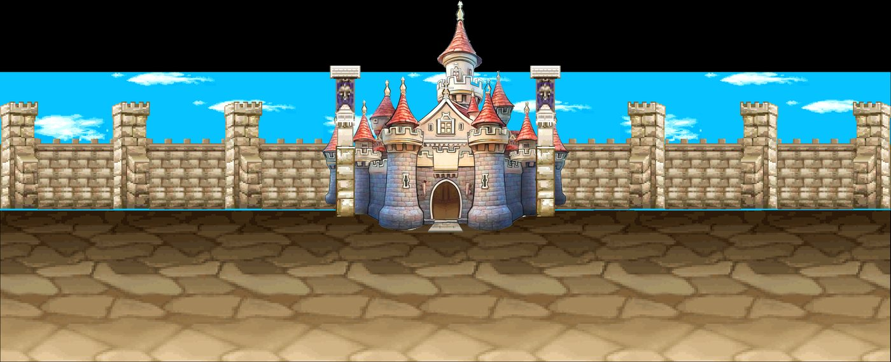
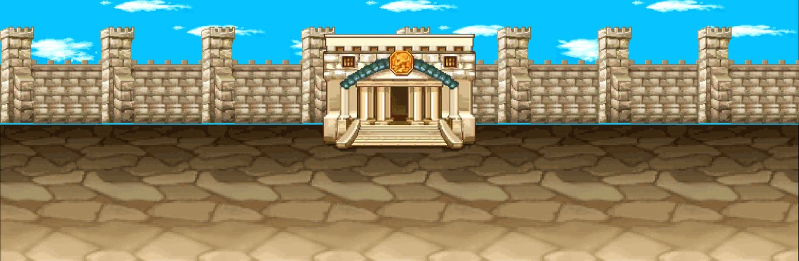
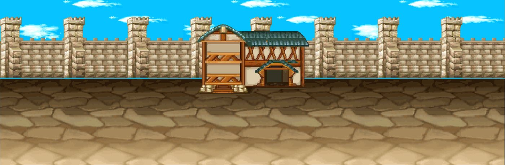
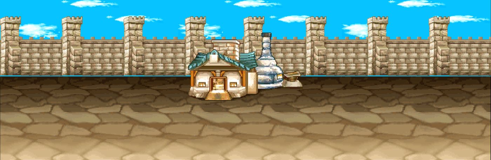
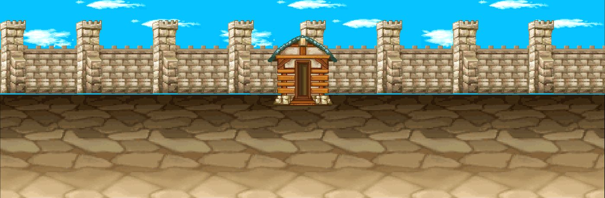
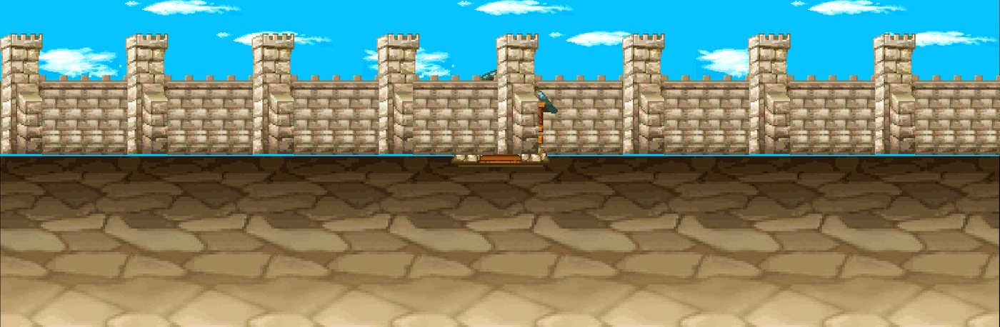

# Kit `guild` — Bang Hội

> **Quy tắc bắt buộc cho Codex** (xem README.md): dùng https://github.com/0x0funky/agent-sprite-forge (generate2dmap / generate2dsprite) với route image_gen tích hợp; cấm codeart2d, API trả phí, vẽ bằng code, lật gương; không commit; không sửa tools/hd2d_audit/*, gate_waivers.json, check.sh; mỗi asset phải tự nhìn ảnh trước khi ghi "vẽ xong"; chỉ Claude/owner đánh dấu "duyệt".

- Style/palette: Đá granit kiên cố, cờ quân kỳ bang hội xanh/vàng (cờ tự thiết kế, không dùng logo gốc); trong nhà gỗ + đá ấm.
- Thư mục asset: `apps/game-web/art-src/hd2d/batch-11-guild/`
- Số map: 6

## 1. Danh sách asset cần vẽ (kit chưa có asset)

Nguồn: Phần C `hd2d-maps-75-gemini-prompt.md`. Yêu cầu gốc: tile sàn đá granit, sàn gỗ, thảm bang, sân huấn luyện; prop: tường thành lũy (module), cổng thành, tháp canh, cờ ×2 màu, kho báu (rương đầy, vàng chất đống), kệ kho, thùng/bao tải ×4, giường doanh trại, giá vũ khí, quầy hàng, chuồng linh thú ×2 + rơm; backdrop xa: tường thành.

| Vẽ | Duyệt | id (số thứ tự; đặt tên tiếng Anh vào manifest `name`) | loại | mô tả + prompt đi kèm |
|---|---|---|---|---|
| ⬜ | ⬜ | `guild-floor-01` | floor | sàn đá granit — tile sàn nhìn từ trên xuống, seamless 512×512; HD-2D Octopath pixel art, palette Bang Hội, outline tối cùng sắc, 33–48 màu, không bóng đổ/sương/chữ. |
| ⬜ | ⬜ | `guild-floor-02` | floor | sàn gỗ — tile sàn nhìn từ trên xuống, seamless 512×512; HD-2D Octopath pixel art, palette Bang Hội, outline tối cùng sắc, 33–48 màu, không bóng đổ/sương/chữ. |
| ⬜ | ⬜ | `guild-floor-03` | floor | thảm bang — tile sàn nhìn từ trên xuống, seamless 512×512; HD-2D Octopath pixel art, palette Bang Hội, outline tối cùng sắc, 33–48 màu, không bóng đổ/sương/chữ. |
| ⬜ | ⬜ | `guild-floor-04` | floor | sân huấn luyện — tile sàn nhìn từ trên xuống, seamless 512×512; HD-2D Octopath pixel art, palette Bang Hội, outline tối cùng sắc, 33–48 màu, không bóng đổ/sương/chữ. |
| ⬜ | ⬜ | `guild-prop-01` | prop | tường thành lũy (module) — prop đứng billboard, pivot giữa-đáy; HD-2D Octopath pixel art, palette Bang Hội, outline tối cùng sắc, 33–48 màu, không bóng đổ/sương/chữ. |
| ⬜ | ⬜ | `guild-prop-02` | prop | cổng thành — prop đứng billboard, pivot giữa-đáy; HD-2D Octopath pixel art, palette Bang Hội, outline tối cùng sắc, 33–48 màu, không bóng đổ/sương/chữ. |
| ⬜ | ⬜ | `guild-prop-03` | prop | tháp canh — prop đứng billboard, pivot giữa-đáy; HD-2D Octopath pixel art, palette Bang Hội, outline tối cùng sắc, 33–48 màu, không bóng đổ/sương/chữ. |
| ⬜ | ⬜ | `guild-prop-04` | prop | cờ màu — prop đứng billboard, pivot giữa-đáy; HD-2D Octopath pixel art, palette Bang Hội, outline tối cùng sắc, 33–48 màu, không bóng đổ/sương/chữ. |
| ⬜ | ⬜ | `guild-prop-05` | prop | cờ màu — prop đứng billboard, pivot giữa-đáy; HD-2D Octopath pixel art, palette Bang Hội, outline tối cùng sắc, 33–48 màu, không bóng đổ/sương/chữ. |
| ⬜ | ⬜ | `guild-prop-06` | prop | kho báu (rương đầy, vàng chất đống) — prop đứng billboard, pivot giữa-đáy; HD-2D Octopath pixel art, palette Bang Hội, outline tối cùng sắc, 33–48 màu, không bóng đổ/sương/chữ. |
| ⬜ | ⬜ | `guild-prop-07` | prop | kệ kho — prop đứng billboard, pivot giữa-đáy; HD-2D Octopath pixel art, palette Bang Hội, outline tối cùng sắc, 33–48 màu, không bóng đổ/sương/chữ. |
| ⬜ | ⬜ | `guild-prop-08` | prop | thùng/bao tải — prop đứng billboard, pivot giữa-đáy; HD-2D Octopath pixel art, palette Bang Hội, outline tối cùng sắc, 33–48 màu, không bóng đổ/sương/chữ. |
| ⬜ | ⬜ | `guild-prop-09` | prop | thùng/bao tải — prop đứng billboard, pivot giữa-đáy; HD-2D Octopath pixel art, palette Bang Hội, outline tối cùng sắc, 33–48 màu, không bóng đổ/sương/chữ. |
| ⬜ | ⬜ | `guild-prop-10` | prop | thùng/bao tải — prop đứng billboard, pivot giữa-đáy; HD-2D Octopath pixel art, palette Bang Hội, outline tối cùng sắc, 33–48 màu, không bóng đổ/sương/chữ. |
| ⬜ | ⬜ | `guild-prop-11` | prop | thùng/bao tải — prop đứng billboard, pivot giữa-đáy; HD-2D Octopath pixel art, palette Bang Hội, outline tối cùng sắc, 33–48 màu, không bóng đổ/sương/chữ. |
| ⬜ | ⬜ | `guild-prop-12` | prop | giường doanh trại — prop đứng billboard, pivot giữa-đáy; HD-2D Octopath pixel art, palette Bang Hội, outline tối cùng sắc, 33–48 màu, không bóng đổ/sương/chữ. |
| ⬜ | ⬜ | `guild-prop-13` | prop | giá vũ khí — prop đứng billboard, pivot giữa-đáy; HD-2D Octopath pixel art, palette Bang Hội, outline tối cùng sắc, 33–48 màu, không bóng đổ/sương/chữ. |
| ⬜ | ⬜ | `guild-prop-14` | prop | quầy hàng — prop đứng billboard, pivot giữa-đáy; HD-2D Octopath pixel art, palette Bang Hội, outline tối cùng sắc, 33–48 màu, không bóng đổ/sương/chữ. |
| ⬜ | ⬜ | `guild-prop-15` | prop | chuồng linh thú + rơm — prop đứng billboard, pivot giữa-đáy; HD-2D Octopath pixel art, palette Bang Hội, outline tối cùng sắc, 33–48 màu, không bóng đổ/sương/chữ. |
| ⬜ | ⬜ | `guild-prop-16` | prop | chuồng linh thú + rơm — prop đứng billboard, pivot giữa-đáy; HD-2D Octopath pixel art, palette Bang Hội, outline tối cùng sắc, 33–48 màu, không bóng đổ/sương/chữ. |
| ⬜ | ⬜ | `guild-backdrop-far-01` | backdrop_far | tường thành — backdrop xa 1280×384 lặp ngang liền (64 px/đơn vị); HD-2D Octopath pixel art, palette Bang Hội, outline tối cùng sắc, 33–48 màu, không bóng đổ/sương/chữ. |
| ⬜ | ⬜ | `guild-floor-extra-01` | floor | tile sàn bổ sung (đủ ≥8 biến thể khác texture), seamless 512×512 |
| ⬜ | ⬜ | `guild-floor-extra-02` | floor | tile sàn bổ sung (đủ ≥8 biến thể khác texture), seamless 512×512 |
| ⬜ | ⬜ | `guild-floor-extra-03` | floor | tile sàn bổ sung (đủ ≥8 biến thể khác texture), seamless 512×512 |
| ⬜ | ⬜ | `guild-floor-extra-04` | floor | tile sàn bổ sung (đủ ≥8 biến thể khác texture), seamless 512×512 |
| ⬜ | ⬜ | `guild-edge-01` | edge | dải chuyển tiếp giữa 2 tile chính, 512×128 liền hai đầu, mép bất quy tắc |
| ⬜ | ⬜ | `guild-edge-02` | edge | dải chuyển tiếp giữa 2 tile chính, 512×128 liền hai đầu, mép bất quy tắc |
| ⬜ | ⬜ | `guild-edge-03` | edge | dải chuyển tiếp giữa 2 tile chính, 512×128 liền hai đầu, mép bất quy tắc |
| ⬜ | ⬜ | `guild-decal-01` | decal | decal tiếp đất theo chủ đề kit (vụn, vết, xương/đá), bất quy tắc, mép mềm |
| ⬜ | ⬜ | `guild-decal-02` | decal | decal tiếp đất theo chủ đề kit (vụn, vết, xương/đá), bất quy tắc, mép mềm |
| ⬜ | ⬜ | `guild-decal-03` | decal | decal tiếp đất theo chủ đề kit (vụn, vết, xương/đá), bất quy tắc, mép mềm |
| ⬜ | ⬜ | `guild-decal-04` | decal | decal tiếp đất theo chủ đề kit (vụn, vết, xương/đá), bất quy tắc, mép mềm |
| ⬜ | ⬜ | `guild-decal-05` | decal | decal tiếp đất theo chủ đề kit (vụn, vết, xương/đá), bất quy tắc, mép mềm |
| ⬜ | ⬜ | `guild-decal-06` | decal | decal tiếp đất theo chủ đề kit (vụn, vết, xương/đá), bất quy tắc, mép mềm |
| ⬜ | ⬜ | `guild-decal-07` | decal | decal tiếp đất theo chủ đề kit (vụn, vết, xương/đá), bất quy tắc, mép mềm |
| ⬜ | ⬜ | `guild-decal-08` | decal | decal tiếp đất theo chủ đề kit (vụn, vết, xương/đá), bất quy tắc, mép mềm |
| ⬜ | ⬜ | `guild-decal-09` | decal | decal tiếp đất theo chủ đề kit (vụn, vết, xương/đá), bất quy tắc, mép mềm |
| ⬜ | ⬜ | `guild-decal-10` | decal | decal tiếp đất theo chủ đề kit (vụn, vết, xương/đá), bất quy tắc, mép mềm |
| ⬜ | ⬜ | `guild-decal-11` | decal | decal tiếp đất theo chủ đề kit (vụn, vết, xương/đá), bất quy tắc, mép mềm |
| ⬜ | ⬜ | `guild-decal-12` | decal | decal tiếp đất theo chủ đề kit (vụn, vết, xương/đá), bất quy tắc, mép mềm |
| ⬜ | ⬜ | `guild-shadow-01` | shadow | bóng procedural alpha mềm, màu kit |
| ⬜ | ⬜ | `guild-shadow-02` | shadow | bóng procedural alpha mềm, màu kit |
| ⬜ | ⬜ | `guild-shadow-03` | shadow | bóng procedural alpha mềm, màu kit |
| ⬜ | ⬜ | `guild-shadow-04` | shadow | bóng procedural alpha mềm, màu kit |
| ⬜ | ⬜ | `guild-backdrop-far` | backdrop | 1280×384, lặp ngang liền, mỗi tầng một khung cảnh khác |
| ⬜ | ⬜ | `guild-backdrop-mid` | backdrop | 1280×384, lặp ngang liền, mỗi tầng một khung cảnh khác |
| ⬜ | ⬜ | `guild-backdrop-near` | backdrop | 1280×384, lặp ngang liền, mỗi tầng một khung cảnh khác |
| ⬜ | ⬜ | `guild-portal-dormant` | portal | cổng nhìn thẳng mặt trước, đúng tông kit |
| ⬜ | ⬜ | `guild-portal-active` | portal | cùng mask với dormant |
| ⬜ | ⬜ | `guild-marker-arrival` | marker | vòng sáng 4 khung |
| ⬜ | ⬜ | `guild-fx-01` | fx | hạt/tia sáng sprite sheet theo chủ đề |
| ⬜ | ⬜ | `guild-fx-02` | fx | hạt/tia sáng sprite sheet theo chủ đề |
| ⬜ | ⬜ | `guild-fx-03` | fx | hạt/tia sáng sprite sheet theo chủ đề |

## 2. Prompt sheet chung cho kit

```text
[Dán Master v2: .ai/design/gpt-redo/00-master-v2.md]
Dùng agent-sprite-forge ($generate2dmap cho tile/prop, $generate2dsprite cho prop/decal/FX/marker). Route ảnh: image_gen tích hợp của Codex (kiểm `route_media.py resolve --kind image`). KHÔNG codeart2d, KHÔNG API, KHÔNG vẽ bằng code.
Kit: Bang Hội (guild). Style: Đá granit kiên cố, cờ quân kỳ bang hội xanh/vàng (cờ tự thiết kế, không dùng logo gốc); trong nhà gỗ + đá ấm.. Style anchor: batch-01-octopath/contact-sheet.png + 2 sprites.png linh thú.
Mỗi lần gọi: 1 sheet ~6 vật trên nền #FF00FF, bố trí 2×3/3×2, cách nhau ≥48 px, không chạm mép. Giữ raw-01.png byte-identical. Cắt/khử nền/pixel finish bằng script forge. 33–48 màu, alpha nhị phân, lề ≥8 px, 128 px = 1 đơn vị (far 64), người = 1.31 đơn vị (cỡ tối đa vật nhỏ: tools/hd2d_audit/size_check.py).
Mỗi asset: thư mục raw-01/final/prompt.md/review.md/qa.json trong apps/game-web/art-src/hd2d/batch-11-guild/<id>/. Tự nhìn 4× nền tối/caro. Xong: `python3 tools/hd2d_audit/art_gate.py batch-11-guild` = 0 lỗi, contact-sheet mới hơn manifest.
```

## 3. Từng map

### `guild_fortress` — Thành Lũy Bang Hội



- Ảnh gốc (đối chiếu): `.ai/design/map-checklists/refs/guild_fortress.jpg` (bản đầy đủ: `~/Downloads/Phimond-P12-Review/map-images/guild_fortress.png`, 2511×1025 px, 100 px = 1 đơn vị APK)
- Nguồn APK: scene `Assets/Scenes/Map/Guild/Guild.unity`, 32 sprite ghép; brief: chưa có
- Cổng: 6 · vùng quái: không · spawn: 0 · NPC: — · ghi chú: hub dịch vụ bang
- Brief điểm neo: **chưa có** (thiếu bounds P12). Codex đối chiếu ảnh gốc bằng mắt; Claude bổ sung brief trước khi dựng layout.

Asset chính: dùng bảng kit (mục 1). Landmark riêng của map (Codex xem ảnh gốc, ghi tên vật nhận diện vào bảng rồi vẽ):

| Vẽ | Duyệt | id | loại | mô tả | prompt |
|---|---|---|---|---|---|
| ⬜ | ⬜ | `guild_fortress-landmark-01` | landmark | (vật nhận diện #1 trong ảnh gốc) | — |
| ⬜ | ⬜ | `guild_fortress-landmark-02` | landmark | (vật nhận diện #2, nếu có) | — |

Prompt cho Codex:

```text
Dùng agent-sprite-forge (generate2dmap + generate2dsprite, route image_gen). Map guild_fortress (), kit guild.
Mở và đính kèm thật ảnh gốc .ai/design/map-checklists/refs/guild_fortress.jpg vào image_gen cùng 2–3 ảnh style batch 00–09 sát loại + 2 anchor linh thú; ghi sha256.
Rà các hàng chưa ✅ trong bảng; vẽ theo sheet 6 vật; landmark riêng: nhìn ảnh gốc, ghi tên vật vào bảng rồi vẽ (không giả là recovered APK nếu là diễn giải).
Xong: cập nhật cột "Vẽ" (✅ chỉ khi đã nhìn final 4×), chạy art_gate cho kit, KHÔNG tự đặt "Duyệt".
```

### `guild_treasury` — Ngân Khố Bang



- Ảnh gốc (đối chiếu): `.ai/design/map-checklists/refs/guild_treasury.jpg` (bản đầy đủ: `~/Downloads/Phimond-P12-Review/map-images/guild_treasury.png`, 2511×821 px, 100 px = 1 đơn vị APK)
- Nguồn APK: scene `Assets/Scenes/Map/Guild/Guild.unity`, 36 sprite ghép; brief: chưa có
- Cổng: 1 · vùng quái: không · spawn: 0 · NPC: —
- Brief điểm neo: **chưa có** (thiếu bounds P12). Codex đối chiếu ảnh gốc bằng mắt; Claude bổ sung brief trước khi dựng layout.

Asset chính: dùng bảng kit (mục 1). Landmark riêng của map (Codex xem ảnh gốc, ghi tên vật nhận diện vào bảng rồi vẽ):

| Vẽ | Duyệt | id | loại | mô tả | prompt |
|---|---|---|---|---|---|
| ⬜ | ⬜ | `guild_treasury-landmark-01` | landmark | (vật nhận diện #1 trong ảnh gốc) | — |
| ⬜ | ⬜ | `guild_treasury-landmark-02` | landmark | (vật nhận diện #2, nếu có) | — |

Prompt cho Codex:

```text
Dùng agent-sprite-forge (generate2dmap + generate2dsprite, route image_gen). Map guild_treasury (), kit guild.
Mở và đính kèm thật ảnh gốc .ai/design/map-checklists/refs/guild_treasury.jpg vào image_gen cùng 2–3 ảnh style batch 00–09 sát loại + 2 anchor linh thú; ghi sha256.
Rà các hàng chưa ✅ trong bảng; vẽ theo sheet 6 vật; landmark riêng: nhìn ảnh gốc, ghi tên vật vào bảng rồi vẽ (không giả là recovered APK nếu là diễn giải).
Xong: cập nhật cột "Vẽ" (✅ chỉ khi đã nhìn final 4×), chạy art_gate cho kit, KHÔNG tự đặt "Duyệt".
```

### `guild_warehouse` — Kho Vật Tư Bang



- Ảnh gốc (đối chiếu): `.ai/design/map-checklists/refs/guild_warehouse.jpg` (bản đầy đủ: `~/Downloads/Phimond-P12-Review/map-images/guild_warehouse.png`, 2511×821 px, 100 px = 1 đơn vị APK)
- Nguồn APK: scene `Assets/Scenes/Map/Guild/Guild.unity`, 36 sprite ghép; brief: chưa có
- Cổng: 1 · vùng quái: không · spawn: 0 · NPC: —
- Brief điểm neo: **chưa có** (thiếu bounds P12). Codex đối chiếu ảnh gốc bằng mắt; Claude bổ sung brief trước khi dựng layout.

Asset chính: dùng bảng kit (mục 1). Landmark riêng của map (Codex xem ảnh gốc, ghi tên vật nhận diện vào bảng rồi vẽ):

| Vẽ | Duyệt | id | loại | mô tả | prompt |
|---|---|---|---|---|---|
| ⬜ | ⬜ | `guild_warehouse-landmark-01` | landmark | (vật nhận diện #1 trong ảnh gốc) | — |
| ⬜ | ⬜ | `guild_warehouse-landmark-02` | landmark | (vật nhận diện #2, nếu có) | — |

Prompt cho Codex:

```text
Dùng agent-sprite-forge (generate2dmap + generate2dsprite, route image_gen). Map guild_warehouse (), kit guild.
Mở và đính kèm thật ảnh gốc .ai/design/map-checklists/refs/guild_warehouse.jpg vào image_gen cùng 2–3 ảnh style batch 00–09 sát loại + 2 anchor linh thú; ghi sha256.
Rà các hàng chưa ✅ trong bảng; vẽ theo sheet 6 vật; landmark riêng: nhìn ảnh gốc, ghi tên vật vào bảng rồi vẽ (không giả là recovered APK nếu là diễn giải).
Xong: cập nhật cột "Vẽ" (✅ chỉ khi đã nhìn final 4×), chạy art_gate cho kit, KHÔNG tự đặt "Duyệt".
```

### `guild_barracks` — Doanh Trại Bang



- Ảnh gốc (đối chiếu): `.ai/design/map-checklists/refs/guild_barracks.jpg` (bản đầy đủ: `~/Downloads/Phimond-P12-Review/map-images/guild_barracks.png`, 2511×821 px, 100 px = 1 đơn vị APK)
- Nguồn APK: scene `Assets/Scenes/Map/Guild/Guild.unity`, 36 sprite ghép; brief: chưa có
- Cổng: 1 · vùng quái: không · spawn: 0 · NPC: —
- Brief điểm neo: **chưa có** (thiếu bounds P12). Codex đối chiếu ảnh gốc bằng mắt; Claude bổ sung brief trước khi dựng layout.

Asset chính: dùng bảng kit (mục 1). Landmark riêng của map (Codex xem ảnh gốc, ghi tên vật nhận diện vào bảng rồi vẽ):

| Vẽ | Duyệt | id | loại | mô tả | prompt |
|---|---|---|---|---|---|
| ⬜ | ⬜ | `guild_barracks-landmark-01` | landmark | (vật nhận diện #1 trong ảnh gốc) | — |
| ⬜ | ⬜ | `guild_barracks-landmark-02` | landmark | (vật nhận diện #2, nếu có) | — |

Prompt cho Codex:

```text
Dùng agent-sprite-forge (generate2dmap + generate2dsprite, route image_gen). Map guild_barracks (), kit guild.
Mở và đính kèm thật ảnh gốc .ai/design/map-checklists/refs/guild_barracks.jpg vào image_gen cùng 2–3 ảnh style batch 00–09 sát loại + 2 anchor linh thú; ghi sha256.
Rà các hàng chưa ✅ trong bảng; vẽ theo sheet 6 vật; landmark riêng: nhìn ảnh gốc, ghi tên vật vào bảng rồi vẽ (không giả là recovered APK nếu là diễn giải).
Xong: cập nhật cột "Vẽ" (✅ chỉ khi đã nhìn final 4×), chạy art_gate cho kit, KHÔNG tự đặt "Duyệt".
```

### `guild_shop` — Quầy Hàng Bang



- Ảnh gốc (đối chiếu): `.ai/design/map-checklists/refs/guild_shop.jpg` (bản đầy đủ: `~/Downloads/Phimond-P12-Review/map-images/guild_shop.png`, 2511×821 px, 100 px = 1 đơn vị APK)
- Nguồn APK: scene `Assets/Scenes/Map/Guild/Guild.unity`, 36 sprite ghép; brief: chưa có
- Cổng: 1 · vùng quái: không · spawn: 0 · NPC: —
- Brief điểm neo: **chưa có** (thiếu bounds P12). Codex đối chiếu ảnh gốc bằng mắt; Claude bổ sung brief trước khi dựng layout.

Asset chính: dùng bảng kit (mục 1). Landmark riêng của map (Codex xem ảnh gốc, ghi tên vật nhận diện vào bảng rồi vẽ):

| Vẽ | Duyệt | id | loại | mô tả | prompt |
|---|---|---|---|---|---|
| ⬜ | ⬜ | `guild_shop-landmark-01` | landmark | (vật nhận diện #1 trong ảnh gốc) | — |
| ⬜ | ⬜ | `guild_shop-landmark-02` | landmark | (vật nhận diện #2, nếu có) | — |

Prompt cho Codex:

```text
Dùng agent-sprite-forge (generate2dmap + generate2dsprite, route image_gen). Map guild_shop (), kit guild.
Mở và đính kèm thật ảnh gốc .ai/design/map-checklists/refs/guild_shop.jpg vào image_gen cùng 2–3 ảnh style batch 00–09 sát loại + 2 anchor linh thú; ghi sha256.
Rà các hàng chưa ✅ trong bảng; vẽ theo sheet 6 vật; landmark riêng: nhìn ảnh gốc, ghi tên vật vào bảng rồi vẽ (không giả là recovered APK nếu là diễn giải).
Xong: cập nhật cột "Vẽ" (✅ chỉ khi đã nhìn final 4×), chạy art_gate cho kit, KHÔNG tự đặt "Duyệt".
```

### `guild_pet_stable` — Chuồng Linh Thú



- Ảnh gốc (đối chiếu): `.ai/design/map-checklists/refs/guild_pet_stable.jpg` (bản đầy đủ: `~/Downloads/Phimond-P12-Review/map-images/guild_pet_stable.png`, 2511×821 px, 100 px = 1 đơn vị APK)
- Nguồn APK: scene `Assets/Scenes/Map/Guild/Guild.unity`, 36 sprite ghép; brief: chưa có
- Cổng: 1 · vùng quái: không · spawn: 0 · NPC: —
- Brief điểm neo: **chưa có** (thiếu bounds P12). Codex đối chiếu ảnh gốc bằng mắt; Claude bổ sung brief trước khi dựng layout.

Asset chính: dùng bảng kit (mục 1). Landmark riêng của map (Codex xem ảnh gốc, ghi tên vật nhận diện vào bảng rồi vẽ):

| Vẽ | Duyệt | id | loại | mô tả | prompt |
|---|---|---|---|---|---|
| ⬜ | ⬜ | `guild_pet_stable-landmark-01` | landmark | (vật nhận diện #1 trong ảnh gốc) | — |
| ⬜ | ⬜ | `guild_pet_stable-landmark-02` | landmark | (vật nhận diện #2, nếu có) | — |

Prompt cho Codex:

```text
Dùng agent-sprite-forge (generate2dmap + generate2dsprite, route image_gen). Map guild_pet_stable (), kit guild.
Mở và đính kèm thật ảnh gốc .ai/design/map-checklists/refs/guild_pet_stable.jpg vào image_gen cùng 2–3 ảnh style batch 00–09 sát loại + 2 anchor linh thú; ghi sha256.
Rà các hàng chưa ✅ trong bảng; vẽ theo sheet 6 vật; landmark riêng: nhìn ảnh gốc, ghi tên vật vào bảng rồi vẽ (không giả là recovered APK nếu là diễn giải).
Xong: cập nhật cột "Vẽ" (✅ chỉ khi đã nhìn final 4×), chạy art_gate cho kit, KHÔNG tự đặt "Duyệt".
```
