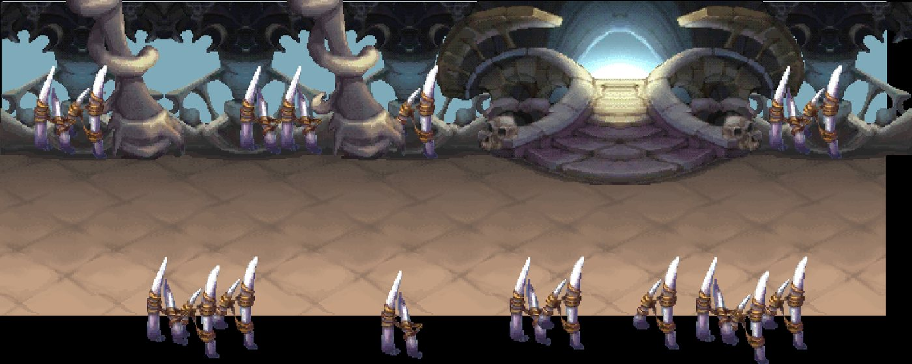
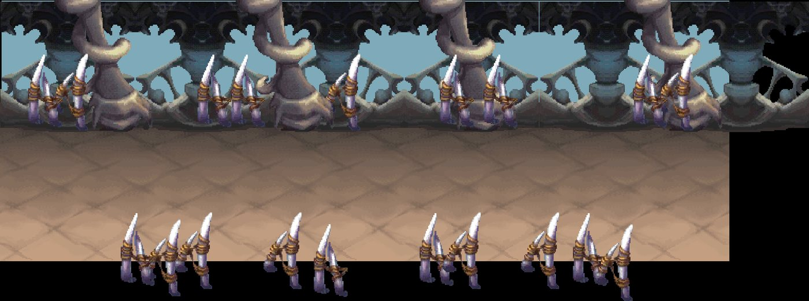
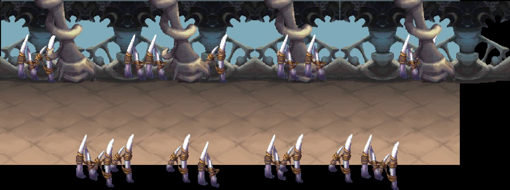

# Kit `maze` — Mê Thành Bất Tử

> **Quy tắc bắt buộc cho Codex** (xem README.md): dùng https://github.com/0x0funky/agent-sprite-forge (generate2dmap / generate2dsprite) với route image_gen tích hợp; cấm codeart2d, API trả phí, vẽ bằng code, lật gương; không commit; không sửa tools/hd2d_audit/*, gate_waivers.json, check.sh; mỗi asset phải tự nhìn ảnh trước khi ghi "vẽ xong"; chỉ Claude/owner đánh dấu "duyệt".

- Style/palette: Tường mê cung dây leo rậm, cổng đá chuyển dịch, bẫy chông sàn; xanh rêu + đá xám.
- Thư mục asset: `apps/game-web/art-src/hd2d/batch-11-maze/`
- Số map: 3

## 1. Danh sách asset cần vẽ (kit chưa có asset)

Nguồn: Phần C `hd2d-maps-75-gemini-prompt.md`. Yêu cầu gốc: tile sàn đá mê cung, cỏ, sàn bẫy; prop: tường mê cung (module lặp + góc + đầu cụt), dây leo, cổng đá chuyển dịch (dormant/active), bẫy chông (thu/ra 4 khung), cột đá ×2, đèn đá, bụi rậm ×3; backdrop xa: mê cung vô tận.

| Vẽ | Duyệt | id (số thứ tự; đặt tên tiếng Anh vào manifest `name`) | loại | mô tả + prompt đi kèm |
|---|---|---|---|---|
| ⬜ | ⬜ | `maze-floor-01` | floor | sàn đá mê cung — tile sàn nhìn từ trên xuống, seamless 512×512; HD-2D Octopath pixel art, palette Mê Thành Bất Tử, outline tối cùng sắc, 33–48 màu, không bóng đổ/sương/chữ. |
| ⬜ | ⬜ | `maze-floor-02` | floor | cỏ — tile sàn nhìn từ trên xuống, seamless 512×512; HD-2D Octopath pixel art, palette Mê Thành Bất Tử, outline tối cùng sắc, 33–48 màu, không bóng đổ/sương/chữ. |
| ⬜ | ⬜ | `maze-floor-03` | floor | sàn bẫy — tile sàn nhìn từ trên xuống, seamless 512×512; HD-2D Octopath pixel art, palette Mê Thành Bất Tử, outline tối cùng sắc, 33–48 màu, không bóng đổ/sương/chữ. |
| ⬜ | ⬜ | `maze-prop-01` | prop | tường mê cung (module lặp + góc + đầu cụt) — prop đứng billboard, pivot giữa-đáy; HD-2D Octopath pixel art, palette Mê Thành Bất Tử, outline tối cùng sắc, 33–48 màu, không bóng đổ/sương/chữ. |
| ⬜ | ⬜ | `maze-prop-02` | prop | dây leo — prop đứng billboard, pivot giữa-đáy; HD-2D Octopath pixel art, palette Mê Thành Bất Tử, outline tối cùng sắc, 33–48 màu, không bóng đổ/sương/chữ. |
| ⬜ | ⬜ | `maze-prop-03` | prop | cổng đá chuyển dịch (dormant/active) — prop đứng billboard, pivot giữa-đáy; HD-2D Octopath pixel art, palette Mê Thành Bất Tử, outline tối cùng sắc, 33–48 màu, không bóng đổ/sương/chữ. |
| ⬜ | ⬜ | `maze-prop-04` | prop | bẫy chông (thu/ra 4 khung) — prop đứng billboard, pivot giữa-đáy; HD-2D Octopath pixel art, palette Mê Thành Bất Tử, outline tối cùng sắc, 33–48 màu, không bóng đổ/sương/chữ. |
| ⬜ | ⬜ | `maze-prop-05` | prop | cột đá — prop đứng billboard, pivot giữa-đáy; HD-2D Octopath pixel art, palette Mê Thành Bất Tử, outline tối cùng sắc, 33–48 màu, không bóng đổ/sương/chữ. |
| ⬜ | ⬜ | `maze-prop-06` | prop | cột đá — prop đứng billboard, pivot giữa-đáy; HD-2D Octopath pixel art, palette Mê Thành Bất Tử, outline tối cùng sắc, 33–48 màu, không bóng đổ/sương/chữ. |
| ⬜ | ⬜ | `maze-prop-07` | prop | đèn đá — prop đứng billboard, pivot giữa-đáy; HD-2D Octopath pixel art, palette Mê Thành Bất Tử, outline tối cùng sắc, 33–48 màu, không bóng đổ/sương/chữ. |
| ⬜ | ⬜ | `maze-prop-08` | prop | bụi rậm — prop đứng billboard, pivot giữa-đáy; HD-2D Octopath pixel art, palette Mê Thành Bất Tử, outline tối cùng sắc, 33–48 màu, không bóng đổ/sương/chữ. |
| ⬜ | ⬜ | `maze-prop-09` | prop | bụi rậm — prop đứng billboard, pivot giữa-đáy; HD-2D Octopath pixel art, palette Mê Thành Bất Tử, outline tối cùng sắc, 33–48 màu, không bóng đổ/sương/chữ. |
| ⬜ | ⬜ | `maze-prop-10` | prop | bụi rậm — prop đứng billboard, pivot giữa-đáy; HD-2D Octopath pixel art, palette Mê Thành Bất Tử, outline tối cùng sắc, 33–48 màu, không bóng đổ/sương/chữ. |
| ⬜ | ⬜ | `maze-backdrop-far-01` | backdrop_far | mê cung vô tận — backdrop xa 1280×384 lặp ngang liền (64 px/đơn vị); HD-2D Octopath pixel art, palette Mê Thành Bất Tử, outline tối cùng sắc, 33–48 màu, không bóng đổ/sương/chữ. |
| ⬜ | ⬜ | `maze-floor-extra-01` | floor | tile sàn bổ sung (đủ ≥8 biến thể khác texture), seamless 512×512 |
| ⬜ | ⬜ | `maze-floor-extra-02` | floor | tile sàn bổ sung (đủ ≥8 biến thể khác texture), seamless 512×512 |
| ⬜ | ⬜ | `maze-floor-extra-03` | floor | tile sàn bổ sung (đủ ≥8 biến thể khác texture), seamless 512×512 |
| ⬜ | ⬜ | `maze-floor-extra-04` | floor | tile sàn bổ sung (đủ ≥8 biến thể khác texture), seamless 512×512 |
| ⬜ | ⬜ | `maze-floor-extra-05` | floor | tile sàn bổ sung (đủ ≥8 biến thể khác texture), seamless 512×512 |
| ⬜ | ⬜ | `maze-edge-01` | edge | dải chuyển tiếp giữa 2 tile chính, 512×128 liền hai đầu, mép bất quy tắc |
| ⬜ | ⬜ | `maze-edge-02` | edge | dải chuyển tiếp giữa 2 tile chính, 512×128 liền hai đầu, mép bất quy tắc |
| ⬜ | ⬜ | `maze-edge-03` | edge | dải chuyển tiếp giữa 2 tile chính, 512×128 liền hai đầu, mép bất quy tắc |
| ⬜ | ⬜ | `maze-decal-01` | decal | decal tiếp đất theo chủ đề kit (vụn, vết, xương/đá), bất quy tắc, mép mềm |
| ⬜ | ⬜ | `maze-decal-02` | decal | decal tiếp đất theo chủ đề kit (vụn, vết, xương/đá), bất quy tắc, mép mềm |
| ⬜ | ⬜ | `maze-decal-03` | decal | decal tiếp đất theo chủ đề kit (vụn, vết, xương/đá), bất quy tắc, mép mềm |
| ⬜ | ⬜ | `maze-decal-04` | decal | decal tiếp đất theo chủ đề kit (vụn, vết, xương/đá), bất quy tắc, mép mềm |
| ⬜ | ⬜ | `maze-decal-05` | decal | decal tiếp đất theo chủ đề kit (vụn, vết, xương/đá), bất quy tắc, mép mềm |
| ⬜ | ⬜ | `maze-decal-06` | decal | decal tiếp đất theo chủ đề kit (vụn, vết, xương/đá), bất quy tắc, mép mềm |
| ⬜ | ⬜ | `maze-decal-07` | decal | decal tiếp đất theo chủ đề kit (vụn, vết, xương/đá), bất quy tắc, mép mềm |
| ⬜ | ⬜ | `maze-decal-08` | decal | decal tiếp đất theo chủ đề kit (vụn, vết, xương/đá), bất quy tắc, mép mềm |
| ⬜ | ⬜ | `maze-decal-09` | decal | decal tiếp đất theo chủ đề kit (vụn, vết, xương/đá), bất quy tắc, mép mềm |
| ⬜ | ⬜ | `maze-decal-10` | decal | decal tiếp đất theo chủ đề kit (vụn, vết, xương/đá), bất quy tắc, mép mềm |
| ⬜ | ⬜ | `maze-decal-11` | decal | decal tiếp đất theo chủ đề kit (vụn, vết, xương/đá), bất quy tắc, mép mềm |
| ⬜ | ⬜ | `maze-decal-12` | decal | decal tiếp đất theo chủ đề kit (vụn, vết, xương/đá), bất quy tắc, mép mềm |
| ⬜ | ⬜ | `maze-shadow-01` | shadow | bóng procedural alpha mềm, màu kit |
| ⬜ | ⬜ | `maze-shadow-02` | shadow | bóng procedural alpha mềm, màu kit |
| ⬜ | ⬜ | `maze-shadow-03` | shadow | bóng procedural alpha mềm, màu kit |
| ⬜ | ⬜ | `maze-shadow-04` | shadow | bóng procedural alpha mềm, màu kit |
| ⬜ | ⬜ | `maze-backdrop-far` | backdrop | 1280×384, lặp ngang liền, mỗi tầng một khung cảnh khác |
| ⬜ | ⬜ | `maze-backdrop-mid` | backdrop | 1280×384, lặp ngang liền, mỗi tầng một khung cảnh khác |
| ⬜ | ⬜ | `maze-backdrop-near` | backdrop | 1280×384, lặp ngang liền, mỗi tầng một khung cảnh khác |
| ⬜ | ⬜ | `maze-portal-dormant` | portal | cổng nhìn thẳng mặt trước, đúng tông kit |
| ⬜ | ⬜ | `maze-portal-active` | portal | cùng mask với dormant |
| ⬜ | ⬜ | `maze-marker-arrival` | marker | vòng sáng 4 khung |
| ⬜ | ⬜ | `maze-fx-01` | fx | hạt/tia sáng sprite sheet theo chủ đề |
| ⬜ | ⬜ | `maze-fx-02` | fx | hạt/tia sáng sprite sheet theo chủ đề |
| ⬜ | ⬜ | `maze-fx-03` | fx | hạt/tia sáng sprite sheet theo chủ đề |

## 2. Prompt sheet chung cho kit

```text
[Dán Master v2: .ai/design/gpt-redo/00-master-v2.md]
Dùng agent-sprite-forge ($generate2dmap cho tile/prop, $generate2dsprite cho prop/decal/FX/marker). Route ảnh: image_gen tích hợp của Codex (kiểm `route_media.py resolve --kind image`). KHÔNG codeart2d, KHÔNG API, KHÔNG vẽ bằng code.
Kit: Mê Thành Bất Tử (maze). Style: Tường mê cung dây leo rậm, cổng đá chuyển dịch, bẫy chông sàn; xanh rêu + đá xám.. Style anchor: batch-01-octopath/contact-sheet.png + 2 sprites.png linh thú.
Mỗi lần gọi: 1 sheet ~6 vật trên nền #FF00FF, bố trí 2×3/3×2, cách nhau ≥48 px, không chạm mép. Giữ raw-01.png byte-identical. Cắt/khử nền/pixel finish bằng script forge. 33–48 màu, alpha nhị phân, lề ≥8 px, 128 px = 1 đơn vị (far 64), người = 1.31 đơn vị (cỡ tối đa vật nhỏ: tools/hd2d_audit/size_check.py).
Mỗi asset: thư mục raw-01/final/prompt.md/review.md/qa.json trong apps/game-web/art-src/hd2d/batch-11-maze/<id>/. Tự nhìn 4× nền tối/caro. Xong: `python3 tools/hd2d_audit/art_gate.py batch-11-maze` = 0 lỗi, contact-sheet mới hơn manifest.
```

## 3. Từng map

### `immortal_maze_main_maze` — Trường Sinh Mê Thành



- Ảnh gốc (đối chiếu): `.ai/design/map-checklists/refs/immortal_maze_main_maze.jpg` (bản đầy đủ: `~/Downloads/Phimond-P12-Review/map-images/immortal_maze_main_maze.png`, 2375×950 px, 100 px = 1 đơn vị APK)
- Nguồn APK: scene `Assets/Scenes/Map/MeThanh.unity`, 32 sprite ghép; brief: [../map-briefs/kit_maze/immortal_maze_main_maze.md](../map-briefs/kit_maze/immortal_maze_main_maze.md)
- Cổng: 2 · vùng quái: không · spawn: 0 · NPC: maze_bex, maze_cleo · ghi chú: giữ nguyên, đã hợp style
- neo `P:immortal_maze_portal_004` (door) Cửa → Bất Tử Mê Tầng: px [1606, 446]
- neo `P:immortal_maze_portal_005` (door) Cửa → Hải Tặc Hào: px [110, 546]
- neo `A:immortal_maze_portal_001` (arrival) Điểm đến từ Bất Tử Mật Tầng: px [1188, 850]
- neo `AT:ship:immortal_maze_main_maze` (arrival) Đến từ trụ Hải Tặc Hào: px [210, 538]
- neo `maze_bex` (npc) : px CẦN ĐẶT
- neo `maze_cleo` (npc) : px CẦN ĐẶT
- NPC cần sprite (batch-05; kiểm trùng): maze_bex, maze_cleo

Asset chính: dùng bảng kit (mục 1). Landmark riêng của map (Codex xem ảnh gốc, ghi tên vật nhận diện vào bảng rồi vẽ):

| Vẽ | Duyệt | id | loại | mô tả | prompt |
|---|---|---|---|---|---|
| ⬜ | ⬜ | `immortal_maze_main_maze-landmark-01` | landmark | (vật nhận diện #1 trong ảnh gốc) | — |
| ⬜ | ⬜ | `immortal_maze_main_maze-landmark-02` | landmark | (vật nhận diện #2, nếu có) | — |

Prompt cho Codex:

```text
Dùng agent-sprite-forge (generate2dmap + generate2dsprite, route image_gen). Map immortal_maze_main_maze (Trường Sinh Mê Thành), kit maze.
Mở và đính kèm thật ảnh gốc .ai/design/map-checklists/refs/immortal_maze_main_maze.jpg vào image_gen cùng 2–3 ảnh style batch 00–09 sát loại + 2 anchor linh thú; ghi sha256.
Rà các hàng chưa ✅ trong bảng; vẽ theo sheet 6 vật; landmark riêng: nhìn ảnh gốc, ghi tên vật vào bảng rồi vẽ (không giả là recovered APK nếu là diễn giải).
Xong: cập nhật cột "Vẽ" (✅ chỉ khi đã nhìn final 4×), chạy art_gate cho kit, KHÔNG tự đặt "Duyệt".
```

### `immortal_maze_floor` — Bất Tử Mê Tầng



- Ảnh gốc (đối chiếu): `.ai/design/map-checklists/refs/immortal_maze_floor.jpg` (bản đầy đủ: `~/Downloads/Phimond-P12-Review/map-images/immortal_maze_floor.png`, 2560×953 px, 100 px = 1 đơn vị APK)
- Nguồn APK: scene `Assets/Scenes/Map/MeThanh.unity`, 36 sprite ghép; brief: [../map-briefs/kit_maze/immortal_maze_floor.md](../map-briefs/kit_maze/immortal_maze_floor.md)
- Cổng: 2 · vùng quái: có · spawn: 30 · NPC: maze_dune · ghi chú: tên nguồn quá chung
- neo `P:immortal_maze_portal_002` (door) Cửa → Trường Sinh Mê Thành: px [133, 749]
- neo `P:immortal_maze_portal_003` (door) Cửa → Trường Sinh Mê Thành: px [2159, 733]
- neo `maze_dune` (npc) : px CẦN ĐẶT
- NPC cần sprite (batch-05; kiểm trùng): maze_dune

Asset chính: dùng bảng kit (mục 1). Landmark riêng của map (Codex xem ảnh gốc, ghi tên vật nhận diện vào bảng rồi vẽ):

| Vẽ | Duyệt | id | loại | mô tả | prompt |
|---|---|---|---|---|---|
| ⬜ | ⬜ | `immortal_maze_floor-landmark-01` | landmark | (vật nhận diện #1 trong ảnh gốc) | — |
| ⬜ | ⬜ | `immortal_maze_floor-landmark-02` | landmark | (vật nhận diện #2, nếu có) | — |

Prompt cho Codex:

```text
Dùng agent-sprite-forge (generate2dmap + generate2dsprite, route image_gen). Map immortal_maze_floor (), kit maze.
Mở và đính kèm thật ảnh gốc .ai/design/map-checklists/refs/immortal_maze_floor.jpg vào image_gen cùng 2–3 ảnh style batch 00–09 sát loại + 2 anchor linh thú; ghi sha256.
Rà các hàng chưa ✅ trong bảng; vẽ theo sheet 6 vật; landmark riêng: nhìn ảnh gốc, ghi tên vật vào bảng rồi vẽ (không giả là recovered APK nếu là diễn giải).
Xong: cập nhật cột "Vẽ" (✅ chỉ khi đã nhìn final 4×), chạy art_gate cho kit, KHÔNG tự đặt "Duyệt".
```

### `immortal_maze_secret_floor` — Bất Tử Mật Tầng



- Ảnh gốc (đối chiếu): `.ai/design/map-checklists/refs/immortal_maze_secret_floor.jpg` (bản đầy đủ: `~/Downloads/Phimond-P12-Review/map-images/immortal_maze_secret_floor.png`, 2560×953 px, 100 px = 1 đơn vị APK)
- Nguồn APK: scene `Assets/Scenes/Map/MeThanh.unity`, 36 sprite ghép; brief: [../map-briefs/kit_maze/immortal_maze_secret_floor.md](../map-briefs/kit_maze/immortal_maze_secret_floor.md)
- Cổng: 1 · vùng quái: có · spawn: 30 · NPC: —
- neo `P:immortal_maze_portal_001` (door) Cửa → Trường Sinh Mê Thành: px [163, 752]

Asset chính: dùng bảng kit (mục 1). Landmark riêng của map (Codex xem ảnh gốc, ghi tên vật nhận diện vào bảng rồi vẽ):

| Vẽ | Duyệt | id | loại | mô tả | prompt |
|---|---|---|---|---|---|
| ⬜ | ⬜ | `immortal_maze_secret_floor-landmark-01` | landmark | (vật nhận diện #1 trong ảnh gốc) | — |
| ⬜ | ⬜ | `immortal_maze_secret_floor-landmark-02` | landmark | (vật nhận diện #2, nếu có) | — |

Prompt cho Codex:

```text
Dùng agent-sprite-forge (generate2dmap + generate2dsprite, route image_gen). Map immortal_maze_secret_floor (), kit maze.
Mở và đính kèm thật ảnh gốc .ai/design/map-checklists/refs/immortal_maze_secret_floor.jpg vào image_gen cùng 2–3 ảnh style batch 00–09 sát loại + 2 anchor linh thú; ghi sha256.
Rà các hàng chưa ✅ trong bảng; vẽ theo sheet 6 vật; landmark riêng: nhìn ảnh gốc, ghi tên vật vào bảng rồi vẽ (không giả là recovered APK nếu là diễn giải).
Xong: cập nhật cột "Vẽ" (✅ chỉ khi đã nhìn final 4×), chạy art_gate cho kit, KHÔNG tự đặt "Duyệt".
```
