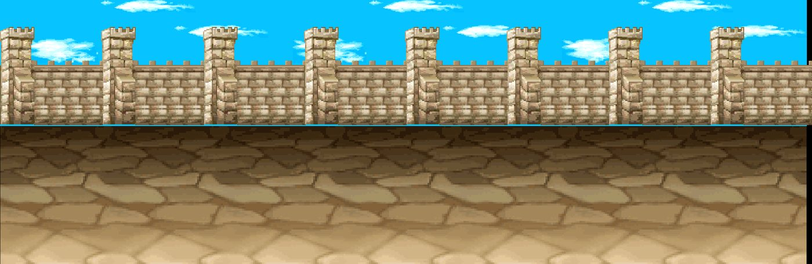
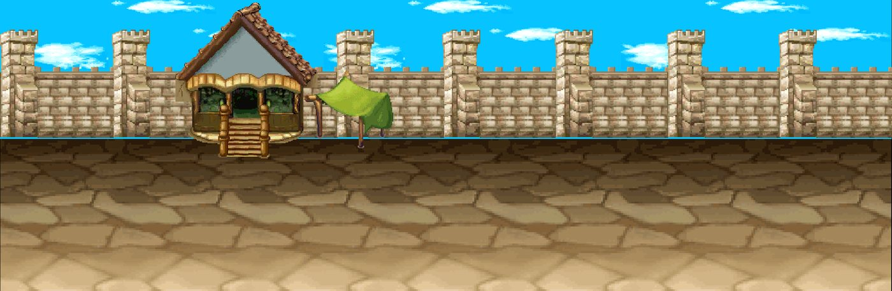
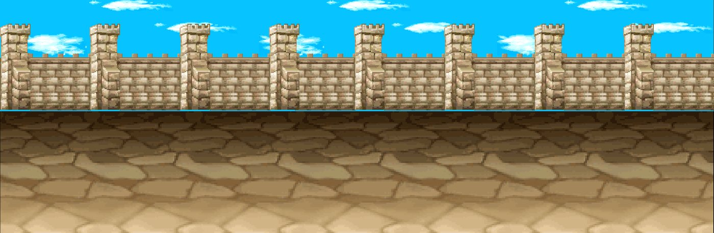
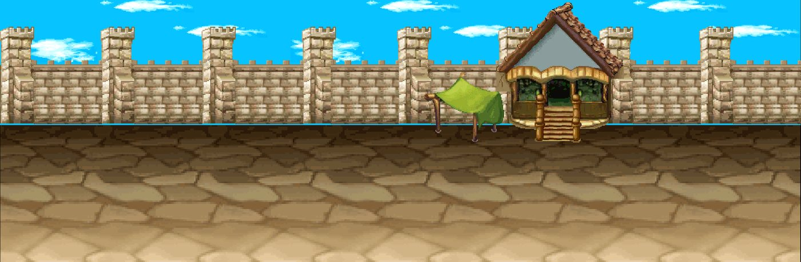

# Kit `minigame` — Sói – Cừu

> **Quy tắc bắt buộc cho Codex** (xem README.md): dùng https://github.com/0x0funky/agent-sprite-forge (generate2dmap / generate2dsprite) với route image_gen tích hợp; cấm codeart2d, API trả phí, vẽ bằng code, lật gương; không commit; không sửa tools/hd2d_audit/*, gate_waivers.json, check.sh; mỗi asset phải tự nhìn ảnh trước khi ghi "vẽ xong"; chỉ Claude/owner đánh dấu "duyệt".

- Style/palette: Hai bên: sân cỏ xanh (cừu) và sân đá u ám (sói); bãi giữa cỏ xanh trung tính; sảnh chờ trong nhà.
- Thư mục asset: `apps/game-web/art-src/hd2d/batch-11-minigame/`
- Số map: 6

## 1. Danh sách asset cần vẽ (kit chưa có asset)

Nguồn: Phần C `hd2d-maps-75-gemini-prompt.md`. Yêu cầu gốc: tile cỏ xanh, cỏ khô vàng, đất đá sói, sàn gỗ nhà; prop: rào gỗ chuồng cừu (đoạn+cọc+cổng), đống cỏ khô ×2, máng cừu, nhà cừu (backdrop mid), hang đá sói, xương, rào đá sói, nhà sói, cờ 2 phe, bục xuất phát, cỏ/hoa ×4; backdrop xa: đồi cỏ.

| Vẽ | Duyệt | id (số thứ tự; đặt tên tiếng Anh vào manifest `name`) | loại | mô tả + prompt đi kèm |
|---|---|---|---|---|
| ⬜ | ⬜ | `minigame-floor-01` | floor | cỏ xanh — tile sàn nhìn từ trên xuống, seamless 512×512; HD-2D Octopath pixel art, palette Sói – Cừu, outline tối cùng sắc, 33–48 màu, không bóng đổ/sương/chữ. |
| ⬜ | ⬜ | `minigame-floor-02` | floor | cỏ khô vàng — tile sàn nhìn từ trên xuống, seamless 512×512; HD-2D Octopath pixel art, palette Sói – Cừu, outline tối cùng sắc, 33–48 màu, không bóng đổ/sương/chữ. |
| ⬜ | ⬜ | `minigame-floor-03` | floor | đất đá sói — tile sàn nhìn từ trên xuống, seamless 512×512; HD-2D Octopath pixel art, palette Sói – Cừu, outline tối cùng sắc, 33–48 màu, không bóng đổ/sương/chữ. |
| ⬜ | ⬜ | `minigame-floor-04` | floor | sàn gỗ nhà — tile sàn nhìn từ trên xuống, seamless 512×512; HD-2D Octopath pixel art, palette Sói – Cừu, outline tối cùng sắc, 33–48 màu, không bóng đổ/sương/chữ. |
| ⬜ | ⬜ | `minigame-prop-01` | prop | rào gỗ chuồng cừu (đoạn+cọc+cổng) — prop đứng billboard, pivot giữa-đáy; HD-2D Octopath pixel art, palette Sói – Cừu, outline tối cùng sắc, 33–48 màu, không bóng đổ/sương/chữ. |
| ⬜ | ⬜ | `minigame-prop-02` | prop | đống cỏ khô — prop đứng billboard, pivot giữa-đáy; HD-2D Octopath pixel art, palette Sói – Cừu, outline tối cùng sắc, 33–48 màu, không bóng đổ/sương/chữ. |
| ⬜ | ⬜ | `minigame-prop-03` | prop | đống cỏ khô — prop đứng billboard, pivot giữa-đáy; HD-2D Octopath pixel art, palette Sói – Cừu, outline tối cùng sắc, 33–48 màu, không bóng đổ/sương/chữ. |
| ⬜ | ⬜ | `minigame-prop-04` | prop | máng cừu — prop đứng billboard, pivot giữa-đáy; HD-2D Octopath pixel art, palette Sói – Cừu, outline tối cùng sắc, 33–48 màu, không bóng đổ/sương/chữ. |
| ⬜ | ⬜ | `minigame-prop-05` | prop | nhà cừu (backdrop mid) — prop đứng billboard, pivot giữa-đáy; HD-2D Octopath pixel art, palette Sói – Cừu, outline tối cùng sắc, 33–48 màu, không bóng đổ/sương/chữ. |
| ⬜ | ⬜ | `minigame-prop-06` | prop | hang đá sói — prop đứng billboard, pivot giữa-đáy; HD-2D Octopath pixel art, palette Sói – Cừu, outline tối cùng sắc, 33–48 màu, không bóng đổ/sương/chữ. |
| ⬜ | ⬜ | `minigame-prop-07` | prop | xương — prop đứng billboard, pivot giữa-đáy; HD-2D Octopath pixel art, palette Sói – Cừu, outline tối cùng sắc, 33–48 màu, không bóng đổ/sương/chữ. |
| ⬜ | ⬜ | `minigame-prop-08` | prop | rào đá sói — prop đứng billboard, pivot giữa-đáy; HD-2D Octopath pixel art, palette Sói – Cừu, outline tối cùng sắc, 33–48 màu, không bóng đổ/sương/chữ. |
| ⬜ | ⬜ | `minigame-prop-09` | prop | nhà sói — prop đứng billboard, pivot giữa-đáy; HD-2D Octopath pixel art, palette Sói – Cừu, outline tối cùng sắc, 33–48 màu, không bóng đổ/sương/chữ. |
| ⬜ | ⬜ | `minigame-prop-10` | prop | cờ 2 phe — prop đứng billboard, pivot giữa-đáy; HD-2D Octopath pixel art, palette Sói – Cừu, outline tối cùng sắc, 33–48 màu, không bóng đổ/sương/chữ. |
| ⬜ | ⬜ | `minigame-prop-11` | prop | bục xuất phát — prop đứng billboard, pivot giữa-đáy; HD-2D Octopath pixel art, palette Sói – Cừu, outline tối cùng sắc, 33–48 màu, không bóng đổ/sương/chữ. |
| ⬜ | ⬜ | `minigame-prop-12` | prop | cỏ/hoa — prop đứng billboard, pivot giữa-đáy; HD-2D Octopath pixel art, palette Sói – Cừu, outline tối cùng sắc, 33–48 màu, không bóng đổ/sương/chữ. |
| ⬜ | ⬜ | `minigame-prop-13` | prop | cỏ/hoa — prop đứng billboard, pivot giữa-đáy; HD-2D Octopath pixel art, palette Sói – Cừu, outline tối cùng sắc, 33–48 màu, không bóng đổ/sương/chữ. |
| ⬜ | ⬜ | `minigame-prop-14` | prop | cỏ/hoa — prop đứng billboard, pivot giữa-đáy; HD-2D Octopath pixel art, palette Sói – Cừu, outline tối cùng sắc, 33–48 màu, không bóng đổ/sương/chữ. |
| ⬜ | ⬜ | `minigame-prop-15` | prop | cỏ/hoa — prop đứng billboard, pivot giữa-đáy; HD-2D Octopath pixel art, palette Sói – Cừu, outline tối cùng sắc, 33–48 màu, không bóng đổ/sương/chữ. |
| ⬜ | ⬜ | `minigame-backdrop-far-01` | backdrop_far | đồi cỏ — backdrop xa 1280×384 lặp ngang liền (64 px/đơn vị); HD-2D Octopath pixel art, palette Sói – Cừu, outline tối cùng sắc, 33–48 màu, không bóng đổ/sương/chữ. |
| ⬜ | ⬜ | `minigame-floor-extra-01` | floor | tile sàn bổ sung (đủ ≥8 biến thể khác texture), seamless 512×512 |
| ⬜ | ⬜ | `minigame-floor-extra-02` | floor | tile sàn bổ sung (đủ ≥8 biến thể khác texture), seamless 512×512 |
| ⬜ | ⬜ | `minigame-floor-extra-03` | floor | tile sàn bổ sung (đủ ≥8 biến thể khác texture), seamless 512×512 |
| ⬜ | ⬜ | `minigame-floor-extra-04` | floor | tile sàn bổ sung (đủ ≥8 biến thể khác texture), seamless 512×512 |
| ⬜ | ⬜ | `minigame-edge-01` | edge | dải chuyển tiếp giữa 2 tile chính, 512×128 liền hai đầu, mép bất quy tắc |
| ⬜ | ⬜ | `minigame-edge-02` | edge | dải chuyển tiếp giữa 2 tile chính, 512×128 liền hai đầu, mép bất quy tắc |
| ⬜ | ⬜ | `minigame-edge-03` | edge | dải chuyển tiếp giữa 2 tile chính, 512×128 liền hai đầu, mép bất quy tắc |
| ⬜ | ⬜ | `minigame-decal-01` | decal | decal tiếp đất theo chủ đề kit (vụn, vết, xương/đá), bất quy tắc, mép mềm |
| ⬜ | ⬜ | `minigame-decal-02` | decal | decal tiếp đất theo chủ đề kit (vụn, vết, xương/đá), bất quy tắc, mép mềm |
| ⬜ | ⬜ | `minigame-decal-03` | decal | decal tiếp đất theo chủ đề kit (vụn, vết, xương/đá), bất quy tắc, mép mềm |
| ⬜ | ⬜ | `minigame-decal-04` | decal | decal tiếp đất theo chủ đề kit (vụn, vết, xương/đá), bất quy tắc, mép mềm |
| ⬜ | ⬜ | `minigame-decal-05` | decal | decal tiếp đất theo chủ đề kit (vụn, vết, xương/đá), bất quy tắc, mép mềm |
| ⬜ | ⬜ | `minigame-decal-06` | decal | decal tiếp đất theo chủ đề kit (vụn, vết, xương/đá), bất quy tắc, mép mềm |
| ⬜ | ⬜ | `minigame-decal-07` | decal | decal tiếp đất theo chủ đề kit (vụn, vết, xương/đá), bất quy tắc, mép mềm |
| ⬜ | ⬜ | `minigame-decal-08` | decal | decal tiếp đất theo chủ đề kit (vụn, vết, xương/đá), bất quy tắc, mép mềm |
| ⬜ | ⬜ | `minigame-decal-09` | decal | decal tiếp đất theo chủ đề kit (vụn, vết, xương/đá), bất quy tắc, mép mềm |
| ⬜ | ⬜ | `minigame-decal-10` | decal | decal tiếp đất theo chủ đề kit (vụn, vết, xương/đá), bất quy tắc, mép mềm |
| ⬜ | ⬜ | `minigame-decal-11` | decal | decal tiếp đất theo chủ đề kit (vụn, vết, xương/đá), bất quy tắc, mép mềm |
| ⬜ | ⬜ | `minigame-decal-12` | decal | decal tiếp đất theo chủ đề kit (vụn, vết, xương/đá), bất quy tắc, mép mềm |
| ⬜ | ⬜ | `minigame-shadow-01` | shadow | bóng procedural alpha mềm, màu kit |
| ⬜ | ⬜ | `minigame-shadow-02` | shadow | bóng procedural alpha mềm, màu kit |
| ⬜ | ⬜ | `minigame-shadow-03` | shadow | bóng procedural alpha mềm, màu kit |
| ⬜ | ⬜ | `minigame-shadow-04` | shadow | bóng procedural alpha mềm, màu kit |
| ⬜ | ⬜ | `minigame-backdrop-far` | backdrop | 1280×384, lặp ngang liền, mỗi tầng một khung cảnh khác |
| ⬜ | ⬜ | `minigame-backdrop-mid` | backdrop | 1280×384, lặp ngang liền, mỗi tầng một khung cảnh khác |
| ⬜ | ⬜ | `minigame-backdrop-near` | backdrop | 1280×384, lặp ngang liền, mỗi tầng một khung cảnh khác |
| ⬜ | ⬜ | `minigame-portal-dormant` | portal | cổng nhìn thẳng mặt trước, đúng tông kit |
| ⬜ | ⬜ | `minigame-portal-active` | portal | cùng mask với dormant |
| ⬜ | ⬜ | `minigame-marker-arrival` | marker | vòng sáng 4 khung |
| ⬜ | ⬜ | `minigame-fx-01` | fx | hạt/tia sáng sprite sheet theo chủ đề |
| ⬜ | ⬜ | `minigame-fx-02` | fx | hạt/tia sáng sprite sheet theo chủ đề |
| ⬜ | ⬜ | `minigame-fx-03` | fx | hạt/tia sáng sprite sheet theo chủ đề |

## 2. Prompt sheet chung cho kit

```text
[Dán Master v2: .ai/design/gpt-redo/00-master-v2.md]
Dùng agent-sprite-forge ($generate2dmap cho tile/prop, $generate2dsprite cho prop/decal/FX/marker). Route ảnh: image_gen tích hợp của Codex (kiểm `route_media.py resolve --kind image`). KHÔNG codeart2d, KHÔNG API, KHÔNG vẽ bằng code.
Kit: Sói – Cừu (minigame). Style: Hai bên: sân cỏ xanh (cừu) và sân đá u ám (sói); bãi giữa cỏ xanh trung tính; sảnh chờ trong nhà.. Style anchor: batch-01-octopath/contact-sheet.png + 2 sprites.png linh thú.
Mỗi lần gọi: 1 sheet ~6 vật trên nền #FF00FF, bố trí 2×3/3×2, cách nhau ≥48 px, không chạm mép. Giữ raw-01.png byte-identical. Cắt/khử nền/pixel finish bằng script forge. 33–48 màu, alpha nhị phân, lề ≥8 px, 128 px = 1 đơn vị (far 64), người = 1.31 đơn vị (cỡ tối đa vật nhỏ: tools/hd2d_audit/size_check.py).
Mỗi asset: thư mục raw-01/final/prompt.md/review.md/qa.json trong apps/game-web/art-src/hd2d/batch-11-minigame/<id>/. Tự nhìn 4× nền tối/caro. Xong: `python3 tools/hd2d_audit/art_gate.py batch-11-minigame` = 0 lỗi, contact-sheet mới hơn manifest.
```

## 3. Từng map

### `wolf_sheep_waiting_hall` — Sảnh Đối Quyết Lang Dương



- Ảnh gốc (đối chiếu): `.ai/design/map-checklists/refs/wolf_sheep_waiting_hall.jpg` (bản đầy đủ: `~/Downloads/Phimond-P12-Review/map-images/wolf_sheep_waiting_hall.png`, 2526×821 px, 100 px = 1 đơn vị APK)
- Nguồn APK: scene `Assets/Scenes/HoatDong/SoiCuu.unity`, 35 sprite ghép; brief: chưa có
- Cổng: 1 · vùng quái: không · spawn: 0 · NPC: —
- Brief điểm neo: **chưa có** (thiếu bounds P12). Codex đối chiếu ảnh gốc bằng mắt; Claude bổ sung brief trước khi dựng layout.

Asset chính: dùng bảng kit (mục 1). Landmark riêng của map (Codex xem ảnh gốc, ghi tên vật nhận diện vào bảng rồi vẽ):

| Vẽ | Duyệt | id | loại | mô tả | prompt |
|---|---|---|---|---|---|
| ⬜ | ⬜ | `wolf_sheep_waiting_hall-landmark-01` | landmark | (vật nhận diện #1 trong ảnh gốc) | — |
| ⬜ | ⬜ | `wolf_sheep_waiting_hall-landmark-02` | landmark | (vật nhận diện #2, nếu có) | — |

Prompt cho Codex:

```text
Dùng agent-sprite-forge (generate2dmap + generate2dsprite, route image_gen). Map wolf_sheep_waiting_hall (Sảnh Đối Quyết Lang Dương), kit minigame.
Mở và đính kèm thật ảnh gốc .ai/design/map-checklists/refs/wolf_sheep_waiting_hall.jpg vào image_gen cùng 2–3 ảnh style batch 00–09 sát loại + 2 anchor linh thú; ghi sha256.
Rà các hàng chưa ✅ trong bảng; vẽ theo sheet 6 vật; landmark riêng: nhìn ảnh gốc, ghi tên vật vào bảng rồi vẽ (không giả là recovered APK nếu là diễn giải).
Xong: cập nhật cột "Vẽ" (✅ chỉ khi đã nhìn final 4×), chạy art_gate cho kit, KHÔNG tự đặt "Duyệt".
```

### `wolf_sheep_sheep_house` — Dương Xá



- Ảnh gốc (đối chiếu): `.ai/design/map-checklists/refs/wolf_sheep_sheep_house.jpg` (bản đầy đủ: `~/Downloads/Phimond-P12-Review/map-images/wolf_sheep_sheep_house.png`, 2511×821 px, 100 px = 1 đơn vị APK)
- Nguồn APK: scene `Assets/Scenes/HoatDong/SoiCuu.unity`, 37 sprite ghép; brief: chưa có
- Cổng: 1 · vùng quái: có · spawn: 0 · NPC: —
- Brief điểm neo: **chưa có** (thiếu bounds P12). Codex đối chiếu ảnh gốc bằng mắt; Claude bổ sung brief trước khi dựng layout.

Asset chính: dùng bảng kit (mục 1). Landmark riêng của map (Codex xem ảnh gốc, ghi tên vật nhận diện vào bảng rồi vẽ):

| Vẽ | Duyệt | id | loại | mô tả | prompt |
|---|---|---|---|---|---|
| ⬜ | ⬜ | `wolf_sheep_sheep_house-landmark-01` | landmark | (vật nhận diện #1 trong ảnh gốc) | — |
| ⬜ | ⬜ | `wolf_sheep_sheep_house-landmark-02` | landmark | (vật nhận diện #2, nếu có) | — |

Prompt cho Codex:

```text
Dùng agent-sprite-forge (generate2dmap + generate2dsprite, route image_gen). Map wolf_sheep_sheep_house (Dương Xá), kit minigame.
Mở và đính kèm thật ảnh gốc .ai/design/map-checklists/refs/wolf_sheep_sheep_house.jpg vào image_gen cùng 2–3 ảnh style batch 00–09 sát loại + 2 anchor linh thú; ghi sha256.
Rà các hàng chưa ✅ trong bảng; vẽ theo sheet 6 vật; landmark riêng: nhìn ảnh gốc, ghi tên vật vào bảng rồi vẽ (không giả là recovered APK nếu là diễn giải).
Xong: cập nhật cột "Vẽ" (✅ chỉ khi đã nhìn final 4×), chạy art_gate cho kit, KHÔNG tự đặt "Duyệt".
```

### `wolf_sheep_sheep_pen` — Dương Lan


- Ảnh gốc (đối chiếu): `.ai/design/map-checklists/refs/wolf_sheep_sheep_pen.jpg` (bản đầy đủ: `~/Downloads/Phimond-P12-Review/map-images/wolf_sheep_sheep_pen.png`, 2511×821 px, 100 px = 1 đơn vị APK)
- Nguồn APK: scene `Assets/Scenes/HoatDong/SoiCuu.unity`, 35 sprite ghép; brief: chưa có
- Cổng: 2 · vùng quái: có · spawn: 0 · NPC: —
- Brief điểm neo: **chưa có** (thiếu bounds P12). Codex đối chiếu ảnh gốc bằng mắt; Claude bổ sung brief trước khi dựng layout.

Asset chính: dùng bảng kit (mục 1). Landmark riêng của map (Codex xem ảnh gốc, ghi tên vật nhận diện vào bảng rồi vẽ):

| Vẽ | Duyệt | id | loại | mô tả | prompt |
|---|---|---|---|---|---|
| ⬜ | ⬜ | `wolf_sheep_sheep_pen-landmark-01` | landmark | (vật nhận diện #1 trong ảnh gốc) | — |
| ⬜ | ⬜ | `wolf_sheep_sheep_pen-landmark-02` | landmark | (vật nhận diện #2, nếu có) | — |

Prompt cho Codex:

```text
Dùng agent-sprite-forge (generate2dmap + generate2dsprite, route image_gen). Map wolf_sheep_sheep_pen (Dương Lan), kit minigame.
Mở và đính kèm thật ảnh gốc .ai/design/map-checklists/refs/wolf_sheep_sheep_pen.jpg vào image_gen cùng 2–3 ảnh style batch 00–09 sát loại + 2 anchor linh thú; ghi sha256.
Rà các hàng chưa ✅ trong bảng; vẽ theo sheet 6 vật; landmark riêng: nhìn ảnh gốc, ghi tên vật vào bảng rồi vẽ (không giả là recovered APK nếu là diễn giải).
Xong: cập nhật cột "Vẽ" (✅ chỉ khi đã nhìn final 4×), chạy art_gate cho kit, KHÔNG tự đặt "Duyệt".
```

### `wolf_sheep_middle_field` — Bãi Tranh Đoạt



- Ảnh gốc (đối chiếu): `.ai/design/map-checklists/refs/wolf_sheep_middle_field.jpg` (bản đầy đủ: `~/Downloads/Phimond-P12-Review/map-images/wolf_sheep_middle_field.png`, 2511×821 px, 100 px = 1 đơn vị APK)
- Nguồn APK: scene `Assets/Scenes/HoatDong/SoiCuu.unity`, 35 sprite ghép; brief: chưa có
- Cổng: 2 · vùng quái: không · spawn: 0 · NPC: —
- Brief điểm neo: **chưa có** (thiếu bounds P12). Codex đối chiếu ảnh gốc bằng mắt; Claude bổ sung brief trước khi dựng layout.

Asset chính: dùng bảng kit (mục 1). Landmark riêng của map (Codex xem ảnh gốc, ghi tên vật nhận diện vào bảng rồi vẽ):

| Vẽ | Duyệt | id | loại | mô tả | prompt |
|---|---|---|---|---|---|
| ⬜ | ⬜ | `wolf_sheep_middle_field-landmark-01` | landmark | (vật nhận diện #1 trong ảnh gốc) | — |
| ⬜ | ⬜ | `wolf_sheep_middle_field-landmark-02` | landmark | (vật nhận diện #2, nếu có) | — |

Prompt cho Codex:

```text
Dùng agent-sprite-forge (generate2dmap + generate2dsprite, route image_gen). Map wolf_sheep_middle_field (), kit minigame.
Mở và đính kèm thật ảnh gốc .ai/design/map-checklists/refs/wolf_sheep_middle_field.jpg vào image_gen cùng 2–3 ảnh style batch 00–09 sát loại + 2 anchor linh thú; ghi sha256.
Rà các hàng chưa ✅ trong bảng; vẽ theo sheet 6 vật; landmark riêng: nhìn ảnh gốc, ghi tên vật vào bảng rồi vẽ (không giả là recovered APK nếu là diễn giải).
Xong: cập nhật cột "Vẽ" (✅ chỉ khi đã nhìn final 4×), chạy art_gate cho kit, KHÔNG tự đặt "Duyệt".
```

### `wolf_sheep_wolf_pen` — Lang Huyệt


- Ảnh gốc (đối chiếu): `.ai/design/map-checklists/refs/wolf_sheep_wolf_pen.jpg` (bản đầy đủ: `~/Downloads/Phimond-P12-Review/map-images/wolf_sheep_wolf_pen.png`, 2511×821 px, 100 px = 1 đơn vị APK)
- Nguồn APK: scene `Assets/Scenes/HoatDong/SoiCuu.unity`, 35 sprite ghép; brief: chưa có
- Cổng: 2 · vùng quái: có · spawn: 0 · NPC: —
- Brief điểm neo: **chưa có** (thiếu bounds P12). Codex đối chiếu ảnh gốc bằng mắt; Claude bổ sung brief trước khi dựng layout.

Asset chính: dùng bảng kit (mục 1). Landmark riêng của map (Codex xem ảnh gốc, ghi tên vật nhận diện vào bảng rồi vẽ):

| Vẽ | Duyệt | id | loại | mô tả | prompt |
|---|---|---|---|---|---|
| ⬜ | ⬜ | `wolf_sheep_wolf_pen-landmark-01` | landmark | (vật nhận diện #1 trong ảnh gốc) | — |
| ⬜ | ⬜ | `wolf_sheep_wolf_pen-landmark-02` | landmark | (vật nhận diện #2, nếu có) | — |

Prompt cho Codex:

```text
Dùng agent-sprite-forge (generate2dmap + generate2dsprite, route image_gen). Map wolf_sheep_wolf_pen (Lang Huyệt), kit minigame.
Mở và đính kèm thật ảnh gốc .ai/design/map-checklists/refs/wolf_sheep_wolf_pen.jpg vào image_gen cùng 2–3 ảnh style batch 00–09 sát loại + 2 anchor linh thú; ghi sha256.
Rà các hàng chưa ✅ trong bảng; vẽ theo sheet 6 vật; landmark riêng: nhìn ảnh gốc, ghi tên vật vào bảng rồi vẽ (không giả là recovered APK nếu là diễn giải).
Xong: cập nhật cột "Vẽ" (✅ chỉ khi đã nhìn final 4×), chạy art_gate cho kit, KHÔNG tự đặt "Duyệt".
```

### `wolf_sheep_wolf_house` — Lang Sào



- Ảnh gốc (đối chiếu): `.ai/design/map-checklists/refs/wolf_sheep_wolf_house.jpg` (bản đầy đủ: `~/Downloads/Phimond-P12-Review/map-images/wolf_sheep_wolf_house.png`, 2511×821 px, 100 px = 1 đơn vị APK)
- Nguồn APK: scene `Assets/Scenes/HoatDong/SoiCuu.unity`, 37 sprite ghép; brief: chưa có
- Cổng: 1 · vùng quái: có · spawn: 0 · NPC: —
- Brief điểm neo: **chưa có** (thiếu bounds P12). Codex đối chiếu ảnh gốc bằng mắt; Claude bổ sung brief trước khi dựng layout.

Asset chính: dùng bảng kit (mục 1). Landmark riêng của map (Codex xem ảnh gốc, ghi tên vật nhận diện vào bảng rồi vẽ):

| Vẽ | Duyệt | id | loại | mô tả | prompt |
|---|---|---|---|---|---|
| ⬜ | ⬜ | `wolf_sheep_wolf_house-landmark-01` | landmark | (vật nhận diện #1 trong ảnh gốc) | — |
| ⬜ | ⬜ | `wolf_sheep_wolf_house-landmark-02` | landmark | (vật nhận diện #2, nếu có) | — |

Prompt cho Codex:

```text
Dùng agent-sprite-forge (generate2dmap + generate2dsprite, route image_gen). Map wolf_sheep_wolf_house (Lang Sào), kit minigame.
Mở và đính kèm thật ảnh gốc .ai/design/map-checklists/refs/wolf_sheep_wolf_house.jpg vào image_gen cùng 2–3 ảnh style batch 00–09 sát loại + 2 anchor linh thú; ghi sha256.
Rà các hàng chưa ✅ trong bảng; vẽ theo sheet 6 vật; landmark riêng: nhìn ảnh gốc, ghi tên vật vào bảng rồi vẽ (không giả là recovered APK nếu là diễn giải).
Xong: cập nhật cột "Vẽ" (✅ chỉ khi đã nhìn final 4×), chạy art_gate cho kit, KHÔNG tự đặt "Duyệt".
```
