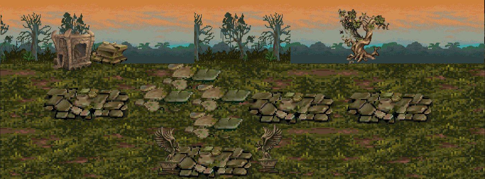
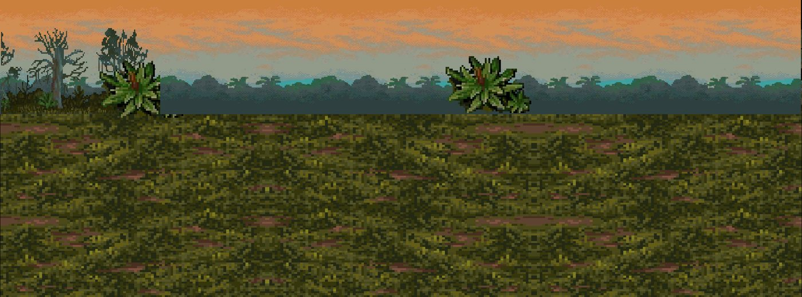
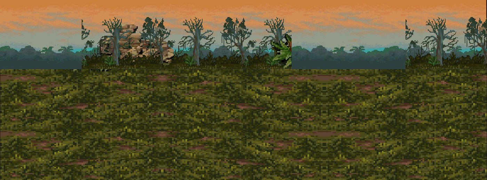
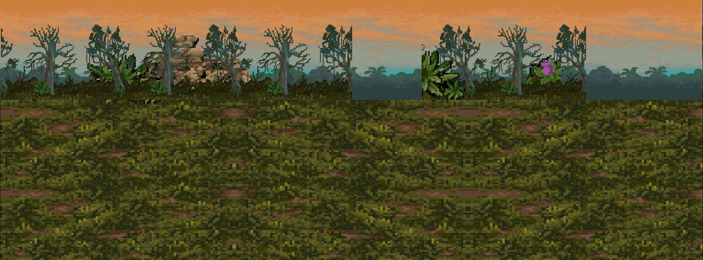
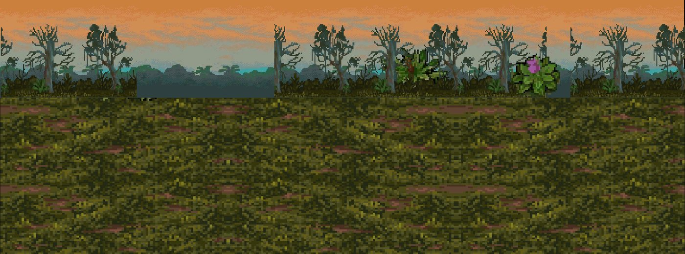
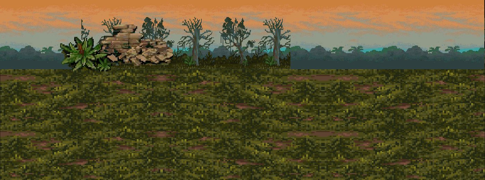

# Kit `nightmare` — Đảo Ác Mộng

> **Quy tắc bắt buộc cho Codex** (xem README.md): dùng https://github.com/0x0funky/agent-sprite-forge (generate2dmap / generate2dsprite) với route image_gen tích hợp; cấm codeart2d, API trả phí, vẽ bằng code, lật gương; không commit; không sửa tools/hd2d_audit/*, gate_waivers.json, check.sh; mỗi asset phải tự nhìn ảnh trước khi ghi "vẽ xong"; chỉ Claude/owner đánh dấu "duyệt".

- Style/palette: Đất tím sẫm nứt phát quang, cây hắc ám, tinh thể bóng tối. Bảng màu: #3A2B52/#5B3F7A, vết nứt phát sáng #B26BFF, rêu độc #4E7A4A.
- Thư mục asset: `apps/game-web/art-src/hd2d/batch-11-nightmare/`
- Số map: 6

## 1. Danh sách asset cần vẽ (kit chưa có asset)

Nguồn: Phần C `hd2d-maps-75-gemini-prompt.md`. Yêu cầu gốc: tile đất tím nứt, đá đen, nền phế tích; prop: rễ hắc ám ×3, cây khô xoắn ×3 (sway-split), tinh thể bóng tối ×3, cổng ma pháp đen (dormant/active), xương/di vật, tàn tích tường, trại tàn sinh (lều rách, đống lửa 4 khung), đèn ma trơi (4 khung); backdrop xa: đảo đen giữa biển tím, trăng.

| Vẽ | Duyệt | id (số thứ tự; đặt tên tiếng Anh vào manifest `name`) | loại | mô tả + prompt đi kèm |
|---|---|---|---|---|
| ⬜ | ⬜ | `nightmare-floor-01` | floor | đất tím nứt — tile sàn nhìn từ trên xuống, seamless 512×512; HD-2D Octopath pixel art, palette Đảo Ác Mộng, outline tối cùng sắc, 33–48 màu, không bóng đổ/sương/chữ. |
| ⬜ | ⬜ | `nightmare-floor-02` | floor | đá đen — tile sàn nhìn từ trên xuống, seamless 512×512; HD-2D Octopath pixel art, palette Đảo Ác Mộng, outline tối cùng sắc, 33–48 màu, không bóng đổ/sương/chữ. |
| ⬜ | ⬜ | `nightmare-floor-03` | floor | nền phế tích — tile sàn nhìn từ trên xuống, seamless 512×512; HD-2D Octopath pixel art, palette Đảo Ác Mộng, outline tối cùng sắc, 33–48 màu, không bóng đổ/sương/chữ. |
| ✅ | ⬜ | `nightmare-prop-01` | prop | rễ hắc ám — prop đứng billboard, pivot giữa-đáy; HD-2D Octopath pixel art, palette Đảo Ác Mộng, outline tối cùng sắc, 33–48 màu, không bóng đổ/sương/chữ. |
| ✅ | ⬜ | `nightmare-prop-02` | prop | rễ hắc ám — prop đứng billboard, pivot giữa-đáy; HD-2D Octopath pixel art, palette Đảo Ác Mộng, outline tối cùng sắc, 33–48 màu, không bóng đổ/sương/chữ. |
| ✅ | ⬜ | `nightmare-prop-03` | prop | rễ hắc ám — prop đứng billboard, pivot giữa-đáy; HD-2D Octopath pixel art, palette Đảo Ác Mộng, outline tối cùng sắc, 33–48 màu, không bóng đổ/sương/chữ. |
| ⬜ | ⬜ | `nightmare-prop-04` | prop | cây khô xoắn (sway-split) — prop đứng billboard, pivot giữa-đáy; HD-2D Octopath pixel art, palette Đảo Ác Mộng, outline tối cùng sắc, 33–48 màu, không bóng đổ/sương/chữ. |
| ⬜ | ⬜ | `nightmare-prop-05` | prop | cây khô xoắn (sway-split) — prop đứng billboard, pivot giữa-đáy; HD-2D Octopath pixel art, palette Đảo Ác Mộng, outline tối cùng sắc, 33–48 màu, không bóng đổ/sương/chữ. |
| ⬜ | ⬜ | `nightmare-prop-06` | prop | cây khô xoắn (sway-split) — prop đứng billboard, pivot giữa-đáy; HD-2D Octopath pixel art, palette Đảo Ác Mộng, outline tối cùng sắc, 33–48 màu, không bóng đổ/sương/chữ. |
| ✅ | ⬜ | `nightmare-prop-07` | prop | tinh thể bóng tối — prop đứng billboard, pivot giữa-đáy; HD-2D Octopath pixel art, palette Đảo Ác Mộng, outline tối cùng sắc, 33–48 màu, không bóng đổ/sương/chữ. |
| ✅ | ⬜ | `nightmare-prop-08` | prop | tinh thể bóng tối — prop đứng billboard, pivot giữa-đáy; HD-2D Octopath pixel art, palette Đảo Ác Mộng, outline tối cùng sắc, 33–48 màu, không bóng đổ/sương/chữ. |
| ✅ | ⬜ | `nightmare-prop-09` | prop | tinh thể bóng tối — prop đứng billboard, pivot giữa-đáy; HD-2D Octopath pixel art, palette Đảo Ác Mộng, outline tối cùng sắc, 33–48 màu, không bóng đổ/sương/chữ. |
| ⬜ | ⬜ | `nightmare-prop-10` | prop | cổng ma pháp đen (dormant/active) — prop đứng billboard, pivot giữa-đáy; HD-2D Octopath pixel art, palette Đảo Ác Mộng, outline tối cùng sắc, 33–48 màu, không bóng đổ/sương/chữ. |
| ⬜ | ⬜ | `nightmare-prop-11` | prop | xương/di vật — prop đứng billboard, pivot giữa-đáy; HD-2D Octopath pixel art, palette Đảo Ác Mộng, outline tối cùng sắc, 33–48 màu, không bóng đổ/sương/chữ. |
| ⬜ | ⬜ | `nightmare-prop-12` | prop | tàn tích tường — prop đứng billboard, pivot giữa-đáy; HD-2D Octopath pixel art, palette Đảo Ác Mộng, outline tối cùng sắc, 33–48 màu, không bóng đổ/sương/chữ. |
| ⬜ | ⬜ | `nightmare-prop-13` | prop | trại tàn sinh (lều rách, đống lửa 4 khung) — prop đứng billboard, pivot giữa-đáy; HD-2D Octopath pixel art, palette Đảo Ác Mộng, outline tối cùng sắc, 33–48 màu, không bóng đổ/sương/chữ. |
| ⬜ | ⬜ | `nightmare-prop-14` | prop | đèn ma trơi (4 khung) — prop đứng billboard, pivot giữa-đáy; HD-2D Octopath pixel art, palette Đảo Ác Mộng, outline tối cùng sắc, 33–48 màu, không bóng đổ/sương/chữ. |
| ⬜ | ⬜ | `nightmare-backdrop-far-01` | backdrop_far | đảo đen giữa biển tím — backdrop xa 1280×384 lặp ngang liền (64 px/đơn vị); HD-2D Octopath pixel art, palette Đảo Ác Mộng, outline tối cùng sắc, 33–48 màu, không bóng đổ/sương/chữ. |
| ⬜ | ⬜ | `nightmare-backdrop-far-02` | backdrop_far | trăng — backdrop xa 1280×384 lặp ngang liền (64 px/đơn vị); HD-2D Octopath pixel art, palette Đảo Ác Mộng, outline tối cùng sắc, 33–48 màu, không bóng đổ/sương/chữ. |
| ⬜ | ⬜ | `nightmare-floor-extra-01` | floor | tile sàn bổ sung (đủ ≥8 biến thể khác texture), seamless 512×512 |
| ⬜ | ⬜ | `nightmare-floor-extra-02` | floor | tile sàn bổ sung (đủ ≥8 biến thể khác texture), seamless 512×512 |
| ⬜ | ⬜ | `nightmare-floor-extra-03` | floor | tile sàn bổ sung (đủ ≥8 biến thể khác texture), seamless 512×512 |
| ⬜ | ⬜ | `nightmare-floor-extra-04` | floor | tile sàn bổ sung (đủ ≥8 biến thể khác texture), seamless 512×512 |
| ⬜ | ⬜ | `nightmare-floor-extra-05` | floor | tile sàn bổ sung (đủ ≥8 biến thể khác texture), seamless 512×512 |
| ⬜ | ⬜ | `nightmare-edge-01` | edge | dải chuyển tiếp giữa 2 tile chính, 512×128 liền hai đầu, mép bất quy tắc |
| ⬜ | ⬜ | `nightmare-edge-02` | edge | dải chuyển tiếp giữa 2 tile chính, 512×128 liền hai đầu, mép bất quy tắc |
| ⬜ | ⬜ | `nightmare-edge-03` | edge | dải chuyển tiếp giữa 2 tile chính, 512×128 liền hai đầu, mép bất quy tắc |
| ⬜ | ⬜ | `nightmare-decal-01` | decal | decal tiếp đất theo chủ đề kit (vụn, vết, xương/đá), bất quy tắc, mép mềm |
| ⬜ | ⬜ | `nightmare-decal-02` | decal | decal tiếp đất theo chủ đề kit (vụn, vết, xương/đá), bất quy tắc, mép mềm |
| ⬜ | ⬜ | `nightmare-decal-03` | decal | decal tiếp đất theo chủ đề kit (vụn, vết, xương/đá), bất quy tắc, mép mềm |
| ⬜ | ⬜ | `nightmare-decal-04` | decal | decal tiếp đất theo chủ đề kit (vụn, vết, xương/đá), bất quy tắc, mép mềm |
| ⬜ | ⬜ | `nightmare-decal-05` | decal | decal tiếp đất theo chủ đề kit (vụn, vết, xương/đá), bất quy tắc, mép mềm |
| ⬜ | ⬜ | `nightmare-decal-06` | decal | decal tiếp đất theo chủ đề kit (vụn, vết, xương/đá), bất quy tắc, mép mềm |
| ⬜ | ⬜ | `nightmare-decal-07` | decal | decal tiếp đất theo chủ đề kit (vụn, vết, xương/đá), bất quy tắc, mép mềm |
| ⬜ | ⬜ | `nightmare-decal-08` | decal | decal tiếp đất theo chủ đề kit (vụn, vết, xương/đá), bất quy tắc, mép mềm |
| ⬜ | ⬜ | `nightmare-decal-09` | decal | decal tiếp đất theo chủ đề kit (vụn, vết, xương/đá), bất quy tắc, mép mềm |
| ⬜ | ⬜ | `nightmare-decal-10` | decal | decal tiếp đất theo chủ đề kit (vụn, vết, xương/đá), bất quy tắc, mép mềm |
| ⬜ | ⬜ | `nightmare-decal-11` | decal | decal tiếp đất theo chủ đề kit (vụn, vết, xương/đá), bất quy tắc, mép mềm |
| ⬜ | ⬜ | `nightmare-decal-12` | decal | decal tiếp đất theo chủ đề kit (vụn, vết, xương/đá), bất quy tắc, mép mềm |
| ⬜ | ⬜ | `nightmare-shadow-01` | shadow | bóng procedural alpha mềm, màu kit |
| ⬜ | ⬜ | `nightmare-shadow-02` | shadow | bóng procedural alpha mềm, màu kit |
| ⬜ | ⬜ | `nightmare-shadow-03` | shadow | bóng procedural alpha mềm, màu kit |
| ⬜ | ⬜ | `nightmare-shadow-04` | shadow | bóng procedural alpha mềm, màu kit |
| ⬜ | ⬜ | `nightmare-backdrop-far` | backdrop | 1280×384, lặp ngang liền, mỗi tầng một khung cảnh khác |
| ⬜ | ⬜ | `nightmare-backdrop-mid` | backdrop | 1280×384, lặp ngang liền, mỗi tầng một khung cảnh khác |
| ⬜ | ⬜ | `nightmare-backdrop-near` | backdrop | 1280×384, lặp ngang liền, mỗi tầng một khung cảnh khác |
| ⬜ | ⬜ | `nightmare-portal-dormant` | portal | cổng nhìn thẳng mặt trước, đúng tông kit |
| ⬜ | ⬜ | `nightmare-portal-active` | portal | cùng mask với dormant |
| ⬜ | ⬜ | `nightmare-marker-arrival` | marker | vòng sáng 4 khung |
| ⬜ | ⬜ | `nightmare-fx-01` | fx | hạt/tia sáng sprite sheet theo chủ đề |
| ⬜ | ⬜ | `nightmare-fx-02` | fx | hạt/tia sáng sprite sheet theo chủ đề |
| ⬜ | ⬜ | `nightmare-fx-03` | fx | hạt/tia sáng sprite sheet theo chủ đề |

## 2. Prompt sheet chung cho kit

```text
[Dán Master v2: .ai/design/gpt-redo/00-master-v2.md]
Dùng agent-sprite-forge ($generate2dmap cho tile/prop, $generate2dsprite cho prop/decal/FX/marker). Route ảnh: image_gen tích hợp của Codex (kiểm `route_media.py resolve --kind image`). KHÔNG codeart2d, KHÔNG API, KHÔNG vẽ bằng code.
Kit: Đảo Ác Mộng (nightmare). Style: Đất tím sẫm nứt phát quang, cây hắc ám, tinh thể bóng tối. Bảng màu: #3A2B52/#5B3F7A, vết nứt phát sáng #B26BFF, rêu độc #4E7A4A.. Style anchor: batch-01-octopath/contact-sheet.png + 2 sprites.png linh thú.
Mỗi lần gọi: 1 sheet ~6 vật trên nền #FF00FF, bố trí 2×3/3×2, cách nhau ≥48 px, không chạm mép. Giữ raw-01.png byte-identical. Cắt/khử nền/pixel finish bằng script forge. 33–48 màu, alpha nhị phân, lề ≥8 px, 128 px = 1 đơn vị (far 64), người = 1.31 đơn vị (cỡ tối đa vật nhỏ: tools/hd2d_audit/size_check.py).
Mỗi asset: thư mục raw-01/final/prompt.md/review.md/qa.json trong apps/game-web/art-src/hd2d/batch-11-nightmare/<id>/. Tự nhìn 4× nền tối/caro. Xong: `python3 tools/hd2d_audit/art_gate.py batch-11-nightmare` = 0 lỗi, contact-sheet mới hơn manifest.
```

## 3. Từng map

### `nightmare_island_survivor_camp` — Trại Tàn Sinh



- Ảnh gốc (đối chiếu): `.ai/design/map-checklists/refs/nightmare_island_survivor_camp.jpg` (bản đầy đủ: `~/Downloads/Phimond-P12-Review/map-images/nightmare_island_survivor_camp.png`, 2248×835 px, 100 px = 1 đơn vị APK)
- Nguồn APK: scene `Assets/Scenes/Map/25-30/DaoAcMong.unity`, 28 sprite ghép; brief: [../map-briefs/kit_nightmare/nightmare_island_survivor_camp.md](../map-briefs/kit_nightmare/nightmare_island_survivor_camp.md)
- Cổng: 4 · vùng quái: có · spawn: 5 · NPC: night_pavel, night_quinn, night_rhea
- neo `P:nightmare_island_portal_002` (door) Cửa → Phế Tích Cổ Thành: px [1059, 361]
- neo `P:nightmare_island_portal_006` (door) Cửa → Đông Đảo Huyền Thuật: px [2128, 492]
- neo `P:nightmare_island_portal_008` (door) Cửa → Oán Linh Hải Đạo: px [96, 528]
- neo `P:nightmare_island_portal_009` (door) Cửa → Cổng Tai Kiếp: px [985, 761]
- neo `night_pavel` (npc) : px CẦN ĐẶT
- neo `night_quinn` (npc) : px CẦN ĐẶT
- neo `night_rhea` (npc) : px CẦN ĐẶT
- NPC cần sprite (batch-05; kiểm trùng): night_pavel, night_quinn, night_rhea

Asset chính: dùng bảng kit (mục 1). Landmark riêng của map (Codex xem ảnh gốc, ghi tên vật nhận diện vào bảng rồi vẽ):

| Vẽ | Duyệt | id | loại | mô tả | prompt |
|---|---|---|---|---|---|
| ✅ | ⬜ | `nightmare_island_survivor_camp-landmark-01` | landmark | weathered eagle statue with wings half-spread on a broken square pedestal — diễn giải HD2D từ ảnh tham chiếu | xem prompt.md + job SHA256 |
| ⬜ | ⬜ | `nightmare_island_survivor_camp-landmark-02` | landmark | (vật nhận diện #2, nếu có) | — |

Prompt cho Codex:

```text
Dùng agent-sprite-forge (generate2dmap + generate2dsprite, route image_gen). Map nightmare_island_survivor_camp (Trại Tàn Sinh), kit nightmare.
Mở và đính kèm thật ảnh gốc .ai/design/map-checklists/refs/nightmare_island_survivor_camp.jpg vào image_gen cùng 2–3 ảnh style batch 00–09 sát loại + 2 anchor linh thú; ghi sha256.
Rà các hàng chưa ✅ trong bảng; vẽ theo sheet 6 vật; landmark riêng: nhìn ảnh gốc, ghi tên vật vào bảng rồi vẽ (không giả là recovered APK nếu là diễn giải).
Xong: cập nhật cột "Vẽ" (✅ chỉ khi đã nhìn final 4×), chạy art_gate cho kit, KHÔNG tự đặt "Duyệt".
```

### `nightmare_island_east_magic_island` — Đông Đảo Huyền Thuật



- Ảnh gốc (đối chiếu): `.ai/design/map-checklists/refs/nightmare_island_east_magic_island.jpg` (bản đầy đủ: `~/Downloads/Phimond-P12-Review/map-images/nightmare_island_east_magic_island.png`, 2248×835 px, 100 px = 1 đơn vị APK)
- Nguồn APK: scene `Assets/Scenes/Map/25-30/DaoAcMong.unity`, 19 sprite ghép; brief: [../map-briefs/kit_nightmare/nightmare_island_east_magic_island.md](../map-briefs/kit_nightmare/nightmare_island_east_magic_island.md)
- Cổng: 2 · vùng quái: có · spawn: 12 · NPC: night_soren
- neo `P:nightmare_island_portal_005` (door) Cửa → Trại Tàn Sinh: px [118, 496]
- neo `P:nightmare_island_portal_010` (door) Cửa → Quảng Trường Thạch Trụ: px [2147, 506]
- neo `AT:square:nightmare_island_east_magic_island` (arrival) Đến từ trụ Quảng Trường: px [2047, 497]
- neo `night_soren` (npc) : px CẦN ĐẶT
- NPC cần sprite (batch-05; kiểm trùng): night_soren

Asset chính: dùng bảng kit (mục 1). Landmark riêng của map (Codex xem ảnh gốc, ghi tên vật nhận diện vào bảng rồi vẽ):

| Vẽ | Duyệt | id | loại | mô tả | prompt |
|---|---|---|---|---|---|
| ✅ | ⬜ | `nightmare_island_east_magic_island-landmark-01` | landmark | tall sharp-leaf green bromeliad with rust-red center and black twisted root base — diễn giải HD2D từ ảnh tham chiếu | xem prompt.md + job SHA256 |
| ⬜ | ⬜ | `nightmare_island_east_magic_island-landmark-02` | landmark | (vật nhận diện #2, nếu có) | — |

Prompt cho Codex:

```text
Dùng agent-sprite-forge (generate2dmap + generate2dsprite, route image_gen). Map nightmare_island_east_magic_island (Đông Đảo Huyền Thuật), kit nightmare.
Mở và đính kèm thật ảnh gốc .ai/design/map-checklists/refs/nightmare_island_east_magic_island.jpg vào image_gen cùng 2–3 ảnh style batch 00–09 sát loại + 2 anchor linh thú; ghi sha256.
Rà các hàng chưa ✅ trong bảng; vẽ theo sheet 6 vật; landmark riêng: nhìn ảnh gốc, ghi tên vật vào bảng rồi vẽ (không giả là recovered APK nếu là diễn giải).
Xong: cập nhật cột "Vẽ" (✅ chỉ khi đã nhìn final 4×), chạy art_gate cho kit, KHÔNG tự đặt "Duyệt".
```

### `nightmare_island_ruins` — Phế Tích Cổ Thành



- Ảnh gốc (đối chiếu): `.ai/design/map-checklists/refs/nightmare_island_ruins.jpg` (bản đầy đủ: `~/Downloads/Phimond-P12-Review/map-images/nightmare_island_ruins.png`, 2248×835 px, 100 px = 1 đơn vị APK)
- Nguồn APK: scene `Assets/Scenes/Map/25-30/DaoAcMong.unity`, 19 sprite ghép; brief: [../map-briefs/kit_nightmare/nightmare_island_ruins.md](../map-briefs/kit_nightmare/nightmare_island_ruins.md)
- Cổng: 1 · vùng quái: có · spawn: 10 · NPC: night_talia
- neo `P:nightmare_island_portal_004` (door) Cửa → Trại Tàn Sinh: px [1683, 781]
- neo `night_talia` (npc) : px CẦN ĐẶT
- NPC cần sprite (batch-05; kiểm trùng): night_talia

Asset chính: dùng bảng kit (mục 1). Landmark riêng của map (Codex xem ảnh gốc, ghi tên vật nhận diện vào bảng rồi vẽ):

| Vẽ | Duyệt | id | loại | mô tả | prompt |
|---|---|---|---|---|---|
| ✅ | ⬜ | `nightmare_island_ruins-landmark-01` | landmark | broken brown masonry wall with jagged stepped top, a dark inset arch fragment and olive creepers — diễn giải HD2D từ ảnh tham chiếu | xem prompt.md + job SHA256 |
| ⬜ | ⬜ | `nightmare_island_ruins-landmark-02` | landmark | (vật nhận diện #2, nếu có) | — |

Prompt cho Codex:

```text
Dùng agent-sprite-forge (generate2dmap + generate2dsprite, route image_gen). Map nightmare_island_ruins (Phế Tích Cổ Thành), kit nightmare.
Mở và đính kèm thật ảnh gốc .ai/design/map-checklists/refs/nightmare_island_ruins.jpg vào image_gen cùng 2–3 ảnh style batch 00–09 sát loại + 2 anchor linh thú; ghi sha256.
Rà các hàng chưa ✅ trong bảng; vẽ theo sheet 6 vật; landmark riêng: nhìn ảnh gốc, ghi tên vật vào bảng rồi vẽ (không giả là recovered APK nếu là diễn giải).
Xong: cập nhật cột "Vẽ" (✅ chỉ khi đã nhìn final 4×), chạy art_gate cho kit, KHÔNG tự đặt "Duyệt".
```

### `nightmare_island_disaster_gate` — Cổng Tai Kiếp



- Ảnh gốc (đối chiếu): `.ai/design/map-checklists/refs/nightmare_island_disaster_gate.jpg` (bản đầy đủ: `~/Downloads/Phimond-P12-Review/map-images/nightmare_island_disaster_gate.png`, 2248×835 px, 100 px = 1 đơn vị APK)
- Nguồn APK: scene `Assets/Scenes/Map/25-30/DaoAcMong.unity`, 19 sprite ghép; brief: [../map-briefs/kit_nightmare/nightmare_island_disaster_gate.md](../map-briefs/kit_nightmare/nightmare_island_disaster_gate.md)
- Cổng: 1 · vùng quái: có · spawn: 10 · NPC: —
- neo `P:nightmare_island_portal_003` (door) Cửa → Trại Tàn Sinh: px [1083, 363]

Asset chính: dùng bảng kit (mục 1). Landmark riêng của map (Codex xem ảnh gốc, ghi tên vật nhận diện vào bảng rồi vẽ):

| Vẽ | Duyệt | id | loại | mô tả | prompt |
|---|---|---|---|---|---|
| ✅ | ⬜ | `nightmare_island_disaster_gate-landmark-01` | landmark | Closed violet thorn-vine seedbud — diễn giải HD2D từ ảnh tham chiếu | xem prompt.md + job SHA256 |
| ⬜ | ⬜ | `nightmare_island_disaster_gate-landmark-02` | landmark | (vật nhận diện #2, nếu có) | — |

Prompt cho Codex:

```text
Dùng agent-sprite-forge (generate2dmap + generate2dsprite, route image_gen). Map nightmare_island_disaster_gate (Cổng Tai Kiếp), kit nightmare.
Mở và đính kèm thật ảnh gốc .ai/design/map-checklists/refs/nightmare_island_disaster_gate.jpg vào image_gen cùng 2–3 ảnh style batch 00–09 sát loại + 2 anchor linh thú; ghi sha256.
Rà các hàng chưa ✅ trong bảng; vẽ theo sheet 6 vật; landmark riêng: nhìn ảnh gốc, ghi tên vật vào bảng rồi vẽ (không giả là recovered APK nếu là diễn giải).
Xong: cập nhật cột "Vẽ" (✅ chỉ khi đã nhìn final 4×), chạy art_gate cho kit, KHÔNG tự đặt "Duyệt".
```

### `nightmare_island_resentment_path` — Oán Linh Hải Đạo



- Ảnh gốc (đối chiếu): `.ai/design/map-checklists/refs/nightmare_island_resentment_path.jpg` (bản đầy đủ: `~/Downloads/Phimond-P12-Review/map-images/nightmare_island_resentment_path.png`, 2248×835 px, 100 px = 1 đơn vị APK)
- Nguồn APK: scene `Assets/Scenes/Map/25-30/DaoAcMong.unity`, 19 sprite ghép; brief: [../map-briefs/kit_nightmare/nightmare_island_resentment_path.md](../map-briefs/kit_nightmare/nightmare_island_resentment_path.md)
- Cổng: 2 · vùng quái: có · spawn: 12 · NPC: night_ulric
- neo `P:nightmare_island_portal_001` (door) Cửa → Tuyệt Vọng Hải Địa: px [128, 475]
- neo `P:nightmare_island_portal_007` (door) Cửa → Trại Tàn Sinh: px [2146, 507]
- neo `night_ulric` (npc) : px CẦN ĐẶT
- NPC cần sprite (batch-05; kiểm trùng): night_ulric

Asset chính: dùng bảng kit (mục 1). Landmark riêng của map (Codex xem ảnh gốc, ghi tên vật nhận diện vào bảng rồi vẽ):

| Vẽ | Duyệt | id | loại | mô tả | prompt |
|---|---|---|---|---|---|
| ✅ | ⬜ | `nightmare_island_resentment_path-landmark-01` | landmark | crooked skeletal tree with many short snapped bare twigs and exposed forked roots — diễn giải HD2D từ ảnh tham chiếu | xem prompt.md + job SHA256 |
| ⬜ | ⬜ | `nightmare_island_resentment_path-landmark-02` | landmark | (vật nhận diện #2, nếu có) | — |

Prompt cho Codex:

```text
Dùng agent-sprite-forge (generate2dmap + generate2dsprite, route image_gen). Map nightmare_island_resentment_path (Oán Linh Hải Đạo), kit nightmare.
Mở và đính kèm thật ảnh gốc .ai/design/map-checklists/refs/nightmare_island_resentment_path.jpg vào image_gen cùng 2–3 ảnh style batch 00–09 sát loại + 2 anchor linh thú; ghi sha256.
Rà các hàng chưa ✅ trong bảng; vẽ theo sheet 6 vật; landmark riêng: nhìn ảnh gốc, ghi tên vật vào bảng rồi vẽ (không giả là recovered APK nếu là diễn giải).
Xong: cập nhật cột "Vẽ" (✅ chỉ khi đã nhìn final 4×), chạy art_gate cho kit, KHÔNG tự đặt "Duyệt".
```

### `nightmare_island_despair_land` — Tuyệt Vọng Hải Địa



- Ảnh gốc (đối chiếu): `.ai/design/map-checklists/refs/nightmare_island_despair_land.jpg` (bản đầy đủ: `~/Downloads/Phimond-P12-Review/map-images/nightmare_island_despair_land.png`, 2248×835 px, 100 px = 1 đơn vị APK)
- Nguồn APK: scene `Assets/Scenes/Map/25-30/DaoAcMong.unity`, 19 sprite ghép; brief: [../map-briefs/kit_nightmare/nightmare_island_despair_land.md](../map-briefs/kit_nightmare/nightmare_island_despair_land.md)
- Cổng: 1 · vùng quái: có · spawn: 12 · NPC: night_vesna
- neo `P:nightmare_island_portal_011` (door) Cửa → Oán Linh Hải Đạo: px [2133, 517]
- neo `night_vesna` (npc) : px CẦN ĐẶT
- NPC cần sprite (batch-05; kiểm trùng): night_vesna

Asset chính: dùng bảng kit (mục 1). Landmark riêng của map (Codex xem ảnh gốc, ghi tên vật nhận diện vào bảng rồi vẽ):

| Vẽ | Duyệt | id | loại | mô tả | prompt |
|---|---|---|---|---|---|
| ✅ | ⬜ | `nightmare_island_despair_land-landmark-01` | landmark | collapsed tiered ancient stone plinth and masonry pile with one leaning upright slab — diễn giải HD2D từ ảnh tham chiếu | xem prompt.md + job SHA256 |
| ⬜ | ⬜ | `nightmare_island_despair_land-landmark-02` | landmark | (vật nhận diện #2, nếu có) | — |

Prompt cho Codex:

```text
Dùng agent-sprite-forge (generate2dmap + generate2dsprite, route image_gen). Map nightmare_island_despair_land (Tuyệt Vọng Hải Địa), kit nightmare.
Mở và đính kèm thật ảnh gốc .ai/design/map-checklists/refs/nightmare_island_despair_land.jpg vào image_gen cùng 2–3 ảnh style batch 00–09 sát loại + 2 anchor linh thú; ghi sha256.
Rà các hàng chưa ✅ trong bảng; vẽ theo sheet 6 vật; landmark riêng: nhìn ảnh gốc, ghi tên vật vào bảng rồi vẽ (không giả là recovered APK nếu là diễn giải).
Xong: cập nhật cột "Vẽ" (✅ chỉ khi đã nhìn final 4×), chạy art_gate cho kit, KHÔNG tự đặt "Duyệt".
```
