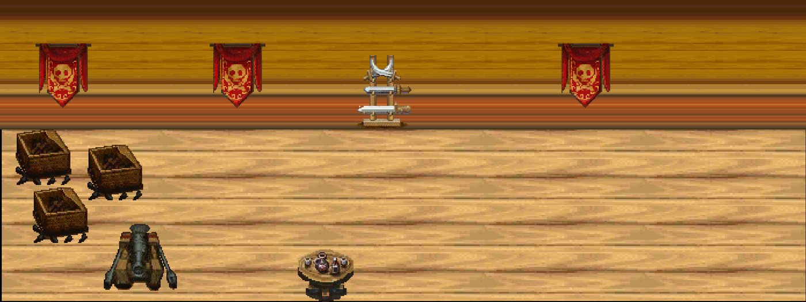

# Kit `ship` — Tàu cướp biển

> **Quy tắc bắt buộc cho Codex** (xem README.md): dùng https://github.com/0x0funky/agent-sprite-forge (generate2dmap / generate2dsprite) với route image_gen tích hợp; cấm codeart2d, API trả phí, vẽ bằng code, lật gương; không commit; không sửa tools/hd2d_audit/*, gate_waivers.json, check.sh; mỗi asset phải tự nhìn ảnh trước khi ghi "vẽ xong"; chỉ Claude/owner đánh dấu "duyệt".

- Style/palette: Gỗ boong tàu, buồm, đèn bão, cờ hải tặc
- Thư mục asset: `apps/game-web/art-src/hd2d/batch-04-octopath/`
- Số map: 1

## 1. Trạng thái asset hiện có

Tổng 21 · duyệt 21 · nháp 0 · khác 0

| Loại | Có | Cần tối thiểu | Ghi chú |
|---|---|---|---|
| floor | 1 | 8 | ⬜ thiếu 7 · tile sàn 512×512 seamless, mỗi biến thể là texture khác |
| edge | 0 | 3 | ⬜ thiếu 3 · dải chuyển tiếp 512×128 liền hai đầu |
| prop | 5 | 36 | ⬜ thiếu 31 · prop đứng, ≥2–3 biến thể thật/chủng loại |
| decal | 2 | 12 | ⬜ thiếu 10 · decal tiếp đất bất quy tắc, mép mềm |
| shadow | 0 | 4 | ⬜ thiếu 4 · bóng procedural alpha mềm (ngoại lệ) |
| backdrop | 1 | 3 | ⬜ thiếu 2 · far/mid/near, lặp ngang liền |
| portal | 1 | 2 | ⬜ thiếu 1 · cặp dormant/active cùng mask |
| marker | 1 | 1 | ✅ · điểm xuất hiện 4 khung |
| fx | 4 | 3 | ✅ · hạt/tia sáng sprite sheet |

### Danh sách asset

| Vẽ | Duyệt | id | loại | kích thước (world) | prompt/nguồn |
|---|---|---|---|---|---|
| ✅ | ✅ duyệt | `ship-hull-backdrop` | backdrop_mid | [8.0, 3.0] | [prompt.md](../../../apps/game-web/art-src/hd2d/batch-04-octopath/ship-hull-backdrop/prompt.md) |
| ✅ | ✅ duyệt | `target-ring` | decal | [0.703125, 0.484375] | [prompt.md](../../../apps/game-web/art-src/hd2d/batch-04-octopath/target-ring/prompt.md) |
| ✅ | ✅ duyệt | `touch-ring` | decal | [0.78125, 0.484375] | [prompt.md](../../../apps/game-web/art-src/hd2d/batch-04-octopath/touch-ring/prompt.md) |
| ✅ | ✅ duyệt | `ship-deck-tile` | floor | [4.0, 4.0] | [prompt.md](../../../apps/game-web/art-src/hd2d/batch-04-octopath/ship-deck-tile/prompt.md) |
| ✅ | ✅ duyệt | `exit-arrow-down` | fx | [0.671875, 0.625] | [prompt.md](../../../apps/game-web/art-src/hd2d/batch-04-octopath/exit-arrow-down/prompt.md) |
| ✅ | ✅ duyệt | `exit-arrow-left` | fx | [0.734375, 0.625] | [prompt.md](../../../apps/game-web/art-src/hd2d/batch-04-octopath/exit-arrow-left/prompt.md) |
| ✅ | ✅ duyệt | `exit-arrow-right` | fx | [0.7421875, 0.625] | [prompt.md](../../../apps/game-web/art-src/hd2d/batch-04-octopath/exit-arrow-right/prompt.md) |
| ✅ | ✅ duyệt | `exit-arrow-up` | fx | [0.6796875, 0.625] | [prompt.md](../../../apps/game-web/art-src/hd2d/batch-04-octopath/exit-arrow-up/prompt.md) |
| ✅ | ✅ duyệt | `quest-complete` | icon | [0.9921875, 0.671875] | [prompt.md](../../../apps/game-web/art-src/hd2d/batch-04-octopath/quest-complete/prompt.md) |
| ✅ | ✅ duyệt | `quest-new` | icon | [0.84375, 0.671875] | [prompt.md](../../../apps/game-web/art-src/hd2d/batch-04-octopath/quest-new/prompt.md) |
| ✅ | ✅ duyệt | `talk-mark` | icon | [0.4609375, 0.3125] | [prompt.md](../../../apps/game-web/art-src/hd2d/batch-04-octopath/talk-mark/prompt.md) |
| ✅ | ✅ duyệt | `storm-lantern` | light | [0.6640625, 1.125] | [prompt.md](../../../apps/game-web/art-src/hd2d/batch-04-octopath/storm-lantern/prompt.md) |
| ✅ | ✅ duyệt | `nest-marker` | marker | [0.765625, 0.625] | [prompt.md](../../../apps/game-web/art-src/hd2d/batch-04-octopath/nest-marker/prompt.md) |
| ✅ | ✅ duyệt | `teleport-pillar-high` | portal | [2.3125, 1.609375] | [prompt.md](../../../apps/game-web/art-src/hd2d/batch-04-octopath/teleport-pillar-high/prompt.md) |
| ✅ | ✅ duyệt | `cannon` | prop | [1.265625, 1.296875] | [prompt.md](../../../apps/game-web/art-src/hd2d/batch-04-octopath/cannon/prompt.md) |
| ✅ | ✅ duyệt | `helm-wheel` | prop | [1.4296875, 1.609375] | [prompt.md](../../../apps/game-web/art-src/hd2d/batch-04-octopath/helm-wheel/prompt.md) |
| ✅ | ✅ duyệt | `mast-trunk` | prop | [2.046875, 2.9375] | [prompt.md](../../../apps/game-web/art-src/hd2d/batch-04-octopath/mast-trunk/prompt.md) |
| ✅ | ✅ duyệt | `rope-coil` | prop | [0.671875, 0.6875] | [prompt.md](../../../apps/game-web/art-src/hd2d/batch-04-octopath/rope-coil/prompt.md) |
| ✅ | ✅ duyệt | `rum-barrel` | prop | [1.234375, 1.15625] | [prompt.md](../../../apps/game-web/art-src/hd2d/batch-04-octopath/rum-barrel/prompt.md) |
| ✅ | ✅ duyệt | `pirate-flag` | prop_sway | [1.3828125, 1.453125] | [prompt.md](../../../apps/game-web/art-src/hd2d/batch-04-octopath/pirate-flag/prompt.md) |
| ✅ | ✅ duyệt | `sail-cloth` | prop_sway | [2.1796875, 2.0] | [prompt.md](../../../apps/game-web/art-src/hd2d/batch-04-octopath/sail-cloth/prompt.md) |

## 2. Prompt sheet chung cho kit

```text
[Dán Master v2: .ai/design/gpt-redo/00-master-v2.md]
Dùng agent-sprite-forge ($generate2dmap cho tile/prop, $generate2dsprite cho prop/decal/FX/marker). Route ảnh: image_gen tích hợp của Codex (kiểm `route_media.py resolve --kind image`). KHÔNG codeart2d, KHÔNG API, KHÔNG vẽ bằng code.
Kit: Tàu cướp biển (ship). Style: Gỗ boong tàu, buồm, đèn bão, cờ hải tặc. Style anchor: batch-01-octopath/contact-sheet.png + 2 sprites.png linh thú.
Mỗi lần gọi: 1 sheet ~6 vật trên nền #FF00FF, bố trí 2×3/3×2, cách nhau ≥48 px, không chạm mép. Giữ raw-01.png byte-identical. Cắt/khử nền/pixel finish bằng script forge. 33–48 màu, alpha nhị phân, lề ≥8 px, 128 px = 1 đơn vị (far 64), người = 1.31 đơn vị (cỡ tối đa vật nhỏ: tools/hd2d_audit/size_check.py).
Mỗi asset: thư mục raw-01/final/prompt.md/review.md/qa.json trong apps/game-web/art-src/hd2d/batch-11-ship/<id>/. Tự nhìn 4× nền tối/caro. Xong: `python3 tools/hd2d_audit/art_gate.py batch-11-ship` = 0 lỗi, contact-sheet mới hơn manifest.
```

## 3. Từng map

### `middle_corridor_main_hall` — Hải Tặc Hào



- Ảnh gốc (đối chiếu): `.ai/design/map-checklists/refs/middle_corridor_main_hall.jpg` (bản đầy đủ: `~/Downloads/Phimond-P12-Review/map-images/middle_corridor_main_hall.png`, 2314×870 px, 100 px = 1 đơn vị APK)
- Nguồn APK: scene `Assets/Scenes/HanhLang.unity`, 29 sprite ghép; brief: chưa có
- Brief điểm neo: **chưa có** (thiếu bounds P12). Codex đối chiếu ảnh gốc bằng mắt; Claude bổ sung brief trước khi dựng layout.

Asset chính: dùng bảng kit (mục 1). Landmark riêng của map (Codex xem ảnh gốc, ghi tên vật nhận diện vào bảng rồi vẽ):

| Vẽ | Duyệt | id | loại | mô tả | prompt |
|---|---|---|---|---|---|
| ⬜ | ⬜ | `middle_corridor_main_hall-landmark-01` | landmark | (vật nhận diện #1 trong ảnh gốc) | — |
| ⬜ | ⬜ | `middle_corridor_main_hall-landmark-02` | landmark | (vật nhận diện #2, nếu có) | — |

Prompt cho Codex:

```text
Dùng agent-sprite-forge (generate2dmap + generate2dsprite, route image_gen). Map middle_corridor_main_hall (Hải Tặc Hào), kit ship.
Mở và đính kèm thật ảnh gốc .ai/design/map-checklists/refs/middle_corridor_main_hall.jpg vào image_gen cùng 2–3 ảnh style batch 00–09 sát loại + 2 anchor linh thú; ghi sha256.
Rà các hàng chưa ✅ trong bảng; vẽ theo sheet 6 vật; landmark riêng: nhìn ảnh gốc, ghi tên vật vào bảng rồi vẽ (không giả là recovered APK nếu là diễn giải).
Xong: cập nhật cột "Vẽ" (✅ chỉ khi đã nhìn final 4×), chạy art_gate cho kit, KHÔNG tự đặt "Duyệt".
```
