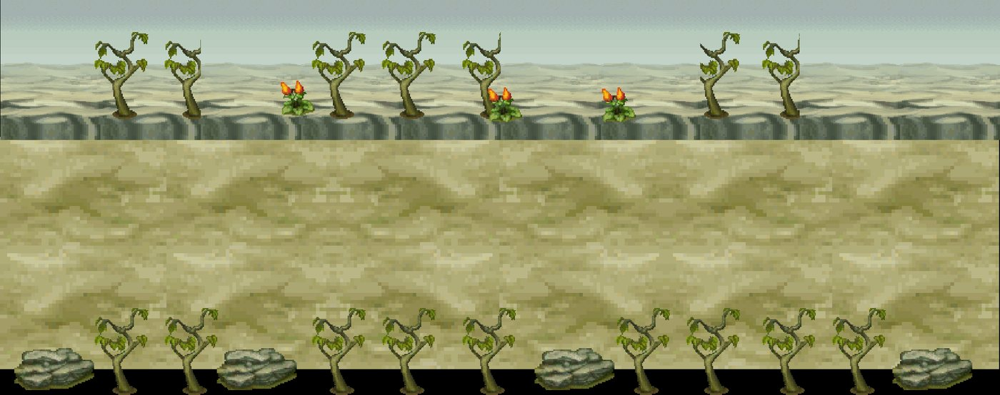
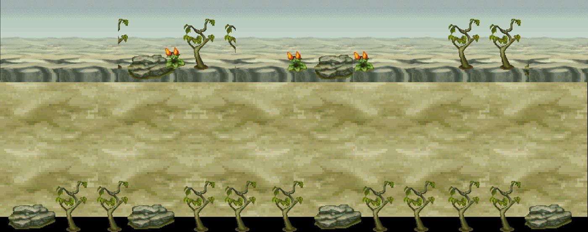
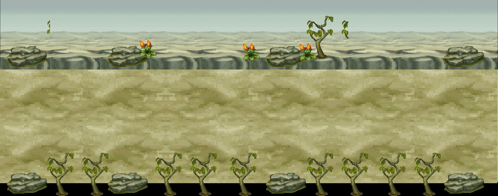
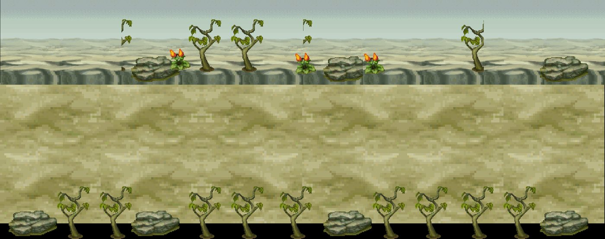
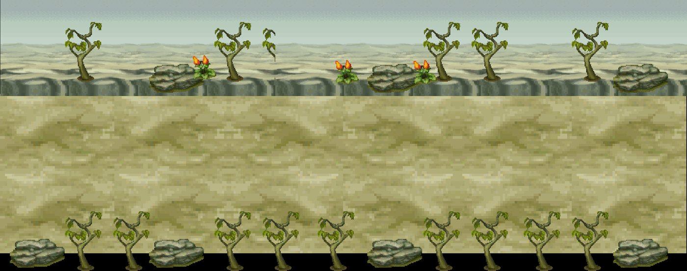
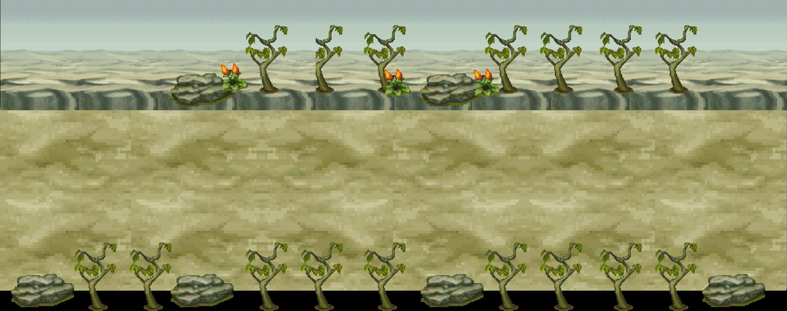
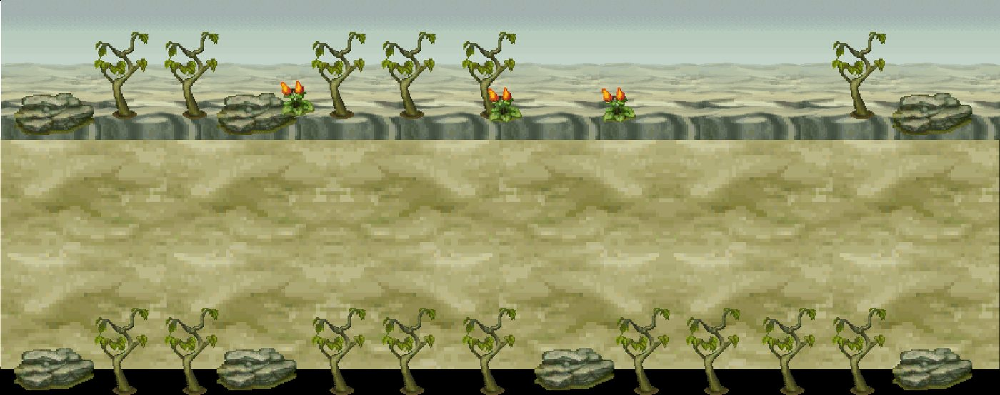
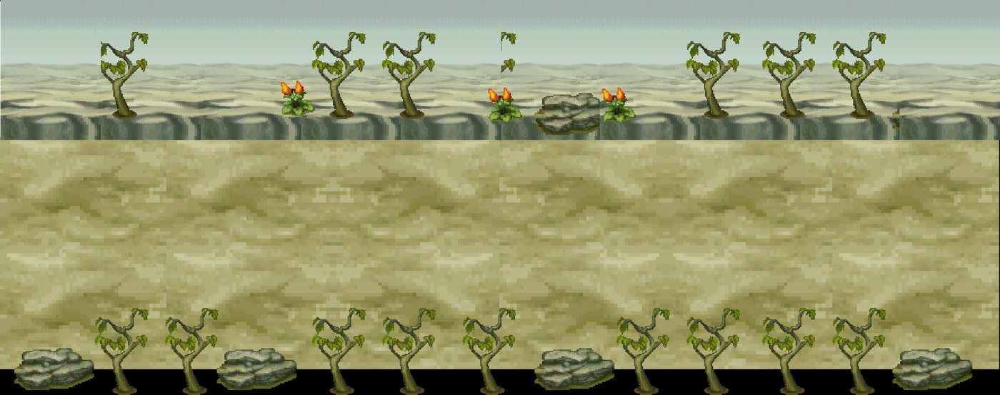
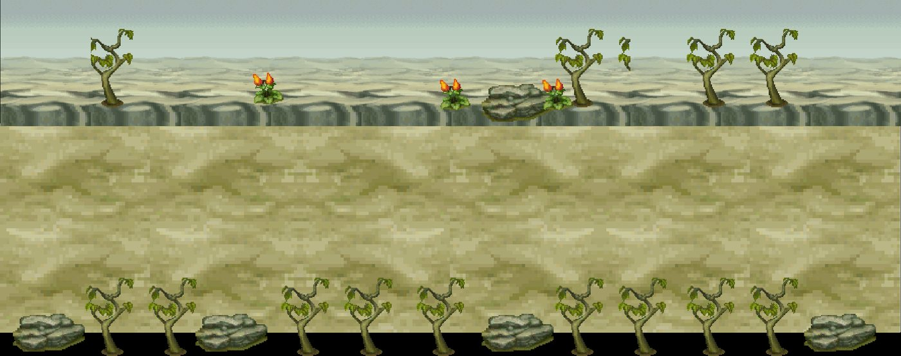

# Kit `tomb` — Lăng Mộ

> **Quy tắc bắt buộc cho Codex** (xem README.md): dùng https://github.com/0x0funky/agent-sprite-forge (generate2dmap / generate2dsprite) với route image_gen tích hợp; cấm codeart2d, API trả phí, vẽ bằng code, lật gương; không commit; không sửa tools/hd2d_audit/*, gate_waivers.json, check.sh; mỗi asset phải tự nhìn ảnh trước khi ghi "vẽ xong"; chỉ Claude/owner đánh dấu "duyệt".

- Style/palette: Gạch mộ rêu phong, đá xám xanh, ánh đèn ma xanh lục. Hai khu ngoài (Cồn Úa Vàng, Bãi Gai Khô) là sa mạc vàng cây gai khô.
- Thư mục asset: `apps/game-web/art-src/hd2d/batch-11-tomb/`
- Số map: 9

## 1. Trạng thái asset hiện có

Tổng 11 · duyệt 0 · nháp 0 · khác 11

| Loại | Có | Cần tối thiểu | Ghi chú |
|---|---|---|---|
| floor | 3 | 8 | ⬜ thiếu 5 · tile sàn 512×512 seamless, mỗi biến thể là texture khác |
| edge | 0 | 3 | ⬜ thiếu 3 · dải chuyển tiếp 512×128 liền hai đầu |
| prop | 5 | 36 | ⬜ thiếu 31 · prop đứng, ≥2–3 biến thể thật/chủng loại |
| decal | 0 | 12 | ⬜ thiếu 12 · decal tiếp đất bất quy tắc, mép mềm |
| shadow | 0 | 4 | ⬜ thiếu 4 · bóng procedural alpha mềm (ngoại lệ) |
| backdrop | 1 | 3 | ⬜ thiếu 2 · far/mid/near, lặp ngang liền |
| portal | 2 | 2 | ✅ · cặp dormant/active cùng mask |
| marker | 0 | 1 | ⬜ thiếu 1 · điểm xuất hiện 4 khung |
| fx | 0 | 3 | ⬜ thiếu 3 · hạt/tia sáng sprite sheet |

### Danh sách asset

| Vẽ | Duyệt | id | loại | kích thước (world) | prompt/nguồn |
|---|---|---|---|---|---|
| ✅ | ❌ pilot Gemini — vẽ lại | `tomb-necropolis-wall-far` | backdrop | [16.0, 6.0] | [prompt.md](../../../apps/game-web/art-src/hd2d/batch-11-tomb/tomb-necropolis-wall-far/prompt.md) |
| ✅ | ❌ pilot Gemini — vẽ lại | `tomb-brick-floor` | floor | [4.0, 4.0] | [prompt.md](../../../apps/game-web/art-src/hd2d/batch-11-tomb/tomb-brick-floor/prompt.md) |
| ✅ | ❌ pilot Gemini — vẽ lại | `tomb-graveyard-dirt` | floor | [4.0, 4.0] | [prompt.md](../../../apps/game-web/art-src/hd2d/batch-11-tomb/tomb-graveyard-dirt/prompt.md) |
| ✅ | ❌ pilot Gemini — vẽ lại | `tomb-tile-edge-decal` | floor | [4.0, 4.0] | — |
| ✅ | ❌ pilot Gemini — vẽ lại | `tomb-portal-active` | portal | [1.6875, 2.1562] | [prompt.md](../../../apps/game-web/art-src/hd2d/batch-11-tomb/tomb-portal-active/prompt.md) |
| ✅ | ❌ pilot Gemini — vẽ lại | `tomb-portal-dormant` | portal | [1.6875, 2.1562] | [prompt.md](../../../apps/game-web/art-src/hd2d/batch-11-tomb/tomb-portal-dormant/prompt.md) |
| ✅ | ❌ pilot Gemini — vẽ lại | `tomb-arch-gate` | prop | [2.1875, 2.0312] | [prompt.md](../../../apps/game-web/art-src/hd2d/batch-11-tomb/tomb-arch-gate/prompt.md) |
| ✅ | ❌ pilot Gemini — vẽ lại | `tomb-gravestone-01` | prop | [1.2578, 1.75] | [prompt.md](../../../apps/game-web/art-src/hd2d/batch-11-tomb/tomb-gravestone-01/prompt.md) |
| ✅ | ❌ pilot Gemini — vẽ lại | `tomb-gravestone-02` | prop | [1.0312, 1.75] | [prompt.md](../../../apps/game-web/art-src/hd2d/batch-11-tomb/tomb-gravestone-02/prompt.md) |
| ✅ | ❌ pilot Gemini — vẽ lại | `tomb-lantern-spirit` | prop | [2.6562, 1.125] | [prompt.md](../../../apps/game-web/art-src/hd2d/batch-11-tomb/tomb-lantern-spirit/prompt.md) |
| ✅ | ❌ pilot Gemini — vẽ lại | `tomb-sarcophagus-01` | prop | [1.0547, 1.8594] | [prompt.md](../../../apps/game-web/art-src/hd2d/batch-11-tomb/tomb-sarcophagus-01/prompt.md) |

## 2. Prompt sheet chung cho kit

```text
[Dán Master v2: .ai/design/gpt-redo/00-master-v2.md]
Dùng agent-sprite-forge ($generate2dmap cho tile/prop, $generate2dsprite cho prop/decal/FX/marker). Route ảnh: image_gen tích hợp của Codex (kiểm `route_media.py resolve --kind image`). KHÔNG codeart2d, KHÔNG API, KHÔNG vẽ bằng code.
Kit: Lăng Mộ (tomb). Style: Gạch mộ rêu phong, đá xám xanh, ánh đèn ma xanh lục. Hai khu ngoài (Cồn Úa Vàng, Bãi Gai Khô) là sa mạc vàng cây gai khô.. Style anchor: batch-01-octopath/contact-sheet.png + 2 sprites.png linh thú.
Mỗi lần gọi: 1 sheet ~6 vật trên nền #FF00FF, bố trí 2×3/3×2, cách nhau ≥48 px, không chạm mép. Giữ raw-01.png byte-identical. Cắt/khử nền/pixel finish bằng script forge. 33–48 màu, alpha nhị phân, lề ≥8 px, 128 px = 1 đơn vị (far 64), người = 1.31 đơn vị (cỡ tối đa vật nhỏ: tools/hd2d_audit/size_check.py).
Mỗi asset: thư mục raw-01/final/prompt.md/review.md/qa.json trong apps/game-web/art-src/hd2d/batch-11-tomb/<id>/. Tự nhìn 4× nền tối/caro. Xong: `python3 tools/hd2d_audit/art_gate.py batch-11-tomb` = 0 lỗi, contact-sheet mới hơn manifest.
```

## 3. Từng map

### `tomb_region_camp` — Trạm Canh Lăng



- Ảnh gốc (đối chiếu): `.ai/design/map-checklists/refs/tomb_region_camp.jpg` (bản đầy đủ: `~/Downloads/Phimond-P12-Review/map-images/tomb_region_camp.png`, 2241×886 px, 100 px = 1 đơn vị APK)
- Nguồn APK: scene `Assets/Scenes/Map/30-35/LangMo.unity`, 43 sprite ghép; brief: [../map-briefs/kit_tomb/tomb_region_camp.md](../map-briefs/kit_tomb/tomb_region_camp.md)
- Cổng: 3 · vùng quái: không · spawn: 0 · NPC: tomb_wren, tomb_xan, tomb_yara, tomb_zora · ghi chú: hub của vùng Lăng Mộ
- neo `P:tomb_region_portal_003` (door) Cửa → Bãi Vãng Sinh: px [1020, 705]
- neo `P:tomb_region_portal_008` (door) Cửa → Tàn Tích Tịch Diệt: px [2125, 486]
- neo `P:tomb_region_portal_013` (door) Cửa → Tuyệt Vọng Chi Địa: px [93, 522]
- neo `tomb_wren` (npc) : px CẦN ĐẶT
- neo `tomb_xan` (npc) : px CẦN ĐẶT
- neo `tomb_yara` (npc) : px CẦN ĐẶT
- neo `tomb_zora` (npc) : px CẦN ĐẶT
- NPC cần sprite (batch-05; kiểm trùng): tomb_wren, tomb_xan, tomb_yara, tomb_zora

Asset chính: dùng bảng kit (mục 1). Landmark riêng của map (Codex xem ảnh gốc, ghi tên vật nhận diện vào bảng rồi vẽ):

| Vẽ | Duyệt | id | loại | mô tả | prompt |
|---|---|---|---|---|---|
| ⬜ | ⬜ | `tomb_region_camp-landmark-01` | landmark | (vật nhận diện #1 trong ảnh gốc) | — |
| ⬜ | ⬜ | `tomb_region_camp-landmark-02` | landmark | (vật nhận diện #2, nếu có) | — |

Prompt cho Codex:

```text
Dùng agent-sprite-forge (generate2dmap + generate2dsprite, route image_gen). Map tomb_region_camp (), kit tomb.
Mở và đính kèm thật ảnh gốc .ai/design/map-checklists/refs/tomb_region_camp.jpg vào image_gen cùng 2–3 ảnh style batch 00–09 sát loại + 2 anchor linh thú; ghi sha256.
Rà các hàng chưa ✅ trong bảng; vẽ theo sheet 6 vật; landmark riêng: nhìn ảnh gốc, ghi tên vật vào bảng rồi vẽ (không giả là recovered APK nếu là diễn giải).
Xong: cập nhật cột "Vẽ" (✅ chỉ khi đã nhìn final 4×), chạy art_gate cho kit, KHÔNG tự đặt "Duyệt".
```

### `tomb_region_resentment_path` — Oán Linh Cổ Đạo



- Ảnh gốc (đối chiếu): `.ai/design/map-checklists/refs/tomb_region_resentment_path.jpg` (bản đầy đủ: `~/Downloads/Phimond-P12-Review/map-images/tomb_region_resentment_path.png`, 2241×886 px, 100 px = 1 đơn vị APK)
- Nguồn APK: scene `Assets/Scenes/Map/30-35/LangMo.unity`, 43 sprite ghép; brief: [../map-briefs/kit_tomb/tomb_region_resentment_path.md](../map-briefs/kit_tomb/tomb_region_resentment_path.md)
- Cổng: 2 · vùng quái: có · spawn: 15 · NPC: tomb_alder
- neo `P:tomb_region_portal_016` (door) Cửa → Quảng Trường Thạch Trụ: px [104, 474]
- neo `P:tomb_region_portal_017` (door) Cửa → Tuyệt Vọng Chi Địa: px [2139, 481]
- neo `AT:square:tomb_region_resentment_path` (arrival) Đến từ trụ Quảng Trường: px [204, 471]
- neo `tomb_alder` (npc) : px CẦN ĐẶT
- NPC cần sprite (batch-05; kiểm trùng): tomb_alder

Asset chính: dùng bảng kit (mục 1). Landmark riêng của map (Codex xem ảnh gốc, ghi tên vật nhận diện vào bảng rồi vẽ):

| Vẽ | Duyệt | id | loại | mô tả | prompt |
|---|---|---|---|---|---|
| ⬜ | ⬜ | `tomb_region_resentment_path-landmark-01` | landmark | (vật nhận diện #1 trong ảnh gốc) | — |
| ⬜ | ⬜ | `tomb_region_resentment_path-landmark-02` | landmark | (vật nhận diện #2, nếu có) | — |

Prompt cho Codex:

```text
Dùng agent-sprite-forge (generate2dmap + generate2dsprite, route image_gen). Map tomb_region_resentment_path (Oán Linh Cổ Đạo), kit tomb.
Mở và đính kèm thật ảnh gốc .ai/design/map-checklists/refs/tomb_region_resentment_path.jpg vào image_gen cùng 2–3 ảnh style batch 00–09 sát loại + 2 anchor linh thú; ghi sha256.
Rà các hàng chưa ✅ trong bảng; vẽ theo sheet 6 vật; landmark riêng: nhìn ảnh gốc, ghi tên vật vào bảng rồi vẽ (không giả là recovered APK nếu là diễn giải).
Xong: cập nhật cột "Vẽ" (✅ chỉ khi đã nhìn final 4×), chạy art_gate cho kit, KHÔNG tự đặt "Duyệt".
```

### `tomb_region_despair_path` — Tuyệt Vọng Chi Địa



- Ảnh gốc (đối chiếu): `.ai/design/map-checklists/refs/tomb_region_despair_path.jpg` (bản đầy đủ: `~/Downloads/Phimond-P12-Review/map-images/tomb_region_despair_path.png`, 2242×886 px, 100 px = 1 đơn vị APK)
- Nguồn APK: scene `Assets/Scenes/Map/30-35/LangMo.unity`, 43 sprite ghép; brief: [../map-briefs/kit_tomb/tomb_region_despair_path.md](../map-briefs/kit_tomb/tomb_region_despair_path.md)
- Cổng: 2 · vùng quái: có · spawn: 15 · NPC: —
- neo `P:tomb_region_portal_001` (door) Cửa → Oán Linh Cổ Đạo: px [99, 497]
- neo `P:tomb_region_portal_012` (door) Cửa → Trạm Canh Lăng: px [2145, 508]

Asset chính: dùng bảng kit (mục 1). Landmark riêng của map (Codex xem ảnh gốc, ghi tên vật nhận diện vào bảng rồi vẽ):

| Vẽ | Duyệt | id | loại | mô tả | prompt |
|---|---|---|---|---|---|
| ⬜ | ⬜ | `tomb_region_despair_path-landmark-01` | landmark | (vật nhận diện #1 trong ảnh gốc) | — |
| ⬜ | ⬜ | `tomb_region_despair_path-landmark-02` | landmark | (vật nhận diện #2, nếu có) | — |

Prompt cho Codex:

```text
Dùng agent-sprite-forge (generate2dmap + generate2dsprite, route image_gen). Map tomb_region_despair_path (Tuyệt Vọng Chi Địa), kit tomb.
Mở và đính kèm thật ảnh gốc .ai/design/map-checklists/refs/tomb_region_despair_path.jpg vào image_gen cùng 2–3 ảnh style batch 00–09 sát loại + 2 anchor linh thú; ghi sha256.
Rà các hàng chưa ✅ trong bảng; vẽ theo sheet 6 vật; landmark riêng: nhìn ảnh gốc, ghi tên vật vào bảng rồi vẽ (không giả là recovered APK nếu là diễn giải).
Xong: cập nhật cột "Vẽ" (✅ chỉ khi đã nhìn final 4×), chạy art_gate cho kit, KHÔNG tự đặt "Duyệt".
```

### `tomb_region_dead_ruins` — Tàn Tích Tịch Diệt



- Ảnh gốc (đối chiếu): `.ai/design/map-checklists/refs/tomb_region_dead_ruins.jpg` (bản đầy đủ: `~/Downloads/Phimond-P12-Review/map-images/tomb_region_dead_ruins.png`, 2241×886 px, 100 px = 1 đơn vị APK)
- Nguồn APK: scene `Assets/Scenes/Map/30-35/LangMo.unity`, 43 sprite ghép; brief: [../map-briefs/kit_tomb/tomb_region_dead_ruins.md](../map-briefs/kit_tomb/tomb_region_dead_ruins.md)
- Cổng: 2 · vùng quái: có · spawn: 0 · NPC: —
- neo `P:tomb_region_portal_006` (door) Cửa → Trạm Canh Lăng: px [120, 481]
- neo `P:tomb_region_portal_009` (door) Cửa → Thâm Cung Tịch Diệt: px [2132, 501]

Asset chính: dùng bảng kit (mục 1). Landmark riêng của map (Codex xem ảnh gốc, ghi tên vật nhận diện vào bảng rồi vẽ):

| Vẽ | Duyệt | id | loại | mô tả | prompt |
|---|---|---|---|---|---|
| ⬜ | ⬜ | `tomb_region_dead_ruins-landmark-01` | landmark | (vật nhận diện #1 trong ảnh gốc) | — |
| ⬜ | ⬜ | `tomb_region_dead_ruins-landmark-02` | landmark | (vật nhận diện #2, nếu có) | — |

Prompt cho Codex:

```text
Dùng agent-sprite-forge (generate2dmap + generate2dsprite, route image_gen). Map tomb_region_dead_ruins (), kit tomb.
Mở và đính kèm thật ảnh gốc .ai/design/map-checklists/refs/tomb_region_dead_ruins.jpg vào image_gen cùng 2–3 ảnh style batch 00–09 sát loại + 2 anchor linh thú; ghi sha256.
Rà các hàng chưa ✅ trong bảng; vẽ theo sheet 6 vật; landmark riêng: nhìn ảnh gốc, ghi tên vật vào bảng rồi vẽ (không giả là recovered APK nếu là diễn giải).
Xong: cập nhật cột "Vẽ" (✅ chỉ khi đã nhìn final 4×), chạy art_gate cho kit, KHÔNG tự đặt "Duyệt".
```

### `tomb_region_deep_ruins` — Thâm Cung Tịch Diệt



- Ảnh gốc (đối chiếu): `.ai/design/map-checklists/refs/tomb_region_deep_ruins.jpg` (bản đầy đủ: `~/Downloads/Phimond-P12-Review/map-images/tomb_region_deep_ruins.png`, 2241×886 px, 100 px = 1 đơn vị APK)
- Nguồn APK: scene `Assets/Scenes/Map/30-35/LangMo.unity`, 43 sprite ghép; brief: [../map-briefs/kit_tomb/tomb_region_deep_ruins.md](../map-briefs/kit_tomb/tomb_region_deep_ruins.md)
- Cổng: 1 · vùng quái: có · spawn: 0 · NPC: — · ghi chú: cụt, nối từ Tàn Tích Tịch Diệt
- neo `P:tomb_region_portal_007` (door) Cửa → Tàn Tích Tịch Diệt: px [118, 511]

Asset chính: dùng bảng kit (mục 1). Landmark riêng của map (Codex xem ảnh gốc, ghi tên vật nhận diện vào bảng rồi vẽ):

| Vẽ | Duyệt | id | loại | mô tả | prompt |
|---|---|---|---|---|---|
| ⬜ | ⬜ | `tomb_region_deep_ruins-landmark-01` | landmark | (vật nhận diện #1 trong ảnh gốc) | — |
| ⬜ | ⬜ | `tomb_region_deep_ruins-landmark-02` | landmark | (vật nhận diện #2, nếu có) | — |

Prompt cho Codex:

```text
Dùng agent-sprite-forge (generate2dmap + generate2dsprite, route image_gen). Map tomb_region_deep_ruins (), kit tomb.
Mở và đính kèm thật ảnh gốc .ai/design/map-checklists/refs/tomb_region_deep_ruins.jpg vào image_gen cùng 2–3 ảnh style batch 00–09 sát loại + 2 anchor linh thú; ghi sha256.
Rà các hàng chưa ✅ trong bảng; vẽ theo sheet 6 vật; landmark riêng: nhìn ảnh gốc, ghi tên vật vào bảng rồi vẽ (không giả là recovered APK nếu là diễn giải).
Xong: cập nhật cột "Vẽ" (✅ chỉ khi đã nhìn final 4×), chạy art_gate cho kit, KHÔNG tự đặt "Duyệt".
```

### `tomb_region_gods_tomb` — Thần Lăng Vĩnh Miên



- Ảnh gốc (đối chiếu): `.ai/design/map-checklists/refs/tomb_region_gods_tomb.jpg` (bản đầy đủ: `~/Downloads/Phimond-P12-Review/map-images/tomb_region_gods_tomb.png`, 2241×886 px, 100 px = 1 đơn vị APK)
- Nguồn APK: scene `Assets/Scenes/Map/30-35/LangMo.unity`, 43 sprite ghép; brief: [../map-briefs/kit_tomb/tomb_region_gods_tomb.md](../map-briefs/kit_tomb/tomb_region_gods_tomb.md)
- Cổng: 1 · vùng quái: có · spawn: 0 · NPC: tomb_bram
- neo `P:tomb_region_portal_004` (door) Cửa → Bãi Vãng Sinh: px [2132, 496]
- neo `tomb_bram` (npc) : px CẦN ĐẶT
- NPC cần sprite (batch-05; kiểm trùng): tomb_bram

Asset chính: dùng bảng kit (mục 1). Landmark riêng của map (Codex xem ảnh gốc, ghi tên vật nhận diện vào bảng rồi vẽ):

| Vẽ | Duyệt | id | loại | mô tả | prompt |
|---|---|---|---|---|---|
| ⬜ | ⬜ | `tomb_region_gods_tomb-landmark-01` | landmark | (vật nhận diện #1 trong ảnh gốc) | — |
| ⬜ | ⬜ | `tomb_region_gods_tomb-landmark-02` | landmark | (vật nhận diện #2, nếu có) | — |

Prompt cho Codex:

```text
Dùng agent-sprite-forge (generate2dmap + generate2dsprite, route image_gen). Map tomb_region_gods_tomb (), kit tomb.
Mở và đính kèm thật ảnh gốc .ai/design/map-checklists/refs/tomb_region_gods_tomb.jpg vào image_gen cùng 2–3 ảnh style batch 00–09 sát loại + 2 anchor linh thú; ghi sha256.
Rà các hàng chưa ✅ trong bảng; vẽ theo sheet 6 vật; landmark riêng: nhìn ảnh gốc, ghi tên vật vào bảng rồi vẽ (không giả là recovered APK nếu là diễn giải).
Xong: cập nhật cột "Vẽ" (✅ chỉ khi đã nhìn final 4×), chạy art_gate cho kit, KHÔNG tự đặt "Duyệt".
```

### `tomb_region_soul_cemetery` — Bãi Vãng Sinh



- Ảnh gốc (đối chiếu): `.ai/design/map-checklists/refs/tomb_region_soul_cemetery.jpg` (bản đầy đủ: `~/Downloads/Phimond-P12-Review/map-images/tomb_region_soul_cemetery.png`, 2241×886 px, 100 px = 1 đơn vị APK)
- Nguồn APK: scene `Assets/Scenes/Map/30-35/LangMo.unity`, 43 sprite ghép; brief: [../map-briefs/kit_tomb/tomb_region_soul_cemetery.md](../map-briefs/kit_tomb/tomb_region_soul_cemetery.md)
- Cổng: 4 · vùng quái: có · spawn: 6 · NPC: tomb_cora, tomb_dov · ghi chú: hub: nối Thần Lăng + 2 khu chưa tên
- neo `P:tomb_region_portal_005` (door) Cửa → Thần Lăng Vĩnh Miên: px [111, 528]
- neo `P:tomb_region_portal_010` (door) Cửa → Bãi Gai Khô: px [1614, 693]
- neo `P:tomb_region_portal_014` (door) Cửa → Cồn Úa Vàng: px [2117, 490]
- neo `P:tomb_region_portal_015` (door) Cửa → Trạm Canh Lăng: px [1064, 372]
- neo `tomb_cora` (npc) : px CẦN ĐẶT
- neo `tomb_dov` (npc) : px CẦN ĐẶT
- NPC cần sprite (batch-05; kiểm trùng): tomb_cora, tomb_dov

Asset chính: dùng bảng kit (mục 1). Landmark riêng của map (Codex xem ảnh gốc, ghi tên vật nhận diện vào bảng rồi vẽ):

| Vẽ | Duyệt | id | loại | mô tả | prompt |
|---|---|---|---|---|---|
| ⬜ | ⬜ | `tomb_region_soul_cemetery-landmark-01` | landmark | (vật nhận diện #1 trong ảnh gốc) | — |
| ⬜ | ⬜ | `tomb_region_soul_cemetery-landmark-02` | landmark | (vật nhận diện #2, nếu có) | — |

Prompt cho Codex:

```text
Dùng agent-sprite-forge (generate2dmap + generate2dsprite, route image_gen). Map tomb_region_soul_cemetery (), kit tomb.
Mở và đính kèm thật ảnh gốc .ai/design/map-checklists/refs/tomb_region_soul_cemetery.jpg vào image_gen cùng 2–3 ảnh style batch 00–09 sát loại + 2 anchor linh thú; ghi sha256.
Rà các hàng chưa ✅ trong bảng; vẽ theo sheet 6 vật; landmark riêng: nhìn ảnh gốc, ghi tên vật vào bảng rồi vẽ (không giả là recovered APK nếu là diễn giải).
Xong: cập nhật cột "Vẽ" (✅ chỉ khi đã nhìn final 4×), chạy art_gate cho kit, KHÔNG tự đặt "Duyệt".
```

### `tomb_region_unnamed_area_01` — Cồn Úa Vàng



- Ảnh gốc (đối chiếu): `.ai/design/map-checklists/refs/tomb_region_unnamed_area_01.jpg` (bản đầy đủ: `~/Downloads/Phimond-P12-Review/map-images/tomb_region_unnamed_area_01.png`, 2241×886 px, 100 px = 1 đơn vị APK)
- Nguồn APK: scene `Assets/Scenes/Map/30-35/LangMo.unity`, 43 sprite ghép; brief: [../map-briefs/kit_tomb/tomb_region_unnamed_area_01.md](../map-briefs/kit_tomb/tomb_region_unnamed_area_01.md)
- Cổng: 1 · vùng quái: có · spawn: 0 · NPC: — · ghi chú: cụt; sa mạc vàng, cây gai khô
- neo `P:tomb_region_portal_002` (door) Cửa → Bãi Vãng Sinh: px [113, 508]

Asset chính: dùng bảng kit (mục 1). Landmark riêng của map (Codex xem ảnh gốc, ghi tên vật nhận diện vào bảng rồi vẽ):

| Vẽ | Duyệt | id | loại | mô tả | prompt |
|---|---|---|---|---|---|
| ⬜ | ⬜ | `tomb_region_unnamed_area_01-landmark-01` | landmark | (vật nhận diện #1 trong ảnh gốc) | — |
| ⬜ | ⬜ | `tomb_region_unnamed_area_01-landmark-02` | landmark | (vật nhận diện #2, nếu có) | — |

Prompt cho Codex:

```text
Dùng agent-sprite-forge (generate2dmap + generate2dsprite, route image_gen). Map tomb_region_unnamed_area_01 (), kit tomb.
Mở và đính kèm thật ảnh gốc .ai/design/map-checklists/refs/tomb_region_unnamed_area_01.jpg vào image_gen cùng 2–3 ảnh style batch 00–09 sát loại + 2 anchor linh thú; ghi sha256.
Rà các hàng chưa ✅ trong bảng; vẽ theo sheet 6 vật; landmark riêng: nhìn ảnh gốc, ghi tên vật vào bảng rồi vẽ (không giả là recovered APK nếu là diễn giải).
Xong: cập nhật cột "Vẽ" (✅ chỉ khi đã nhìn final 4×), chạy art_gate cho kit, KHÔNG tự đặt "Duyệt".
```

### `tomb_region_unnamed_area_02` — Bãi Gai Khô



- Ảnh gốc (đối chiếu): `.ai/design/map-checklists/refs/tomb_region_unnamed_area_02.jpg` (bản đầy đủ: `~/Downloads/Phimond-P12-Review/map-images/tomb_region_unnamed_area_02.png`, 2241×886 px, 100 px = 1 đơn vị APK)
- Nguồn APK: scene `Assets/Scenes/Map/30-35/LangMo.unity`, 43 sprite ghép; brief: [../map-briefs/kit_tomb/tomb_region_unnamed_area_02.md](../map-briefs/kit_tomb/tomb_region_unnamed_area_02.md)
- Cổng: 1 · vùng quái: có · spawn: 0 · NPC: — · ghi chú: cụt; cùng nền với 01
- neo `P:tomb_region_portal_011` (door) Cửa → Bãi Vãng Sinh: px [1945, 398]

Asset chính: dùng bảng kit (mục 1). Landmark riêng của map (Codex xem ảnh gốc, ghi tên vật nhận diện vào bảng rồi vẽ):

| Vẽ | Duyệt | id | loại | mô tả | prompt |
|---|---|---|---|---|---|
| ⬜ | ⬜ | `tomb_region_unnamed_area_02-landmark-01` | landmark | (vật nhận diện #1 trong ảnh gốc) | — |
| ⬜ | ⬜ | `tomb_region_unnamed_area_02-landmark-02` | landmark | (vật nhận diện #2, nếu có) | — |

Prompt cho Codex:

```text
Dùng agent-sprite-forge (generate2dmap + generate2dsprite, route image_gen). Map tomb_region_unnamed_area_02 (), kit tomb.
Mở và đính kèm thật ảnh gốc .ai/design/map-checklists/refs/tomb_region_unnamed_area_02.jpg vào image_gen cùng 2–3 ảnh style batch 00–09 sát loại + 2 anchor linh thú; ghi sha256.
Rà các hàng chưa ✅ trong bảng; vẽ theo sheet 6 vật; landmark riêng: nhìn ảnh gốc, ghi tên vật vào bảng rồi vẽ (không giả là recovered APK nếu là diễn giải).
Xong: cập nhật cột "Vẽ" (✅ chỉ khi đã nhìn final 4×), chạy art_gate cho kit, KHÔNG tự đặt "Duyệt".
```
