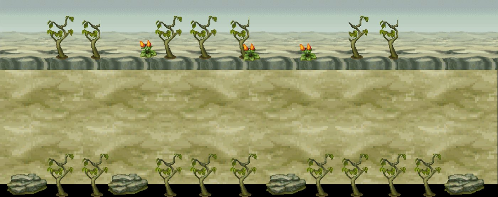
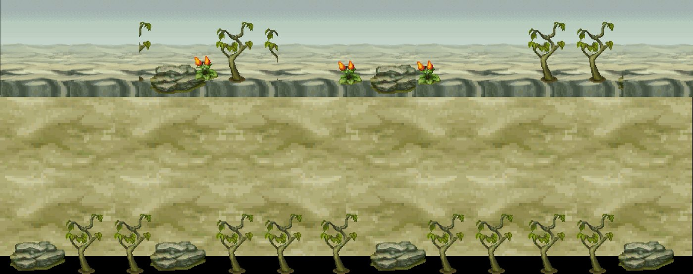
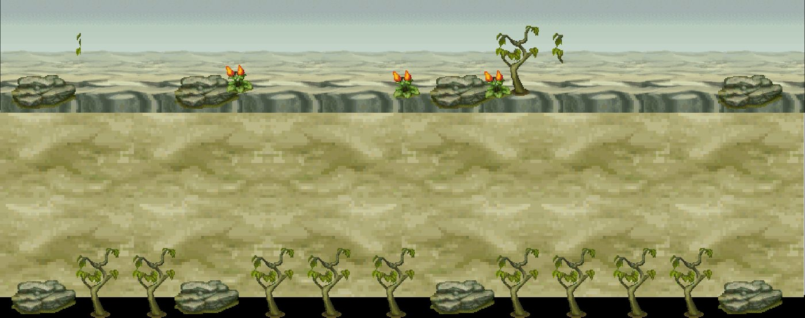
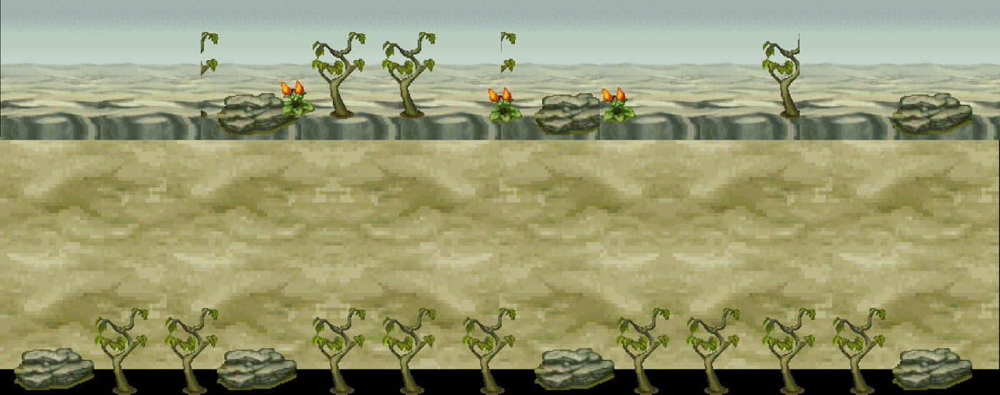
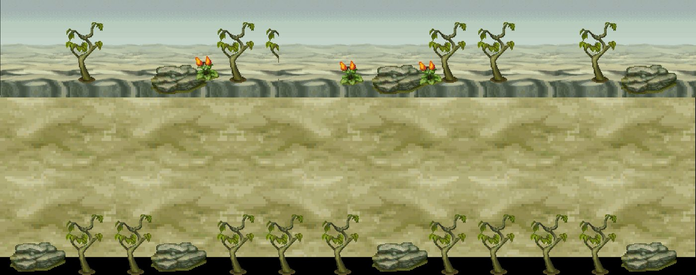
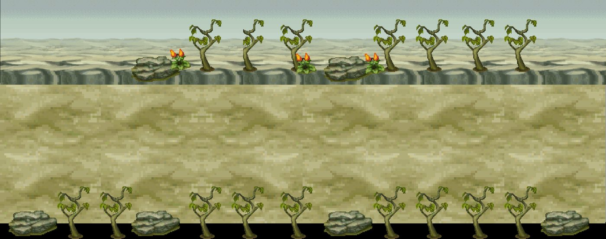
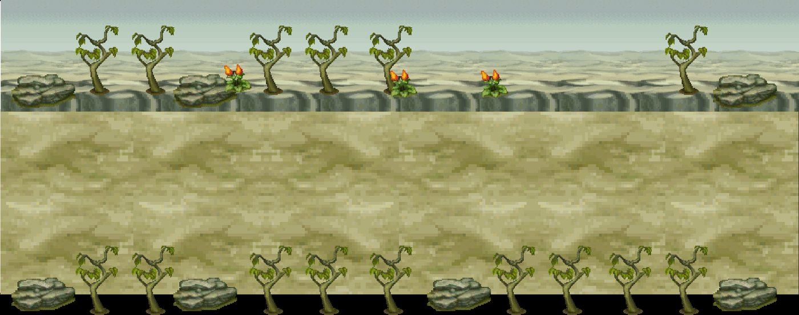
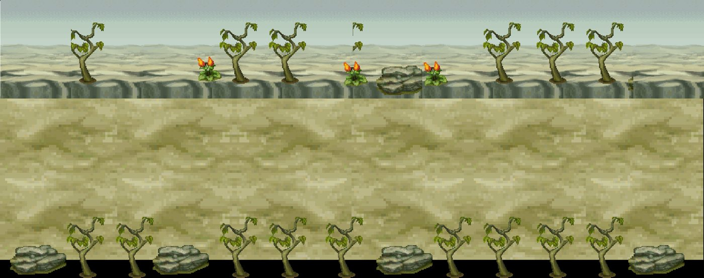
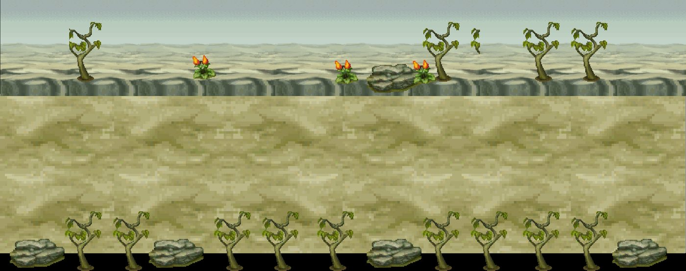

# Kit `tomb` — Lăng Mộ

> **Nghiệm thu Claude 2026-11-09** (mức V1, chưa 4×): DUYỆT 59, VẼ_LẠI 17. Map: {'CHƯA ĐỦ': 9}. Trạng thái hiện hành ở [ASSET-VERDICTS-20261109.csv](ASSET-VERDICTS-20261109.csv) / [MAP-COVERAGE-20261109.csv](MAP-COVERAGE-20261109.csv); tick ✅/❌ bên dưới là LỊCH SỬ, không phải approval.
> VẼ_LẠI (17): `tomb-lantern-post`, `tomb-spirit-brazier`, `tomb-glyph-stele`, `tomb-wall-sprit-torch`, `tomb-ancient-keys`, `tomb-dead-thorn-bush`, `tomb-dead-tree-stump`, `tomb-guardian-statue-head`, `tomb-hanging-censer`, `tomb-graveyard-dirt`, `tomb-floor-cracked-slate`, `tomb-floor-ashen-dust`, `tomb-floor-golden-sand`, `tomb-tile-edge-decal`, … (+3)

> **Quy tắc bắt buộc cho Codex** (xem README.md): dùng https://github.com/0x0funky/agent-sprite-forge (generate2dmap / generate2dsprite) với route image_gen tích hợp; cấm codeart2d, API trả phí, vẽ bằng code, lật gương; không commit; không sửa tools/hd2d_audit/*, gate_waivers.json, check.sh; mỗi asset phải tự nhìn ảnh trước khi ghi "vẽ xong"; chỉ Claude/owner đánh dấu "duyệt".

- Style/palette: Gạch mộ rêu phong, đá xám xanh, ánh đèn ma xanh lục. Hai khu ngoài (Cồn Úa Vàng, Bãi Gai Khô) là sa mạc vàng cây gai khô.
- Thư mục asset: `art/src/hd2d/batch-11-tomb/`
- Số map: 9

## 1. Trạng thái asset hiện có

Tổng 76 asset candidates trong manifest · duyệt 0 · toàn bộ chờ owner review.

| Loại | Có | Cần tối thiểu | Ghi chú |
|---|---:|---:|---|
| floor | 8 | 8 | Có đủ số lượng; cần xem seam và phối cảnh từng tile |
| edge | 3 | 3 | Có đủ số lượng; cần xem trong composite map |
| prop | 39 | 36 | Không tính hai portal riêng ở hàng portal |
| decal | 13 | 12 | Đủ số lượng; moss-soil vừa redraw, chờ review |
| shadow | 4 | 4 | Procedural alpha; chờ owner review |
| backdrop | 3 | 3 | Far/mid/near có ứng viên; repeat motif còn cần composite review |
| portal | 2 | 2 | Redraw có chung mask; chờ owner review |
| marker | 1 | 1 | Bốn frame có mặt; chờ owner review |
| fx | 3 | 3 | Ba FX tĩnh; chưa có animation |

Floor QA update 2026-11-03: `tomb-floor-cracked-slate` redraw 04 (X=5.807/Y=4.620), `tomb-graveyard-dirt` redraw 01 (X=2.766/Y=2.740), and `tomb-floor-ashen-dust` redraw 03 (X=5.793/Y=5.705) are 512×512, 48-color image_gen candidates with 3×3 and 4× dark/checker previews inspected. All remain owner-pending. The brick-floor and dry-gravel redraw attempts were rejected for repeat cadence/banding and retained under `jobs/floors-redraw-20261103/`. `tomb-tile-edge-decal` redraw 03 replaces the draft as a smaller-fragment alternative (X=3.585/Y=5.775, 48 colors); 3×3 review shows only low-contrast but still visible close-range cadence. It remains unapproved and needs owner review. Far backdrop redraw 03 replaces the previous skyline draft: binary alpha, 41 opaque colors, horizontal seam MAE 2.260, with 3×1 preview reviewed. It reduces tall-tower repetition; remaining tree/ruin cadence and scene composition need owner review. Mid redraw attempts 02–05 are archived/rejected; selected mid/near drafts still show repeating landmarks and need further iteration/scene review. Crypt-mossstone redraws 02–06 were also reviewed: 02, 03, 05 and 06 pass numeric seams but fail texture/repeat review; 04 fails seams (6.389/6.941; max 6) and repeats long cracks. No redraw promoted; current final remains a draft and needs another attempt.
Crypt mossstone retries 07–09 were all rejected and retained under `jobs/floors-redraw-20261103/`; no manifest change. Full gate's remaining error is Ancient `ancient-floor-02` seam X 14.2/8.1.

Landmark rows: 18/18 đã đối chiếu với 9 ảnh map và gắn lại vào hai prop môi trường dùng chung (cây gai khô, cụm hoa cam đỏ). Ảnh nguồn không thể hiện 18 landmark độc nhất; các diễn giải không được ghi là sprite APK phục hồi. Tất cả chờ owner duyệt.

### Danh sách asset (đồng bộ manifest, 2026-10-30)

| Vẽ | Duyệt | id | loại | kích thước (world) | prompt/QA |
|---|---|---|---|---|---|
| ✅ | ❌ | `tomb-portal-dormant` | portal | [1.75, 1.8203] | [prompt.md](../../../art/src/hd2d/batch-11-tomb/tomb-portal-dormant/prompt.md) · [QA](../../../art/src/hd2d/batch-11-tomb/tomb-portal-dormant/qa.json) |
| ✅ | ❌ | `tomb-portal-active` | portal | [1.75, 1.8203] | [prompt.md](../../../art/src/hd2d/batch-11-tomb/tomb-portal-active/prompt.md) · [QA](../../../art/src/hd2d/batch-11-tomb/tomb-portal-active/qa.json) |
| ✅ | ❌ | `tomb-lantern-spirit` | prop | [2.6562, 1.125] | [prompt.md](../../../art/src/hd2d/batch-11-tomb/tomb-lantern-spirit/prompt.md) · [QA](../../../art/src/hd2d/batch-11-tomb/tomb-lantern-spirit/qa.json) |
| ✅ | ❌ | `tomb-necropolis-wall-far` | backdrop | [16.0, 6.0] | [prompt.md](../../../art/src/hd2d/batch-11-tomb/tomb-necropolis-wall-far/prompt.md) · [QA](../../../art/src/hd2d/batch-11-tomb/tomb-necropolis-wall-far/qa.json) |
| ✅ | ❌ | `tomb-gravestone-01` | prop | [1.7969, 1.7188] | [prompt.md](../../../art/src/hd2d/batch-11-tomb/tomb-gravestone-01/prompt.md) · [QA](../../../art/src/hd2d/batch-11-tomb/tomb-gravestone-01/qa.json) |
| ✅ | ❌ | `tomb-gravestone-02` | prop | [1.2422, 1.9375] | [prompt.md](../../../art/src/hd2d/batch-11-tomb/tomb-gravestone-02/prompt.md) · [QA](../../../art/src/hd2d/batch-11-tomb/tomb-gravestone-02/qa.json) |
| ✅ | ❌ | `tomb-sarcophagus-01` | prop | [2.4766, 1.5] | [prompt.md](../../../art/src/hd2d/batch-11-tomb/tomb-sarcophagus-01/prompt.md) · [QA](../../../art/src/hd2d/batch-11-tomb/tomb-sarcophagus-01/qa.json) |
| ✅ | ❌ | `tomb-sealed-coffer` | prop | [2.1562, 1.5] | [prompt.md](../../../art/src/hd2d/batch-11-tomb/tomb-sealed-coffer/prompt.md) · [QA](../../../art/src/hd2d/batch-11-tomb/tomb-sealed-coffer/qa.json) |
| ✅ | ❌ | `tomb-lantern-post` | prop | [1.0625, 1.5625] | [prompt.md](../../../art/src/hd2d/batch-11-tomb/tomb-lantern-post/prompt.md) · [QA](../../../art/src/hd2d/batch-11-tomb/tomb-lantern-post/qa.json) |
| ✅ | ❌ | `tomb-rooted-urn` | prop | [0.9531, 1.0938] | [prompt.md](../../../art/src/hd2d/batch-11-tomb/tomb-rooted-urn/prompt.md) · [QA](../../../art/src/hd2d/batch-11-tomb/tomb-rooted-urn/qa.json) |
| ✅ | ❌ | `tomb-arch-gate` | prop | [2.3516, 2.2188] | [prompt.md](../../../art/src/hd2d/batch-11-tomb/tomb-arch-gate/prompt.md) · [QA](../../../art/src/hd2d/batch-11-tomb/tomb-arch-gate/qa.json) |
| ✅ | ❌ | `tomb-broken-column-short` | prop | [1.1094, 1.3125] | [prompt.md](../../../art/src/hd2d/batch-11-tomb/tomb-broken-column-short/prompt.md) · [QA](../../../art/src/hd2d/batch-11-tomb/tomb-broken-column-short/qa.json) |
| ✅ | ❌ | `tomb-cracked-pillar` | prop | [1.2031, 2.0312] | [prompt.md](../../../art/src/hd2d/batch-11-tomb/tomb-cracked-pillar/prompt.md) · [QA](../../../art/src/hd2d/batch-11-tomb/tomb-cracked-pillar/qa.json) |
| ✅ | ❌ | `tomb-offering-altar` | prop | [2.4688, 1.4375] | [prompt.md](../../../art/src/hd2d/batch-11-tomb/tomb-offering-altar/prompt.md) · [QA](../../../art/src/hd2d/batch-11-tomb/tomb-offering-altar/qa.json) |
| ✅ | ❌ | `tomb-spirit-brazier` | prop | [0.6953, 0.9453] | [prompt.md](../../../art/src/hd2d/batch-11-tomb/tomb-spirit-brazier/prompt.md) · [QA](../../../art/src/hd2d/batch-11-tomb/tomb-spirit-brazier/qa.json) |
| ✅ | ❌ | `tomb-glyph-stele` | prop | [1.2109, 1.9375] | [prompt.md](../../../art/src/hd2d/batch-11-tomb/tomb-glyph-stele/prompt.md) · [QA](../../../art/src/hd2d/batch-11-tomb/tomb-glyph-stele/qa.json) |
| ✅ | ❌ | `tomb-iron-chain-shackle` | prop | [1.9531, 1.2188] | [prompt.md](../../../art/src/hd2d/batch-11-tomb/tomb-iron-chain-shackle/prompt.md) · [QA](../../../art/src/hd2d/batch-11-tomb/tomb-iron-chain-shackle/qa.json) |
| ✅ | ❌ | `tomb-rubble-barrier` | prop | [1.6562, 1.4375] | [prompt.md](../../../art/src/hd2d/batch-11-tomb/tomb-rubble-barrier/prompt.md) · [QA](../../../art/src/hd2d/batch-11-tomb/tomb-rubble-barrier/qa.json) |
| ✅ | ❌ | `tomb-offering-bowl` | prop | [1.3281, 1.1875] | [prompt.md](../../../art/src/hd2d/batch-11-tomb/tomb-offering-bowl/prompt.md) · [QA](../../../art/src/hd2d/batch-11-tomb/tomb-offering-bowl/qa.json) |
| ✅ | ❌ | `tomb-root-reliquary` | prop | [1.7422, 1.625] | [prompt.md](../../../art/src/hd2d/batch-11-tomb/tomb-root-reliquary/prompt.md) · [QA](../../../art/src/hd2d/batch-11-tomb/tomb-root-reliquary/qa.json) |
| ✅ | ❌ | `tomb-bat-roost-arch` | prop | [1.4688, 1.5625] | [prompt.md](../../../art/src/hd2d/batch-11-tomb/tomb-bat-roost-arch/prompt.md) · [QA](../../../art/src/hd2d/batch-11-tomb/tomb-bat-roost-arch/qa.json) |
| ✅ | ❌ | `tomb-effigy-coffin-lid` | prop | [1.6641, 1.5625] | [prompt.md](../../../art/src/hd2d/batch-11-tomb/tomb-effigy-coffin-lid/prompt.md) · [QA](../../../art/src/hd2d/batch-11-tomb/tomb-effigy-coffin-lid/qa.json) |
| ✅ | ❌ | `tomb-broken-stairs` | prop | [1.6875, 1.2188] | [prompt.md](../../../art/src/hd2d/batch-11-tomb/tomb-broken-stairs/prompt.md) · [QA](../../../art/src/hd2d/batch-11-tomb/tomb-broken-stairs/qa.json) |
| ✅ | ❌ | `tomb-column-capital` | prop | [1.3047, 1.4375] | [prompt.md](../../../art/src/hd2d/batch-11-tomb/tomb-column-capital/prompt.md) · [QA](../../../art/src/hd2d/batch-11-tomb/tomb-column-capital/qa.json) |
| ✅ | ❌ | `tomb-sealed-urn` | prop | [1.0938, 1.0859] | [prompt.md](../../../art/src/hd2d/batch-11-tomb/tomb-sealed-urn/prompt.md) · [QA](../../../art/src/hd2d/batch-11-tomb/tomb-sealed-urn/qa.json) |
| ✅ | ❌ | `tomb-wall-sprit-torch` | prop | [1.1797, 1.625] | [prompt.md](../../../art/src/hd2d/batch-11-tomb/tomb-wall-sprit-torch/prompt.md) · [QA](../../../art/src/hd2d/batch-11-tomb/tomb-wall-sprit-torch/qa.json) |
| ✅ | ❌ | `tomb-cracked-ground-stela` | prop | [0.8438, 1.5625] | [prompt.md](../../../art/src/hd2d/batch-11-tomb/tomb-cracked-ground-stela/prompt.md) · [QA](../../../art/src/hd2d/batch-11-tomb/tomb-cracked-ground-stela/qa.json) |
| ✅ | ❌ | `tomb-ancient-keys` | prop | [0.8906, 1.5625] | [prompt.md](../../../art/src/hd2d/batch-11-tomb/tomb-ancient-keys/prompt.md) · [QA](../../../art/src/hd2d/batch-11-tomb/tomb-ancient-keys/qa.json) |
| ✅ | ❌ | `tomb-dead-thorn-bush` | prop | [1.4141, 1.2188] | [prompt.md](../../../art/src/hd2d/batch-11-tomb/tomb-dead-thorn-bush/prompt.md) · [QA](../../../art/src/hd2d/batch-11-tomb/tomb-dead-thorn-bush/qa.json) |
| ✅ | ❌ | `tomb-dead-tree-stump` | prop | [1.6562, 1.4375] | [prompt.md](../../../art/src/hd2d/batch-11-tomb/tomb-dead-tree-stump/prompt.md) · [QA](../../../art/src/hd2d/batch-11-tomb/tomb-dead-tree-stump/qa.json) |
| ✅ | ❌ | `tomb-sandstone-boulder` | prop | [1.6484, 1.1875] | [prompt.md](../../../art/src/hd2d/batch-11-tomb/tomb-sandstone-boulder/prompt.md) · [QA](../../../art/src/hd2d/batch-11-tomb/tomb-sandstone-boulder/qa.json) |
| ✅ | ❌ | `tomb-cracked-clay-jar` | prop | [1.0, 1.0938] | [prompt.md](../../../art/src/hd2d/batch-11-tomb/tomb-cracked-clay-jar/prompt.md) · [QA](../../../art/src/hd2d/batch-11-tomb/tomb-cracked-clay-jar/qa.json) |
| ✅ | ❌ | `tomb-sand-buried-marker` | prop | [1.6094, 1.5625] | [prompt.md](../../../art/src/hd2d/batch-11-tomb/tomb-sand-buried-marker/prompt.md) · [QA](../../../art/src/hd2d/batch-11-tomb/tomb-sand-buried-marker/qa.json) |
| ✅ | ❌ | `tomb-collapsed-burial-arch` | prop | [1.75, 1.5625] | [prompt.md](../../../art/src/hd2d/batch-11-tomb/tomb-collapsed-burial-arch/prompt.md) · [QA](../../../art/src/hd2d/batch-11-tomb/tomb-collapsed-burial-arch/qa.json) |
| ✅ | ❌ | `tomb-guardian-statue-head` | prop | [1.1406, 1.2188] | [prompt.md](../../../art/src/hd2d/batch-11-tomb/tomb-guardian-statue-head/prompt.md) · [QA](../../../art/src/hd2d/batch-11-tomb/tomb-guardian-statue-head/qa.json) |
| ✅ | ❌ | `tomb-open-sarcophagus-shell` | prop | [2.4062, 1.4375] | [prompt.md](../../../art/src/hd2d/batch-11-tomb/tomb-open-sarcophagus-shell/prompt.md) · [QA](../../../art/src/hd2d/batch-11-tomb/tomb-open-sarcophagus-shell/qa.json) |
| ✅ | ❌ | `tomb-hanging-censer` | prop | [0.7266, 1.1875] | [prompt.md](../../../art/src/hd2d/batch-11-tomb/tomb-hanging-censer/prompt.md) · [QA](../../../art/src/hd2d/batch-11-tomb/tomb-hanging-censer/qa.json) |
| ✅ | ❌ | `tomb-carved-seal-disc` | prop | [1.6875, 1.625] | [prompt.md](../../../art/src/hd2d/batch-11-tomb/tomb-carved-seal-disc/prompt.md) · [QA](../../../art/src/hd2d/batch-11-tomb/tomb-carved-seal-disc/qa.json) |
| ✅ | ❌ | `tomb-expedition-crate` | prop | [1.125, 1.0469] | [prompt.md](../../../art/src/hd2d/batch-11-tomb/tomb-expedition-crate/prompt.md) · [QA](../../../art/src/hd2d/batch-11-tomb/tomb-expedition-crate/qa.json) |
| ✅ | ❌ | `tomb-memorial-plinth` | prop | [1.4453, 1.5625] | [prompt.md](../../../art/src/hd2d/batch-11-tomb/tomb-memorial-plinth/prompt.md) · [QA](../../../art/src/hd2d/batch-11-tomb/tomb-memorial-plinth/qa.json) |
| ✅ | ❌ | `tomb-brick-floor` | tile | [4, 4] | [prompt.md](../../../art/src/hd2d/batch-11-tomb/tomb-brick-floor/prompt.md) · [QA](../../../art/src/hd2d/batch-11-tomb/tomb-brick-floor/qa.json) |
| ✅ | ❌ | `tomb-graveyard-dirt` | tile | [4, 4] | [prompt.md](../../../art/src/hd2d/batch-11-tomb/tomb-graveyard-dirt/prompt.md) · [QA](../../../art/src/hd2d/batch-11-tomb/tomb-graveyard-dirt/qa.json) |
| ✅ | ❌ | `tomb-floor-crypt-mossstone` | tile | [4, 4] | [prompt.md](../../../art/src/hd2d/batch-11-tomb/tomb-floor-crypt-mossstone/prompt.md) · [QA](../../../art/src/hd2d/batch-11-tomb/tomb-floor-crypt-mossstone/qa.json) |
| ✅ | ❌ | `tomb-floor-cracked-slate` | tile | [4, 4] | [prompt.md](../../../art/src/hd2d/batch-11-tomb/tomb-floor-cracked-slate/prompt.md) · [QA](../../../art/src/hd2d/batch-11-tomb/tomb-floor-cracked-slate/qa.json) |
| ✅ | ❌ | `tomb-floor-ashen-dust` | tile | [4, 4] | [prompt.md](../../../art/src/hd2d/batch-11-tomb/tomb-floor-ashen-dust/prompt.md) · [QA](../../../art/src/hd2d/batch-11-tomb/tomb-floor-ashen-dust/qa.json) |
| ✅ | ❌ | `tomb-floor-dry-gravel` | tile | [4, 4] | [prompt.md](../../../art/src/hd2d/batch-11-tomb/tomb-floor-dry-gravel/prompt.md) · [QA](../../../art/src/hd2d/batch-11-tomb/tomb-floor-dry-gravel/qa.json) |
| ✅ | ❌ | `tomb-floor-golden-sand` | tile | [4, 4] | [prompt.md](../../../art/src/hd2d/batch-11-tomb/tomb-floor-golden-sand/prompt.md) · [QA](../../../art/src/hd2d/batch-11-tomb/tomb-floor-golden-sand/qa.json) |
| ✅ | ❌ | `tomb-tile-edge-decal` | tile | [4, 4] | [prompt.md](../../../art/src/hd2d/batch-11-tomb/tomb-tile-edge-decal/prompt.md) · [QA](../../../art/src/hd2d/batch-11-tomb/tomb-tile-edge-decal/qa.json) |
| ✅ | ❌ | `tomb-edge-crypt-soil` | edge | [4, 1] | [prompt.md](../../../art/src/hd2d/batch-11-tomb/tomb-edge-crypt-soil/prompt.md) · [QA](../../../art/src/hd2d/batch-11-tomb/tomb-edge-crypt-soil/qa.json) |
| ✅ | ❌ | `tomb-edge-ruin-rubble` | edge | [4, 1] | [prompt.md](../../../art/src/hd2d/batch-11-tomb/tomb-edge-ruin-rubble/prompt.md) · [QA](../../../art/src/hd2d/batch-11-tomb/tomb-edge-ruin-rubble/qa.json) |
| ✅ | ❌ | `tomb-edge-desert-sand` | edge | [4, 1] | [prompt.md](../../../art/src/hd2d/batch-11-tomb/tomb-edge-desert-sand/prompt.md) · [QA](../../../art/src/hd2d/batch-11-tomb/tomb-edge-desert-sand/qa.json) |
| ✅ | ❌ | `tomb-decal-moss-soil` | decal | [3.25, 2.0234] | [prompt.md](../../../art/src/hd2d/batch-11-tomb/tomb-decal-moss-soil/prompt.md) · [QA](../../../art/src/hd2d/batch-11-tomb/tomb-decal-moss-soil/qa.json) |
| ✅ | ❌ | `tomb-decal-tomb-rubble` | decal | [3.25, 3.2344] | [prompt.md](../../../art/src/hd2d/batch-11-tomb/tomb-decal-tomb-rubble/prompt.md) · [QA](../../../art/src/hd2d/batch-11-tomb/tomb-decal-tomb-rubble/qa.json) |
| ✅ | ❌ | `tomb-decal-slate-chips` | decal | [3.25, 3.0312] | [prompt.md](../../../art/src/hd2d/batch-11-tomb/tomb-decal-slate-chips/prompt.md) · [QA](../../../art/src/hd2d/batch-11-tomb/tomb-decal-slate-chips/qa.json) |
| ✅ | ❌ | `tomb-decal-spirit-stain` | decal | [3.25, 3.1953] | [prompt.md](../../../art/src/hd2d/batch-11-tomb/tomb-decal-spirit-stain/prompt.md) · [QA](../../../art/src/hd2d/batch-11-tomb/tomb-decal-spirit-stain/qa.json) |
| ✅ | ❌ | `tomb-decal-ochre-dust` | decal | [3.25, 3.0625] | [prompt.md](../../../art/src/hd2d/batch-11-tomb/tomb-decal-ochre-dust/prompt.md) · [QA](../../../art/src/hd2d/batch-11-tomb/tomb-decal-ochre-dust/qa.json) |
| ✅ | ❌ | `tomb-decal-gravel-trail` | decal | [2.7891, 3.25] | [prompt.md](../../../art/src/hd2d/batch-11-tomb/tomb-decal-gravel-trail/prompt.md) · [QA](../../../art/src/hd2d/batch-11-tomb/tomb-decal-gravel-trail/qa.json) |
| ✅ | ❌ | `tomb-spawn-marker` | marker | [1.5, 1.5] | [prompt.md](../../../art/src/hd2d/batch-11-tomb/tomb-spawn-marker/prompt.md) · [QA](../../../art/src/hd2d/batch-11-tomb/tomb-spawn-marker/qa.json) |
| ✅ | ❌ | `tomb-decal-cracked-earth` | decal | [3.25, 3.1172] | [prompt.md](../../../art/src/hd2d/batch-11-tomb/tomb-decal-cracked-earth/prompt.md) · [QA](../../../art/src/hd2d/batch-11-tomb/tomb-decal-cracked-earth/qa.json) |
| ✅ | ❌ | `tomb-decal-rune-dust` | decal | [3.25, 2.9062] | [prompt.md](../../../art/src/hd2d/batch-11-tomb/tomb-decal-rune-dust/prompt.md) · [QA](../../../art/src/hd2d/batch-11-tomb/tomb-decal-rune-dust/qa.json) |
| ✅ | ❌ | `tomb-decal-bone-fragments` | decal | [3.2188, 3.1875] | [prompt.md](../../../art/src/hd2d/batch-11-tomb/tomb-decal-bone-fragments/prompt.md) · [QA](../../../art/src/hd2d/batch-11-tomb/tomb-decal-bone-fragments/qa.json) |
| ✅ | ❌ | `tomb-decal-thorn-litter` | decal | [3.25, 2.8906] | [prompt.md](../../../art/src/hd2d/batch-11-tomb/tomb-decal-thorn-litter/prompt.md) · [QA](../../../art/src/hd2d/batch-11-tomb/tomb-decal-thorn-litter/qa.json) |
| ✅ | ❌ | `tomb-decal-sand-ripple` | decal | [3.25, 2.7734] | [prompt.md](../../../art/src/hd2d/batch-11-tomb/tomb-decal-sand-ripple/prompt.md) · [QA](../../../art/src/hd2d/batch-11-tomb/tomb-decal-sand-ripple/qa.json) |
| ✅ | ❌ | `tomb-decal-moss-seam` | decal | [3.1016, 2.9688] | [prompt.md](../../../art/src/hd2d/batch-11-tomb/tomb-decal-moss-seam/prompt.md) · [QA](../../../art/src/hd2d/batch-11-tomb/tomb-decal-moss-seam/qa.json) |
| ✅ | ❌ | `tomb-decal-coffin-drag` | decal | [3.25, 2.9453] | [prompt.md](../../../art/src/hd2d/batch-11-tomb/tomb-decal-coffin-drag/prompt.md) · [QA](../../../art/src/hd2d/batch-11-tomb/tomb-decal-coffin-drag/qa.json) |
| ✅ | ❌ | `tomb-shadow-small-prop` | shadow | [0.875, 0.5] | [prompt.md](../../../art/src/hd2d/batch-11-tomb/tomb-shadow-small-prop/prompt.md) · [QA](../../../art/src/hd2d/batch-11-tomb/tomb-shadow-small-prop/qa.json) |
| ✅ | ❌ | `tomb-shadow-gravestone` | shadow | [1.25, 0.625] | [prompt.md](../../../art/src/hd2d/batch-11-tomb/tomb-shadow-gravestone/prompt.md) · [QA](../../../art/src/hd2d/batch-11-tomb/tomb-shadow-gravestone/qa.json) |
| ✅ | ❌ | `tomb-shadow-large-arch` | shadow | [2.125, 0.75] | [prompt.md](../../../art/src/hd2d/batch-11-tomb/tomb-shadow-large-arch/prompt.md) · [QA](../../../art/src/hd2d/batch-11-tomb/tomb-shadow-large-arch/qa.json) |
| ✅ | ❌ | `tomb-shadow-dead-tree` | shadow | [1.75, 0.8125] | [prompt.md](../../../art/src/hd2d/batch-11-tomb/tomb-shadow-dead-tree/prompt.md) · [QA](../../../art/src/hd2d/batch-11-tomb/tomb-shadow-dead-tree/qa.json) |
| ✅ | ❌ | `tomb-fx-spirit-wisp-01` | fx | [1.25, 1.25] | [prompt.md](../../../art/src/hd2d/batch-11-tomb/tomb-fx-spirit-wisp-01/prompt.md) · [QA](../../../art/src/hd2d/batch-11-tomb/tomb-fx-spirit-wisp-01/qa.json) |
| ✅ | ❌ | `tomb-fx-rune-pulse-01` | fx | [1.25, 1.25] | [prompt.md](../../../art/src/hd2d/batch-11-tomb/tomb-fx-rune-pulse-01/prompt.md) · [QA](../../../art/src/hd2d/batch-11-tomb/tomb-fx-rune-pulse-01/qa.json) |
| ✅ | ❌ | `tomb-fx-stone-chips-01` | fx | [1.25, 1.25] | [prompt.md](../../../art/src/hd2d/batch-11-tomb/tomb-fx-stone-chips-01/prompt.md) · [QA](../../../art/src/hd2d/batch-11-tomb/tomb-fx-stone-chips-01/qa.json) |
| ✅ | ❌ | `tomb-necropolis-wall-mid` | backdrop | [16, 6] | [prompt.md](../../../art/src/hd2d/batch-11-tomb/tomb-necropolis-wall-mid/prompt.md) · [QA](../../../art/src/hd2d/batch-11-tomb/tomb-necropolis-wall-mid/qa.json) |
| ✅ | ❌ | `tomb-necropolis-wall-near` | backdrop | [16, 6] | [prompt.md](../../../art/src/hd2d/batch-11-tomb/tomb-necropolis-wall-near/prompt.md) · [QA](../../../art/src/hd2d/batch-11-tomb/tomb-necropolis-wall-near/qa.json) |
| ✅ | ❌ | `tomb-map-dry-sapling` | prop | [1.25, 1.5] | [prompt.md](../../../art/src/hd2d/batch-11-tomb/tomb-map-dry-sapling/prompt.md) · [QA](../../../art/src/hd2d/batch-11-tomb/tomb-map-dry-sapling/qa.json) |
| ✅ | ❌ | `tomb-map-orange-blooms` | prop | [0.75, 0.75] | [prompt.md](../../../art/src/hd2d/batch-11-tomb/tomb-map-orange-blooms/prompt.md) · [QA](../../../art/src/hd2d/batch-11-tomb/tomb-map-orange-blooms/qa.json) |

## 2. Prompt sheet chung cho kit

```text
[Dán Master v2: .ai/design/gpt-redo/00-master-v2.md]
Dùng agent-sprite-forge ($generate2dmap cho tile/prop, $generate2dsprite cho prop/decal/FX/marker). Route ảnh: image_gen tích hợp của Codex (kiểm `route_media.py resolve --kind image`). KHÔNG codeart2d, KHÔNG API, KHÔNG vẽ bằng code.
Kit: Lăng Mộ (tomb). Style: Gạch mộ rêu phong, đá xám xanh, ánh đèn ma xanh lục. Hai khu ngoài (Cồn Úa Vàng, Bãi Gai Khô) là sa mạc vàng cây gai khô.. Style anchor: batch-01-octopath/contact-sheet.png + 2 sprites.png linh thú.
Mỗi lần gọi: 1 sheet ~6 vật trên nền #FF00FF, bố trí 2×3/3×2, cách nhau ≥48 px, không chạm mép. Giữ raw-01.png byte-identical. Cắt/khử nền/pixel finish bằng script forge. 33–48 màu, alpha nhị phân, lề ≥8 px, 128 px = 1 đơn vị (far 64), người = 1.31 đơn vị (cỡ tối đa vật nhỏ: tools/hd2d_audit/size_check.py).
Mỗi asset: thư mục raw-01/final/prompt.md/review.md/qa.json trong art/src/hd2d/batch-11-tomb/<id>/. Tự nhìn 4× nền tối/caro. Xong: `python3 tools/hd2d_audit/art_gate.py batch-11-tomb` = 0 lỗi, contact-sheet mới hơn manifest.
```

## 3. Từng map

Landmark rows reuse the same foliage props because the nine source screenshots show recurring dry saplings and orange bloom tufts, not nine distinct named monuments. The kit manifest stores each reused asset once; approvals remain pending.

### `tomb_region_camp` — Trạm Canh Lăng



- Ảnh gốc (đối chiếu): `.ai/design/map-checklists/refs/tomb_region_camp.jpg` (bản đầy đủ: `~/Downloads/Phimond-P12-Review/map-images/tomb_region_camp.png`, 2241×886 px, 100 px = 1 đơn vị APK)
- Nguồn APK: scene `Assets/Scenes/Map/30-35/LangMo.unity`, 43 sprite ghép; brief: [../map-briefs/kit_tomb/tomb_region_camp.md](../map-briefs/kit_tomb/tomb_region_camp.md)
- Cổng: 3 · vùng quái: không · spawn: 0 · NPC: tomb_wren, tomb_xan, tomb_yara, tomb_zora · ghi chú: hub của vùng Lăng Mộ
- neo `P:tomb_region_portal_003` (door) Cửa → Bãi Vãng Sinh: px [1020, 705]
- neo `P:tomb_region_portal_008` (door) Cửa → Tàn Tích Tịch Diệt: px [2125, 486]
- neo `P:tomb_region_portal_013` (door) Cửa → Tuyệt Vọng Chi Địa: px [93, 522]
- neo `tomb_wren` (npc) : px CẦN ĐẶT
- neo `tomb_xan` (npc) : px CẦN ĐẶT
- neo `tomb_yara` (npc) : px CẦN ĐẶT
- neo `tomb_zora` (npc) : px CẦN ĐẶT
- NPC cần sprite (batch-05; kiểm trùng): tomb_wren, tomb_xan, tomb_yara, tomb_zora

Asset chính: dùng bảng kit (mục 1). Landmark riêng của map (Codex xem ảnh gốc, ghi tên vật nhận diện vào bảng rồi vẽ):

| Vẽ | Duyệt | id | loại | mô tả | prompt |
|---|---|---|---|---|---|
| ✅ | ❌ | `tomb_region_camp-landmark-01` | reused prop | Cây gai khô mọc dọc bờ bản đồ (tái sử dụng prop kit; không phải landmark độc nhất) — `tomb-map-dry-sapling` | [prompt.md](../../../art/src/hd2d/batch-11-tomb/tomb-map-dry-sapling/prompt.md) · [QA](../../../art/src/hd2d/batch-11-tomb/tomb-map-dry-sapling/qa.json) |
| ✅ | ❌ | `tomb_region_camp-landmark-02` | reused prop | Cụm hoa cam đỏ thấp lặp ở mép cát (tái sử dụng prop kit; không phải landmark độc nhất) — `tomb-map-orange-blooms` | [prompt.md](../../../art/src/hd2d/batch-11-tomb/tomb-map-orange-blooms/prompt.md) · [QA](../../../art/src/hd2d/batch-11-tomb/tomb-map-orange-blooms/qa.json) |

Prompt cho Codex:

```text
Dùng agent-sprite-forge (generate2dmap + generate2dsprite, route image_gen). Map tomb_region_camp (), kit tomb.
Mở và đính kèm thật ảnh gốc .ai/design/map-checklists/refs/tomb_region_camp.jpg vào image_gen cùng 2–3 ảnh style batch 00–09 sát loại + 2 anchor linh thú; ghi sha256.
Rà các hàng chưa ✅ trong bảng; vẽ theo sheet 6 vật; landmark riêng: nhìn ảnh gốc, ghi tên vật vào bảng rồi vẽ (không giả là recovered APK nếu là diễn giải).
Xong: cập nhật cột "Vẽ" (✅ chỉ khi đã nhìn final 4×), chạy art_gate cho kit, KHÔNG tự đặt "Duyệt".
```

### `tomb_region_resentment_path` — Oán Linh Cổ Đạo



- Ảnh gốc (đối chiếu): `.ai/design/map-checklists/refs/tomb_region_resentment_path.jpg` (bản đầy đủ: `~/Downloads/Phimond-P12-Review/map-images/tomb_region_resentment_path.png`, 2241×886 px, 100 px = 1 đơn vị APK)
- Nguồn APK: scene `Assets/Scenes/Map/30-35/LangMo.unity`, 43 sprite ghép; brief: [../map-briefs/kit_tomb/tomb_region_resentment_path.md](../map-briefs/kit_tomb/tomb_region_resentment_path.md)
- Cổng: 2 · vùng quái: có · spawn: 15 · NPC: tomb_alder
- neo `P:tomb_region_portal_016` (door) Cửa → Quảng Trường Thạch Trụ: px [104, 474]
- neo `P:tomb_region_portal_017` (door) Cửa → Tuyệt Vọng Chi Địa: px [2139, 481]
- neo `AT:square:tomb_region_resentment_path` (arrival) Đến từ trụ Quảng Trường: px [204, 471]
- neo `tomb_alder` (npc) : px CẦN ĐẶT
- NPC cần sprite (batch-05; kiểm trùng): tomb_alder

Asset chính: dùng bảng kit (mục 1). Landmark riêng của map (Codex xem ảnh gốc, ghi tên vật nhận diện vào bảng rồi vẽ):

| Vẽ | Duyệt | id | loại | mô tả | prompt |
|---|---|---|---|---|---|
| ✅ | ❌ | `tomb_region_resentment_path-landmark-01` | reused prop | Cây gai khô mọc dọc bờ bản đồ (tái sử dụng prop kit; không phải landmark độc nhất) — `tomb-map-dry-sapling` | [prompt.md](../../../art/src/hd2d/batch-11-tomb/tomb-map-dry-sapling/prompt.md) · [QA](../../../art/src/hd2d/batch-11-tomb/tomb-map-dry-sapling/qa.json) |
| ✅ | ❌ | `tomb_region_resentment_path-landmark-02` | reused prop | Cụm hoa cam đỏ thấp lặp ở mép cát (tái sử dụng prop kit; không phải landmark độc nhất) — `tomb-map-orange-blooms` | [prompt.md](../../../art/src/hd2d/batch-11-tomb/tomb-map-orange-blooms/prompt.md) · [QA](../../../art/src/hd2d/batch-11-tomb/tomb-map-orange-blooms/qa.json) |

Prompt cho Codex:

```text
Dùng agent-sprite-forge (generate2dmap + generate2dsprite, route image_gen). Map tomb_region_resentment_path (Oán Linh Cổ Đạo), kit tomb.
Mở và đính kèm thật ảnh gốc .ai/design/map-checklists/refs/tomb_region_resentment_path.jpg vào image_gen cùng 2–3 ảnh style batch 00–09 sát loại + 2 anchor linh thú; ghi sha256.
Rà các hàng chưa ✅ trong bảng; vẽ theo sheet 6 vật; landmark riêng: nhìn ảnh gốc, ghi tên vật vào bảng rồi vẽ (không giả là recovered APK nếu là diễn giải).
Xong: cập nhật cột "Vẽ" (✅ chỉ khi đã nhìn final 4×), chạy art_gate cho kit, KHÔNG tự đặt "Duyệt".
```

### `tomb_region_despair_path` — Tuyệt Vọng Chi Địa



- Ảnh gốc (đối chiếu): `.ai/design/map-checklists/refs/tomb_region_despair_path.jpg` (bản đầy đủ: `~/Downloads/Phimond-P12-Review/map-images/tomb_region_despair_path.png`, 2242×886 px, 100 px = 1 đơn vị APK)
- Nguồn APK: scene `Assets/Scenes/Map/30-35/LangMo.unity`, 43 sprite ghép; brief: [../map-briefs/kit_tomb/tomb_region_despair_path.md](../map-briefs/kit_tomb/tomb_region_despair_path.md)
- Cổng: 2 · vùng quái: có · spawn: 15 · NPC: —
- neo `P:tomb_region_portal_001` (door) Cửa → Oán Linh Cổ Đạo: px [99, 497]
- neo `P:tomb_region_portal_012` (door) Cửa → Trạm Canh Lăng: px [2145, 508]

Asset chính: dùng bảng kit (mục 1). Landmark riêng của map (Codex xem ảnh gốc, ghi tên vật nhận diện vào bảng rồi vẽ):

| Vẽ | Duyệt | id | loại | mô tả | prompt |
|---|---|---|---|---|---|
| ✅ | ❌ | `tomb_region_despair_path-landmark-01` | reused prop | Cây gai khô mọc dọc bờ bản đồ (tái sử dụng prop kit; không phải landmark độc nhất) — `tomb-map-dry-sapling` | [prompt.md](../../../art/src/hd2d/batch-11-tomb/tomb-map-dry-sapling/prompt.md) · [QA](../../../art/src/hd2d/batch-11-tomb/tomb-map-dry-sapling/qa.json) |
| ✅ | ❌ | `tomb_region_despair_path-landmark-02` | reused prop | Cụm hoa cam đỏ thấp lặp ở mép cát (tái sử dụng prop kit; không phải landmark độc nhất) — `tomb-map-orange-blooms` | [prompt.md](../../../art/src/hd2d/batch-11-tomb/tomb-map-orange-blooms/prompt.md) · [QA](../../../art/src/hd2d/batch-11-tomb/tomb-map-orange-blooms/qa.json) |

Prompt cho Codex:

```text
Dùng agent-sprite-forge (generate2dmap + generate2dsprite, route image_gen). Map tomb_region_despair_path (Tuyệt Vọng Chi Địa), kit tomb.
Mở và đính kèm thật ảnh gốc .ai/design/map-checklists/refs/tomb_region_despair_path.jpg vào image_gen cùng 2–3 ảnh style batch 00–09 sát loại + 2 anchor linh thú; ghi sha256.
Rà các hàng chưa ✅ trong bảng; vẽ theo sheet 6 vật; landmark riêng: nhìn ảnh gốc, ghi tên vật vào bảng rồi vẽ (không giả là recovered APK nếu là diễn giải).
Xong: cập nhật cột "Vẽ" (✅ chỉ khi đã nhìn final 4×), chạy art_gate cho kit, KHÔNG tự đặt "Duyệt".
```

### `tomb_region_dead_ruins` — Tàn Tích Tịch Diệt



- Ảnh gốc (đối chiếu): `.ai/design/map-checklists/refs/tomb_region_dead_ruins.jpg` (bản đầy đủ: `~/Downloads/Phimond-P12-Review/map-images/tomb_region_dead_ruins.png`, 2241×886 px, 100 px = 1 đơn vị APK)
- Nguồn APK: scene `Assets/Scenes/Map/30-35/LangMo.unity`, 43 sprite ghép; brief: [../map-briefs/kit_tomb/tomb_region_dead_ruins.md](../map-briefs/kit_tomb/tomb_region_dead_ruins.md)
- Cổng: 2 · vùng quái: có · spawn: 0 · NPC: —
- neo `P:tomb_region_portal_006` (door) Cửa → Trạm Canh Lăng: px [120, 481]
- neo `P:tomb_region_portal_009` (door) Cửa → Thâm Cung Tịch Diệt: px [2132, 501]

Asset chính: dùng bảng kit (mục 1). Landmark riêng của map (Codex xem ảnh gốc, ghi tên vật nhận diện vào bảng rồi vẽ):

| Vẽ | Duyệt | id | loại | mô tả | prompt |
|---|---|---|---|---|---|
| ✅ | ❌ | `tomb_region_dead_ruins-landmark-01` | reused prop | Cây gai khô mọc dọc bờ bản đồ (tái sử dụng prop kit; không phải landmark độc nhất) — `tomb-map-dry-sapling` | [prompt.md](../../../art/src/hd2d/batch-11-tomb/tomb-map-dry-sapling/prompt.md) · [QA](../../../art/src/hd2d/batch-11-tomb/tomb-map-dry-sapling/qa.json) |
| ✅ | ❌ | `tomb_region_dead_ruins-landmark-02` | reused prop | Cụm hoa cam đỏ thấp lặp ở mép cát (tái sử dụng prop kit; không phải landmark độc nhất) — `tomb-map-orange-blooms` | [prompt.md](../../../art/src/hd2d/batch-11-tomb/tomb-map-orange-blooms/prompt.md) · [QA](../../../art/src/hd2d/batch-11-tomb/tomb-map-orange-blooms/qa.json) |

Prompt cho Codex:

```text
Dùng agent-sprite-forge (generate2dmap + generate2dsprite, route image_gen). Map tomb_region_dead_ruins (), kit tomb.
Mở và đính kèm thật ảnh gốc .ai/design/map-checklists/refs/tomb_region_dead_ruins.jpg vào image_gen cùng 2–3 ảnh style batch 00–09 sát loại + 2 anchor linh thú; ghi sha256.
Rà các hàng chưa ✅ trong bảng; vẽ theo sheet 6 vật; landmark riêng: nhìn ảnh gốc, ghi tên vật vào bảng rồi vẽ (không giả là recovered APK nếu là diễn giải).
Xong: cập nhật cột "Vẽ" (✅ chỉ khi đã nhìn final 4×), chạy art_gate cho kit, KHÔNG tự đặt "Duyệt".
```

### `tomb_region_deep_ruins` — Thâm Cung Tịch Diệt



- Ảnh gốc (đối chiếu): `.ai/design/map-checklists/refs/tomb_region_deep_ruins.jpg` (bản đầy đủ: `~/Downloads/Phimond-P12-Review/map-images/tomb_region_deep_ruins.png`, 2241×886 px, 100 px = 1 đơn vị APK)
- Nguồn APK: scene `Assets/Scenes/Map/30-35/LangMo.unity`, 43 sprite ghép; brief: [../map-briefs/kit_tomb/tomb_region_deep_ruins.md](../map-briefs/kit_tomb/tomb_region_deep_ruins.md)
- Cổng: 1 · vùng quái: có · spawn: 0 · NPC: — · ghi chú: cụt, nối từ Tàn Tích Tịch Diệt
- neo `P:tomb_region_portal_007` (door) Cửa → Tàn Tích Tịch Diệt: px [118, 511]

Asset chính: dùng bảng kit (mục 1). Landmark riêng của map (Codex xem ảnh gốc, ghi tên vật nhận diện vào bảng rồi vẽ):

| Vẽ | Duyệt | id | loại | mô tả | prompt |
|---|---|---|---|---|---|
| ✅ | ❌ | `tomb_region_deep_ruins-landmark-01` | reused prop | Cây gai khô mọc dọc bờ bản đồ (tái sử dụng prop kit; không phải landmark độc nhất) — `tomb-map-dry-sapling` | [prompt.md](../../../art/src/hd2d/batch-11-tomb/tomb-map-dry-sapling/prompt.md) · [QA](../../../art/src/hd2d/batch-11-tomb/tomb-map-dry-sapling/qa.json) |
| ✅ | ❌ | `tomb_region_deep_ruins-landmark-02` | reused prop | Cụm hoa cam đỏ thấp lặp ở mép cát (tái sử dụng prop kit; không phải landmark độc nhất) — `tomb-map-orange-blooms` | [prompt.md](../../../art/src/hd2d/batch-11-tomb/tomb-map-orange-blooms/prompt.md) · [QA](../../../art/src/hd2d/batch-11-tomb/tomb-map-orange-blooms/qa.json) |

Prompt cho Codex:

```text
Dùng agent-sprite-forge (generate2dmap + generate2dsprite, route image_gen). Map tomb_region_deep_ruins (), kit tomb.
Mở và đính kèm thật ảnh gốc .ai/design/map-checklists/refs/tomb_region_deep_ruins.jpg vào image_gen cùng 2–3 ảnh style batch 00–09 sát loại + 2 anchor linh thú; ghi sha256.
Rà các hàng chưa ✅ trong bảng; vẽ theo sheet 6 vật; landmark riêng: nhìn ảnh gốc, ghi tên vật vào bảng rồi vẽ (không giả là recovered APK nếu là diễn giải).
Xong: cập nhật cột "Vẽ" (✅ chỉ khi đã nhìn final 4×), chạy art_gate cho kit, KHÔNG tự đặt "Duyệt".
```

### `tomb_region_gods_tomb` — Thần Lăng Vĩnh Miên



- Ảnh gốc (đối chiếu): `.ai/design/map-checklists/refs/tomb_region_gods_tomb.jpg` (bản đầy đủ: `~/Downloads/Phimond-P12-Review/map-images/tomb_region_gods_tomb.png`, 2241×886 px, 100 px = 1 đơn vị APK)
- Nguồn APK: scene `Assets/Scenes/Map/30-35/LangMo.unity`, 43 sprite ghép; brief: [../map-briefs/kit_tomb/tomb_region_gods_tomb.md](../map-briefs/kit_tomb/tomb_region_gods_tomb.md)
- Cổng: 1 · vùng quái: có · spawn: 0 · NPC: tomb_bram
- neo `P:tomb_region_portal_004` (door) Cửa → Bãi Vãng Sinh: px [2132, 496]
- neo `tomb_bram` (npc) : px CẦN ĐẶT
- NPC cần sprite (batch-05; kiểm trùng): tomb_bram

Asset chính: dùng bảng kit (mục 1). Landmark riêng của map (Codex xem ảnh gốc, ghi tên vật nhận diện vào bảng rồi vẽ):

| Vẽ | Duyệt | id | loại | mô tả | prompt |
|---|---|---|---|---|---|
| ✅ | ❌ | `tomb_region_gods_tomb-landmark-01` | reused prop | Cây gai khô mọc dọc bờ bản đồ (tái sử dụng prop kit; không phải landmark độc nhất) — `tomb-map-dry-sapling` | [prompt.md](../../../art/src/hd2d/batch-11-tomb/tomb-map-dry-sapling/prompt.md) · [QA](../../../art/src/hd2d/batch-11-tomb/tomb-map-dry-sapling/qa.json) |
| ✅ | ❌ | `tomb_region_gods_tomb-landmark-02` | reused prop | Cụm hoa cam đỏ thấp lặp ở mép cát (tái sử dụng prop kit; không phải landmark độc nhất) — `tomb-map-orange-blooms` | [prompt.md](../../../art/src/hd2d/batch-11-tomb/tomb-map-orange-blooms/prompt.md) · [QA](../../../art/src/hd2d/batch-11-tomb/tomb-map-orange-blooms/qa.json) |

Prompt cho Codex:

```text
Dùng agent-sprite-forge (generate2dmap + generate2dsprite, route image_gen). Map tomb_region_gods_tomb (), kit tomb.
Mở và đính kèm thật ảnh gốc .ai/design/map-checklists/refs/tomb_region_gods_tomb.jpg vào image_gen cùng 2–3 ảnh style batch 00–09 sát loại + 2 anchor linh thú; ghi sha256.
Rà các hàng chưa ✅ trong bảng; vẽ theo sheet 6 vật; landmark riêng: nhìn ảnh gốc, ghi tên vật vào bảng rồi vẽ (không giả là recovered APK nếu là diễn giải).
Xong: cập nhật cột "Vẽ" (✅ chỉ khi đã nhìn final 4×), chạy art_gate cho kit, KHÔNG tự đặt "Duyệt".
```

### `tomb_region_soul_cemetery` — Bãi Vãng Sinh



- Ảnh gốc (đối chiếu): `.ai/design/map-checklists/refs/tomb_region_soul_cemetery.jpg` (bản đầy đủ: `~/Downloads/Phimond-P12-Review/map-images/tomb_region_soul_cemetery.png`, 2241×886 px, 100 px = 1 đơn vị APK)
- Nguồn APK: scene `Assets/Scenes/Map/30-35/LangMo.unity`, 43 sprite ghép; brief: [../map-briefs/kit_tomb/tomb_region_soul_cemetery.md](../map-briefs/kit_tomb/tomb_region_soul_cemetery.md)
- Cổng: 4 · vùng quái: có · spawn: 6 · NPC: tomb_cora, tomb_dov · ghi chú: hub: nối Thần Lăng + 2 khu chưa tên
- neo `P:tomb_region_portal_005` (door) Cửa → Thần Lăng Vĩnh Miên: px [111, 528]
- neo `P:tomb_region_portal_010` (door) Cửa → Bãi Gai Khô: px [1614, 693]
- neo `P:tomb_region_portal_014` (door) Cửa → Cồn Úa Vàng: px [2117, 490]
- neo `P:tomb_region_portal_015` (door) Cửa → Trạm Canh Lăng: px [1064, 372]
- neo `tomb_cora` (npc) : px CẦN ĐẶT
- neo `tomb_dov` (npc) : px CẦN ĐẶT
- NPC cần sprite (batch-05; kiểm trùng): tomb_cora, tomb_dov

Asset chính: dùng bảng kit (mục 1). Landmark riêng của map (Codex xem ảnh gốc, ghi tên vật nhận diện vào bảng rồi vẽ):

| Vẽ | Duyệt | id | loại | mô tả | prompt |
|---|---|---|---|---|---|
| ✅ | ❌ | `tomb_region_soul_cemetery-landmark-01` | reused prop | Cây gai khô mọc dọc bờ bản đồ (tái sử dụng prop kit; không phải landmark độc nhất) — `tomb-map-dry-sapling` | [prompt.md](../../../art/src/hd2d/batch-11-tomb/tomb-map-dry-sapling/prompt.md) · [QA](../../../art/src/hd2d/batch-11-tomb/tomb-map-dry-sapling/qa.json) |
| ✅ | ❌ | `tomb_region_soul_cemetery-landmark-02` | reused prop | Cụm hoa cam đỏ thấp lặp ở mép cát (tái sử dụng prop kit; không phải landmark độc nhất) — `tomb-map-orange-blooms` | [prompt.md](../../../art/src/hd2d/batch-11-tomb/tomb-map-orange-blooms/prompt.md) · [QA](../../../art/src/hd2d/batch-11-tomb/tomb-map-orange-blooms/qa.json) |

Prompt cho Codex:

```text
Dùng agent-sprite-forge (generate2dmap + generate2dsprite, route image_gen). Map tomb_region_soul_cemetery (), kit tomb.
Mở và đính kèm thật ảnh gốc .ai/design/map-checklists/refs/tomb_region_soul_cemetery.jpg vào image_gen cùng 2–3 ảnh style batch 00–09 sát loại + 2 anchor linh thú; ghi sha256.
Rà các hàng chưa ✅ trong bảng; vẽ theo sheet 6 vật; landmark riêng: nhìn ảnh gốc, ghi tên vật vào bảng rồi vẽ (không giả là recovered APK nếu là diễn giải).
Xong: cập nhật cột "Vẽ" (✅ chỉ khi đã nhìn final 4×), chạy art_gate cho kit, KHÔNG tự đặt "Duyệt".
```

### `tomb_region_unnamed_area_01` — Cồn Úa Vàng



- Ảnh gốc (đối chiếu): `.ai/design/map-checklists/refs/tomb_region_unnamed_area_01.jpg` (bản đầy đủ: `~/Downloads/Phimond-P12-Review/map-images/tomb_region_unnamed_area_01.png`, 2241×886 px, 100 px = 1 đơn vị APK)
- Nguồn APK: scene `Assets/Scenes/Map/30-35/LangMo.unity`, 43 sprite ghép; brief: [../map-briefs/kit_tomb/tomb_region_unnamed_area_01.md](../map-briefs/kit_tomb/tomb_region_unnamed_area_01.md)
- Cổng: 1 · vùng quái: có · spawn: 0 · NPC: — · ghi chú: cụt; sa mạc vàng, cây gai khô
- neo `P:tomb_region_portal_002` (door) Cửa → Bãi Vãng Sinh: px [113, 508]

Asset chính: dùng bảng kit (mục 1). Landmark riêng của map (Codex xem ảnh gốc, ghi tên vật nhận diện vào bảng rồi vẽ):

| Vẽ | Duyệt | id | loại | mô tả | prompt |
|---|---|---|---|---|---|
| ✅ | ❌ | `tomb_region_unnamed_area_01-landmark-01` | reused prop | Cây gai khô mọc dọc bờ bản đồ (tái sử dụng prop kit; không phải landmark độc nhất) — `tomb-map-dry-sapling` | [prompt.md](../../../art/src/hd2d/batch-11-tomb/tomb-map-dry-sapling/prompt.md) · [QA](../../../art/src/hd2d/batch-11-tomb/tomb-map-dry-sapling/qa.json) |
| ✅ | ❌ | `tomb_region_unnamed_area_01-landmark-02` | reused prop | Cụm hoa cam đỏ thấp lặp ở mép cát (tái sử dụng prop kit; không phải landmark độc nhất) — `tomb-map-orange-blooms` | [prompt.md](../../../art/src/hd2d/batch-11-tomb/tomb-map-orange-blooms/prompt.md) · [QA](../../../art/src/hd2d/batch-11-tomb/tomb-map-orange-blooms/qa.json) |

Prompt cho Codex:

```text
Dùng agent-sprite-forge (generate2dmap + generate2dsprite, route image_gen). Map tomb_region_unnamed_area_01 (), kit tomb.
Mở và đính kèm thật ảnh gốc .ai/design/map-checklists/refs/tomb_region_unnamed_area_01.jpg vào image_gen cùng 2–3 ảnh style batch 00–09 sát loại + 2 anchor linh thú; ghi sha256.
Rà các hàng chưa ✅ trong bảng; vẽ theo sheet 6 vật; landmark riêng: nhìn ảnh gốc, ghi tên vật vào bảng rồi vẽ (không giả là recovered APK nếu là diễn giải).
Xong: cập nhật cột "Vẽ" (✅ chỉ khi đã nhìn final 4×), chạy art_gate cho kit, KHÔNG tự đặt "Duyệt".
```

### `tomb_region_unnamed_area_02` — Bãi Gai Khô



- Ảnh gốc (đối chiếu): `.ai/design/map-checklists/refs/tomb_region_unnamed_area_02.jpg` (bản đầy đủ: `~/Downloads/Phimond-P12-Review/map-images/tomb_region_unnamed_area_02.png`, 2241×886 px, 100 px = 1 đơn vị APK)
- Nguồn APK: scene `Assets/Scenes/Map/30-35/LangMo.unity`, 43 sprite ghép; brief: [../map-briefs/kit_tomb/tomb_region_unnamed_area_02.md](../map-briefs/kit_tomb/tomb_region_unnamed_area_02.md)
- Cổng: 1 · vùng quái: có · spawn: 0 · NPC: — · ghi chú: cụt; cùng nền với 01
- neo `P:tomb_region_portal_011` (door) Cửa → Bãi Vãng Sinh: px [1945, 398]

Asset chính: dùng bảng kit (mục 1). Landmark riêng của map (Codex xem ảnh gốc, ghi tên vật nhận diện vào bảng rồi vẽ):

| Vẽ | Duyệt | id | loại | mô tả | prompt |
|---|---|---|---|---|---|
| ✅ | ❌ | `tomb_region_unnamed_area_02-landmark-01` | reused prop | Cây gai khô mọc dọc bờ bản đồ (tái sử dụng prop kit; không phải landmark độc nhất) — `tomb-map-dry-sapling` | [prompt.md](../../../art/src/hd2d/batch-11-tomb/tomb-map-dry-sapling/prompt.md) · [QA](../../../art/src/hd2d/batch-11-tomb/tomb-map-dry-sapling/qa.json) |
| ✅ | ❌ | `tomb_region_unnamed_area_02-landmark-02` | reused prop | Cụm hoa cam đỏ thấp lặp ở mép cát (tái sử dụng prop kit; không phải landmark độc nhất) — `tomb-map-orange-blooms` | [prompt.md](../../../art/src/hd2d/batch-11-tomb/tomb-map-orange-blooms/prompt.md) · [QA](../../../art/src/hd2d/batch-11-tomb/tomb-map-orange-blooms/qa.json) |

Prompt cho Codex:

```text
Dùng agent-sprite-forge (generate2dmap + generate2dsprite, route image_gen). Map tomb_region_unnamed_area_02 (), kit tomb.
Mở và đính kèm thật ảnh gốc .ai/design/map-checklists/refs/tomb_region_unnamed_area_02.jpg vào image_gen cùng 2–3 ảnh style batch 00–09 sát loại + 2 anchor linh thú; ghi sha256.
Rà các hàng chưa ✅ trong bảng; vẽ theo sheet 6 vật; landmark riêng: nhìn ảnh gốc, ghi tên vật vào bảng rồi vẽ (không giả là recovered APK nếu là diễn giải).
Xong: cập nhật cột "Vẽ" (✅ chỉ khi đã nhìn final 4×), chạy art_gate cho kit, KHÔNG tự đặt "Duyệt".
```


Backdrop update 2026-11-04: `tomb-necropolis-wall-mid` draft was redrawn to low ruined masonry, 1024×384 / 47 colors, seam X MAE 5.403, adjacent 3.188. Viewed 3×1; no named landmark repeats, slight capstone cadence remains. It is a candidate awaiting composite review and owner approval. Details: `jobs/backdrop-mid-redraw-20261104/`.

Near-backdrop update 2026-11-04: four redraw attempts were rejected after 3×1 inspection for repeated root piles, capstones, diagonal slabs, or pointed stacks. No manifest change; existing near layer remains a draft for owner/composite review. Attempts and prompts are under `jobs/backdrop-near-redraw-20261104/`.


### Crypt mossstone redraw retries — 2026-11-04 (10–13)

- Attempts 10–13 were retained under `jobs/floors-redraw-20261104/` with raw images, exact prompts, 512×512/48-color candidates, seam QA and 3×3 repeats.
- 10 cropbest rejected: seam X/Y 19.801/20.278; obvious tile cadence. 11 rejected: 6.602/5.811 but dark tile grid persists. 12 rejected: 5.180/10.536 and tile boundary/cadence visible. 13 used Octopath dirt-floor style reference; seams 4.565/4.546 but faint tile grid and regular fine-stone rhythm remain.
- No manifest change; current crypt mossstone stays a draft. Need a less regular stone grammar or a non-repeating floor treatment; do not promote based only on seam score.


### Near backdrop redraw 05 — 2026-11-04

- New low masonry strip (1024×384, 47 opaque colors, binary alpha) from the original cemetery map reference and Octopath forest-hedge style reference. Horizontal seam RGBA MAE 3.118 / adjacent 1.170.
- Rejected after 3×1 repeat review: root and capstone rhythm recurs visibly; no manifest change. Raw, packaged candidate, exact prompt, QA and repeat preview saved in `jobs/backdrop-near-redraw-20261104/`. Need a different composition grammar than continuous modular masonry.


### Near backdrop redraw 06 — 2026-11-04

- Broken-rubble strip: 1024×384, 48 opaque colors, binary alpha. Seam and adjacent RGBA MAE are both 0 because both endpoints are fully transparent.
- Rejected after 3×1 review: the same tall rubble heap and root recur once per tile; empty endpoints hide the seam metric. Raw, exact prompt, packaged candidate, QA and repeat preview are retained. No manifest change.


### Near backdrop redraw 05 selected for composition draft — 2026-11-04

- Replaced the tall-column near layer with a low broken masonry strip (1024×384, 47 opaque colors, binary alpha), chosen for map composition review. QA: horizontal seam RGBA MAE 3.118 / adjacent 1.170. The 3×1 repeat still shows a mild root/capstone cadence; this remains `approved:false` and needs composite/owner review.
- Prior final, prompt, QA and review are backed up in `jobs/backdrop-near-redraw-20261104/before-near-draft-20261104/`. Raw and exact prompt retained. Manifest revision 38; Tomb contact sheet rebuilt at 76 assets. Redraw 06 was rejected because a transparent seam score of 0 concealed a repeated tall rubble motif.
- Full multi-kit gate rerun after the manifest update: 494 assets, 0 errors, 0 warnings. This is mechanical QA only.


### Composite review update — 2026-11-04

A temporary review scene stacked the current far, mid, and near drafts. The low near wall reads as a separate depth band and did not obscure visible grave props/floor in the center camera frame. Horizontal cadence was not proven across the full map from that narrow view; the repeat remains visible in its 3×1 sheet. Scene JSON, three texture inputs, and review notes are retained in `jobs/backdrop-composite-review-20261104/`. Temporary files were removed from `apps/game-web/public/`; no runtime scene was changed. Owner review is still pending.


### Crypt mossstone retries 14–15 — 2026-11-04

- Both attempts are archived with exact prompts, raw image_gen outputs, 512×512/48-color candidates, QA and 3×3 previews in `jobs/floors-redraw-20261104/`.
- 14 (X/Y 5.102/8.101) rejected for visible horizontal patch cadence and soft finish. 15 (3.563/3.630) rejected as too smooth/featureless for a crypt flagstone tile. Manifest unchanged; current final remains a draft.


### Crypt mossstone retries 14–16 — 2026-11-04

- Attempts are archived with exact prompt, raw, candidate, QA and 3×3 preview under `jobs/floors-redraw-20261104/`.
- 14: X/Y 5.102/8.101; rejected for repeated horizontal texture patches and soft finish. 15: 3.563/3.630; rejected as too smooth/featureless. 16: 9.144/8.630; rejected for seam failure and noisy cluster cadence. No manifest update.


### Crypt brick-floor redraws 05–07 — 2026-11-04

Three more candidates are retained in `jobs/floors-redraw-20261104/`; none replaces the manifest tile. Attempt 05 has repeated density clusters (seams 6.639/8.671), 06 has recurring broad stones/horizontal bands (8.836/8.555), and 07 has cluster cadence with severe seam mismatch (14.518/15.515). All were inspected in 3×3 and rejected. Prompts and QA identify the generation as text-prompt-only; this session could not attach the source/style references required by the checklist. Manifest remains revision 39 / 76 assets / approved 0.


### Crypt brick-floor redraws 08–10 — 2026-11-04

Attempts 08–10 were generated with attached image references (hashes in per-attempt QA), processed to 512×512 / 48 colors, and inspected in 3×3 repeat. 08: seams 5.212/7.145, soft grouping; 09: 10.806/14.507, repeated small-stone cadence; 10: 4.861/9.745, broad cluster cadence. All rejected, no manifest change. The existing brick tile stays in place; future redraw needs a different material/layout approach.
