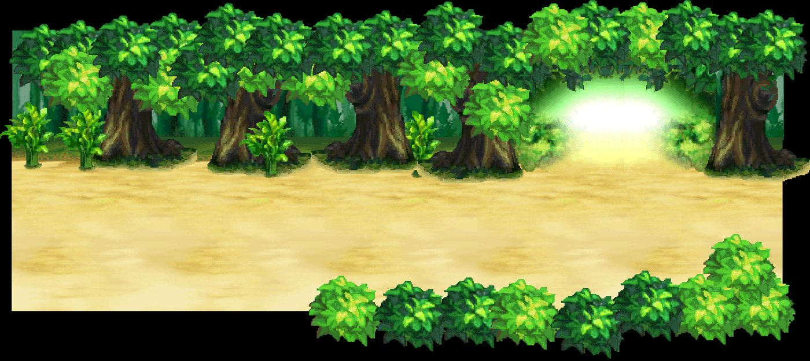
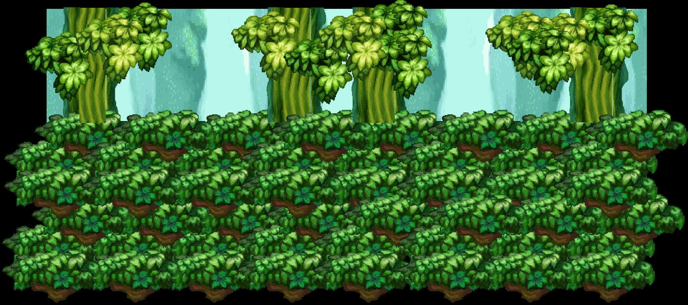
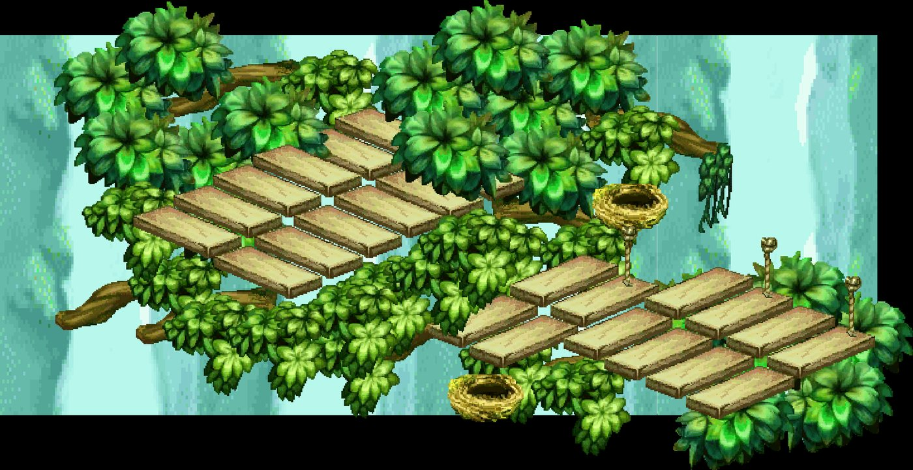

# BRIEF DRAFT v2026-11-10 — source-image correction (Claude review pending)

This draft corrects the tower kit subject and palette from three map screenshots. It does not approve or tick any art task. The historic tower-stone brief below is superseded for content; preserve its old rows as audit history. Do not generate tower assets until Claude/owner reviews this corrected asset list, as required by `BRIEF-tower`.

## Visual read from the map references

| Map | Visible source elements | Evidence crop |
|---|---|---|
| `tower_region_main_tower` | Warm pale sand path; continuous dark olive foreground shrub border; large broadleaf trees with thick brown trunks; scattered small upright leafy plants; a bright forest opening at the right; blue-green sky behind canopy. | [`tower_region_main_tower-evidence.png`](handoffs/art-submit-2026-11-10/tower-brief/ref-crops/tower_region_main_tower-evidence.png) |
| `tower_region_deep_woods` | Huge vertically striped green trunks; oversized layered green canopies; dense repeated leafy undergrowth/platform bands; turquoise waterfall or sky background. | [`tower_region_deep_woods-evidence.png`](handoffs/art-submit-2026-11-10/tower-brief/ref-crops/tower_region_deep_woods-evidence.png) |
| `tower_region_secret_floor` | Pale wooden plank bridges between leafy tree platforms; branch supports; thick foliage and hanging vines; small woven bird nests on thin posts; turquoise waterfall or sky behind. | [`tower_region_secret_floor-evidence.png`](handoffs/art-submit-2026-11-10/tower-brief/ref-crops/tower_region_secret_floor-evidence.png) |

## Corrected candidate asset set (all entries have screenshot evidence)

| Asset family / candidate task | Maps used | Visible object / intended role | Evidence |
|---|---|---|---|
| `tower-floor-01` | main tower | Warm sandy trail ground | main tower crop |
| `tower-floor-02` | deep woods | Dense olive-green forest floor/undergrowth platform texture | deep woods crop |
| `tower-floor-03` | secret floor | Pale timber plank bridge deck texture | secret floor crop |
| `tower-edge-01` | main tower | Irregular transition between sandy path and leafy border | main tower crop |
| `tower-edge-02` | deep woods | Transition from dense foliage platform to turquoise distance | deep woods crop |
| `tower-edge-03` | secret floor | Leafy platform/branch edge around plank bridge | secret floor crop |
| `tower-backdrop-far-01` | all three | Blue-green sky/waterfall distance; keep light/sky pixels from becoming baked glow | all three crops |
| `tower-prop-01` | main tower, deep woods | Broadleaf tree canopy cluster | main + deep woods crops |
| `tower-prop-02` | main tower, deep woods | Thick brown tree trunk with roots | main + deep woods crops |
| `tower-prop-03` | main tower | Small upright leafy plant | main tower crop |
| `tower-prop-04` | main tower, deep woods | Irregular dense shrub cluster | main + deep woods crops |
| `tower-prop-05` | secret floor | Individual pale wooden bridge plank | secret floor crop |
| `tower-prop-06` | secret floor | Branch support under raised plank bridge | secret floor crop |
| `tower-prop-07` | secret floor | Woven bird nest on a slender post | secret floor crop |
| `tower-prop-08` | secret floor | Hanging leafy vine/branch fringe | secret floor crop |
| `tower_region_main_tower-landmark-01` | main tower | Large broadleaf tree with thick trunk at the forest edge | main tower crop |
| `tower_region_deep_woods-landmark-01` | deep woods | Tall green-striped giant tree trunk and broad crown | deep woods crop |
| `tower_region_secret_floor-landmark-01` | secret floor | Plank bridge crossing between leafy platforms with visible nest | secret floor crop |

## Explicitly removed from the old brief

No screenshot evidence supports a stone hex rune floor, metal railing, stone bird statues, giant feather, tower spiral staircase, stone tower columns, or a sea-of-clouds backdrop. These descriptions must not drive art generation. The visible palette is olive and bright leaf green, natural brown bark, warm pale sand, light tan wood, and turquoise sky/waterfall. Do not add structural objects just because of the kit name “tower.”

The CSV's existing tower prompts that repeat the removed subject description are in conflict with the map screenshots. For tower tasks, use the corrected source-image subject list above; if task wording cannot be reconciled, leave that row BLOCKED with the conflict rather than inventing a stone-tower asset.

# Kit `tower` — Điểu Tháp

> **Nghiệm thu Claude 2026-11-09** (mức V1, chưa 4×): THIẾU_CHƯA_CÓ 50. Map: {'CHƯA CÓ ART': 3}. Trạng thái hiện hành ở [ASSET-VERDICTS-20261109.csv](ASSET-VERDICTS-20261109.csv) / [MAP-COVERAGE-20261109.csv](MAP-COVERAGE-20261109.csv); tick ✅/❌ bên dưới là LỊCH SỬ, không phải approval.
> **Cảnh báo brief:** brief plan (tháp đá) ≠ ảnh gốc (rừng xanh, cầu ván gỗ, tổ chim) — thực hiện `BRIEF-tower` trong [ROADMAP-ART-92MAPS-20261109.md](ROADMAP-ART-92MAPS-20261109.md) trước khi vẽ.

> **Quy tắc bắt buộc cho Codex** (xem README.md): dùng https://github.com/0x0funky/agent-sprite-forge (generate2dmap / generate2dsprite) với route image_gen tích hợp; cấm codeart2d, API trả phí, vẽ bằng code, lật gương; không commit; không sửa tools/hd2d_audit/*, gate_waivers.json, check.sh; mỗi asset phải tự nhìn ảnh trước khi ghi "vẽ xong"; chỉ Claude/owner đánh dấu "duyệt".

- Style/palette: Tháp đá cao nhìn trên mây, đá lục giác phù văn, lan can kim loại; rừng Vân Tiêu Thiên Tầng xanh lam.
- Thư mục asset: `art/src/hd2d/batch-11-tower/`
- Số map: 3

## 1. Danh sách asset cần vẽ (kit chưa có asset)

Nguồn: Phần C `hd2d-maps-75-gemini-prompt.md`. Yêu cầu gốc: tile sàn đá lục giác phù văn, đá lát tháp, cỏ tầng thượng; prop: lan can kim loại (đoạn lặp), cột tháp ×3, cửa chuyển tầng (dormant/active), tượng chim đá ×2, lông vũ khổng lồ, đèn tháp, bậc thang xoắn; backdrop xa: biển mây từ trên cao.

| Vẽ | Duyệt | id (số thứ tự; đặt tên tiếng Anh vào manifest `name`) | loại | mô tả + prompt đi kèm |
|---|---|---|---|---|
| ⬜ | ⬜ | `tower-floor-01` | floor | sàn đá lục giác phù văn — tile sàn nhìn từ trên xuống, seamless 512×512; HD-2D Octopath pixel art, palette Điểu Tháp, outline tối cùng sắc, 33–48 màu, không bóng đổ/sương/chữ. |
| ⬜ | ⬜ | `tower-floor-02` | floor | đá lát tháp — tile sàn nhìn từ trên xuống, seamless 512×512; HD-2D Octopath pixel art, palette Điểu Tháp, outline tối cùng sắc, 33–48 màu, không bóng đổ/sương/chữ. |
| ⬜ | ⬜ | `tower-floor-03` | floor | cỏ tầng thượng — tile sàn nhìn từ trên xuống, seamless 512×512; HD-2D Octopath pixel art, palette Điểu Tháp, outline tối cùng sắc, 33–48 màu, không bóng đổ/sương/chữ. |
| ⬜ | ⬜ | `tower-prop-01` | prop | lan can kim loại (đoạn lặp) — prop đứng billboard, pivot giữa-đáy; HD-2D Octopath pixel art, palette Điểu Tháp, outline tối cùng sắc, 33–48 màu, không bóng đổ/sương/chữ. |
| ⬜ | ⬜ | `tower-prop-02` | prop | cột tháp — prop đứng billboard, pivot giữa-đáy; HD-2D Octopath pixel art, palette Điểu Tháp, outline tối cùng sắc, 33–48 màu, không bóng đổ/sương/chữ. |
| ⬜ | ⬜ | `tower-prop-03` | prop | cột tháp — prop đứng billboard, pivot giữa-đáy; HD-2D Octopath pixel art, palette Điểu Tháp, outline tối cùng sắc, 33–48 màu, không bóng đổ/sương/chữ. |
| ⬜ | ⬜ | `tower-prop-04` | prop | cột tháp — prop đứng billboard, pivot giữa-đáy; HD-2D Octopath pixel art, palette Điểu Tháp, outline tối cùng sắc, 33–48 màu, không bóng đổ/sương/chữ. |
| ⬜ | ⬜ | `tower-prop-05` | prop | cửa chuyển tầng (dormant/active) — prop đứng billboard, pivot giữa-đáy; HD-2D Octopath pixel art, palette Điểu Tháp, outline tối cùng sắc, 33–48 màu, không bóng đổ/sương/chữ. |
| ⬜ | ⬜ | `tower-prop-06` | prop | tượng chim đá — prop đứng billboard, pivot giữa-đáy; HD-2D Octopath pixel art, palette Điểu Tháp, outline tối cùng sắc, 33–48 màu, không bóng đổ/sương/chữ. |
| ⬜ | ⬜ | `tower-prop-07` | prop | tượng chim đá — prop đứng billboard, pivot giữa-đáy; HD-2D Octopath pixel art, palette Điểu Tháp, outline tối cùng sắc, 33–48 màu, không bóng đổ/sương/chữ. |
| ⬜ | ⬜ | `tower-prop-08` | prop | lông vũ khổng lồ — prop đứng billboard, pivot giữa-đáy; HD-2D Octopath pixel art, palette Điểu Tháp, outline tối cùng sắc, 33–48 màu, không bóng đổ/sương/chữ. |
| ⬜ | ⬜ | `tower-prop-09` | prop | đèn tháp — prop đứng billboard, pivot giữa-đáy; HD-2D Octopath pixel art, palette Điểu Tháp, outline tối cùng sắc, 33–48 màu, không bóng đổ/sương/chữ. |
| ⬜ | ⬜ | `tower-prop-10` | prop | bậc thang xoắn — prop đứng billboard, pivot giữa-đáy; HD-2D Octopath pixel art, palette Điểu Tháp, outline tối cùng sắc, 33–48 màu, không bóng đổ/sương/chữ. |
| ⬜ | ⬜ | `tower-backdrop-far-01` | backdrop_far | biển mây từ trên cao — backdrop xa 1280×384 lặp ngang liền (64 px/đơn vị); HD-2D Octopath pixel art, palette Điểu Tháp, outline tối cùng sắc, 33–48 màu, không bóng đổ/sương/chữ. |
| ⬜ | ⬜ | `tower-floor-extra-01` | floor | tile sàn bổ sung (đủ ≥8 biến thể khác texture), seamless 512×512 |
| ⬜ | ⬜ | `tower-floor-extra-02` | floor | tile sàn bổ sung (đủ ≥8 biến thể khác texture), seamless 512×512 |
| ⬜ | ⬜ | `tower-floor-extra-03` | floor | tile sàn bổ sung (đủ ≥8 biến thể khác texture), seamless 512×512 |
| ⬜ | ⬜ | `tower-floor-extra-04` | floor | tile sàn bổ sung (đủ ≥8 biến thể khác texture), seamless 512×512 |
| ⬜ | ⬜ | `tower-floor-extra-05` | floor | tile sàn bổ sung (đủ ≥8 biến thể khác texture), seamless 512×512 |
| ⬜ | ⬜ | `tower-edge-01` | edge | dải chuyển tiếp giữa 2 tile chính, 512×128 liền hai đầu, mép bất quy tắc |
| ⬜ | ⬜ | `tower-edge-02` | edge | dải chuyển tiếp giữa 2 tile chính, 512×128 liền hai đầu, mép bất quy tắc |
| ⬜ | ⬜ | `tower-edge-03` | edge | dải chuyển tiếp giữa 2 tile chính, 512×128 liền hai đầu, mép bất quy tắc |
| ⬜ | ⬜ | `tower-decal-01` | decal | decal tiếp đất theo chủ đề kit (vụn, vết, xương/đá), bất quy tắc, mép mềm |
| ⬜ | ⬜ | `tower-decal-02` | decal | decal tiếp đất theo chủ đề kit (vụn, vết, xương/đá), bất quy tắc, mép mềm |
| ⬜ | ⬜ | `tower-decal-03` | decal | decal tiếp đất theo chủ đề kit (vụn, vết, xương/đá), bất quy tắc, mép mềm |
| ⬜ | ⬜ | `tower-decal-04` | decal | decal tiếp đất theo chủ đề kit (vụn, vết, xương/đá), bất quy tắc, mép mềm |
| ⬜ | ⬜ | `tower-decal-05` | decal | decal tiếp đất theo chủ đề kit (vụn, vết, xương/đá), bất quy tắc, mép mềm |
| ⬜ | ⬜ | `tower-decal-06` | decal | decal tiếp đất theo chủ đề kit (vụn, vết, xương/đá), bất quy tắc, mép mềm |
| ⬜ | ⬜ | `tower-decal-07` | decal | decal tiếp đất theo chủ đề kit (vụn, vết, xương/đá), bất quy tắc, mép mềm |
| ⬜ | ⬜ | `tower-decal-08` | decal | decal tiếp đất theo chủ đề kit (vụn, vết, xương/đá), bất quy tắc, mép mềm |
| ⬜ | ⬜ | `tower-decal-09` | decal | decal tiếp đất theo chủ đề kit (vụn, vết, xương/đá), bất quy tắc, mép mềm |
| ⬜ | ⬜ | `tower-decal-10` | decal | decal tiếp đất theo chủ đề kit (vụn, vết, xương/đá), bất quy tắc, mép mềm |
| ⬜ | ⬜ | `tower-decal-11` | decal | decal tiếp đất theo chủ đề kit (vụn, vết, xương/đá), bất quy tắc, mép mềm |
| ⬜ | ⬜ | `tower-decal-12` | decal | decal tiếp đất theo chủ đề kit (vụn, vết, xương/đá), bất quy tắc, mép mềm |
| ⬜ | ⬜ | `tower-shadow-01` | shadow | bóng procedural alpha mềm, màu kit |
| ⬜ | ⬜ | `tower-shadow-02` | shadow | bóng procedural alpha mềm, màu kit |
| ⬜ | ⬜ | `tower-shadow-03` | shadow | bóng procedural alpha mềm, màu kit |
| ⬜ | ⬜ | `tower-shadow-04` | shadow | bóng procedural alpha mềm, màu kit |
| ⬜ | ⬜ | `tower-backdrop-far` | backdrop | 1280×384, lặp ngang liền, mỗi tầng một khung cảnh khác |
| ⬜ | ⬜ | `tower-backdrop-mid` | backdrop | 1280×384, lặp ngang liền, mỗi tầng một khung cảnh khác |
| ⬜ | ⬜ | `tower-backdrop-near` | backdrop | 1280×384, lặp ngang liền, mỗi tầng một khung cảnh khác |
| ⬜ | ⬜ | `tower-portal-dormant` | portal | cổng nhìn thẳng mặt trước, đúng tông kit |
| ⬜ | ⬜ | `tower-portal-active` | portal | cùng mask với dormant |
| ⬜ | ⬜ | `tower-marker-arrival` | marker | vòng sáng 4 khung |
| ⬜ | ⬜ | `tower-fx-01` | fx | hạt/tia sáng sprite sheet theo chủ đề |
| ⬜ | ⬜ | `tower-fx-02` | fx | hạt/tia sáng sprite sheet theo chủ đề |
| ⬜ | ⬜ | `tower-fx-03` | fx | hạt/tia sáng sprite sheet theo chủ đề |

## 2. Prompt sheet chung cho kit

```text
[Dán Master v2: .ai/design/gpt-redo/00-master-v2.md]
Dùng agent-sprite-forge ($generate2dmap cho tile/prop, $generate2dsprite cho prop/decal/FX/marker). Route ảnh: image_gen tích hợp của Codex (kiểm `route_media.py resolve --kind image`). KHÔNG codeart2d, KHÔNG API, KHÔNG vẽ bằng code.
Kit: Điểu Tháp (tower). Style: Tháp đá cao nhìn trên mây, đá lục giác phù văn, lan can kim loại; rừng Vân Tiêu Thiên Tầng xanh lam.. Style anchor: batch-01-octopath/contact-sheet.png + 2 sprites.png linh thú.
Mỗi lần gọi: 1 sheet ~6 vật trên nền #FF00FF, bố trí 2×3/3×2, cách nhau ≥48 px, không chạm mép. Giữ raw-01.png byte-identical. Cắt/khử nền/pixel finish bằng script forge. 33–48 màu, alpha nhị phân, lề ≥8 px, 128 px = 1 đơn vị (far 64), người = 1.31 đơn vị (cỡ tối đa vật nhỏ: tools/hd2d_audit/size_check.py).
Mỗi asset: thư mục raw-01/final/prompt.md/review.md/qa.json trong art/src/hd2d/batch-11-tower/<id>/. Tự nhìn 4× nền tối/caro. Xong: `python3 tools/hd2d_audit/art_gate.py batch-11-tower` = 0 lỗi, contact-sheet mới hơn manifest.
```

## 3. Từng map

### `tower_region_main_tower` — Điểu Tháp



- Ảnh gốc (đối chiếu): `.ai/design/map-checklists/refs/tower_region_main_tower.jpg` (bản đầy đủ: `~/Downloads/Phimond-P12-Review/map-images/tower_region_main_tower.png`, 2363×1055 px, 100 px = 1 đơn vị APK)
- Nguồn APK: scene `Assets/Scenes/Map/ThapChim.unity`, 55 sprite ghép; brief: [../map-briefs/kit_tower/tower_region_main_tower.md](../map-briefs/kit_tower/tower_region_main_tower.md)
- Cổng: 2 · vùng quái: không · spawn: 0 · NPC: tower_yves, tower_zane · ghi chú: 'Tháp Chim' là đề xuất sửa chính tả trong NAMING-REVIEW
- neo `P:tower_region_portal_004` (door) Cửa → Vân Tiêu Thiên Tầng: px [1803, 533]
- neo `P:tower_region_portal_005` (door) Cửa → Hải Tặc Hào: px [153, 632]
- neo `A:tower_region_portal_001` (arrival) Điểm đến từ Điểu Tháp Mật Tầng: px [1181, 956]
- neo `AT:ship:tower_region_main_tower` (arrival) Đến từ trụ Hải Tặc Hào: px [252, 622]
- neo `tower_yves` (npc) : px CẦN ĐẶT
- neo `tower_zane` (npc) : px CẦN ĐẶT
- NPC cần sprite (batch-05; kiểm trùng): tower_yves, tower_zane

Asset chính: dùng bảng kit (mục 1). Landmark riêng của map (Codex xem ảnh gốc, ghi tên vật nhận diện vào bảng rồi vẽ):

| Vẽ | Duyệt | id | loại | mô tả | prompt |
|---|---|---|---|---|---|
| ⬜ | ⬜ | `tower_region_main_tower-landmark-01` | landmark | (vật nhận diện #1 trong ảnh gốc) | — |
| ⬜ | ⬜ | `tower_region_main_tower-landmark-02` | landmark | (vật nhận diện #2, nếu có) | — |

Prompt cho Codex:

```text
Dùng agent-sprite-forge (generate2dmap + generate2dsprite, route image_gen). Map tower_region_main_tower (), kit tower.
Mở và đính kèm thật ảnh gốc .ai/design/map-checklists/refs/tower_region_main_tower.jpg vào image_gen cùng 2–3 ảnh style batch 00–09 sát loại + 2 anchor linh thú; ghi sha256.
Rà các hàng chưa ✅ trong bảng; vẽ theo sheet 6 vật; landmark riêng: nhìn ảnh gốc, ghi tên vật vào bảng rồi vẽ (không giả là recovered APK nếu là diễn giải).
Xong: cập nhật cột "Vẽ" (✅ chỉ khi đã nhìn final 4×), chạy art_gate cho kit, KHÔNG tự đặt "Duyệt".
```

### `tower_region_deep_woods` — Vân Tiêu Thiên Tầng



- Ảnh gốc (đối chiếu): `.ai/design/map-checklists/refs/tower_region_deep_woods.jpg` (bản đầy đủ: `~/Downloads/Phimond-P12-Review/map-images/tower_region_deep_woods.png`, 2642×1174 px, 100 px = 1 đơn vị APK)
- Nguồn APK: scene `Assets/Scenes/Map/ThapChim.unity`, 46 sprite ghép; brief: [../map-briefs/kit_tower/tower_region_deep_woods.md](../map-briefs/kit_tower/tower_region_deep_woods.md)
- Cổng: 2 · vùng quái: có · spawn: 17 · NPC: tower_aria · ghi chú: tên nguồn trùng
- neo `P:tower_region_portal_002` (door) Cửa → Điểu Tháp: px [310, 775]
- neo `P:tower_region_portal_003` (door) Cửa → Điểu Tháp: px [2274, 781]
- neo `tower_aria` (npc) : px CẦN ĐẶT
- NPC cần sprite (batch-05; kiểm trùng): tower_aria

Asset chính: dùng bảng kit (mục 1). Landmark riêng của map (Codex xem ảnh gốc, ghi tên vật nhận diện vào bảng rồi vẽ):

| Vẽ | Duyệt | id | loại | mô tả | prompt |
|---|---|---|---|---|---|
| ⬜ | ⬜ | `tower_region_deep_woods-landmark-01` | landmark | (vật nhận diện #1 trong ảnh gốc) | — |
| ⬜ | ⬜ | `tower_region_deep_woods-landmark-02` | landmark | (vật nhận diện #2, nếu có) | — |

Prompt cho Codex:

```text
Dùng agent-sprite-forge (generate2dmap + generate2dsprite, route image_gen). Map tower_region_deep_woods (), kit tower.
Mở và đính kèm thật ảnh gốc .ai/design/map-checklists/refs/tower_region_deep_woods.jpg vào image_gen cùng 2–3 ảnh style batch 00–09 sát loại + 2 anchor linh thú; ghi sha256.
Rà các hàng chưa ✅ trong bảng; vẽ theo sheet 6 vật; landmark riêng: nhìn ảnh gốc, ghi tên vật vào bảng rồi vẽ (không giả là recovered APK nếu là diễn giải).
Xong: cập nhật cột "Vẽ" (✅ chỉ khi đã nhìn final 4×), chạy art_gate cho kit, KHÔNG tự đặt "Duyệt".
```

### `tower_region_secret_floor` — Điểu Tháp Mật Tầng



- Ảnh gốc (đối chiếu): `.ai/design/map-checklists/refs/tower_region_secret_floor.jpg` (bản đầy đủ: `~/Downloads/Phimond-P12-Review/map-images/tower_region_secret_floor.png`, 2410×1243 px, 100 px = 1 đơn vị APK)
- Nguồn APK: scene `Assets/Scenes/Map/ThapChim.unity`, 50 sprite ghép; brief: [../map-briefs/kit_tower/tower_region_secret_floor.md](../map-briefs/kit_tower/tower_region_secret_floor.md)
- Cổng: 1 · vùng quái: có · spawn: 17 · NPC: —
- neo `P:tower_region_portal_001` (door) Cửa → Điểu Tháp: px [1567, 297]

Asset chính: dùng bảng kit (mục 1). Landmark riêng của map (Codex xem ảnh gốc, ghi tên vật nhận diện vào bảng rồi vẽ):

| Vẽ | Duyệt | id | loại | mô tả | prompt |
|---|---|---|---|---|---|
| ⬜ | ⬜ | `tower_region_secret_floor-landmark-01` | landmark | (vật nhận diện #1 trong ảnh gốc) | — |
| ⬜ | ⬜ | `tower_region_secret_floor-landmark-02` | landmark | (vật nhận diện #2, nếu có) | — |

Prompt cho Codex:

```text
Dùng agent-sprite-forge (generate2dmap + generate2dsprite, route image_gen). Map tower_region_secret_floor (), kit tower.
Mở và đính kèm thật ảnh gốc .ai/design/map-checklists/refs/tower_region_secret_floor.jpg vào image_gen cùng 2–3 ảnh style batch 00–09 sát loại + 2 anchor linh thú; ghi sha256.
Rà các hàng chưa ✅ trong bảng; vẽ theo sheet 6 vật; landmark riêng: nhìn ảnh gốc, ghi tên vật vào bảng rồi vẽ (không giả là recovered APK nếu là diễn giải).
Xong: cập nhật cột "Vẽ" (✅ chỉ khi đã nhìn final 4×), chạy art_gate cho kit, KHÔNG tự đặt "Duyệt".
```
