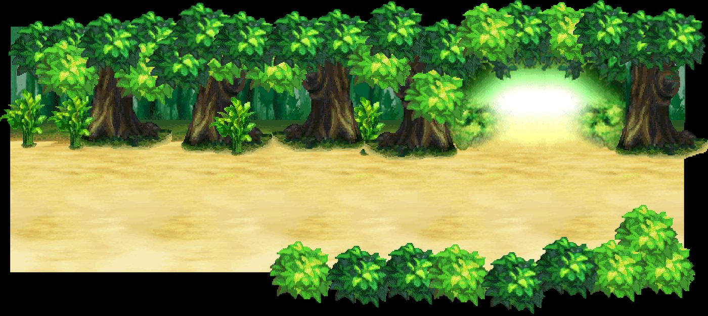
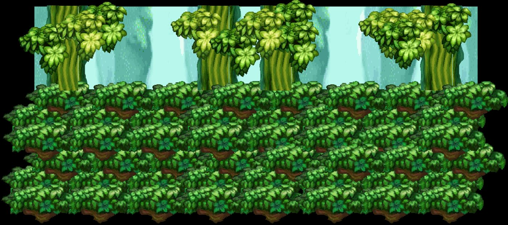
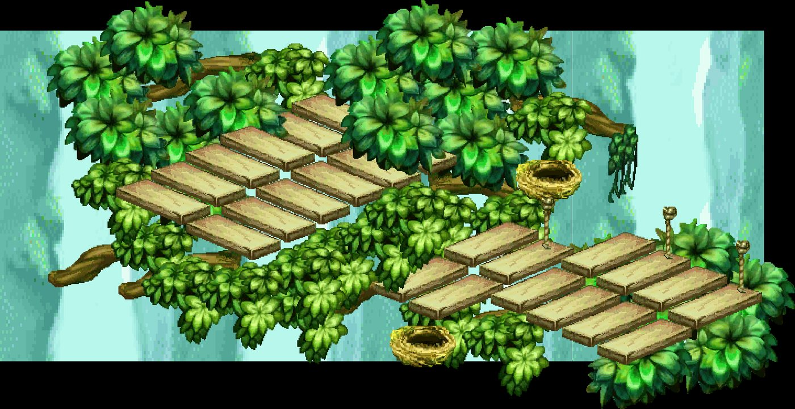

# Kit `tower` — Điểu Tháp

> **Quy tắc bắt buộc cho Codex** (xem README.md): dùng https://github.com/0x0funky/agent-sprite-forge (generate2dmap / generate2dsprite) với route image_gen tích hợp; cấm codeart2d, API trả phí, vẽ bằng code, lật gương; không commit; không sửa tools/hd2d_audit/*, gate_waivers.json, check.sh; mỗi asset phải tự nhìn ảnh trước khi ghi "vẽ xong"; chỉ Claude/owner đánh dấu "duyệt".

- Style/palette: Tháp đá cao nhìn trên mây, đá lục giác phù văn, lan can kim loại; rừng Vân Tiêu Thiên Tầng xanh lam.
- Thư mục asset: `apps/game-web/art-src/hd2d/batch-11-tower/`
- Số map: 3

## 1. Danh sách asset cần vẽ (kit chưa có asset)

Nguồn: Phần C `hd2d-maps-75-gemini-prompt.md`. Yêu cầu gốc: tile sàn đá lục giác phù văn, đá lát tháp, cỏ tầng thượng; prop: lan can kim loại (đoạn lặp), cột tháp ×3, cửa chuyển tầng (dormant/active), tượng chim đá ×2, lông vũ khổng lồ, đèn tháp, bậc thang xoắn; backdrop xa: biển mây từ trên cao.

| Vẽ | Duyệt | id (số thứ tự; đặt tên tiếng Anh vào manifest `name`) | loại | mô tả + prompt đi kèm |
|---|---|---|---|---|
| ⬜ | ⬜ | `tower-floor-01` | floor | sàn đá lục giác phù văn — tile sàn nhìn từ trên xuống, seamless 512×512; HD-2D Octopath pixel art, palette Điểu Tháp, outline tối cùng sắc, 33–48 màu, không bóng đổ/sương/chữ. |
| ⬜ | ⬜ | `tower-floor-02` | floor | đá lát tháp — tile sàn nhìn từ trên xuống, seamless 512×512; HD-2D Octopath pixel art, palette Điểu Tháp, outline tối cùng sắc, 33–48 màu, không bóng đổ/sương/chữ. |
| ⬜ | ⬜ | `tower-floor-03` | floor | cỏ tầng thượng — tile sàn nhìn từ trên xuống, seamless 512×512; HD-2D Octopath pixel art, palette Điểu Tháp, outline tối cùng sắc, 33–48 màu, không bóng đổ/sương/chữ. |
| ⬜ | ⬜ | `tower-prop-01` | prop | lan can kim loại (đoạn lặp) — prop đứng billboard, pivot giữa-đáy; HD-2D Octopath pixel art, palette Điểu Tháp, outline tối cùng sắc, 33–48 màu, không bóng đổ/sương/chữ. |
| ⬜ | ⬜ | `tower-prop-02` | prop | cột tháp — prop đứng billboard, pivot giữa-đáy; HD-2D Octopath pixel art, palette Điểu Tháp, outline tối cùng sắc, 33–48 màu, không bóng đổ/sương/chữ. |
| ⬜ | ⬜ | `tower-prop-03` | prop | cột tháp — prop đứng billboard, pivot giữa-đáy; HD-2D Octopath pixel art, palette Điểu Tháp, outline tối cùng sắc, 33–48 màu, không bóng đổ/sương/chữ. |
| ⬜ | ⬜ | `tower-prop-04` | prop | cột tháp — prop đứng billboard, pivot giữa-đáy; HD-2D Octopath pixel art, palette Điểu Tháp, outline tối cùng sắc, 33–48 màu, không bóng đổ/sương/chữ. |
| ⬜ | ⬜ | `tower-prop-05` | prop | cửa chuyển tầng (dormant/active) — prop đứng billboard, pivot giữa-đáy; HD-2D Octopath pixel art, palette Điểu Tháp, outline tối cùng sắc, 33–48 màu, không bóng đổ/sương/chữ. |
| ⬜ | ⬜ | `tower-prop-06` | prop | tượng chim đá — prop đứng billboard, pivot giữa-đáy; HD-2D Octopath pixel art, palette Điểu Tháp, outline tối cùng sắc, 33–48 màu, không bóng đổ/sương/chữ. |
| ⬜ | ⬜ | `tower-prop-07` | prop | tượng chim đá — prop đứng billboard, pivot giữa-đáy; HD-2D Octopath pixel art, palette Điểu Tháp, outline tối cùng sắc, 33–48 màu, không bóng đổ/sương/chữ. |
| ⬜ | ⬜ | `tower-prop-08` | prop | lông vũ khổng lồ — prop đứng billboard, pivot giữa-đáy; HD-2D Octopath pixel art, palette Điểu Tháp, outline tối cùng sắc, 33–48 màu, không bóng đổ/sương/chữ. |
| ⬜ | ⬜ | `tower-prop-09` | prop | đèn tháp — prop đứng billboard, pivot giữa-đáy; HD-2D Octopath pixel art, palette Điểu Tháp, outline tối cùng sắc, 33–48 màu, không bóng đổ/sương/chữ. |
| ⬜ | ⬜ | `tower-prop-10` | prop | bậc thang xoắn — prop đứng billboard, pivot giữa-đáy; HD-2D Octopath pixel art, palette Điểu Tháp, outline tối cùng sắc, 33–48 màu, không bóng đổ/sương/chữ. |
| ⬜ | ⬜ | `tower-backdrop-far-01` | backdrop_far | biển mây từ trên cao — backdrop xa 1280×384 lặp ngang liền (64 px/đơn vị); HD-2D Octopath pixel art, palette Điểu Tháp, outline tối cùng sắc, 33–48 màu, không bóng đổ/sương/chữ. |
| ⬜ | ⬜ | `tower-floor-extra-01` | floor | tile sàn bổ sung (đủ ≥8 biến thể khác texture), seamless 512×512 |
| ⬜ | ⬜ | `tower-floor-extra-02` | floor | tile sàn bổ sung (đủ ≥8 biến thể khác texture), seamless 512×512 |
| ⬜ | ⬜ | `tower-floor-extra-03` | floor | tile sàn bổ sung (đủ ≥8 biến thể khác texture), seamless 512×512 |
| ⬜ | ⬜ | `tower-floor-extra-04` | floor | tile sàn bổ sung (đủ ≥8 biến thể khác texture), seamless 512×512 |
| ⬜ | ⬜ | `tower-floor-extra-05` | floor | tile sàn bổ sung (đủ ≥8 biến thể khác texture), seamless 512×512 |
| ⬜ | ⬜ | `tower-edge-01` | edge | dải chuyển tiếp giữa 2 tile chính, 512×128 liền hai đầu, mép bất quy tắc |
| ⬜ | ⬜ | `tower-edge-02` | edge | dải chuyển tiếp giữa 2 tile chính, 512×128 liền hai đầu, mép bất quy tắc |
| ⬜ | ⬜ | `tower-edge-03` | edge | dải chuyển tiếp giữa 2 tile chính, 512×128 liền hai đầu, mép bất quy tắc |
| ⬜ | ⬜ | `tower-decal-01` | decal | decal tiếp đất theo chủ đề kit (vụn, vết, xương/đá), bất quy tắc, mép mềm |
| ⬜ | ⬜ | `tower-decal-02` | decal | decal tiếp đất theo chủ đề kit (vụn, vết, xương/đá), bất quy tắc, mép mềm |
| ⬜ | ⬜ | `tower-decal-03` | decal | decal tiếp đất theo chủ đề kit (vụn, vết, xương/đá), bất quy tắc, mép mềm |
| ⬜ | ⬜ | `tower-decal-04` | decal | decal tiếp đất theo chủ đề kit (vụn, vết, xương/đá), bất quy tắc, mép mềm |
| ⬜ | ⬜ | `tower-decal-05` | decal | decal tiếp đất theo chủ đề kit (vụn, vết, xương/đá), bất quy tắc, mép mềm |
| ⬜ | ⬜ | `tower-decal-06` | decal | decal tiếp đất theo chủ đề kit (vụn, vết, xương/đá), bất quy tắc, mép mềm |
| ⬜ | ⬜ | `tower-decal-07` | decal | decal tiếp đất theo chủ đề kit (vụn, vết, xương/đá), bất quy tắc, mép mềm |
| ⬜ | ⬜ | `tower-decal-08` | decal | decal tiếp đất theo chủ đề kit (vụn, vết, xương/đá), bất quy tắc, mép mềm |
| ⬜ | ⬜ | `tower-decal-09` | decal | decal tiếp đất theo chủ đề kit (vụn, vết, xương/đá), bất quy tắc, mép mềm |
| ⬜ | ⬜ | `tower-decal-10` | decal | decal tiếp đất theo chủ đề kit (vụn, vết, xương/đá), bất quy tắc, mép mềm |
| ⬜ | ⬜ | `tower-decal-11` | decal | decal tiếp đất theo chủ đề kit (vụn, vết, xương/đá), bất quy tắc, mép mềm |
| ⬜ | ⬜ | `tower-decal-12` | decal | decal tiếp đất theo chủ đề kit (vụn, vết, xương/đá), bất quy tắc, mép mềm |
| ⬜ | ⬜ | `tower-shadow-01` | shadow | bóng procedural alpha mềm, màu kit |
| ⬜ | ⬜ | `tower-shadow-02` | shadow | bóng procedural alpha mềm, màu kit |
| ⬜ | ⬜ | `tower-shadow-03` | shadow | bóng procedural alpha mềm, màu kit |
| ⬜ | ⬜ | `tower-shadow-04` | shadow | bóng procedural alpha mềm, màu kit |
| ⬜ | ⬜ | `tower-backdrop-far` | backdrop | 1280×384, lặp ngang liền, mỗi tầng một khung cảnh khác |
| ⬜ | ⬜ | `tower-backdrop-mid` | backdrop | 1280×384, lặp ngang liền, mỗi tầng một khung cảnh khác |
| ⬜ | ⬜ | `tower-backdrop-near` | backdrop | 1280×384, lặp ngang liền, mỗi tầng một khung cảnh khác |
| ⬜ | ⬜ | `tower-portal-dormant` | portal | cổng nhìn thẳng mặt trước, đúng tông kit |
| ⬜ | ⬜ | `tower-portal-active` | portal | cùng mask với dormant |
| ⬜ | ⬜ | `tower-marker-arrival` | marker | vòng sáng 4 khung |
| ⬜ | ⬜ | `tower-fx-01` | fx | hạt/tia sáng sprite sheet theo chủ đề |
| ⬜ | ⬜ | `tower-fx-02` | fx | hạt/tia sáng sprite sheet theo chủ đề |
| ⬜ | ⬜ | `tower-fx-03` | fx | hạt/tia sáng sprite sheet theo chủ đề |

## 2. Prompt sheet chung cho kit

```text
[Dán Master v2: .ai/design/gpt-redo/00-master-v2.md]
Dùng agent-sprite-forge ($generate2dmap cho tile/prop, $generate2dsprite cho prop/decal/FX/marker). Route ảnh: image_gen tích hợp của Codex (kiểm `route_media.py resolve --kind image`). KHÔNG codeart2d, KHÔNG API, KHÔNG vẽ bằng code.
Kit: Điểu Tháp (tower). Style: Tháp đá cao nhìn trên mây, đá lục giác phù văn, lan can kim loại; rừng Vân Tiêu Thiên Tầng xanh lam.. Style anchor: batch-01-octopath/contact-sheet.png + 2 sprites.png linh thú.
Mỗi lần gọi: 1 sheet ~6 vật trên nền #FF00FF, bố trí 2×3/3×2, cách nhau ≥48 px, không chạm mép. Giữ raw-01.png byte-identical. Cắt/khử nền/pixel finish bằng script forge. 33–48 màu, alpha nhị phân, lề ≥8 px, 128 px = 1 đơn vị (far 64), người = 1.31 đơn vị (cỡ tối đa vật nhỏ: tools/hd2d_audit/size_check.py).
Mỗi asset: thư mục raw-01/final/prompt.md/review.md/qa.json trong apps/game-web/art-src/hd2d/batch-11-tower/<id>/. Tự nhìn 4× nền tối/caro. Xong: `python3 tools/hd2d_audit/art_gate.py batch-11-tower` = 0 lỗi, contact-sheet mới hơn manifest.
```

## 3. Từng map

### `tower_region_main_tower` — Điểu Tháp



- Ảnh gốc (đối chiếu): `.ai/design/map-checklists/refs/tower_region_main_tower.jpg` (bản đầy đủ: `~/Downloads/Phimond-P12-Review/map-images/tower_region_main_tower.png`, 2363×1055 px, 100 px = 1 đơn vị APK)
- Nguồn APK: scene `Assets/Scenes/Map/ThapChim.unity`, 55 sprite ghép; brief: [../map-briefs/kit_tower/tower_region_main_tower.md](../map-briefs/kit_tower/tower_region_main_tower.md)
- Cổng: 2 · vùng quái: không · spawn: 0 · NPC: tower_yves, tower_zane · ghi chú: 'Tháp Chim' là đề xuất sửa chính tả trong NAMING-REVIEW
- neo `P:tower_region_portal_004` (door) Cửa → Vân Tiêu Thiên Tầng: px [1803, 533]
- neo `P:tower_region_portal_005` (door) Cửa → Hải Tặc Hào: px [153, 632]
- neo `A:tower_region_portal_001` (arrival) Điểm đến từ Điểu Tháp Mật Tầng: px [1181, 956]
- neo `AT:ship:tower_region_main_tower` (arrival) Đến từ trụ Hải Tặc Hào: px [252, 622]
- neo `tower_yves` (npc) : px CẦN ĐẶT
- neo `tower_zane` (npc) : px CẦN ĐẶT
- NPC cần sprite (batch-05; kiểm trùng): tower_yves, tower_zane

Asset chính: dùng bảng kit (mục 1). Landmark riêng của map (Codex xem ảnh gốc, ghi tên vật nhận diện vào bảng rồi vẽ):

| Vẽ | Duyệt | id | loại | mô tả | prompt |
|---|---|---|---|---|---|
| ⬜ | ⬜ | `tower_region_main_tower-landmark-01` | landmark | (vật nhận diện #1 trong ảnh gốc) | — |
| ⬜ | ⬜ | `tower_region_main_tower-landmark-02` | landmark | (vật nhận diện #2, nếu có) | — |

Prompt cho Codex:

```text
Dùng agent-sprite-forge (generate2dmap + generate2dsprite, route image_gen). Map tower_region_main_tower (), kit tower.
Mở và đính kèm thật ảnh gốc .ai/design/map-checklists/refs/tower_region_main_tower.jpg vào image_gen cùng 2–3 ảnh style batch 00–09 sát loại + 2 anchor linh thú; ghi sha256.
Rà các hàng chưa ✅ trong bảng; vẽ theo sheet 6 vật; landmark riêng: nhìn ảnh gốc, ghi tên vật vào bảng rồi vẽ (không giả là recovered APK nếu là diễn giải).
Xong: cập nhật cột "Vẽ" (✅ chỉ khi đã nhìn final 4×), chạy art_gate cho kit, KHÔNG tự đặt "Duyệt".
```

### `tower_region_deep_woods` — Vân Tiêu Thiên Tầng



- Ảnh gốc (đối chiếu): `.ai/design/map-checklists/refs/tower_region_deep_woods.jpg` (bản đầy đủ: `~/Downloads/Phimond-P12-Review/map-images/tower_region_deep_woods.png`, 2642×1174 px, 100 px = 1 đơn vị APK)
- Nguồn APK: scene `Assets/Scenes/Map/ThapChim.unity`, 46 sprite ghép; brief: [../map-briefs/kit_tower/tower_region_deep_woods.md](../map-briefs/kit_tower/tower_region_deep_woods.md)
- Cổng: 2 · vùng quái: có · spawn: 17 · NPC: tower_aria · ghi chú: tên nguồn trùng
- neo `P:tower_region_portal_002` (door) Cửa → Điểu Tháp: px [310, 775]
- neo `P:tower_region_portal_003` (door) Cửa → Điểu Tháp: px [2274, 781]
- neo `tower_aria` (npc) : px CẦN ĐẶT
- NPC cần sprite (batch-05; kiểm trùng): tower_aria

Asset chính: dùng bảng kit (mục 1). Landmark riêng của map (Codex xem ảnh gốc, ghi tên vật nhận diện vào bảng rồi vẽ):

| Vẽ | Duyệt | id | loại | mô tả | prompt |
|---|---|---|---|---|---|
| ⬜ | ⬜ | `tower_region_deep_woods-landmark-01` | landmark | (vật nhận diện #1 trong ảnh gốc) | — |
| ⬜ | ⬜ | `tower_region_deep_woods-landmark-02` | landmark | (vật nhận diện #2, nếu có) | — |

Prompt cho Codex:

```text
Dùng agent-sprite-forge (generate2dmap + generate2dsprite, route image_gen). Map tower_region_deep_woods (), kit tower.
Mở và đính kèm thật ảnh gốc .ai/design/map-checklists/refs/tower_region_deep_woods.jpg vào image_gen cùng 2–3 ảnh style batch 00–09 sát loại + 2 anchor linh thú; ghi sha256.
Rà các hàng chưa ✅ trong bảng; vẽ theo sheet 6 vật; landmark riêng: nhìn ảnh gốc, ghi tên vật vào bảng rồi vẽ (không giả là recovered APK nếu là diễn giải).
Xong: cập nhật cột "Vẽ" (✅ chỉ khi đã nhìn final 4×), chạy art_gate cho kit, KHÔNG tự đặt "Duyệt".
```

### `tower_region_secret_floor` — Điểu Tháp Mật Tầng



- Ảnh gốc (đối chiếu): `.ai/design/map-checklists/refs/tower_region_secret_floor.jpg` (bản đầy đủ: `~/Downloads/Phimond-P12-Review/map-images/tower_region_secret_floor.png`, 2410×1243 px, 100 px = 1 đơn vị APK)
- Nguồn APK: scene `Assets/Scenes/Map/ThapChim.unity`, 50 sprite ghép; brief: [../map-briefs/kit_tower/tower_region_secret_floor.md](../map-briefs/kit_tower/tower_region_secret_floor.md)
- Cổng: 1 · vùng quái: có · spawn: 17 · NPC: —
- neo `P:tower_region_portal_001` (door) Cửa → Điểu Tháp: px [1567, 297]

Asset chính: dùng bảng kit (mục 1). Landmark riêng của map (Codex xem ảnh gốc, ghi tên vật nhận diện vào bảng rồi vẽ):

| Vẽ | Duyệt | id | loại | mô tả | prompt |
|---|---|---|---|---|---|
| ⬜ | ⬜ | `tower_region_secret_floor-landmark-01` | landmark | (vật nhận diện #1 trong ảnh gốc) | — |
| ⬜ | ⬜ | `tower_region_secret_floor-landmark-02` | landmark | (vật nhận diện #2, nếu có) | — |

Prompt cho Codex:

```text
Dùng agent-sprite-forge (generate2dmap + generate2dsprite, route image_gen). Map tower_region_secret_floor (), kit tower.
Mở và đính kèm thật ảnh gốc .ai/design/map-checklists/refs/tower_region_secret_floor.jpg vào image_gen cùng 2–3 ảnh style batch 00–09 sát loại + 2 anchor linh thú; ghi sha256.
Rà các hàng chưa ✅ trong bảng; vẽ theo sheet 6 vật; landmark riêng: nhìn ảnh gốc, ghi tên vật vào bảng rồi vẽ (không giả là recovered APK nếu là diễn giải).
Xong: cập nhật cột "Vẽ" (✅ chỉ khi đã nhìn final 4×), chạy art_gate cho kit, KHÔNG tự đặt "Duyệt".
```
