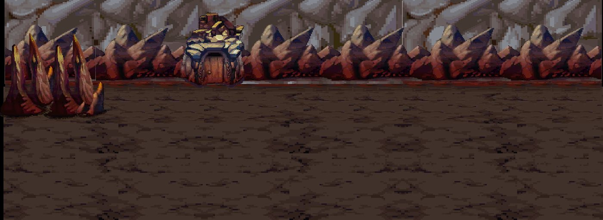
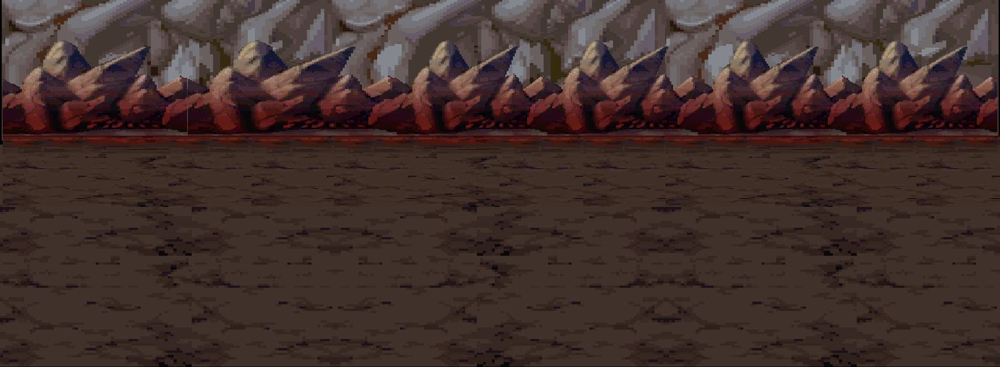
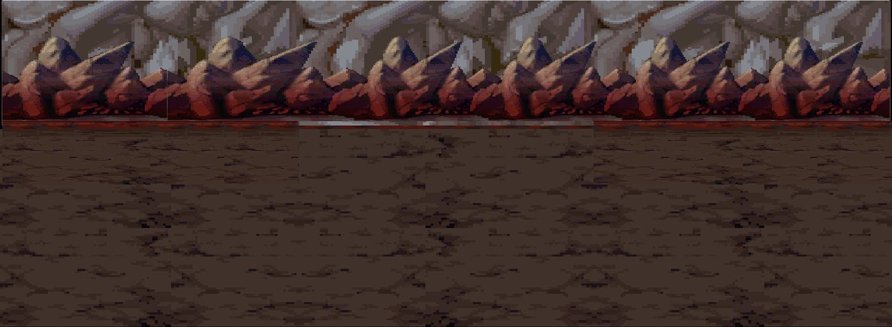
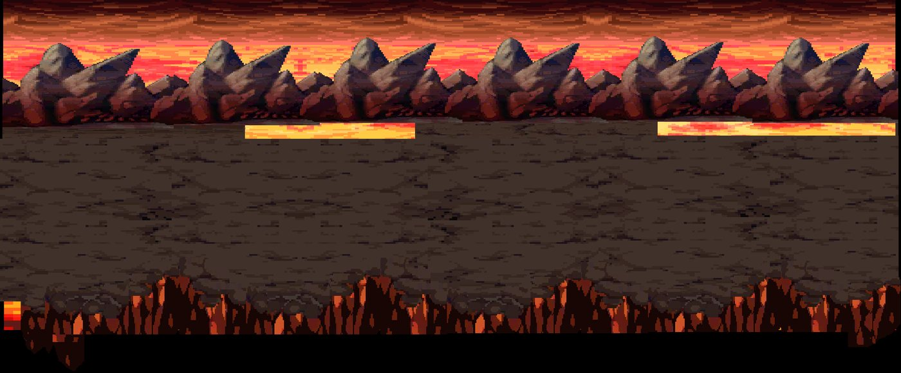
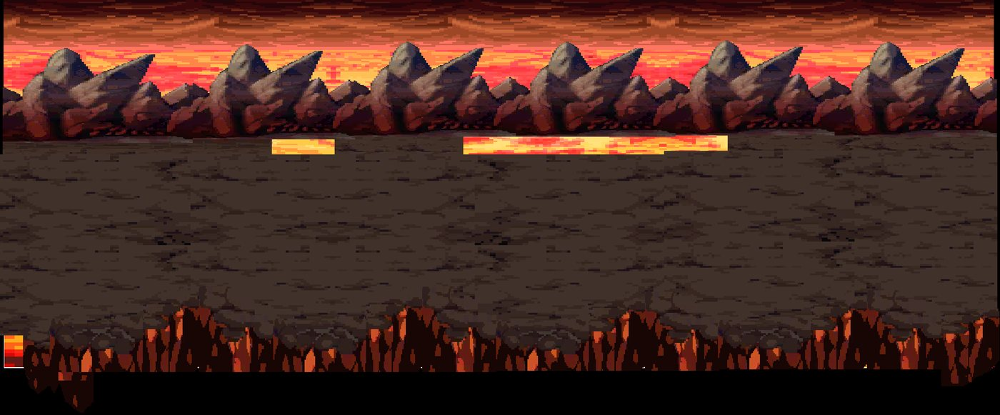
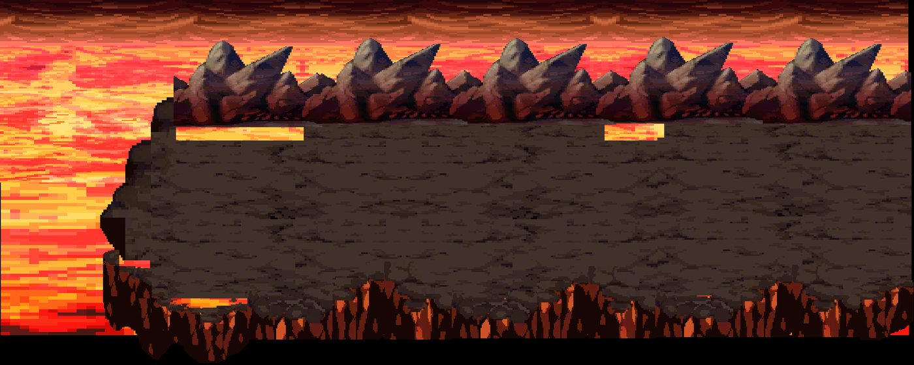

# Kit `windrock` — Núi Phong Thạch

> **Quy tắc bắt buộc cho Codex** (xem README.md): dùng https://github.com/0x0funky/agent-sprite-forge (generate2dmap / generate2dsprite) với route image_gen tích hợp; cấm codeart2d, API trả phí, vẽ bằng code, lật gương; không commit; không sửa tools/hd2d_audit/*, gate_waivers.json, check.sh; mỗi asset phải tự nhìn ảnh trước khi ghi "vẽ xong"; chỉ Claude/owner đánh dấu "duyệt".

- Style/palette: Đá xám lam, cỏ núi khô, tuyết lốm đốm trên cao, gió mạnh (cờ/cỏ nghiêng). Bảng màu đá #7B8794/#566070, cỏ khô #8A8F4E, tuyết #E8EEF4.
- Thư mục asset: `apps/game-web/art-src/hd2d/batch-11-windrock/`
- Số map: 6

## 1. Trạng thái asset hiện có

Tổng 74 · duyệt 0 · nháp 0 · khác 74

| Loại | Có | Cần tối thiểu | Ghi chú |
|---|---|---|---|
| floor | 8 | 8 | ✅ · tile sàn 512×512 seamless, mỗi biến thể là texture khác |
| edge | 0 | 3 | ⬜ thiếu 3 · dải chuyển tiếp 512×128 liền hai đầu |
| prop | 40 | 36 | ✅ · prop đứng, ≥2–3 biến thể thật/chủng loại |
| decal | 13 | 12 | ✅ · decal tiếp đất bất quy tắc, mép mềm |
| shadow | 6 | 4 | ✅ · bóng procedural alpha mềm (ngoại lệ) |
| backdrop | 4 | 3 | ✅ · far/mid/near, lặp ngang liền |
| portal | 2 | 2 | ✅ · cặp dormant/active cùng mask |
| marker | 1 | 1 | ✅ · điểm xuất hiện 4 khung |
| fx | 0 | 3 | ⬜ thiếu 3 · hạt/tia sáng sprite sheet |

### Danh sách asset

| Vẽ | Duyệt | id | loại | kích thước (world) | prompt/nguồn |
|---|---|---|---|---|---|
| ✅ | ❌ Gemini bị trả — vẽ lại | `windrock-cliffs-near` | backdrop | [16.0, 6.0] | — |
| ✅ | ❌ Gemini bị trả — vẽ lại | `windrock-horizon-gradient` | backdrop | [16.0, 2.0] | — |
| ✅ | ❌ Gemini bị trả — vẽ lại | `windrock-peaks-mid` | backdrop | [16.0, 6.0] | — |
| ✅ | ❌ Gemini bị trả — vẽ lại | `windrock-peaks-wall-far` | backdrop | [16.0, 6.0] | — |
| ✅ | ❌ Gemini bị trả — vẽ lại | `windrock-chasm-ravine-01` | decal | [4.0, 4.0] | — |
| ✅ | ❌ Gemini bị trả — vẽ lại | `windrock-chasm-ravine-02` | decal | [4.0, 4.0] | — |
| ✅ | ❌ Gemini bị trả — vẽ lại | `windrock-decal-alpine-moss-edge` | decal | [1.8, 3.8] | — |
| ✅ | ❌ Gemini bị trả — vẽ lại | `windrock-decal-ice-patch-01` | decal | [1.8, 1.8] | — |
| ✅ | ❌ Gemini bị trả — vẽ lại | `windrock-decal-ice-patch-02` | decal | [1.8, 1.8] | — |
| ✅ | ❌ Gemini bị trả — vẽ lại | `windrock-decal-rock-fissure-01` | decal | [2.0, 2.5] | — |
| ✅ | ❌ Gemini bị trả — vẽ lại | `windrock-decal-rock-fissure-02` | decal | [2.0, 2.5] | — |
| ✅ | ❌ Gemini bị trả — vẽ lại | `windrock-decal-scree-run-01` | decal | [3.5, 2.0] | — |
| ✅ | ❌ Gemini bị trả — vẽ lại | `windrock-decal-scree-run-02` | decal | [3.5, 2.0] | — |
| ✅ | ❌ Gemini bị trả — vẽ lại | `windrock-decal-snow-drift-01` | decal | [3.8, 1.8] | — |
| ✅ | ❌ Gemini bị trả — vẽ lại | `windrock-decal-snow-drift-02` | decal | [3.8, 1.8] | — |
| ✅ | ❌ Gemini bị trả — vẽ lại | `windrock-decal-snow-footprints` | decal | [1.8, 3.8] | — |
| ✅ | ❌ Gemini bị trả — vẽ lại | `windrock-tile-edge-decal` | decal | [4.0, 4.0] | — |
| ✅ | ❌ Gemini bị trả — vẽ lại | `windrock-grass-snow-floor` | floor | [4.0, 4.0] | — |
| ✅ | ❌ Gemini bị trả — vẽ lại | `windrock-gravel-floor` | floor | [4.0, 4.0] | — |
| ✅ | ❌ Gemini bị trả — vẽ lại | `windrock-mountain-path-floor` | floor | [4.0, 4.0] | — |
| ✅ | ❌ Gemini bị trả — vẽ lại | `windrock-rock-floor-01` | floor | [4.0, 4.0] | — |
| ✅ | ❌ Gemini bị trả — vẽ lại | `windrock-rock-floor-02` | floor | [4.0, 4.0] | — |
| ✅ | ❌ Gemini bị trả — vẽ lại | `windrock-scree-floor` | floor | [4.0, 4.0] | — |
| ✅ | ❌ Gemini bị trả — vẽ lại | `windrock-slate-floor` | floor | [4.0, 4.0] | — |
| ✅ | ❌ Gemini bị trả — vẽ lại | `windrock-snow-crust-floor` | floor | [4.0, 4.0] | — |
| ✅ | ❌ Gemini bị trả — vẽ lại | `windrock-spawn-marker` | marker | [4.0, 1.0] | — |
| ✅ | ❌ Gemini bị trả — vẽ lại | `windrock-portal-active` | portal | [3.0, 3.5] | — |
| ✅ | ❌ Gemini bị trả — vẽ lại | `windrock-portal-dormant` | portal | [3.0, 3.5] | — |
| ✅ | ❌ Gemini bị trả — vẽ lại | `windrock-ancient-stele` | prop | [1.5, 1.8] | — |
| ✅ | ❌ Gemini bị trả — vẽ lại | `windrock-arch-gate` | prop | [3.8, 3.5] | — |
| ✅ | ❌ Gemini bị trả — vẽ lại | `windrock-backpack-gear` | prop | [1.0, 1.1] | — |
| ✅ | ❌ Gemini bị trả — vẽ lại | `windrock-boulder-snow-01` | prop | [1.8, 1.5] | — |
| ✅ | ❌ Gemini bị trả — vẽ lại | `windrock-boulder-snow-02` | prop | [1.6, 1.4] | — |
| ✅ | ❌ Gemini bị trả — vẽ lại | `windrock-bridge-anchor-post-left` | prop | [1.9, 2.1] | — |
| ✅ | ❌ Gemini bị trả — vẽ lại | `windrock-bridge-anchor-post-right` | prop | [1.9, 2.1] | — |
| ✅ | ❌ Gemini bị trả — vẽ lại | `windrock-bridge-broken` | prop | [2.2, 0.9] | — |
| ✅ | ❌ Gemini bị trả — vẽ lại | `windrock-bridge-repeat` | prop | [2.5, 0.9] | — |
| ✅ | ❌ Gemini bị trả — vẽ lại | `windrock-camp-tent` | prop | [2.4, 1.8] | — |
| ✅ | ❌ Gemini bị trả — vẽ lại | `windrock-campfire-anim` | prop | [4.0, 1.0] | — |
| ✅ | ❌ Gemini bị trả — vẽ lại | `windrock-cliff-01` | prop | [3.0, 2.5] | — |
| ✅ | ❌ Gemini bị trả — vẽ lại | `windrock-cliff-snow-ledge` | prop | [3.0, 2.5] | — |
| ✅ | ❌ Gemini bị trả — vẽ lại | `windrock-dead-wood-stump` | prop | [1.0, 1.4] | — |
| ✅ | ❌ Gemini bị trả — vẽ lại | `windrock-firewood-stack` | prop | [1.2, 1.1] | — |
| ✅ | ❌ Gemini bị trả — vẽ lại | `windrock-grass-snow-clump-01` | prop | [0.9, 0.8] | — |
| ✅ | ❌ Gemini bị trả — vẽ lại | `windrock-grass-snow-clump-02` | prop | [0.9, 0.8] | — |
| ✅ | ❌ Gemini bị trả — vẽ lại | `windrock-grass-snow-clump-03` | prop | [0.9, 0.8] | — |
| ✅ | ❌ Gemini bị trả — vẽ lại | `windrock-pebbles-scatter` | prop | [1.4, 1.0] | — |
| ✅ | ❌ Gemini bị trả — vẽ lại | `windrock-pillar-01` | prop | [1.8, 2.8] | — |
| ✅ | ❌ Gemini bị trả — vẽ lại | `windrock-pine-canopy` | prop | [2.2, 3.2] | — |
| ✅ | ❌ Gemini bị trả — vẽ lại | `windrock-pine-large-01-canopy` | prop | [2.3, 3.8] | — |
| ✅ | ❌ Gemini bị trả — vẽ lại | `windrock-pine-large-01-trunk` | prop | [1.3, 3.4] | — |
| ✅ | ❌ Gemini bị trả — vẽ lại | `windrock-pine-large-02-canopy` | prop | [2.6, 3.6] | — |
| ✅ | ❌ Gemini bị trả — vẽ lại | `windrock-pine-large-02-trunk` | prop | [1.1, 3.0] | — |
| ✅ | ❌ Gemini bị trả — vẽ lại | `windrock-pine-trunk` | prop | [1.2, 2.8] | — |
| ✅ | ❌ Gemini bị trả — vẽ lại | `windrock-prayer-flagpole` | prop | [1.8, 3.6] | — |
| ✅ | ❌ Gemini bị trả — vẽ lại | `windrock-shrub-snow-01` | prop | [1.0, 0.8] | — |
| ✅ | ❌ Gemini bị trả — vẽ lại | `windrock-shrub-snow-02` | prop | [1.0, 0.8] | — |
| ✅ | ❌ Gemini bị trả — vẽ lại | `windrock-shrub-snow-03` | prop | [1.0, 0.8] | — |
| ✅ | ❌ Gemini bị trả — vẽ lại | `windrock-shrub-snow-04` | prop | [1.0, 0.9] | — |
| ✅ | ❌ Gemini bị trả — vẽ lại | `windrock-signpost-blank` | prop | [1.2, 1.6] | — |
| ✅ | ❌ Gemini bị trả — vẽ lại | `windrock-spire-pillar-tall-01` | prop | [1.4, 3.0] | — |
| ✅ | ❌ Gemini bị trả — vẽ lại | `windrock-spire-pillar-tall-02` | prop | [1.4, 3.0] | — |
| ✅ | ❌ Gemini bị trả — vẽ lại | `windrock-stone-stairs` | prop | [2.7, 2.6] | — |
| ✅ | ❌ Gemini bị trả — vẽ lại | `windrock-supply-crate` | prop | [1.1, 1.3] | — |
| ✅ | ❌ Gemini bị trả — vẽ lại | `windrock-supply-keg` | prop | [1.0, 1.3] | — |
| ✅ | ❌ Gemini bị trả — vẽ lại | `windrock-trail-cairn` | prop | [1.1, 1.7] | — |
| ✅ | ❌ Gemini bị trả — vẽ lại | `windrock-wooden-barrel` | prop | [1.0, 1.2] | — |
| ✅ | ❌ Gemini bị trả — vẽ lại | `windrock-wooden-fence` | prop | [2.2, 1.2] | — |
| ✅ | ❌ Gemini bị trả — vẽ lại | `windrock-shadow-large-oval` | shadow | [3.0, 1.4] | — |
| ✅ | ❌ Gemini bị trả — vẽ lại | `windrock-shadow-medium-oval` | shadow | [2.0, 1.1] | — |
| ✅ | ❌ Gemini bị trả — vẽ lại | `windrock-shadow-pillar-long` | shadow | [1.6, 1.6] | — |
| ✅ | ❌ Gemini bị trả — vẽ lại | `windrock-shadow-small-round` | shadow | [1.1, 0.6] | — |
| ✅ | ❌ Gemini bị trả — vẽ lại | `windrock-shadow-stairs-spread` | shadow | [3.0, 1.6] | — |
| ✅ | ❌ Gemini bị trả — vẽ lại | `windrock-shadow-tree-canopy` | shadow | [2.4, 1.2] | — |

## 2. Prompt sheet chung cho kit

```text
[Dán Master v2: .ai/design/gpt-redo/00-master-v2.md]
Dùng agent-sprite-forge ($generate2dmap cho tile/prop, $generate2dsprite cho prop/decal/FX/marker). Route ảnh: image_gen tích hợp của Codex (kiểm `route_media.py resolve --kind image`). KHÔNG codeart2d, KHÔNG API, KHÔNG vẽ bằng code.
Kit: Núi Phong Thạch (windrock). Style: Đá xám lam, cỏ núi khô, tuyết lốm đốm trên cao, gió mạnh (cờ/cỏ nghiêng). Bảng màu đá #7B8794/#566070, cỏ khô #8A8F4E, tuyết #E8EEF4.. Style anchor: batch-01-octopath/contact-sheet.png + 2 sprites.png linh thú.
Mỗi lần gọi: 1 sheet ~6 vật trên nền #FF00FF, bố trí 2×3/3×2, cách nhau ≥48 px, không chạm mép. Giữ raw-01.png byte-identical. Cắt/khử nền/pixel finish bằng script forge. 33–48 màu, alpha nhị phân, lề ≥8 px, 128 px = 1 đơn vị (far 64), người = 1.31 đơn vị (cỡ tối đa vật nhỏ: tools/hd2d_audit/size_check.py).
Mỗi asset: thư mục raw-01/final/prompt.md/review.md/qa.json trong apps/game-web/art-src/hd2d/batch-11-windrock/<id>/. Tự nhìn 4× nền tối/caro. Xong: `python3 tools/hd2d_audit/art_gate.py batch-11-windrock` = 0 lỗi, contact-sheet mới hơn manifest.
```

## 3. Từng map

### `windrock_mountain_camp` — Trại Phong Thạch



- Ảnh gốc (đối chiếu): `.ai/design/map-checklists/refs/windrock_mountain_camp.jpg` (bản đầy đủ: `~/Downloads/Phimond-P12-Review/map-images/windrock_mountain_camp.png`, 2261×825 px, 100 px = 1 đơn vị APK)
- Nguồn APK: scene `Assets/Scenes/Map/20-25/MomDaGio.unity`, 21 sprite ghép; brief: [../map-briefs/kit_windrock/windrock_mountain_camp.md](../map-briefs/kit_windrock/windrock_mountain_camp.md)
- Cổng: 3 · vùng quái: không · spawn: 0 · NPC: wind_hesper, wind_iris, wind_jorin, wind_kestra
- neo `P:windrock_mountain_portal_002` (door) Cửa → Dãy Phong Lĩnh: px [643, 374]
- neo `P:windrock_mountain_portal_006` (door) Cửa → Hẻm Gió Gào: px [2143, 485]
- neo `P:windrock_mountain_portal_008` (door) Cửa → Cầu Thiên Thạch: px [111, 573]
- neo `wind_hesper` (npc) : px CẦN ĐẶT
- neo `wind_iris` (npc) : px CẦN ĐẶT
- neo `wind_jorin` (npc) : px CẦN ĐẶT
- neo `wind_kestra` (npc) : px CẦN ĐẶT
- NPC cần sprite (batch-05; kiểm trùng): wind_hesper, wind_iris, wind_jorin, wind_kestra

Asset chính: dùng bảng kit (mục 1). Landmark riêng của map (Codex xem ảnh gốc, ghi tên vật nhận diện vào bảng rồi vẽ):

| Vẽ | Duyệt | id | loại | mô tả | prompt |
|---|---|---|---|---|---|
| ⬜ | ⬜ | `windrock_mountain_camp-landmark-01` | landmark | (vật nhận diện #1 trong ảnh gốc) | — |
| ⬜ | ⬜ | `windrock_mountain_camp-landmark-02` | landmark | (vật nhận diện #2, nếu có) | — |

Prompt cho Codex:

```text
Dùng agent-sprite-forge (generate2dmap + generate2dsprite, route image_gen). Map windrock_mountain_camp (Trại Phong Thạch), kit windrock.
Mở và đính kèm thật ảnh gốc .ai/design/map-checklists/refs/windrock_mountain_camp.jpg vào image_gen cùng 2–3 ảnh style batch 00–09 sát loại + 2 anchor linh thú; ghi sha256.
Rà các hàng chưa ✅ trong bảng; vẽ theo sheet 6 vật; landmark riêng: nhìn ảnh gốc, ghi tên vật vào bảng rồi vẽ (không giả là recovered APK nếu là diễn giải).
Xong: cập nhật cột "Vẽ" (✅ chỉ khi đã nhìn final 4×), chạy art_gate cho kit, KHÔNG tự đặt "Duyệt".
```

### `windrock_mountain_stone_bridge` — Cầu Thiên Thạch



- Ảnh gốc (đối chiếu): `.ai/design/map-checklists/refs/windrock_mountain_stone_bridge.jpg` (bản đầy đủ: `~/Downloads/Phimond-P12-Review/map-images/windrock_mountain_stone_bridge.png`, 2248×825 px, 100 px = 1 đơn vị APK)
- Nguồn APK: scene `Assets/Scenes/Map/20-25/MomDaGio.unity`, 16 sprite ghép; brief: [../map-briefs/kit_windrock/windrock_mountain_stone_bridge.md](../map-briefs/kit_windrock/windrock_mountain_stone_bridge.md)
- Cổng: 2 · vùng quái: có · spawn: 12 · NPC: wind_loren
- neo `P:windrock_mountain_portal_007` (door) Cửa → Trại Phong Thạch: px [2147, 507]
- neo `P:windrock_mountain_portal_010` (door) Cửa → Quảng Trường Thạch Trụ: px [109, 473]
- neo `AT:square:windrock_mountain_stone_bridge` (arrival) Đến từ trụ Quảng Trường: px [209, 467]
- neo `wind_loren` (npc) : px CẦN ĐẶT
- NPC cần sprite (batch-05; kiểm trùng): wind_loren

Asset chính: dùng bảng kit (mục 1). Landmark riêng của map (Codex xem ảnh gốc, ghi tên vật nhận diện vào bảng rồi vẽ):

| Vẽ | Duyệt | id | loại | mô tả | prompt |
|---|---|---|---|---|---|
| ⬜ | ⬜ | `windrock_mountain_stone_bridge-landmark-01` | landmark | (vật nhận diện #1 trong ảnh gốc) | — |
| ⬜ | ⬜ | `windrock_mountain_stone_bridge-landmark-02` | landmark | (vật nhận diện #2, nếu có) | — |

Prompt cho Codex:

```text
Dùng agent-sprite-forge (generate2dmap + generate2dsprite, route image_gen). Map windrock_mountain_stone_bridge (Cầu Thiên Thạch), kit windrock.
Mở và đính kèm thật ảnh gốc .ai/design/map-checklists/refs/windrock_mountain_stone_bridge.jpg vào image_gen cùng 2–3 ảnh style batch 00–09 sát loại + 2 anchor linh thú; ghi sha256.
Rà các hàng chưa ✅ trong bảng; vẽ theo sheet 6 vật; landmark riêng: nhìn ảnh gốc, ghi tên vật vào bảng rồi vẽ (không giả là recovered APK nếu là diễn giải).
Xong: cập nhật cột "Vẽ" (✅ chỉ khi đã nhìn final 4×), chạy art_gate cho kit, KHÔNG tự đặt "Duyệt".
```

### `windrock_mountain_howling_canyon` — Hẻm Gió Gào



- Ảnh gốc (đối chiếu): `.ai/design/map-checklists/refs/windrock_mountain_howling_canyon.jpg` (bản đầy đủ: `~/Downloads/Phimond-P12-Review/map-images/windrock_mountain_howling_canyon.png`, 2248×826 px, 100 px = 1 đơn vị APK)
- Nguồn APK: scene `Assets/Scenes/Map/20-25/MomDaGio.unity`, 16 sprite ghép; brief: [../map-briefs/kit_windrock/windrock_mountain_howling_canyon.md](../map-briefs/kit_windrock/windrock_mountain_howling_canyon.md)
- Cổng: 1 · vùng quái: có · spawn: 12 · NPC: —
- neo `P:windrock_mountain_portal_005` (door) Cửa → Trại Phong Thạch: px [119, 477]

Asset chính: dùng bảng kit (mục 1). Landmark riêng của map (Codex xem ảnh gốc, ghi tên vật nhận diện vào bảng rồi vẽ):

| Vẽ | Duyệt | id | loại | mô tả | prompt |
|---|---|---|---|---|---|
| ⬜ | ⬜ | `windrock_mountain_howling_canyon-landmark-01` | landmark | (vật nhận diện #1 trong ảnh gốc) | — |
| ⬜ | ⬜ | `windrock_mountain_howling_canyon-landmark-02` | landmark | (vật nhận diện #2, nếu có) | — |

Prompt cho Codex:

```text
Dùng agent-sprite-forge (generate2dmap + generate2dsprite, route image_gen). Map windrock_mountain_howling_canyon (Hẻm Gió Gào), kit windrock.
Mở và đính kèm thật ảnh gốc .ai/design/map-checklists/refs/windrock_mountain_howling_canyon.jpg vào image_gen cùng 2–3 ảnh style batch 00–09 sát loại + 2 anchor linh thú; ghi sha256.
Rà các hàng chưa ✅ trong bảng; vẽ theo sheet 6 vật; landmark riêng: nhìn ảnh gốc, ghi tên vật vào bảng rồi vẽ (không giả là recovered APK nếu là diễn giải).
Xong: cập nhật cột "Vẽ" (✅ chỉ khi đã nhìn final 4×), chạy art_gate cho kit, KHÔNG tự đặt "Duyệt".
```

### `windrock_mountain_mountain_range` — Dãy Phong Lĩnh



- Ảnh gốc (đối chiếu): `.ai/design/map-checklists/refs/windrock_mountain_mountain_range.jpg` (bản đầy đủ: `~/Downloads/Phimond-P12-Review/map-images/windrock_mountain_mountain_range.png`, 2262×938 px, 100 px = 1 đơn vị APK)
- Nguồn APK: scene `Assets/Scenes/Map/20-25/MomDaGio.unity`, 26 sprite ghép; brief: [../map-briefs/kit_windrock/windrock_mountain_mountain_range.md](../map-briefs/kit_windrock/windrock_mountain_mountain_range.md)
- Cổng: 2 · vùng quái: có · spawn: 12 · NPC: wind_mirel
- neo `P:windrock_mountain_portal_004` (door) Cửa → Sơn Đạo Phong Vân: px [108, 525]
- neo `P:windrock_mountain_portal_009` (door) Cửa → Trại Phong Thạch: px [2158, 522]
- neo `wind_mirel` (npc) : px CẦN ĐẶT
- NPC cần sprite (batch-05; kiểm trùng): wind_mirel

Asset chính: dùng bảng kit (mục 1). Landmark riêng của map (Codex xem ảnh gốc, ghi tên vật nhận diện vào bảng rồi vẽ):

| Vẽ | Duyệt | id | loại | mô tả | prompt |
|---|---|---|---|---|---|
| ⬜ | ⬜ | `windrock_mountain_mountain_range-landmark-01` | landmark | (vật nhận diện #1 trong ảnh gốc) | — |
| ⬜ | ⬜ | `windrock_mountain_mountain_range-landmark-02` | landmark | (vật nhận diện #2, nếu có) | — |

Prompt cho Codex:

```text
Dùng agent-sprite-forge (generate2dmap + generate2dsprite, route image_gen). Map windrock_mountain_mountain_range (Dãy Phong Lĩnh), kit windrock.
Mở và đính kèm thật ảnh gốc .ai/design/map-checklists/refs/windrock_mountain_mountain_range.jpg vào image_gen cùng 2–3 ảnh style batch 00–09 sát loại + 2 anchor linh thú; ghi sha256.
Rà các hàng chưa ✅ trong bảng; vẽ theo sheet 6 vật; landmark riêng: nhìn ảnh gốc, ghi tên vật vào bảng rồi vẽ (không giả là recovered APK nếu là diễn giải).
Xong: cập nhật cột "Vẽ" (✅ chỉ khi đã nhìn final 4×), chạy art_gate cho kit, KHÔNG tự đặt "Duyệt".
```

### `windrock_mountain_mountain_path` — Sơn Đạo Phong Vân



- Ảnh gốc (đối chiếu): `.ai/design/map-checklists/refs/windrock_mountain_mountain_path.jpg` (bản đầy đủ: `~/Downloads/Phimond-P12-Review/map-images/windrock_mountain_mountain_path.png`, 2262×938 px, 100 px = 1 đơn vị APK)
- Nguồn APK: scene `Assets/Scenes/Map/20-25/MomDaGio.unity`, 26 sprite ghép; brief: [../map-briefs/kit_windrock/windrock_mountain_mountain_path.md](../map-briefs/kit_windrock/windrock_mountain_mountain_path.md)
- Cổng: 2 · vùng quái: có · spawn: 12 · NPC: wind_nolan
- neo `P:windrock_mountain_portal_001` (door) Cửa → Đỉnh Thiên Phong: px [114, 519]
- neo `P:windrock_mountain_portal_003` (door) Cửa → Dãy Phong Lĩnh: px [2176, 510]
- neo `wind_nolan` (npc) : px CẦN ĐẶT
- NPC cần sprite (batch-05; kiểm trùng): wind_nolan

Asset chính: dùng bảng kit (mục 1). Landmark riêng của map (Codex xem ảnh gốc, ghi tên vật nhận diện vào bảng rồi vẽ):

| Vẽ | Duyệt | id | loại | mô tả | prompt |
|---|---|---|---|---|---|
| ⬜ | ⬜ | `windrock_mountain_mountain_path-landmark-01` | landmark | (vật nhận diện #1 trong ảnh gốc) | — |
| ⬜ | ⬜ | `windrock_mountain_mountain_path-landmark-02` | landmark | (vật nhận diện #2, nếu có) | — |

Prompt cho Codex:

```text
Dùng agent-sprite-forge (generate2dmap + generate2dsprite, route image_gen). Map windrock_mountain_mountain_path (Sơn Đạo Phong Vân), kit windrock.
Mở và đính kèm thật ảnh gốc .ai/design/map-checklists/refs/windrock_mountain_mountain_path.jpg vào image_gen cùng 2–3 ảnh style batch 00–09 sát loại + 2 anchor linh thú; ghi sha256.
Rà các hàng chưa ✅ trong bảng; vẽ theo sheet 6 vật; landmark riêng: nhìn ảnh gốc, ghi tên vật vào bảng rồi vẽ (không giả là recovered APK nếu là diễn giải).
Xong: cập nhật cột "Vẽ" (✅ chỉ khi đã nhìn final 4×), chạy art_gate cho kit, KHÔNG tự đặt "Duyệt".
```

### `windrock_mountain_summit` — Đỉnh Thiên Phong



- Ảnh gốc (đối chiếu): `.ai/design/map-checklists/refs/windrock_mountain_summit.jpg` (bản đầy đủ: `~/Downloads/Phimond-P12-Review/map-images/windrock_mountain_summit.png`, 2254×904 px, 100 px = 1 đơn vị APK)
- Nguồn APK: scene `Assets/Scenes/Map/20-25/MomDaGio.unity`, 24 sprite ghép; brief: [../map-briefs/kit_windrock/windrock_mountain_summit.md](../map-briefs/kit_windrock/windrock_mountain_summit.md)
- Cổng: 1 · vùng quái: có · spawn: 10 · NPC: wind_orla
- neo `P:windrock_mountain_portal_011` (door) Cửa → Sơn Đạo Phong Vân: px [2138, 511]
- neo `wind_orla` (npc) : px CẦN ĐẶT
- NPC cần sprite (batch-05; kiểm trùng): wind_orla

Asset chính: dùng bảng kit (mục 1). Landmark riêng của map (Codex xem ảnh gốc, ghi tên vật nhận diện vào bảng rồi vẽ):

| Vẽ | Duyệt | id | loại | mô tả | prompt |
|---|---|---|---|---|---|
| ⬜ | ⬜ | `windrock_mountain_summit-landmark-01` | landmark | (vật nhận diện #1 trong ảnh gốc) | — |
| ⬜ | ⬜ | `windrock_mountain_summit-landmark-02` | landmark | (vật nhận diện #2, nếu có) | — |

Prompt cho Codex:

```text
Dùng agent-sprite-forge (generate2dmap + generate2dsprite, route image_gen). Map windrock_mountain_summit (Đỉnh Thiên Phong), kit windrock.
Mở và đính kèm thật ảnh gốc .ai/design/map-checklists/refs/windrock_mountain_summit.jpg vào image_gen cùng 2–3 ảnh style batch 00–09 sát loại + 2 anchor linh thú; ghi sha256.
Rà các hàng chưa ✅ trong bảng; vẽ theo sheet 6 vật; landmark riêng: nhìn ảnh gốc, ghi tên vật vào bảng rồi vẽ (không giả là recovered APK nếu là diễn giải).
Xong: cập nhật cột "Vẽ" (✅ chỉ khi đã nhìn final 4×), chạy art_gate cho kit, KHÔNG tự đặt "Duyệt".
```
