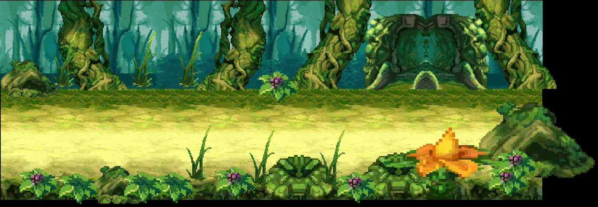
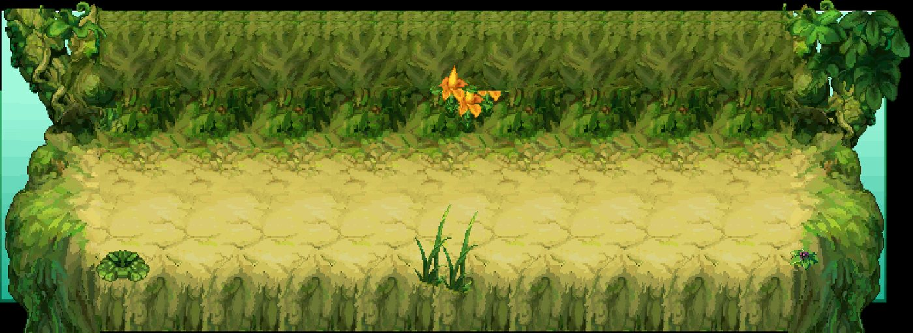
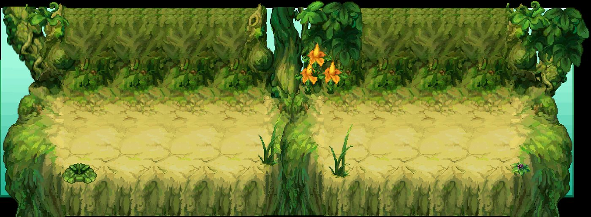

# Kit `world_tree` — Cây Thế Giới

> **Nghiệm thu Claude 2026-11-09** (mức V1, chưa 4×): DUYỆT 47, VẼ_LẠI 4, THIẾU_CHƯA_CÓ 1. Map: {'CHƯA ĐỦ': 3}. Trạng thái hiện hành ở [ASSET-VERDICTS-20261109.csv](ASSET-VERDICTS-20261109.csv) / [MAP-COVERAGE-20261109.csv](MAP-COVERAGE-20261109.csv); tick ✅/❌ bên dưới là LỊCH SỬ, không phải approval.
> VẼ_LẠI (4): `world_tree-edge-01`, `world_tree-edge-02`, `world_tree-floor-extra-05`, `world_tree_gate-landmark-01`

> **Quy tắc bắt buộc cho Codex** (xem README.md): dùng https://github.com/0x0funky/agent-sprite-forge (generate2dmap / generate2dsprite) với route image_gen tích hợp; cấm codeart2d, API trả phí, vẽ bằng code, lật gương; không commit; không sửa tools/hd2d_audit/*, gate_waivers.json, check.sh; mỗi asset phải tự nhìn ảnh trước khi ghi "vẽ xong"; chỉ Claude/owner đánh dấu "duyệt".

- Style/palette: Cành cây khổng lồ làm lối đi, lá to bằng mái nhà, quả thần phát sáng; xanh lục sáng + vàng kim.
- Thư mục asset: `art/src/hd2d/batch-11-world_tree/`
- Số map: 3

## 1. Danh sách asset cần vẽ (kit chưa có asset)

Nguồn: Phần C `hd2d-maps-75-gemini-prompt.md`. Yêu cầu gốc: tile vỏ cây/cành lát, rêu, lá rụng; prop: rễ khổng lồ ×3, lá khổng lồ ×3 (sway), nấm khổng lồ, quả thần phát sáng (4 khung), cổng tán cây, bậc thang cành, dây leo, đom đóm (4 khung); backdrop xa: thân cây vươn tới trời, tán lá.

| Vẽ | Duyệt | id (số thứ tự; đặt tên tiếng Anh vào manifest `name`) | loại | mô tả + prompt đi kèm |
|---|---|---|---|---|
| ✅ | ⬜ | `world_tree-floor-01` | floor | vỏ cây/cành lát 512×512/40 màu; seam 3×3 không lộ nối/lưới, cadence lặp rõ; outer8 không đồng nhất (top/bottom/left/right 40/40/40/40 màu). Candidate chờ owner review. |
| ✅ | ⬜ | `world_tree-floor-02` | floor | rêu xanh ngọc texture rộng, 512×512/40 màu; seam X=4.323, Y=5.340, không lộ lưới ở mosaic 3×3. Viền ngoài chưa phẳng, cadence hơi đều; candidate chờ owner review. |
| ✅ | ⬜ | `world_tree-floor-03` | floor | nền olive với lá/vỏ vụn nhỏ, 512×512/40 màu; seam X=2.781, Y=3.122; corr với floor-02=0.111. Không lộ lưới 3×3; outer8 chưa phẳng, leaf identity khá nhẹ; candidate chờ review. |
| ✅ | ⬜ | `world_tree-prop-01` | prop | rễ buttress khổng lồ xòe đôi, 384×256/40 màu; alpha nhị phân, margin 8 px; final đã xem 4×. Candidate chờ owner review. |
| ✅ | ⬜ | `world_tree-prop-02` | prop | rễ vòm móc bất đối xứng, có khoảng rỗng dưới vòm, 432×310/39 màu; alpha nhị phân, margin 8 px; final đã xem 4×. Candidate chờ owner review. |
| ✅ | ⬜ | `world_tree-prop-03` | prop | dải rễ ngang thấp với ba ngón cuộn, 512×160/39 màu; alpha nhị phân, margin tối thiểu 8 px; viền đỏ của lần sinh đầu đã loại, bản redraw đã xem 4×. Candidate chờ owner review. |
| ✅ | ⬜ | `world_tree-prop-04` | prop | chùm ba lá khổng lồ hình quạt, 432×288/40 màu; alpha nhị phân, lề 8px, `sway:true`; final đã xem 4×. Candidate chờ review. |
| ✅ | ⬜ | `world_tree-prop-05` | prop | một lá thần khổng lồ hình tim, chóp cuộn, 368×343/40 màu; `sway:true`, alpha nhị phân, margin 8px; final đã xem 4×. Candidate chờ review. |
| ✅ | ⬜ | `world_tree-prop-06` | prop | lá paddle khổng lồ có thân cong ở góc trái, 512×304/39 màu; alpha nhị phân, margin 8 px, `sway:true`; final đã xem 4×. Candidate chờ owner review. |
| ✅ | ⬜ | `world_tree-prop-07` | prop | nấm tán vàng khổng lồ, 512×480/38 màu; alpha nhị phân, margin 8 px; final đã xem 4×. Candidate chờ owner review. |
| ✅ | ⬜ | `world_tree-prop-08` | prop | quả thần 4 khung glow, atlas 512×128/128×128 mỗi frame/40 màu; binary alpha, registration ổn định; đã xem 4×. Candidate chờ owner review. |
| ✅ | ⬜ | `world_tree-prop-09` | prop | cổng vòm hai thân cây đan tán lá, 512×384/35 màu; lỗ đi xuyên trong suốt, binary alpha, đã xem 4×. Candidate chờ owner review. |
| ✅ | ⬜ | `world_tree-prop-10` | prop | sáu bậc cành cây lên chéo, 512×384/29 màu; binary alpha, lề tối thiểu 8 px, đã xem 4×. Candidate chờ owner review. |
| ✅ | ⬜ | `world_tree-prop-11` | prop | dây leo dài xoắn, lá thưa, 256×512/36 màu; binary alpha, `sway:true`, đã xem 4×. Candidate chờ owner review. |
| ✅ | ⬜ | `world_tree-prop-12` | prop | đom đóm đơn 4 khung glow, atlas 512×128/128×128 mỗi frame/39 màu; binary alpha, registration lệch tối đa 1px; đã xem 4×. Candidate chờ owner review. |
| ✅ | ⬜ | `world_tree-backdrop-far-01` | backdrop_far | thân cây khổng lồ xa + tán skyline; 1280×384/40 màu, tile ngang seam X=9.817, mosaic 3×1 không lộ join; cadence thân cây lặp còn thấy. Candidate chờ owner xem map-scale. |
| ✅ | ⬜ | `world_tree-backdrop-far-02` | backdrop_far | skyline tán cây xa, khoảng trời vàng nhạt; 1280×384/40 màu, seam X=2.518, 3×1 không lộ join. Mound cadence lặp, cần offset khi ghép. Candidate chờ owner. |
| ✅ | ⬜ | `world_tree-floor-extra-01` | floor | vỏ cây ẩm tối, lỗ nhỏ/dăm vàng/rãnh rêu; 512×512/40 màu, seam X=4.359/Y=4.342, corr với floor-01/02/03 <0.064. 3×3 không lộ grid rõ nhưng cadence nhẹ; outer8 không uniform. Candidate phụ, cần owner map-scale review. |
| ✅ | ⬜ | `world_tree-floor-extra-02` | floor | rêu emerald hạt nhỏ tối, dăm vỏ và đốm vàng; 512×512/40 màu, seam X=6.302/Y=6.999, corr với floor-01/02/03 [np.float64(0.0606), np.float64(0.067), np.float64(0.078)]. 3×3 có cadence nhưng không thấy đường nối rõ; outer8 không uniform. Candidate phụ, cần owner map-scale review. |
| ✅ | ⬜ | `world_tree-floor-extra-03` | floor | đất vỏ cây umber tối, dăm hổ phách thưa/rêu nhỏ; 512×512/40 màu, seam 1.700/2.001, tương quan [np.float64(0.0485), np.float64(0.0532), np.float64(0.0577)]. 3×3 không lộ seam nhưng vị trí dăm lặp nhận ra; dùng phụ, offset map-scale. Owner review pending. |
| ✅ | ⬜ | `world_tree-floor-extra-04` | floor | vỏ cây olive-gray dạng vảy nhỏ, lichen/đốm vàng; 512×512/40 màu, seam 7.611/9.097, corr [np.float64(0.0837), np.float64(0.0923), np.float64(0.0913)]. Mosaic có cadence vảy nghiêng, candidate dùng phụ/offset, owner review pending. |
| ✅ | ⬜ | `world_tree-floor-extra-05` | floor | rêu emerald sáng với phấn vàng thưa, 512×512/40 màu; nearest + no-dither finish; seam X=9.315/Y=10.120; corr cao nhất 0.861 với floor-03. Mosaic có cadence nhẹ; outer8 chưa đồng nhất; candidate dùng phụ/offset, chờ owner map-scale review. |
| ✅ | ⬜ | `world_tree-edge-01` | edge | dải chuyển rêu → vỏ cây 512×128/40 màu, alpha đục; art-gate seam X=10.586/limit 14. Repeat 3× không lộ mối nối lớn nhưng nhịp vỏ cây lặp và màu tối; candidate tạm để thử map-scale, chưa duyệt. |
| ✅ | ⬜ | `world_tree-edge-02` | edge | dải rêu emerald → lối vỏ vàng 512×128/37 màu, alpha nhị phân; art-gate seam 17.768/17.630, giới hạn tương đối 28.208. Candidate tạm; mảng bark và foliage lặp trong repeat 3×, cần thử map-scale. |
| ⬜ | ⬜ | `world_tree-edge-03` | edge | dải chuyển tiếp giữa 2 tile chính, 512×128 liền hai đầu, mép bất quy tắc. Attempts 01–16 rejected; 13 soft/mottled, 14 blocky/regular, 15 too flat, 16 repeats moss clusters and bark boundary despite low seam mean. Continue redraw; recent studies in `batch-11-world_tree/jobs/edge-03-attempt-13..16-study/`. |
| ✅ | ⬜ | `world_tree-decal-01` | decal | cụm lá rụng vàng/xanh và vụn vỏ cây, 384×256/39 màu; binary alpha, xem 4×. Candidate chờ owner review. |
| ✅ | ⬜ | `world_tree-decal-02` | decal | cụm rêu thấp với hai đầu rễ cuộn, 384×256/34 màu; binary alpha, xem 4×. Candidate chờ owner review. |
| ✅ | ⬜ | `world_tree-decal-03` | decal | dải mảnh vỏ cây và ba hạt hổ phách, 384×256/35 màu; binary alpha, xem 4×. Candidate chờ owner review. |
| ✅ | ⬜ | `world_tree-decal-04` | decal | vòng tăng trưởng vỏ cây đứt đoạn, 384×384/38 màu; binary alpha, xem 4×. Candidate chờ owner review. |
| ✅ | ⬜ | `world_tree-decal-05` | decal | vệt nhựa cây hổ phách và vụn vỏ, 384×256/40 màu; binary alpha, xem 4×. Candidate chờ owner review. |
| ✅ | ⬜ | `world_tree-decal-06` | decal | mảng vỏ cây có rãnh rễ cong và rêu thưa, 384×256/36 màu; binary alpha, xem 4×. Candidate chờ owner review. |
| ✅ | ⬜ | `world_tree-decal-07` | decal | dăm vỏ cây xoắn, rêu và vỏ hạt rỗng, 384×256/39 màu; binary alpha, xem 4×. Candidate chờ owner review. |
| ✅ | ⬜ | `world_tree-decal-08` | decal | vệt nhựa cây hổ phách đứt đoạn, dăm vỏ và rêu thưa; 384×256/40 màu, alpha nhị phân, lề ≥8 px; xem 4× và trên floor-01. Màu hổ phách nổi mạnh, nên dùng tiết chế; candidate chờ owner review. |
| ✅ | ⬜ | `world_tree-decal-09` | decal | vết nứt vỏ cây tỏa nhánh và dăm rời, 384×256/40 màu; binary alpha, xem 4×. Candidate chờ owner review. |
| ✅ | ⬜ | `world_tree-decal-10` | decal | cánh hoa vàng rụng, tâm hổ phách, 384×256/37 màu; binary alpha, xem 4×. Candidate chờ owner review. |
| ✅ | ⬜ | `world_tree-decal-11` | decal | vỏ hạt thần rỗng nứt đôi, hạt vàng rơi; 384×256/40 màu, alpha nhị phân, lề 8px; final đã xem 4× caro/tối. Candidate chờ owner duyệt. |
| ✅ | ⬜ | `world_tree-decal-12` | decal | cụm 3 mầm cây non lá cuộn và vụn vỏ; 384×256/40 màu, alpha nhị phân, lề 8px; xem 4× caro/tối. Candidate chờ owner duyệt. |
| ✅ | ⬜ | `world_tree-shadow-01` | shadow | bóng tán cây xanh rừng, 512×256/40 màu RGB; alpha mềm có chủ đích; xem 4×. Candidate chờ owner review. |
| ✅ | ⬜ | `world_tree-shadow-02` | shadow | bóng rễ uốn chéo, 512×256/40 màu RGB, alpha mềm; tương phản cần review trong composition; đã xem 4×. Candidate chờ owner review. |
| ✅ | ⬜ | `world_tree-shadow-03` | shadow | bóng cành chéo tán lá, 512×256/40 màu RGB; alpha mềm; đã xem 4× và map-scale. Candidate chờ owner review. |
| ✅ | ⬜ | `world_tree-shadow-04` | shadow | bóng tán dappled ngang, alpha mềm; 512×256/40 màu; alpha≤32 spill đã loại, xem 4× caro/tối. Diffuse hơn shadow khác, cần owner so map-scale. |
| ✅ | ⬜ | `world_tree-backdrop-far-01`, `world_tree-backdrop-far-02` | backdrop_far | Hai lớp xa 1280×384, lặp ngang; thân cây/tán trời và skyline tán lá. Cả hai candidate đã đăng ký, cần review map-scale/owner; chưa duyệt. |
| ✅ | ⬜ | `world_tree-backdrop-mid` | backdrop | lớp trung cảnh thân cây/cành ngang; 1280×384/40 màu, alpha nhị phân, seam X=9.516, khoảng rỗng thật, repeat 3× đã xem; nhịp thân cây lặp rõ. Candidate cần map-scale. |
| ✅ | ⬜ | `world_tree-backdrop-near` | backdrop | lớp gần thân cây/tán đóng khung hai mép; 1280×384/40 màu, alpha nhị phân, seam X=5.378, repeat 3×1 không lộ join, giữa trong suốt. Motif khung lặp; cần offset/map-scale. |
| ✅ | ⬜ | `world_tree-portal-dormant` | portal | vòm hai thân cây đan tán lá, lối giữa trong suốt; 512×384/40 màu, alpha nhị phân, lề 8px; xem 4×. Candidate chờ owner review. |
| ✅ | ⬜ | `world_tree-portal-active` | portal | cùng mask dormant (IoU 1.0), rune xanh lục/vàng kim dọc vòm; 512×384/40 màu, alpha nhị phân; xem 4×. Ánh rune sáng, chờ owner review. |
| ✅ | ⬜ | `world_tree-marker-arrival` | marker | vòng rune lá phẳng nhìn từ trên xuống, 4 khung 128×128, atlas 512×128/40 màu, alpha nhị phân; sparkle chạy vòng N→E→S→W, đã xem 4× caro/tối. Candidate chờ owner duyệt. |
| ✅ | ⬜ | `world_tree-fx-01` | fx | lá xanh-vàng rơi 4 frame, atlas 512×128; 40 màu chung, alpha nhị phân, viền cell alpha 0; spill QC và strict process pass, final 4× đã xem. Candidate chờ owner; animation 4 pose là one-shot, không loop liền. |
| ✅ | ⬜ | `world_tree-fx-02` | fx | cụm hạt phấn vàng bay lên 4 frame, atlas 512×128/40 màu, alpha nhị phân, final margin ≥8 px; strict process pass, đã xem 4×. Spill raw có safe_frame warning 1/4; candidate chờ owner, one-shot không loop liền. |
| ✅ | ⬜ | `world_tree-fx-03` | fx | giọt nhựa vàng nổ thành mảnh lá/hạt 4 frame; atlas 512×128/40 màu, binary alpha, final margin >8 px; strict process pass, xem 4×. Raw spill có safe_frame warning 1/4; candidate one-shot chờ owner. |

## 2. Prompt sheet chung cho kit

```text
[Dán Master v2: .ai/design/gpt-redo/00-master-v2.md]
Dùng agent-sprite-forge ($generate2dmap cho tile/prop, $generate2dsprite cho prop/decal/FX/marker). Route ảnh: image_gen tích hợp của Codex (kiểm `route_media.py resolve --kind image`). KHÔNG codeart2d, KHÔNG API, KHÔNG vẽ bằng code.
Kit: Cây Thế Giới (world_tree). Style: Cành cây khổng lồ làm lối đi, lá to bằng mái nhà, quả thần phát sáng; xanh lục sáng + vàng kim.. Style anchor: batch-01-octopath/contact-sheet.png + 2 sprites.png linh thú.
Mỗi lần gọi: 1 sheet ~6 vật trên nền #FF00FF, bố trí 2×3/3×2, cách nhau ≥48 px, không chạm mép. Giữ raw-01.png byte-identical. Cắt/khử nền/pixel finish bằng script forge. 33–48 màu, alpha nhị phân, lề ≥8 px, 128 px = 1 đơn vị (far 64), người = 1.31 đơn vị (cỡ tối đa vật nhỏ: tools/hd2d_audit/size_check.py).
Mỗi asset: thư mục raw-01/final/prompt.md/review.md/qa.json trong art/src/hd2d/batch-11-world_tree/<id>/. Tự nhìn 4× nền tối/caro. Xong: `python3 tools/hd2d_audit/art_gate.py batch-11-world_tree` = 0 lỗi, contact-sheet mới hơn manifest.
```

## 3. Từng map

### QA composition review — 2026-11-06

- `qa-compositions.py` creates three mockups over the original map references; `qa-compositions.json` records source-map hashes, candidate asset hashes, anchors and preview scales. These are QA images only, not runtime scenes or approval evidence.
- Visual review found style/scale mismatch: several generated props (notably the flower, arch, mushroom and fruit) read glossy/rendered against the original's crisp pixel art; the arch is visually heavy at the doorway. Rework these candidates toward the original's grouped pixel clusters and compare scale/lighting before marking the kit complete. No owner approval is implied.

### `world_tree_gate` — Thế Thụ Môn



- Ảnh gốc (đối chiếu): `.ai/design/map-checklists/refs/world_tree_gate.jpg` (bản đầy đủ: `~/Downloads/Phimond-P12-Review/map-images/world_tree_gate.png`, 2476×860 px, 100 px = 1 đơn vị APK)
- Nguồn APK: scene `Assets/Scenes/Map/CayTheGioi.unity`, 42 sprite ghép; brief: [../map-briefs/kit_world_tree/world_tree_gate.md](../map-briefs/kit_world_tree/world_tree_gate.md)
- Cổng: 2 · vùng quái: không · spawn: 0 · NPC: tree_vik, tree_willa
- neo `P:world_tree_portal_004` (door) Cửa → Thế Thụ Thâm Lâm: px [1766, 448]
- neo `P:world_tree_portal_005` (door) Cửa → Hải Tặc Hào: px [116, 547]
- neo `A:world_tree_portal_001` (arrival) Điểm đến từ Mật Thất Thế Thụ: px [1238, 760]
- neo `AT:ship:world_tree_gate` (arrival) Đến từ trụ Hải Tặc Hào: px [215, 537]
- neo `tree_vik` (npc) : px CẦN ĐẶT
- neo `tree_willa` (npc) : px CẦN ĐẶT
- NPC cần sprite (batch-05; kiểm trùng): tree_vik, tree_willa

Asset chính: dùng bảng kit (mục 1). Landmark riêng của map (Codex xem ảnh gốc, ghi tên vật nhận diện vào bảng rồi vẽ):

| Vẽ | Duyệt | id | loại | mô tả | prompt |
|---|---|---|---|---|---|
| ✅ | ⬜ | `world_tree_gate-landmark-01` | landmark | hoa vàng cam cánh nhọn xòe ngang, nụ giữa cao, cụm lá xanh; redraw 384×384/40 màu, alpha nhị phân; xem 4× caro/tối và map-scale. Candidate attempt 04, gần silhouette map gốc hơn; chờ owner review. | image_gen có map gốc làm reference; raw-02; candidate only |
| ✅ | ⬜ | `world_tree_gate-landmark-02` | landmark | bụi 3 hoa tím với tâm vàng và lá xanh; 256×256/38 màu, binary alpha; xem 4× caro/tối. Candidate, diễn giải từ map gốc. | đã tạo và key nền magenta; Claude/owner review pending |

Prompt cho Codex:

```text
Dùng agent-sprite-forge (generate2dmap + generate2dsprite, route image_gen). Map world_tree_gate (), kit world_tree.
Mở và đính kèm thật ảnh gốc .ai/design/map-checklists/refs/world_tree_gate.jpg vào image_gen cùng 2–3 ảnh style batch 00–09 sát loại + 2 anchor linh thú; ghi sha256.
Rà các hàng chưa ✅ trong bảng; vẽ theo sheet 6 vật; landmark riêng: nhìn ảnh gốc, ghi tên vật vào bảng rồi vẽ (không giả là recovered APK nếu là diễn giải).
Xong: cập nhật cột "Vẽ" (✅ chỉ khi đã nhìn final 4×), chạy art_gate cho kit, KHÔNG tự đặt "Duyệt".
```

### `world_tree_deep_woods` — Thế Thụ Thâm Lâm



- Ảnh gốc (đối chiếu): `.ai/design/map-checklists/refs/world_tree_deep_woods.jpg` (bản đầy đủ: `~/Downloads/Phimond-P12-Review/map-images/world_tree_deep_woods.png`, 2586×946 px, 100 px = 1 đơn vị APK)
- Nguồn APK: scene `Assets/Scenes/Map/CayTheGioi.unity`, 37 sprite ghép; brief: [../map-briefs/kit_world_tree/world_tree_deep_woods.md](../map-briefs/kit_world_tree/world_tree_deep_woods.md)
- Cổng: 2 · vùng quái: có · spawn: 17 · NPC: — · ghi chú: tên nguồn trùng
- neo `P:world_tree_portal_002` (door) Cửa → Thế Thụ Môn: px [180, 549]
- neo `P:world_tree_portal_003` (door) Cửa → Thế Thụ Môn: px [2253, 539]

Asset chính: dùng bảng kit (mục 1). Landmark riêng của map (Codex xem ảnh gốc, ghi tên vật nhận diện vào bảng rồi vẽ):

| Vẽ | Duyệt | id | loại | mô tả | prompt |
|---|---|---|---|---|---|
| ✅ | ⬜ | `world_tree_deep_woods-landmark-01` | landmark | tái dùng `world_tree_gate-landmark-01` cho loài hoa vàng cam ở giữa tán xa; đặt ở foreground layer theo ảnh gốc. | asset dùng chung, không tạo bản trùng; owner duyệt map-scale pending |
| ✅ | ⬜ | `world_tree_deep_woods-landmark-02` | landmark | tái dùng `world_tree-decal-02` làm rosette rễ/rêu góc trước trái; cần bố trí dưới tán. | asset dùng chung, không tạo bản trùng; owner duyệt map-scale pending |

Prompt cho Codex:

```text
Dùng agent-sprite-forge (generate2dmap + generate2dsprite, route image_gen). Map world_tree_deep_woods (), kit world_tree.
Mở và đính kèm thật ảnh gốc .ai/design/map-checklists/refs/world_tree_deep_woods.jpg vào image_gen cùng 2–3 ảnh style batch 00–09 sát loại + 2 anchor linh thú; ghi sha256.
Rà các hàng chưa ✅ trong bảng; vẽ theo sheet 6 vật; landmark riêng: nhìn ảnh gốc, ghi tên vật vào bảng rồi vẽ (không giả là recovered APK nếu là diễn giải).
Xong: cập nhật cột "Vẽ" (✅ chỉ khi đã nhìn final 4×), chạy art_gate cho kit, KHÔNG tự đặt "Duyệt".
```

### `world_tree_secret_chamber` — Mật Thất Thế Thụ



- Ảnh gốc (đối chiếu): `.ai/design/map-checklists/refs/world_tree_secret_chamber.jpg` (bản đầy đủ: `~/Downloads/Phimond-P12-Review/map-images/world_tree_secret_chamber.png`, 2586×950 px, 100 px = 1 đơn vị APK)
- Nguồn APK: scene `Assets/Scenes/Map/CayTheGioi.unity`, 40 sprite ghép; brief: [../map-briefs/kit_world_tree/world_tree_secret_chamber.md](../map-briefs/kit_world_tree/world_tree_secret_chamber.md)
- Cổng: 1 · vùng quái: có · spawn: 17 · NPC: —
- neo `P:world_tree_portal_001` (door) Cửa → Thế Thụ Môn: px [191, 587]

Asset chính: dùng bảng kit (mục 1). Landmark riêng của map (Codex xem ảnh gốc, ghi tên vật nhận diện vào bảng rồi vẽ):

| Vẽ | Duyệt | id | loại | mô tả | prompt |
|---|---|---|---|---|---|
| ✅ | ⬜ | `world_tree_secret_chamber-landmark-01` | landmark | thân cây khổng lồ chạc đôi chia phòng, 384×512/39 màu, alpha nhị phân; xem 4× caro/tối. Candidate, diễn giải từ map gốc. | đã tạo và key nền magenta; Claude/owner review pending |
| ✅ | ⬜ | `world_tree_secret_chamber-landmark-02` | landmark | tái dùng `world_tree_gate-landmark-01` ba lần thành cụm hoa cạnh thân cây trung tâm. | asset dùng chung, không tạo bản trùng; owner duyệt map-scale pending |

Prompt cho Codex:

```text
Dùng agent-sprite-forge (generate2dmap + generate2dsprite, route image_gen). Map world_tree_secret_chamber (), kit world_tree.
Mở và đính kèm thật ảnh gốc .ai/design/map-checklists/refs/world_tree_secret_chamber.jpg vào image_gen cùng 2–3 ảnh style batch 00–09 sát loại + 2 anchor linh thú; ghi sha256.
Rà các hàng chưa ✅ trong bảng; vẽ theo sheet 6 vật; landmark riêng: nhìn ảnh gốc, ghi tên vật vào bảng rồi vẽ (không giả là recovered APK nếu là diễn giải).
Xong: cập nhật cột "Vẽ" (✅ chỉ khi đã nhìn final 4×), chạy art_gate cho kit, KHÔNG tự đặt "Duyệt".
```

### Candidate redraw notes — 2026-11-05

- `floor-extra-01` attempts 04–11 rejected (cadence/edge bands); attempt 12 registered. `floor-extra-02` attempt 01 rejected; attempt 02 registered. `floor-extra-03` attempts 01–02 rejected, attempt 03 registered with repeat-cadence limit. `floor-extra-04` attempts 01–02 rejected (horizontal layers; edit repeats floor-01-like plates, color-only distinction). Keep rejects under `jobs/`; do not count them.
- `edge-01` attempts 03–04 remain rejected: 03 repeats root/moss rhythm; 04 repeats cadence and endpoint seam stays high after crop optimization (RGB mean 16.93), with magenta fringe. Continue redraw.
- `fx-01` attempts 05–07 and 09–12 remain rejected/provisional. Attempt 13 is registered as `world_tree-fx-01`: 4-frame falling leaf, 40-color shared palette; spill QC and strict process pass, visual review complete. FX-02/03 remain open.
