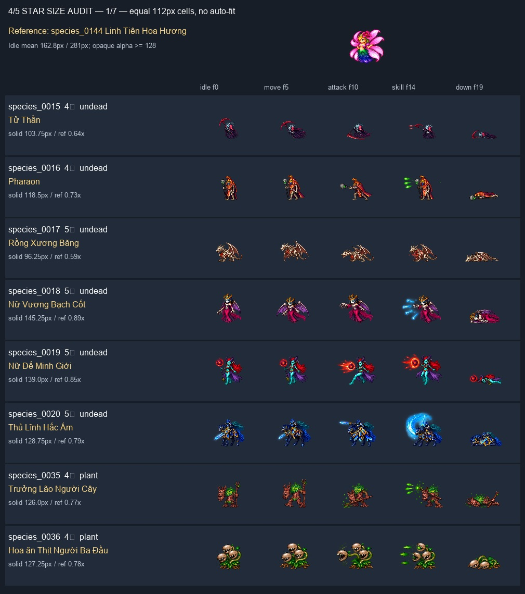
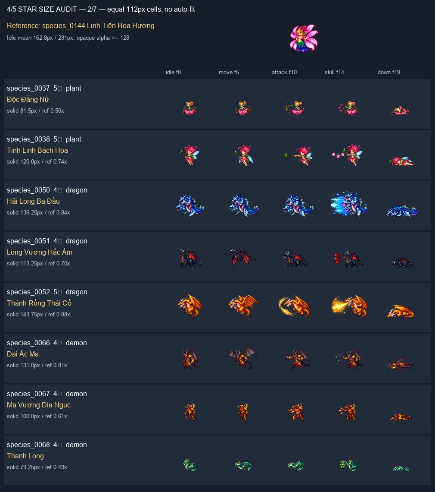
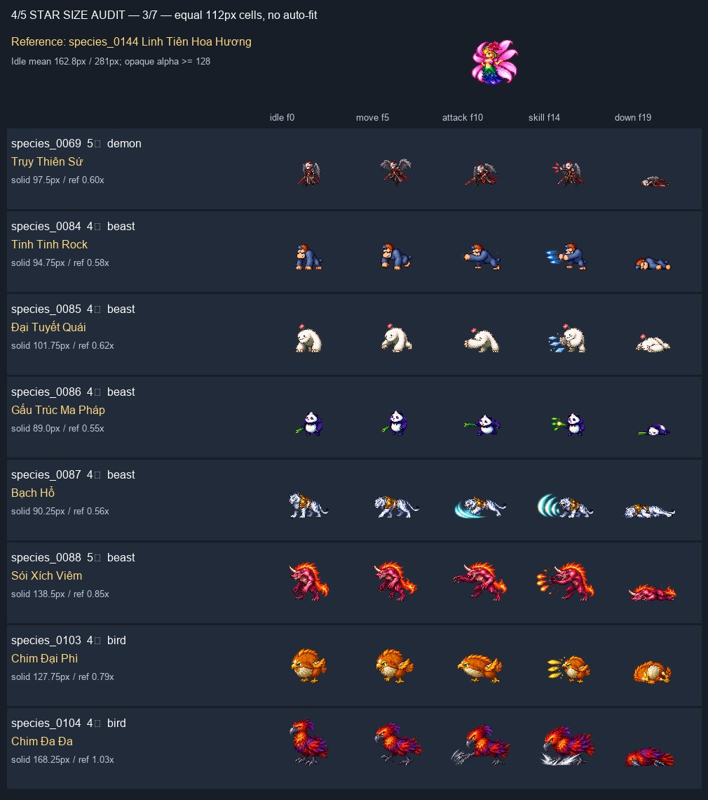
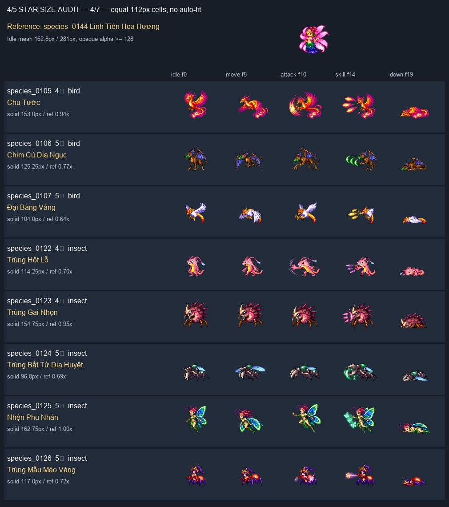
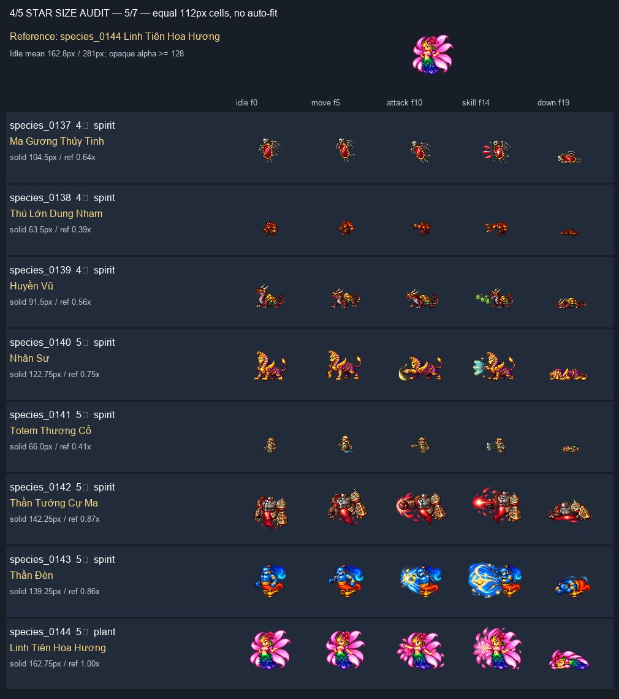
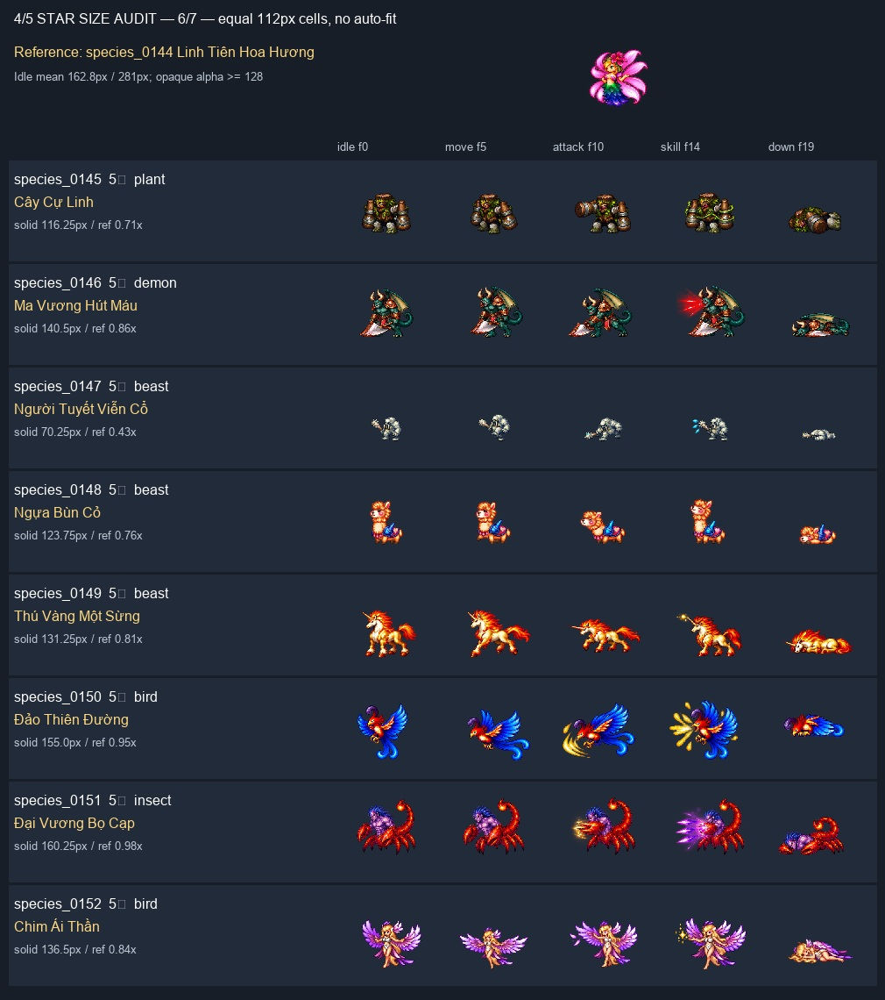
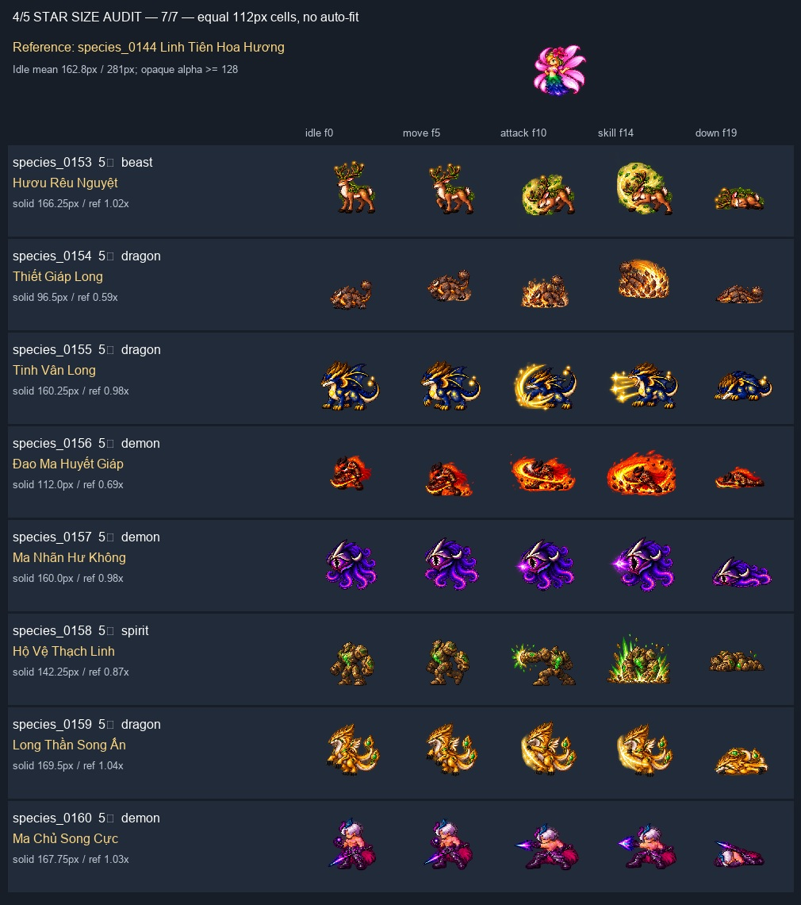

# Review size pet 4★ / 5★ — 2026-10-19

## Kết luận

Đã đo 56 atlas (21 loài 4★, 35 loài 5★), toàn bộ 20 frame/atlas; đã nhìn đối chiếu 5 pose đại diện của từng loài (idle, movement, attack, skill, down) trong 7 contact sheet cùng tỷ lệ ô. Đây là audit nguồn và đường render, **không phải playtest trực tiếp 56 loài trong runtime**.

Linh Tiên Hoa Hương (`species_0144`) là chuẩn cảm quan humanoid: idle đầu 164px; trung bình 4 idle 162.75px ở alpha ≥128. Bbox bao gồm cánh/hoa/vũ khí/FX nếu chúng có alpha đủ cao; số đo này là chỉ báo sàng lọc, không thay thế đo anatomy bằng mắt.

**32/56** loài có chiều cao bbox idle dưới 80% chuẩn; **13/56** dưới 100px. Không kết luận cả 32 là lỗi: thú bốn chân phải xét thêm chiều dài và khối. Các nguồn rất nhỏ cần ưu tiên: Thú Lớn Dung Nham (63.5px), Totem Thượng Cổ (66px), Người Tuyết Viễn Cổ (70.25px), Thanh Long (79.25px), Độc Đằng Nữ (81.5px).

## Vì sao trong game có thể nhỏ

- `apps/game-web/src/render/stage.ts` dùng chung PET_WORLD_H=1.1, WILD_H=1.3, BATTLE_H=2.2 cho mọi loài trong từng ngữ cảnh, chưa có profile riêng cho rồng/cự thú/người.
- `tools/build-web-assets/build_assets.py` đo bodyH bằng `281 - ymin`, bao gồm phần trống dưới chân. Vì `createPetSprite` chia targetBodyH cho bodyH, đây không phải chiều cao thân hiển thị thuần. Nếu target được hiểu là chiều cao thân, cần tách extent-to-pivot và visible body height. Theo mô hình này trên 56 nguồn, alpha >40 chỉ chiếm 47.6–83.4% target; đây là mô phỏng khi export, chưa phải đo runtime các loài đó.
- Player web có chiều cao metadata 58×0.0265=1.537 world units; follower target 1.1 đã thấp hơn người trước khi xét khoảng trống. Không so trực tiếp battle 2.2 với player ở world vì khác ngữ cảnh/camera.
- Manifest web hiện chỉ có 10 loài, tất cả 1★; chưa có 56 loài này và Linh Tiên. `resolveSpecies` trả atlas dự phòng nếu thiếu ID. Cần nối đúng registry trước khi nghiệm thu in-game; không thể đánh giá một loài bằng ảnh fallback.
- Texture low-tier là atlas giảm nửa bằng BOX; pet hiển thị lớn có thể thiếu nét. Giữ texture full-resolution cho pet được nhìn gần/cỡ lớn, cân bằng budget; scale không tự phục hồi chi tiết nguồn.

## Scale được hay phải vẽ lại?

Game scale được: tăng đồng đều quad và pivot của cả atlas, giữ tỷ lệ, hướng và frame; không liên quan damage/collision. Cần profile size riêng theo loài và theo world/battle, áp dụng cùng scale cho 20 frame, không auto-fit từng frame gây co giãn.

Đề xuất thử nghiệm (chưa runtime/owner-approved): humanoid quanh 1.0× Linh Tiên; rồng/cự thú khoảng 1.25–1.6× về tổng khối đọc được. Thú bốn chân có thể thấp hơn người ở vai nhưng dài/rộng hơn. Không hiểu 1.6× là bắt mọi rồng cao gấp 1.6 lần người. Sừng/cánh/FX không dùng làm thước thân. Special nổi bật qua hình khối/hiệu ứng có kiểm soát, không chỉ phóng lớn.

Chỉ redraw nếu thử ở cỡ đích vẫn thiếu chi tiết mặt/vũ khí/khớp hoặc anatomy không đọc được. Nguồn khoảng 60–100px cần QA kỹ; chưa đủ bằng chứng để kết luận bắt buộc vẽ lại. Không sửa/vẽ đè art đã duyệt trong đợt review này.

## Thứ tự xử lý đề xuất

1. Bổ sung review scene riêng đủ 56 loài + Linh Tiên + player, đúng asset mapping, ở camera/world/battle thực tế; không kích hoạt candidate vào gameplay.
2. Tách phép đo thân/extent/pivot; profile size từng loài; giới hạn bounding box khi attack/skill, kiểm tra chồng UI và 1v3.
3. Trial full-res + scale ở cỡ hiển thị thật; QA nhóm nguồn rất nhỏ trước; ghi rõ size màn hình, viewport và mức zoom.
4. Chỉ lập batch redraw cho loài thất bại sau trial; giữ design/anatomy/palette, chờ owner duyệt hash mới.
5. Khi runtime được duyệt: test world/battle/motion đủ 20 frame, layout hẹp và draw-call/texture budget 50 CCU; tăng size không đồng nghĩa đã chứng nhận hiệu năng.

## Review từng loài

| ID | Loài | Sao | Idle H×W (px) | H / chuẩn | Nhận xét |
|---|---|---:|---:|---:|---|
| species_0015 | Tử Thần | 4 | 103.75×94.5 | 0.64 | Dáng người/lưỡi hái nhỏ; tăng hiển thị, kiểm tra mặt và vũ khí ở cỡ đích. |
| species_0016 | Pharaon | 4 | 118.5×84.0 | 0.73 | Pharaon thấp hơn chuẩn người; ưu tiên scale, giữ tỷ lệ người thanh mảnh. |
| species_0017 | Rồng Xương Băng | 5 | 96.25×125.25 | 0.59 | Rồng xương nhỏ cả chiều cao lẫn bề ngang; cần lớn hơn người về tổng khối. |
| species_0018 | Nữ Vương Bạch Cốt | 5 | 145.25×115.0 | 0.89 | Silhouette rõ; tăng nhẹ theo chuẩn người, tránh tính cánh là thân. |
| species_0019 | Nữ Đế Minh Giới | 5 | 139.0×125.0 | 0.85 | Silhouette rõ; scale nhẹ, đo thân riêng khỏi quả cầu phép. |
| species_0020 | Thủ Lĩnh Hắc Ám | 5 | 128.75×147.0 | 0.79 | Kỵ sĩ/thú cưỡi nên có tổng khối lớn hơn humanoid, không chỉ tăng chiều cao. |
| species_0035 | Trưởng Lão Người Cây | 4 | 126.0×121.5 | 0.77 | Người cây cần khối lớn và tay/cành rõ hơn; thử scale trước. |
| species_0036 | Hoa ăn Thịt Người Ba Đầu | 4 | 127.25×127.5 | 0.78 | Ba đầu đọc được; scale đều, không bắt cây bò ngang cao bằng humanoid. |
| species_0037 | Độc Đằng Nữ | 5 | 81.5×85.5 | 0.50 | Rất nhỏ ở ô chung; chi tiết mặt/thân dễ mất, cần thử tăng cỡ và QA nguồn. |
| species_0038 | Tinh Linh Bách Hoa | 5 | 120.0×110.0 | 0.74 | Tiên dáng người nhỏ hơn chuẩn; tăng hiển thị, không dùng cánh/hoa làm thước thân. |
| species_0050 | Hải Long Ba Đầu | 4 | 136.25×172.0 | 0.84 | Ba đầu và bề ngang khá rõ; đề xuất khối rồng lớn hơn người. |
| species_0051 | Long Vương Hắc Ám | 4 | 113.25×135.5 | 0.70 | Rồng tối tương đối nhỏ và tối; tăng size rồi kiểm tra tương phản trên nền map. |
| species_0052 | Thánh Rồng Thái Cổ | 5 | 143.75×138.5 | 0.88 | Nguồn khá rõ; tăng profile rồng, không cần mặc định vẽ lại. |
| species_0066 | Đại Ác Ma | 4 | 131.0×103.5 | 0.81 | Ác ma khá rõ; căn lại theo chuẩn người/cơ thể, không theo sải cánh. |
| species_0067 | Ma Vương Địa Ngục | 4 | 100.0×68.0 | 0.61 | Người và vũ khí nhỏ, mặt ít pixel; ưu tiên kiểm tra nguồn ở cỡ lớn. |
| species_0068 | Thanh Long | 4 | 79.25×80.5 | 0.49 | Thanh Long rất nhỏ; ưu tiên tăng khối rồng và QA lại chi tiết nguồn. |
| species_0069 | Trụy Thiên Sứ | 5 | 97.5×86.5 | 0.60 | Humanoid/cánh nhỏ; tăng cỡ để mặt và vũ khí dễ đọc. |
| species_0084 | Tinh Tinh Rock | 4 | 94.75×94.0 | 0.58 | Khỉ thấp nhưng khối nhỏ; scale theo thú to, không ép cao như người. |
| species_0085 | Đại Tuyết Quái | 4 | 101.75×94.5 | 0.62 | Yeti cần to hơn người về khối; nguồn hiện nhỏ, QA mặt/tay khi tăng. |
| species_0086 | Gấu Trúc Ma Pháp | 4 | 89.0×95.0 | 0.55 | Dáng chibi hợp thiết kế nhưng quá nhỏ tại cùng ô; tăng vừa, giữ anatomy. |
| species_0087 | Bạch Hổ | 4 | 90.25×146.5 | 0.56 | Thú bốn chân thấp là đúng; căn chiều dài/thân, không ép chiều cao bằng người. |
| species_0088 | Sói Xích Viêm | 5 | 138.5×144.0 | 0.85 | Khối thú khá rõ; tăng vừa theo vai/lưng, loại lửa khỏi phép đo thân. |
| species_0103 | Chim Đại Phì | 4 | 127.75×128.0 | 0.79 | Dáng tròn đọc rõ; tăng vừa theo khối, giữ thiết kế chim. |
| species_0104 | Chim Đa Đa | 4 | 168.25×151.5 | 1.03 | Size nguồn gần chuẩn; không cần phóng đồng loạt chỉ vì 4 sao. |
| species_0105 | Chu Tước | 4 | 153.0×146.0 | 0.94 | Silhouette tốt; profile chim lớn, chừa chỗ đuôi/lửa. |
| species_0106 | Chim Cú Địa Ngục | 5 | 125.25×134.0 | 0.77 | Cú lớn cần tăng khối; so thân riêng khỏi cánh. |
| species_0107 | Đại Bàng Vàng | 5 | 104.0×113.5 | 0.64 | Chim nhỏ khi đứng cạnh chuẩn; tăng size, QA đầu và mỏ. |
| species_0122 | Trùng Hốt Lỗ | 4 | 114.25×104.5 | 0.70 | Dáng đứng nhỏ hơn chuẩn; tăng vừa để đọc rõ mặt và tay. |
| species_0123 | Trùng Gai Nhọn | 4 | 154.75×138.5 | 0.95 | Nguồn tương đối rõ; ưu tiên scale/context, chừa khoảng cho gai. |
| species_0124 | Trùng Bất Tử Địa Huyệt | 5 | 96.0×141.5 | 0.59 | Thấp vì anatomy bò ngang; căn bề ngang/thân, QA chân ở cỡ đích. |
| species_0125 | Nhện Phu Nhân | 5 | 162.75×129.0 | 1.00 | Nguồn gần chuẩn, rõ; không cần vẽ lại vì size. |
| species_0126 | Trùng Mẫu Mào Vàng | 5 | 117.0×105.0 | 0.72 | Thân humanoid trên bụng côn trùng nhỏ; tăng size để đọc mặt. |
| species_0137 | Ma Gương Thủy Tinh | 4 | 104.5×93.0 | 0.64 | Gương/chi nhỏ; tăng vừa, kiểm tra mặt gương trên nền tối. |
| species_0138 | Thú Lớn Dung Nham | 4 | 63.5×60.5 | 0.39 | Nhỏ nhất nhóm, 63.5px; ưu tiên thử tăng lớn và QA nguồn, có thể cần redraw nếu thiếu nét. |
| species_0139 | Huyền Vũ | 4 | 91.5×115.0 | 0.56 | Dáng bốn chân thấp; tăng khối/chiều dài, không ép cao như humanoid. |
| species_0140 | Nhân Sư | 5 | 122.75×132.0 | 0.75 | Nhân Sư nên nặng và rộng hơn người; scale theo thân/sải chân. |
| species_0141 | Totem Thượng Cổ | 5 | 66.0×55.5 | 0.41 | 66px, họa tiết quá li ti; nhóm ưu tiên QA nguồn sau tăng size. |
| species_0142 | Thần Tướng Cự Ma | 5 | 142.25×142.0 | 0.87 | Khối lớn rõ; profile cự thú, đừng ép cùng cao với pet nhỏ. |
| species_0143 | Thần Đèn | 5 | 139.25×126.0 | 0.86 | Djinn khá rõ; tăng nhẹ theo thân + đèn, giữ nối đuôi và mũi đèn. |
| species_0144 | Linh Tiên Hoa Hương | 5 | 162.75×165.5 | 1.00 | Chuẩn size humanoid do chủ game chọn; giữ nguyên PNG. |
| species_0145 | Cây Cự Linh | 5 | 116.25×135.25 | 0.71 | Cự linh nhỏ so tên/khối dự kiến; tăng hiển thị, giữ nguyên nguồn duyệt. |
| species_0146 | Ma Vương Hút Máu | 5 | 140.5×156.25 | 0.86 | Nguồn khá rõ; scale theo thân, không lấy đao/cánh làm chiều cao người. |
| species_0147 | Người Tuyết Viễn Cổ | 5 | 70.25×92.5 | 0.43 | 70.25px, cự thú đang thành mini; ưu tiên lớn hơn người và QA mặt/tay. |
| species_0148 | Ngựa Bùn Cỏ | 5 | 123.75×94.5 | 0.76 | Thiết kế chibi, không đổi anatomy; tăng vừa, tránh thành pet mini. |
| species_0149 | Thú Vàng Một Sừng | 5 | 131.25×164.5 | 0.81 | Bốn chân/sừng rõ; giữ thấp hơn người ở vai nhưng đủ dài và to. |
| species_0150 | Đảo Thiên Đường | 5 | 155.0×161.0 | 0.95 | Nguồn rõ; scale theo chim và chừa đuôi, không cần redraw size. |
| species_0151 | Đại Vương Bọ Cạp | 5 | 160.25×164.0 | 0.98 | Khối/càng rõ; profile lớn và rộng, giữ art đã duyệt. |
| species_0152 | Chim Ái Thần | 5 | 136.5×174.0 | 0.84 | Cánh rộng nhưng người nhỏ hơn bbox; scale theo thân humanoid, chừa cánh. |
| species_0153 | Hươu Rêu Nguyệt | 5 | 166.25×134.5 | 1.02 | Nguồn mới đã gần chuẩn ô; cần profile thú bốn chân khi runtime được duyệt. |
| species_0154 | Thiết Giáp Long | 5 | 96.5×131.0 | 0.59 | Rồng thấp/bò ngang; tăng khối/chiều dài, không ép đứng cao như humanoid; giữ bản duyệt. |
| species_0155 | Tinh Vân Long | 5 | 160.25×185.25 | 0.98 | Nguồn mới rõ và rộng; profile rồng lớn hơn người, chưa kích hoạt runtime. |
| species_0156 | Đao Ma Huyết Giáp | 5 | 112.0×131.5 | 0.69 | Thân/đao bị lửa lấn; tăng cỡ và QA readability; giữ bản duyệt. |
| species_0157 | Ma Nhãn Hư Không | 5 | 160.0×166.75 | 0.98 | Nguồn mới gần chuẩn; căn lõi/mắt riêng khỏi xúc tu/FX, không cần cố lớn như rồng. |
| species_0158 | Hộ Vệ Thạch Linh | 5 | 142.25×137.75 | 0.87 | Khối rõ; profile golem lớn hơn người, giữ bản duyệt. |
| species_0159 | Long Thần Song Ấn | 5 | 169.5×167.25 | 1.04 | Nguồn mới gần chuẩn; profile Special rồng lớn, chừa hai cánh và ấn. |
| species_0160 | Ma Chủ Song Cực | 5 | 167.75×155.75 | 1.03 | Nguồn mới gần chuẩn người; giữ tỷ lệ shonen, FX không quyết định size thân. |

## Bằng chứng và giới hạn

- [Số đo JSON](measurements.json), [CSV](measurements.csv), script tái chạy `audit.py`. 56/56 SHA khớp selection/manifest tại thời điểm chạy. Không sửa atlas, registry hay runtime.
- Nguồn 152 lấy owner selection, 8 mới lấy extension art manifest. 5 candidate mới vẫn chờ duyệt; 3 extension đã duyệt được giữ nguyên. Review size không thay thế approval.
- Body-core chưa có polygon/mask chuyên biệt nên bbox opaque có thể chứa FX; mọi giá trị tỷ lệ là phép đo toàn silhouette.
- Chưa chạy 56 loài trong game hoặc chứng nhận FPS/50 CCU. Không restart server/đụng DB vì scope review art.

